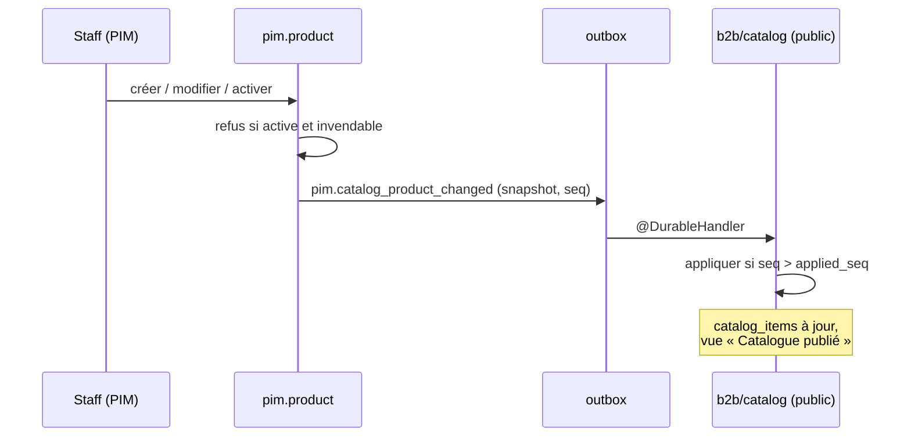

# Plan — un catalogue synchronisé, activé par audience

> 📐 **Doc-first, rien n'est bâti** (rédigé le 2026-10-15). Remplace deux
> plans, qui restent en place avec un bandeau :
> [`plan-audience-par-heritage.md`](plan-audience-par-heritage.md) (même jour)
> et [`plan-publication-par-faits-versionnes.md`](plan-publication-par-faits-versionnes.md)
> (2026-10-13). Leurs relevés de l'existant et les contradictions de `vitruve`
> y sont toujours ; ce document ne les recopie pas, il y renvoie.
>
> Touche **l'argent** (le prix part en continu) et porte une **migration de
> données** : `vitruve` est obligatoire avant Hugo (CLAUDE.md §9 bis).
> Comptes : base de **dev** seulement, la production n'a pas été mesurée.

## 0. La demande (Hugo, 2026-10-15)

> « Quand on fait la création d'un produit ou d'une catégorie, ça s'ajoute en
> simultané à b2b, évidemment non vendu […] que le geste de publication
> disparaisse un peu et qu'on revienne au final à activer le produit pour
> l'audience définie. Là j'ai trop d'étapes pour un truc bête. »

Décisions déjà prises le même jour :

| #   | Décision                                                                                                                                  |
| --- | ----------------------------------------------------------------------------------------------------------------------------------------- |
| H1  | Audience `pro` / `public` / `both`, posée sur la famille, une fiche peut l'élargir ou la restreindre                                      |
| H2  | Les contextes de vente restent, comme régimes de TVA                                                                                      |
| H3  | Une modification d'une fiche active part **tout de suite**, sans relecture                                                                |
| H4  | Les schémas `pim` et `public` restent séparés                                                                                             |
| H5  | Le masquage de la plateforme ne fait que retirer, et n'a qu'une route                                                                     |
| H6  | Une vue « Catalogue publié » : une ligne par article, une colonne par audience                                                            |
| H7  | Une fiche publiée mais invisible aujourd'hui est dépubliée à la bascule                                                                   |
| H9  | La vue « Catalogue publié » va dans **Gestion Boutique** (aujourd'hui « Catalogue actuel en ligne », section Catalogue, `/b2b/catalogue`) |
| H10 | **Aucune perte de donnée** : des gens remplissent le catalogue en ce moment — §4 bis                                                      |
| H8  | Les tables à QR iront sur le site, comme capacité « sur place » (plan à venir)                                                            |

## 1. Avant / après, vu du staff

| Avant                                                                                                         | Après                                                    |
| ------------------------------------------------------------------------------------------------------------- | -------------------------------------------------------- |
| créer → remplir → publier → lier au canal B2B → cocher la case B2B → aperçu → envoyer → accepter la livraison | **créer → remplir → activer**                            |
| la plateforme ignore une fiche tant qu'elle n'a pas été envoyée                                               | la fiche est sur la plateforme dès sa création, inactive |
| rien ne se vend au public seul                                                                                | l'audience le dit                                        |

## 2. Décisions

### C1 — Deux états : inactive, active ; la garde est dans la projection

`ProductStatus` garde ses valeurs en base (`draft`, `published`, `archived` —
une valeur d'enum Postgres ne se renomme pas, CLAUDE.md §8) ; l'écran et le
domaine disent **inactive / active / archivée**. `publish()` devient
`activate()`, `unpublish()` devient `deactivate()`.

**Ce qui se vend se décide déclinaison par déclinaison, comme aujourd'hui.**
La projection écarte déjà une déclinaison sans prix, sans taux ou sans
allergènes (`variant_sans_prix`, `variant_sans_taux`, refus de `publish()`).
Ce plan généralise ce tri au lieu d'ajouter des refus sur chaque geste :

- **une déclinaison incomplète n'est jamais vendue** — sans allergènes, sans
  prix ou sans taux, elle part dans le snapshot marquée `incomplete` avec ce
  qui lui manque, et la plateforme la range non vendable ;
- **activer** refuse une fiche qui n'a **aucune** déclinaison complète, avec
  la liste de ce qui manque ;
- **aucune modification d'une fiche active n'est refusée** pour cause
  d'incomplétude : une déclinaison neuve (`Variant.open` naît sans prix,
  `variant.ts:262-280`) arrive non vendable, celle dont on vide les
  allergènes sort de la vente, une famille dont on retire le taux sort ses
  fiches de la vente. Chacune se voit dans la vue « Catalogue publié »
  (« incomplète : allergènes »).

Pourquoi pas des refus sur chaque geste (version précédente) : la
vendabilité dépend de choses que `Product` ne voit pas — taux de la famille
(`set-category-vat`), suppression d'un taux (`remove-vat-rate`),
`reclassify`, `setChannels` qui efface des taux (`product.ts:230-245`),
rapport pro. Les énumérer laisserait toujours un trou ; la projection, elle,
lit l'état final, quel que soit le geste. C'est la règle « interdire plutôt
que vérifier » : une déclinaison incomplète n'a pas de prix servi, elle est
**invendable par construction**.

Ce qui reste vendu sans relecture, choisi par Hugo (H3) : une valeur
**fausse mais complète** — un prix mal tapé.

### C2 — L'audience (H1)

Reprise telle quelle de [`plan-audience-par-heritage.md`](plan-audience-par-heritage.md)
D1 et D3 : `category.audience` obligatoire, `product.audience` nullable
(hérite), `OPERATION_AUDIENCES` réutilisée, et une règle `servedTo(item,
viewer)` qui remplace les **quatre** lectures directes du masquage côté
plateforme (D3 du plan d'audience, relevé `vitruve`).

### C3 — La synchronisation : un fait par fiche, à chaque enregistrement

- Toute écriture sur une fiche ou une famille — création comprise, active ou
  non — émet, **dans sa transaction**, un fait durable
  `pim.catalog_product_changed` portant le **snapshot complet** de la fiche :
  ce que `projection.ts` fabrique aujourd'hui par produit, plus `status` et
  `audience`. Un snapshot, pas un diff : il se rejoue seul.
- Même chose pour la famille (`pim.catalog_category_changed`) et pour les
  opérations (`pim.catalog_operation_changed`).
- **Les règles globales voyagent comme règles, pas recopiées par fiche.**
  Les limites de commande traversent déjà en règles depuis la v7 du fil
  (`projection.ts:307-315`) : elles deviennent un fait global
  `pim.catalog_rules_changed`, avec le rapport pro. Recopier une règle
  globale sur chaque fiche réémettrait tout le catalogue à chaque réglage.
- **Ce qui change des prix ou des taux sur plusieurs fiches** — taux d'une
  famille, pourcentage d'un taux (`update-vat-rate.ts:37-47`), suppression
  d'un taux, rapport pro (le HT pro est calculé par fiche), allergènes d'un
  ingrédient (`set-ingredient-allergens.ts`), description d'une image venue de
  la médiathèque (`on-media-asset-described.ts`), renommage ou déplacement de
  famille si le snapshot les porte — émet **une tâche de réémission** des
  fiches concernées, exécutée hors de la transaction du geste, **une
  transaction par fiche**. Aucun geste ne verrouille le catalogue entier.
  La liste exacte des émetteurs se dresse au lot 4, par grep sur les
  écritures des tables que la projection lit.
- Le fait est déclaré dans `pim/channels/b2b-platform/` ; le récepteur est un
  `@DurableHandler` par fait dans `b2b/catalog/application/handlers/`
  (`lint:durable-cross-block`), sur le modèle de
  `on-product-media-changed.handler.ts`.
- **Une fiche inactive arrive aussi**, et la plateforme la range non vendue :
  c'est ce qui fait « apparaître » le catalogue en cours de saisie.

### C4 — L'ordre : deux enregistrements simultanés

Objection BLOQUANT n° 2 de `vitruve` (2026-10-13), et sa précision du
2026-10-15 : les handlers chargent l'agrégat **hors** transaction
(`save-variant-allergens.ts:46` avant `uow.run` l. 79), et les satellites
(allergènes, rédactionnel, médias) s'écrivent par des ports qui ne passent
pas par `products.save`.

Proposé : **le snapshot n'est jamais pris dans l'agrégat en mémoire.** Un
seul émetteur, `CatalogEmitter.emit(productIds, tx)`, appelé en **dernière
instruction** de la transaction de chaque geste :

1. `SELECT … FOR UPDATE` sur les lignes `pim.product` concernées, **triées par
   id** — le seul verrou du mécanisme, toujours dans le même ordre, sur la
   même table : pas d'interblocage possible entre deux émetteurs ;
2. tire le numéro d'ordre **après** le verrou ;
3. **relit la fiche en base** dans la transaction et la projette ;
4. écrit le fait dans l'outbox.

En `READ COMMITTED`, l'instruction qui suit l'obtention du verrou voit ce
que la transaction précédente a validé : le snapshot émis sous le numéro
`n+1` contient donc forcément l'écriture émise sous `n`. Les handlers n'ont
pas à changer d'ordre de chargement ; ils ajoutent l'appel, et un geste qui
ne l'ajoute pas est rattrapé par la parité (§4). Le refus de C1 ne juge plus
un état en mémoire : il n'y a plus de refus sur fiche active.

⚠️ **À vérifier au lot 2** : que tous les handlers d'écriture passent par
une transaction `uow` qui porte l'outbox (vu pour `set-product-media.ts:72-85`
seulement), et en compter le nombre (≈ 22 dans `catalogue/product/application/`,
plus `category/`).

Côté plateforme : `catalog_items.applied_seq`, écriture **conditionnée en
base** (`WHERE applied_seq < :seq`), comme `showIfNewer`.

### C5 — Ce qui disparaît

- Le push, l'aperçu, l'empreinte comme verrou, la boîte `catalog_delivery` et
  l'acceptation (liste dans le plan de publication, P5). La boîte se vide
  avant la bascule (aucune livraison `pending`).
- Le lien au canal B2B, la matrice des canaux, le point de vente sauf sa
  grille de tables (plan d'audience, D5 et Q4).
- Les deux routes de masquage, remplacées par une (H5, plan d'audience D7).
- **Les tables restent en base** (CLAUDE.md §0), plus lues ni écrites.

**Et l'espace E-commerce du back-office (Hugo, 2026-10-15)** : une fois
« Réception » retirée, il n'a plus aucune vue — le catalogue publié, les
opérations et les promotions sont en Gestion Boutique, les textes, le pied de
page et le contact en Communication, les mentions en Réglages › Légal. Le
lot 5 le supprime : son entrée au rail et au lanceur, `b2b/b2b-page`,
`B2B_VIEWS` ; `/b2b` et ses anciennes adresses redirigent vers leurs
nouvelles places (favoris), avant les gardes.

### C6 — Ce qui reste

- **Les révisions, comme historique** : une photographie du catalogue, prise
  automatiquement une fois par jour où quelque chose a changé, et à la main
  avec un nom ; le diff entre deux révisions. **Pas de « revenir à R »
  automatique dans ce plan** : réémettre d'anciens snapshots sans réécrire le
  référentiel contournerait la projection et serait annulé par la prochaine
  édition (`vitruve`, 2026-10-15). Restaurer une fiche se fait dans le
  référentiel, à la main, révision sous les yeux. → Q1.
- **Le masquage**, comme frein d'urgence : une faute de prix sur une fiche
  active se retire en un clic le temps de corriger (H3).
- **L'interrupteur `PIM_PUBLICATION_ENABLED`** : fermé, les faits ne
  s'émettent pas ; « réémettre tout » rattrape à la réouverture.
- **`catalog_versions` et `orders.catalog_version_id`** : la colonne n'a aucun
  lecteur hors son écriture (`vitruve`, grep du 2026-10-15) et chaque ligne de
  commande copie déjà prix et TVA. **Aucune estampille neuve** : la colonne
  reste, plus écrite. Un `max(applied_seq)` ne désignerait de toute façon
  aucun état du catalogue.

### C7 — La bascule

1. Comptage en prod : fiches publiées non liées, liées non publiées,
   dérogations sans case `b2b`, livraisons en attente.
2. Les fiches invisibles aujourd'hui repassent inactives (H7) ; la liste est
   rendue.
3. Audiences posées : `both` sur tout ce qui est vendu aujourd'hui (plan
   d'audience, D6).
4. « Réémettre tout » : chaque fiche, active ou non, émet son snapshot ; la
   plateforme se remplit, y compris des fiches inactives.

## 3. Lots

| Lot   | Contenu                                                                                                                                                    | Donne                             |
| ----- | ---------------------------------------------------------------------------------------------------------------------------------------------------------- | --------------------------------- |
| **1** | Comptage ; colonnes d'audience ; activer/désactiver avec le refus complet (C1) ; refus sur fiche active                                                    | l'agrégat tient la règle          |
| **2** | Faits fiche + famille, verrou et `seq` (C3, C4) ; récepteur conditionné ; `servedTo` ; réémettre tout                                                      | **créer → la plateforme le voit** |
| **3** | Écrans : bouton Activer, audience famille et fiche, vue « Catalogue publié » déplacée en Gestion Boutique (H9), route unique de masquage                   | **le parcours en trois gestes**   |
| **4** | ~~Opérations en faits~~ (elles passent au commerce) ; émissions en lot (TVA, limites ; le rapport pro est déjà réémis, cf. lot S) ; révisions automatiques | plus aucun besoin du push         |
| **5** | Retraits (C5) ; estampille de commande par `seq`                                                                                                           | le ménage                         |

**Le push est coupé dès que le lot 2 est en service.** Il envoie un
instantané complet et efface ce qui n'y figure pas — il effacerait les fiches
inactives que les faits posent, sans `applied_seq`. Le filet n'est pas le
push, c'est « réémettre tout ». Retour arrière avant le lot 5 : redéployer la
version précédente rouvre le push (son code est encore là), et les fiches
dépubliées par H7 se réactivent depuis la liste rendue en C7.

### Lot 1 — ce qui se bâtit (détaillé le 2026-10-15)

> ✅ **Bâti le 2026-10-15.** Trois écarts au texte ci-dessous, tous assumés :
> les routes d'audience sont sous `/pim/catalogue/categories/:id/audience` et
> `/pim/catalogue/products/:id/audience` (le voisinage) ; l'aperçu de bascule
> est `GET /pim/channels/b2b/audience-switch-preview`, dans le canal, parce
> qu'il lit le lien au canal et que le catalogue n'importe pas ses canaux
> (ADR-13) ; un changement d'audience entre dans `content-facts` (il périme la
> signature) mais ne déclenche **pas** de révision automatique — c'est le
> lot 4. Une famille archivée refuse un changement d'audience.

**Le lot 1 ne change aucun comportement servi.** Le push lit encore le lien
et la matrice ; l'audience existe, se règle par l'API, et n'est lue par
aucune émission. Il n'écrit aucun statut de fiche.

| #   | Quoi                                                                                                                                                                                                                                                                                                                                                                                                                                                                                                                                                                                                                                                                                                                                                         |
| --- | ------------------------------------------------------------------------------------------------------------------------------------------------------------------------------------------------------------------------------------------------------------------------------------------------------------------------------------------------------------------------------------------------------------------------------------------------------------------------------------------------------------------------------------------------------------------------------------------------------------------------------------------------------------------------------------------------------------------------------------------------------------ |
| 1a  | **Migration** `…_l_audience_du_catalogue` (additive) : `pim.category.audience text NOT NULL DEFAULT 'both'` et `pim.product.audience text NULL`, chacune avec un `CHECK (audience IN ('pro','public','both'))`. Toutes les familles à `both` — c'est ce qu'elles font aujourd'hui (§1.2 du plan d'audience). Aucune fiche n'est touchée.                                                                                                                                                                                                                                                                                                                                                                                                                     |
| 1b  | **Domaine** : value object `Audience` (`pim/catalogue/shared/domain/value-objects/audience.ts`), type tiré de `OPERATION_AUDIENCES` de `@lfd/pim-contracts`, refus `InvalidAudienceError` (400). `Category.changeAudience(a)` et `Product.changeAudience(a \| null)`, rendant `changed: boolean` comme les autres mutations. Fonction pure `effectiveAudience(productAudience, categoryAudience)`.                                                                                                                                                                                                                                                                                                                                                           |
| 1c  | **Commandes et routes** (style PIM colocalisé) : `set-category-audience.ts` → `PUT /pim/categories/:id/audience { audience }` ; `set-product-audience.ts` → `PUT /pim/products/:id/audience { audience: … \| null }` (`null` = hérite). Mêmes permissions que leurs voisines (`:id/vat`). Faits de journal `product_category.audience_changed` et `product.audience_changed` ; les deux entrent dans `global-causes.ts` / `content-facts.ts` là où entrent les `channels_changed` (une audience changée déclenche une révision).                                                                                                                                                                                                                             |
| 1d  | **Lectures** : le détail d'une famille et d'une fiche, et la liste des fiches, exposent `audience`, et pour la fiche `effectiveAudience` et `audienceInherited`. Contrats dans `@lfd/pim-contracts`.                                                                                                                                                                                                                                                                                                                                                                                                                                                                                                                                                         |
| 1e  | **Activer** : `Product.publish()` → `activate()`, `unpublish()` → `deactivate()` (domaine et handlers). Routes `/publish` `/unpublish` et valeurs de journal **inchangées** (le front n'est touché qu'au lot 3 ; une valeur de journal ne se renomme pas). Refus **en plus** de celui des allergènes, qui reste par déclinaison jusqu'au lot 2 (§ ci-dessous) : `activate` exige au moins une déclinaison non arrêtée **avec un prix** et, pour chaque audience effective, **un taux** au contexte qui la facture (`pro` → `b2b`, `public` → `takeaway`). Le taux est résolu par le handler (lecteur déjà utilisé par la projection, `vatPercents`) et passé à `activate(resolvedVat, audience)`. L'erreur nomme ce qui manque, déclinaison par déclinaison. |
| 1f  | **Le comptage de la bascule** : `GET /pim/catalogue/audience-switch-preview`, lecture seule, permission de lecture du référentiel. Rend trois listes (id, SKU, nom) : publiées non liées au canal, liées non publiées, publiées dont la case `b2b` effective est fermée. C'est ce qui mesure la production sans accès direct à sa base.                                                                                                                                                                                                                                                                                                                                                                                                                      |

⚠️ **Pourquoi le refus des allergènes reste par déclinaison au lot 1** : C1
assouplit la règle (« au moins une déclinaison complète ») parce que la
projection du lot 2 écartera une déclinaison sans allergènes. Aujourd'hui
elle ne l'écarte pas — elle compte sur `publish()`. Assouplir avant le lot 2
mettrait en vente une déclinaison sans déclaration.

Tests : unitaires domaine (`Audience`, `effectiveAudience`, `activate` et ses
refus), handlers à ports mockés, e2e : régler l'audience d'une famille et
d'une fiche puis relire, refus d'une valeur inconnue, activation refusée sans
prix et sans taux, aperçu de bascule sur un semis.

### Lot 2 — ce qui se bâtit (détaillé le 2026-10-15)

Ouvert avant d'écrire : `set-product-media.ts:60-95` (le fait durable écrit
dans la transaction, relu après l'écriture), `on-product-media-changed.handler.ts`
(le récepteur `@DurableHandler`), `catalog.prisma` (`CatalogItem.priceMillicents`
est `NOT NULL`, `withdrawnAt` dit « plus vendu », `sellable-filter.ts` le
tient en un seul `STILL_SOLD`), et les onze lecteurs de `catalog_items`.

**Décision de forme — la plateforme ne change pas ce que `catalog_items`
veut dire.** Elle reste la table de ce qui **se vend** : onze lecteurs, dont
les commandes et la tarification, la lisent comme telle, et un prix n'y est
jamais nul. Ce qui manquait — une fiche inactive, une déclinaison incomplète,
l'audience — va dans une table neuve, par **fiche** :

`public.catalog_entries` : `product_id` (clé), `product_sku`, `name`,
`category_id`, `status` (`inactive` | `active` | `archived`), `audience`
(effective), `gaps` (jsonb : déclinaison → ce qui manque), `applied_seq`,
`received_at`. C'est elle que la vue « Catalogue publié » lit pour montrer le
catalogue en train de se construire ; `catalog_items` garde les seules
déclinaisons vendables d'une fiche active, avec `audience` en colonne neuve.

Découpé en deux, parce que 2a se déploie sans rien changer de servi :

**2a — les rails, interrupteur fermé**

> ✅ **Bâti le 2026-10-15, non commité à l'écriture de ce bandeau.** Écarts au
> texte, tous à relire :
>
> - **le taux `b2b` est exigé de toute déclinaison vendable**, audience
>   `public` comprise : `catalog_items.price_millicents` (prix pro HT) est
>   `NOT NULL` et ne se calcule pas sans lui. Une fiche « public » sans taux
>   `b2b` reste dans `gaps` (`vat:b2b`) — l'activation du lot 1, elle,
>   l'accepte ;
> - **les limites de commande** ne sont pas réécrites par un fait sur un
>   article existant (règles globales, lot 4) ; un article NEUF reçu par un
>   fait naît sans limite tant que le lot 4 n'est pas bâti ;
> - **une famille archivée** n'est pas marquée côté plateforme :
>   `catalog_categories` n'a pas de colonne de retrait, et aucune migration du
>   lot ne l'ajoute ; l'audience de la famille n'y est pas rangée non plus ;
> - `set-ingredient-allergens` n'émet pas : la projection ne lit pas les
>   allergènes d'un ingrédient (vérifié le 2026-10-15) ; les créations de taux,
>   de contexte et d'entrée d'allergène non plus (rien ne les cite encore) ;
> - les gestes « plusieurs fiches » hors famille (taux, contextes, référentiel
>   d'allergènes, réglages comptables) réémettent **tout** le catalogue, une
>   transaction par fiche, après la transaction du geste — « les fiches
>   concernées » reste à affiner (lot 4, mesure du délai) ;
> - la réémission « plusieurs fiches » est **attendue** par la requête du
>   geste (pas une tâche détachée) ; une fiche en échec est journalisée et
>   n'échoue pas le geste ;
> - `CATALOG_FACTS_ENABLED` traverse le Worker (`container/worker.ts`) et le
>   workflow de déploiement, sinon la poser ne l'ouvrirait pas.

| #   | Quoi                                                                                                                                                                                                                                                                                                                                                                                                                                                                                                                                                                                         |
| --- | -------------------------------------------------------------------------------------------------------------------------------------------------------------------------------------------------------------------------------------------------------------------------------------------------------------------------------------------------------------------------------------------------------------------------------------------------------------------------------------------------------------------------------------------------------------------------------------------- |
| 2a1 | **Le fait** `pim.catalog_product_changed` dans `pim/channels/b2b-platform/products/` : snapshot d'une fiche = ce que `projectCatalog` produit pour elle, plus `status`, `audience` effective, `gaps`, `seq`. Une déclinaison incomplète (sans prix, sans taux, **ou sans allergènes déclarés**) part dans `gaps`, pas dans les vendables. Même chose pour la famille : `pim.catalog_category_changed`.                                                                                                                                                                                       |
| 2a2 | **L'émetteur** `CatalogEmitter.emit(productIds)` : dans la transaction ambiante, `SELECT … FOR UPDATE` sur `pim.product` trié par id, `nextval` d'une séquence `pim.catalog_publication_seq`, relecture et projection, écriture du fait par le port durable existant. Ne fait rien si `PIM_PUBLICATION_ENABLED` est fermé, ou si `CATALOG_FACTS_ENABLED` (nouveau, fermé par défaut) l'est.                                                                                                                                                                                                  |
| 2a3 | **Les appels** : chaque handler d'écriture de `catalogue/product/application/` et `catalogue/category/application/` appelle l'émetteur en dernière instruction de son `uow.run` (fiche : elle-même ; famille : la famille, et ses fiches si le geste change ce que leur snapshot porte — taux, audience, nom). Inventaire des handlers rendu avec le lot ; un handler qui n'écrit pas dans une `uow` est une faille à signaler, pas à combler en douce.                                                                                                                                      |
| 2a4 | **Le récepteur** un abonné « on-catalog-product-changed » dans `b2b/catalog/application/handlers/` : une transaction ; `INSERT … ON CONFLICT (product_id) DO UPDATE … WHERE catalog_entries.applied_seq < EXCLUDED.applied_seq` ; si la ligne n'a pas bougé, rien d'autre. Sinon : upsert des déclinaisons vendables (`withdrawnAt = null`), `withdrawnAt` posé sur les autres déclinaisons de la fiche ; **jamais** une écriture sur `catalog_item_overrides`. Validation par article reprise d'`IngestCatalogService`. Même schéma pour la famille (`catalog_categories` + `applied_seq`). |
| 2a5 | **`servedTo(item, viewer)`** : audience de l'article contient le lecteur ET pas de masquage pour lui. Remplace les quatre lectures directes (D3 du plan d'audience). `audience` `NULL` = `both`.                                                                                                                                                                                                                                                                                                                                                                                             |
| 2a6 | **Réémettre** : `POST /pim/channels/b2b/reemit` (tout, ou une fiche), marqué `@PublicationGesture()`. Une transaction par fiche.                                                                                                                                                                                                                                                                                                                                                                                                                                                             |

Migrations : `pim.catalog_publication_seq` (séquence) ; `public.catalog_entries` ;
`catalog_categories.applied_seq` ; `catalog_items.audience` nullable. Toutes
additives.

Tests : e2e de bout en bout **en processus** (créer une fiche au PIM, relayer
l'outbox, la lire dans `catalog_entries`) ; ordre (deux faits appliqués à
l'envers : le plus ancien n'écrit rien) ; décisions qui survivent à dix faits ;
fiche désactivée → déclinaisons retirées, décisions intactes ; commande pro
refusée sur un article `public`.

**Corrections après `vitruve` (2026-10-15), qui priment sur les tables
ci-dessus :**

- **Tous les émetteurs avant la bascule** (BLOQUANT). 2a3 couvre aussi ce qui
  change un snapshot hors de `catalogue/` : `ingredients/application/set-product-ingredients.ts`
  (par fiche, émetteur direct) ; `vat-rates/*`, `sales-contexts/*`,
  `allergens/*` (révision, archivage), `accounting-rules/application/set-pro-price-ratio.ts`
  et `choose-pro-price-method.ts` (plusieurs fiches : tâche de réémission des
  fiches concernées, une transaction par fiche). Sans eux, ouvrir
  l'interrupteur figerait les prix servis. Le lot 4 ne garde que les
  opérations, les limites de commande et les révisions automatiques.
- **Une fiche apporte sa famille** (SÉRIEUX). Les faits fiche et famille vont à
  deux abonnés sans ordre entre eux, et `catalog_items.category_id` est une clé
  étrangère. Le snapshot d'une fiche porte donc sa famille (nom, parent,
  position, taux) ; le récepteur la crée si la plateforme ne la connaît pas, et
  ne la met jamais à jour — c'est le fait famille, sous son propre
  `applied_seq`, qui le fait. `catalog_entries.category_id` sans clé
  étrangère. « Réémettre tout » émet les familles d'abord.
- **Un seul écrivain à la fois** (SÉRIEUX). Dès 2a, `IngestCatalogService.apply`
  lit `CATALOG_FACTS_ENABLED` : ouvert, le push ne touche plus fiches ni
  familles (il ne porte plus qu'opérations et règles). 2b2 est donc bâti en
  2a, et ne fait plus qu'être ouvert.
- **Le retrait se fait par fiche, sur les SKU** (SÉRIEUX). Le récepteur pose
  `withdrawnAt` sur toute ligne de `catalog_items` dont le `product_id` est la
  fiche et dont le SKU n'est pas dans les vendables du fait : une fiche
  archivée ou inactive retire toutes les siennes, un SKU renommé retire
  l'ancien. Les décisions restent sur l'ancien SKU, inertes.
- **Le comptage de bascule compte aussi les allergènes** (SÉRIEUX) : l'aperçu
  gagne la liste des déclinaisons vendues aujourd'hui **sans déclaration**,
  qui sortiront de la vente à la bascule (2b3).
- « Réémettre » est un `@PublicationGesture()` : impossible tant que
  `PIM_PUBLICATION_ENABLED` est fermé, et c'est voulu.
- Tests ajoutés : fiche reçue avant sa famille ; même fait livré deux fois.

**Ce que 2a a appris, et qui devient un préalable de 2b (2026-10-15) :**

- ~~**Le taux `b2b` est exigé pour toute fiche, même `public`.**~~ **Tranché
  plus large (Hugo, 2026-10-15)** : « n'importe quelle fiche devrait être en
  capacité de servir n'importe quel contexte, qu'il soit servi à l'instant T
  ou non ». Une fiche est complète quand elle a un prix, ses allergènes, et un
  taux pour **chaque contexte de vente en service** (`SalesContext.active`) —
  pas seulement ceux de son audience. L'audience dit à qui on vend
  aujourd'hui ; changer d'audience ne doit jamais rendre une fiche
  invendable. 2b aligne l'activation du lot 1 (`activation-gaps.ts`) et les
  `gaps` de la projection (`catalog-facts.ts`) sur cette règle, et l'aperçu de
  bascule compte les fiches actives auxquelles il manque un taux.
- **Les limites de commande passent avant l'ouverture.** Un article neuf reçu
  par un fait naît sans limite (le récepteur ne les écrit pas). Le fait global
  `pim.catalog_rules_changed` (C3) remonte donc du lot 4 au lot 2b.
- **La famille sur la plateforme ne range encore ni son retrait ni son
  audience** : le fait les porte, `catalog_categories` n'a pas les colonnes. 2b
  les ajoute (additif).
- Les gestes multi-fiches (taux, contextes, allergènes, rapport pro) réémettent
  **tout** le catalogue, dans la requête du geste : correct, plus lent qu'il
  ne faut. À mesurer à l'ouverture ; resserrer aux fiches concernées si la
  réponse dépasse quelques secondes.
- Les faits ignorent la matrice des canaux (`canal_ferme`) : c'est l'audience
  qui décide, comme prévu (C2, C5).

**2b — la bascule**, une fois 2a en service et l'aperçu de bascule relu par Hugo

> ✅ **Bâti le 2026-10-15 sauf 2b4 (l'ouverture, geste de Hugo), non commité à
> l'écriture de ce bandeau.** Écarts au texte, tous à relire :
>
> - **une seule règle de complétude** (`variantGaps`, à côté de l'activation dans le domaine de la fiche), appelée par
>   l'activation et par `catalog-facts.ts` : prix public, allergènes, prix pro
>   résolu par `proPriceOf`, un taux pour chaque `SalesContext` en service — et
>   le `b2b` toujours, même s'il était mis hors service (`price_millicents`
>   `NOT NULL`). Sans rapport pro réglé, l'activation est désormais refusée
>   (`pro_price_rule`) — elle lisait `ratio_ttc` jusque-là ;
> - **2b3 n'était pas sûr avec le push** : `projection.ts` n'écartait pas une
>   déclinaison sans allergènes (il ne regarde même pas le statut). Il l'écarte
>   désormais, motif `variant_sans_allergenes`, testé en dernier pour qu'aucun
>   autre motif ne change ; l'empreinte de parité `ratio_ttc` est inchangée ;
> - **2b1** : `POST /pim/channels/b2b/audience-switch`, qui passe par
>   `DeactivateProductCommand` fiche par fiche (le dépôt des fiches ne sort pas
>   du catalogue) ; l'aperçu gagne `activeIncomplete` ;
> - **les limites en règles** : `pim.catalog_rules_changed` (verrou consultatif
>   - numéro), rangé dans `public.catalog_rules`, descendu sur les articles en
>     vente par les trois récepteurs. Il a fallu `catalog_items.variant_id` (une
>     règle de rang « déclinaison » vise un identifiant que la plateforme ne
>     rangeait pas) ; « réémettre tout » émet les règles en dernier ;
> - **la famille** : `catalog_categories.withdrawn_at` et `audience`
>   (`20261015400000`) ; une restauration remet la date à `NULL`.
> - le geste est au runbook (« Basculer le catalogue vers les faits »).

| #   | Quoi                                                                                                                 |
| --- | -------------------------------------------------------------------------------------------------------------------- |
| 2b1 | Commande `ApplyAudienceSwitch` : désactive les fiches que l'aperçu liste (H7), journalisé par fiche.                 |
| 2b2 | ~~Bâti en 2a~~ (garde dans `apply`) : il ne reste qu'à ouvrir.                                                       |
| 2b3 | Le refus des allergènes passe à « au moins une déclinaison complète » (C1) : la projection 2a1 les écarte désormais. |
| 2b4 | Ouverture de `CATALOG_FACTS_ENABLED`, puis « réémettre tout ». Le geste est écrit au runbook.                        |

### La TVA découplée des canaux (bâti le 2026-10-15)

Préalable à 2b4, conséquence de « une fiche complète a un taux pour chaque
contexte en service » : un taux se règle désormais pour tout contexte en
service, que la famille ou la fiche le vende ou non, et fermer un canal
n'efface plus aucun taux (`refuseVatWithoutChannel`,
`forgetVatOfClosedChannels` et les deux erreurs `tva_without_channel`
retirés). **Le push filtre** les prix par contexte sur les canaux effectifs
(`soldPercents`, `projection.ts`) : il ne porte pas l'audience, et sans ce
filtre un taux à emporter posé sur une famille vendue aux seuls pros
l'aurait fait entrer dans la boutique publique. Ce filtre tombe avec le push
(lot 5) ; les faits ne filtrent pas — l'audience y décide.

### Lot 3 — décisions déjà prises (2026-10-15)

> 🟡 **Partie API bâtie le 2026-10-15, non commitée à l'écriture de ce
> bandeau ; le front reste à faire.** `PUT admin/catalog/:sku/masking`
> (`SetMaskingCommand`, refus 409 `catalog.item.masking_outside_audience`) —
> les deux anciennes routes sont **retirées** (seul lecteur : le back-office,
> `catalogue.service.ts`, à basculer) ; `GET admin/catalog/published`
> (contrat `PublishedCatalogView` de `@lfd/contracts`). Écarts et décisions
> postérieures à relire :
>
> - **Les pros attendent aussi** (Hugo, 2026-10-15, option 2) : deux drapeaux
>   indépendants, `catalog_items.public_review_pending` (`20261015600000`) et
>   `pro_review_pending` (`20261015600200`), posés à la création d'une ligne
>   par un fait pour chaque audience qu'elle contient, jamais ensuite, jamais
>   par le push. `servedTo` refuse chaque audience tant que son drapeau est
>   posé — une commande pro sur un article en attente pro est refusée.
>   `POST admin/catalog/review/approve { skus, audiences }`, faits
>   `catalog_item.pro_review_approved` / `public_review_approved` ;
> - une ligne née pour une audience n'attend rien pour l'autre : l'élargir ne
>   la met pas en attente ;
> - le fait porte désormais `audienceInherited` (`null` sur un fait d'avant),
>   rangé dans `catalog_entries.audience_inherited` ; `catalog_entries.variants`
>   range les déclinaisons complètes du fait (`20261015600100`), pour qu'une
>   fiche inactive les montre ; une déclinaison incomplète n'a que son SKU ;
> - un état `inactif`, décidé juste après « hors audience » ;
> - une fiche connue du seul push (sans fait reçu) n'apparaît pas dans la vue.

**La validation avant la boutique publique.** Hugo : « que les produits
nouvellement arrivés sur public soient masqués ? ça servira de vérification,
et un callout inline sur `/b2b/catalogue` pour dire que de nouveaux produits
ont été ajoutés, les afficher dans la boutique ».

- **Un état « à valider pour la boutique »**, posé par le récepteur à la
  **première arrivée d'un SKU** sur la plateforme — une fiche neuve, **ou une
  déclinaison neuve d'une fiche déjà en ligne** (Hugo : oui). Une fiche déjà
  en ligne qui change de prix ou de texte n'y repasse pas.
- **Pas pour un élargissement d'audience** : une fiche qui passe de `pro` à
  `both` n'est pas remise en attente (Hugo : non) — l'audience est déjà une
  décision humaine prise au référentiel.
- **Un drapeau à part, pas le masquage** : `catalog_items.public_review_pending`
  (posé à la création de la ligne, jamais ensuite). Le récepteur n'écrit
  toujours pas `catalog_item_overrides` (§4 bis), et « je l'ai masqué exprès »
  reste distinct de « personne ne l'a encore regardé ». `servedTo` refuse le
  public tant que le drapeau est posé ; les pros voient l'article tout de
  suite.
- **L'écran** : sur `/b2b/catalogue` (« Catalogue publié », Gestion
  Boutique), un `fold-callout` inline « N nouveaux produits — vus des pros,
  pas encore dans la boutique publique », la liste, « Afficher dans la
  boutique » par ligne et « Tout afficher » ; la cellule public dit « en
  attente de validation ». Une route pour lever le drapeau (une ou plusieurs
  lignes), journalisée.
- **La vitrine** (lot W) ne voit pas un article en attente : elle lit la vue
  publique.
- **La bascule** : « tout renvoyer » ne pose le drapeau que sur les SKU qui
  n'existaient pas encore dans `catalog_items` ; rien de ce qui est en ligne
  ne repasse en attente.

### Lot P — le prix pro saisi (décidé le 2026-10-15)

> ✅ **Bâti le 2026-10-15, non commité à l'écriture de ce bandeau.** La méthode
> reste `ratio_ttc` : la parité est tenue par la suite « la parité ratio_ttc,
> avant et après le lot P » du canal B2B (empreinte relevée avant le changement
> de signature). Écarts au texte, tous à relire :
>
> - **une seconde migration**, `20261015300100_la_methode_prix_saisi` : le
>   `CHECK accounting_rules_method_known` (`20260913140000`) n'admettait que
>   `ratio_ttc` — choisir `entered` aurait échoué en base. Il est élargi ;
> - le prix pro se saisit en **texte** (`proPriceHt: "27.30331"`, absent =
>   inchangé, `null` = effacer) ; la vue rend `proPriceMillicents` ;
> - P4 n'applique **pas** la règle « tous les contextes » de 2b : seulement
>   « une déclinaison tarifée = prix public ET prix pro » sous `entered` ;
> - le push gagne un motif `variant_sans_prix_pro` (au lieu de
>   `variant_sans_taux`, qui enverrait ouvrir le mauvais écran) ;
> - P5 : `GET` (aperçu) et `POST` (écriture, `pim_tax:write`) sur
>   `/pim/accounting-rules/pro-price-prefill`, contrôleur dans le catalogue
>   (le catalogue importe déjà les règles comptables) ; le fait,
>   d'abord `variant.pro_price_prefilled` (lu ni par `attribution.ts` ni par
>   `content-facts.ts`), est renommé `product.pro_price_prefilled` le
>   2026-10-15 (Hugo) : il est attribué au champ `proPriceMillicents` et
>   périme la signature ;
> - la révision ne porte `proPriceMillicents` que lorsqu'il est saisi : une clé
>   à `null` partout aurait rebasculé toutes les empreintes déjà posées.

> « On enlève la règle, le calcul avec le ratio pro/public global ; tu me
> mets un champ prix pro HT dans la fiche, en dessous du public TTC ; en
> revanche n'efface pas le code si possible ; le prix HT doit pouvoir
> prendre 5 décimales. » — Hugo, 2026-10-15. Puis : par déclinaison, oui ;
> pré-remplir depuis le ratio, oui ; exigé pour activer, oui.

Ouvert avant d'écrire : `packages/pim-contracts/src/accounting-rules.ts`
(`PRO_PRICE_METHODS = ["ratio_ttc"]`, `proPriceOf` — « l'unique porte » du
prix pro, qui annonce elle-même le `switch` « avec la deuxième méthode »),
`projection.ts:228-247` et `catalog-facts.ts` (`sellableVariant`) (les deux appelants côté fil), `product.prisma`
(`priceCents`, `pricingFollowsDefault` sur la déclinaison).

**Cinq décimales = des millicentimes.** 10⁻⁵ € est l'unité que le fil et
`catalog_items.price_millicents` portent déjà (`ProPrice.htMillicents`). Un
entier, jamais un flottant.

| #   | Quoi                                                                                                                                                                                                                                                                                                                                                                                                                                                            |
| --- | --------------------------------------------------------------------------------------------------------------------------------------------------------------------------------------------------------------------------------------------------------------------------------------------------------------------------------------------------------------------------------------------------------------------------------------------------------------- |
| P1  | **Migration** additive : `pim.product_variant.pro_price_millicents INT NULL`, `CHECK (>= 0)`. Une déclinaison qui suit le tarif du défaut (`pricingFollowsDefault`) suit aussi son prix pro.                                                                                                                                                                                                                                                                    |
| P2  | **Domaine** : value object `ProPriceHt` (saisie en euros, au plus 5 décimales, ≥ 0 → millicentimes ; refus au-delà de 5 décimales) ; la mutation de tarif de la déclinaison (`update-variant-pricing`) le porte à côté du prix public.                                                                                                                                                                                                                          |
| P3  | **La porte du prix** : `PRO_PRICE_METHODS = ["ratio_ttc", "entered"]`. `proPriceOf` reçoit le prix pro saisi ; en `entered`, `htMillicents` = la saisie, `ttcCents` = ce HT au taux de l'article, arrondi au centime (même règle d'arrondi que `htMillicentsOf`, à l'envers) ; saisie absente → `null`. **La branche `ratio_ttc` ne bouge pas** : le code reste, et la méthode reste sélectionnable dans _Règles comptables_.                                   |
| P4  | **Complétude** : en `entered`, une déclinaison sans prix pro est incomplète (`gaps: pro_price`, jamais vendue) et `activate` la refuse — avec la règle « tous les contextes » de 2b.                                                                                                                                                                                                                                                                            |
| P5  | **Pré-remplissage** : `PrefillProPrices`, deux temps. `dryRun` rend la liste (SKU, prix public TTC, prix pro HT calculé par le ratio et le taux `b2b` en vigueur) ; `apply` l'écrit **uniquement** là où `pro_price_millicents` est `NULL`, journalisé par déclinaison. Une déclinaison sans taux `b2b` n'est pas pré-remplie : elle est listée à part. Puis la méthode passe à `entered` dans _Règles comptables_ (geste existant, `choose-pro-price-method`). |
| P6  | **Écrans** : dans la section Tarification de la fiche, « Prix pro HT » sous le prix public TTC (5 décimales, unité écrite) ; dans _Règles comptables_, la méthode « Prix saisi » et le bouton de pré-remplissage avec son aperçu.                                                                                                                                                                                                                               |

**Corrections après `vitruve` (2026-10-15), qui priment sur la table :**

- **Deux listes de méthodes** (BLOQUANT) : `entered` s'ajoute aussi à
  `packages/contracts/src/journal-facts/referential-settings.ts:61`, que le
  fait de changement de méthode valide (l. 209). Sans elle, la bascule de
  méthode échoue à la journalisation.
- **Cinq appelants de `proPriceOf`** (BLOQUANT) : `projection.ts:242`,
  `catalog-facts.ts` (`sellableVariant`), `accounting-rules-page.ts:217` et `:254`,
  `product-form-store.ts:887` et `:916`. Nouvelle signature :
  `proPriceOf(publicTtcCents, policy, articleVatPercent, enteredHtMillicents: number | null)`.
  Dans `catalog-facts.ts`, `gapsOf` gagne `pro_price` **avant** que
  `sellableVariant` n'appelle la porte : une saisie absente écarte la
  déclinaison, elle ne lève pas `IncompleteVariantProjectedError`.
- **La fiche ne ment pas** (BLOQUANT) : sous `entered`, `proPricing` et
  `basePriceEurFor` (`product-form-store.ts:868-910`) lisent la saisie ; la
  « remise » tirée du ratio n'est plus affichée — à sa place, l'écart
  constaté entre prix pro et prix public, en lecture. Le JSDoc de `proPriceOf`
  recompte ses appelants.
- **Sous `entered`, le HT fait foi** (SÉRIEUX) : `ttcCents` est un affichage,
  jamais une source ; personne ne redérive un HT de ce TTC. La doctrine
  « le TTC fait foi » reste vraie sous `ratio_ttc`. Le commentaire de
  `product-form-store.ts:901-905` est réécrit en conséquence, et
  `prisma-catalog.reader.ts:297` (qui repasse par `htMillicentsOf`) est lu au
  lot : il ne doit pas recalculer un HT reçu.
- **P5 rejoue la porte** (SÉRIEUX) : le pré-remplissage appelle `proPriceOf`
  sous `ratio_ttc`, sur les mêmes `percents` que la projection (résolution
  famille/fiche, `vatOf` au contexte `b2b`). Contrôle obligatoire, rendu par
  l'aperçu : pour chaque déclinaison, HT servi aujourd'hui = HT pré-rempli,
  au millicentime ; un seul écart bloque l'`apply`.
- **Déclinaisons alignées** (SÉRIEUX) : le prix pro suit le défaut par le
  même mécanisme que le prix public — la résolution dans l'instantané de
  `Product` (`variant.ts:411-412`). P5 **n'écrit que sur les déclinaisons
  qui ont leur propre tarif** ; une alignée n'a pas de colonne réveillée au
  désalignement.
- **`apply` passe par l'agrégat** (SÉRIEUX) : `Product.priceVariant`
  (`product.ts:489`), un fait de journal `product.pro_price_prefilled` par
  déclinaison, et l'émetteur du lot 2a (sans effet tant que les faits sont
  fermés).
- **Les révisions couvrent le prix pro** (SÉRIEUX) : le champ entre dans la
  source (`prisma-catalog-revision.source.ts:74`), le diff, l'attribution et
  la signature ; sans quoi le filet du §4 ne couvre pas le prix qu'on vend.
- **Bascule de méthode → fil** : changer la méthode réémet tout le catalogue
  (déjà branché en 2a pour `choose-pro-price-method`) ; côté push actuel, le
  prochain push porte les prix saisis. P5 exact ⇒ aucune ligne d'historique de
  prix à la bascule ; une ligne serait le signe d'un écart, et le contrôle de
  P5 l'aura refusé avant.
- **À dire à Hugo** : après la bascule, revenir à `ratio_ttc` reste un clic,
  mais change des prix servis dès qu'une saisie a divergé du ratio.
- `revision.ts:44` cite une méthode `remise_apres_tva_max` disparue : relue et
  corrigée au passage.

**🔴 La saisie prime, quelle que soit la méthode (Hugo, 2026-10-15)** : « si
un prix pro HT a été marqué dans le champ, c'est lui qui doit nourrir le
tableau sur la partie canaux ». `proPriceOf` sert la saisie dès qu'elle
existe ; la méthode ne décide plus que du **repli** d'une déclinaison sans
saisie — le ratio sous `ratio_ttc`, rien sous `entered`. Conséquences :
l'écran, l'envoi actuel et les faits disent la même chose ; une saisie est
vendue **dès son enregistrement**, même avant la bascule de méthode ; la
bascule ne fait plus qu'interdire le repli. L'empreinte de parité reste vraie
sans saisie (128 cas) et un test prouve que les deux chemins du fil portent la
saisie au millicentime.

**Ordre** : P1 à P4 se déploient avec la méthode toujours sur `ratio_ttc` —
rien de servi ne change. P5 puis la bascule de méthode sont les gestes de
Hugo, après relecture de l'aperçu. Le lot P passe **avant** 2b : la
complétude de 2b en dépend.

**Ce qui ne change pas** : les prix décidés par la plateforme
(`catalog_item_overrides.price_millicents`) priment toujours sur le prix
reçu ; les mercuriales et paliers s'appliquent par-dessus comme aujourd'hui.

### Lot S — le prix pro saisi seul, le rapport devient une suggestion (décidé le 2026-10-16)

> 📐 **Doc-first, rien n'est bâti** (rédigé le 2026-10-16). Touche l'argent :
> contredit par `vitruve` le même jour ; ses corrections, en fin de section,
> priment sur la table.

> « Le rapport pro public devrait devenir une suggestion plutôt qu'un
> problème, je veux qu'on valorise en premier l'écriture directe du prix
> pro. » — Hugo, 2026-10-16. Puis : « oui écris-le ».

Ouvert avant d'écrire (2026-10-16) :

- `proPriceOf` (`packages/pim-contracts/src/accounting-rules.ts:215-234`) sert
  déjà la saisie dès qu'elle existe ; le rapport ne fixe plus un prix que
  pour une déclinaison **sans saisie**, et seulement sous `ratio_ttc` ;
- `ratio_ttc` est la valeur d'un réglage muet
  (`ProPriceMethodSetting.ratioTtc()`, appelé par
  `accounting-rules.ts:45`) ;
- changer le rapport (`set-pro-price-ratio.ts`) ou la méthode
  (`choose-pro-price-method.ts`) réémet **déjà** tout le catalogue par
  `CatalogReemission`. Le « rapport pro » de la ligne 4 du tableau des lots
  est donc déjà couvert ; ce qu'en disait l'état du 2026-10-16 était faux ;
- le pré-remplissage existe (P5, `pro-price-prefill.ts`, aperçu puis
  écriture là où rien n'est saisi, contrôle au millicentime).

| #   | Quoi                                                                                                                                                                                                                                                                                                                                                                                                                                                                                                                                                                |
| --- | ------------------------------------------------------------------------------------------------------------------------------------------------------------------------------------------------------------------------------------------------------------------------------------------------------------------------------------------------------------------------------------------------------------------------------------------------------------------------------------------------------------------------------------------------------------------- |
| S1  | **Le prix pro saisi est la seule source.** Sous la règle cible, une déclinaison sans saisie est incomplète (`gaps: pro_price`, P4) : jamais vendue aux pros, et « Activer » la refuse en le nommant. Concrètement, c'est la méthode `entered`, déjà bâtie : rien de neuf dans la porte du prix.                                                                                                                                                                                                                                                                     |
| S2  | **Le défaut d'une base vierge devient `entered`** (`AccountingRules`, réglage muet). Une base existante garde sa valeur jusqu'au geste S5 : aucune migration ne change une méthode en place.                                                                                                                                                                                                                                                                                                                                                                        |
| S3  | **Le rapport est une suggestion.** Dans la fiche, sous « Prix pro HT » : « Suggéré : x,xxxxx € HT (rapport de y %) » et un bouton « Reprendre », qui remplit le champ sans enregistrer. Le calcul est celui de `ratioTtcProPrice` au taux `b2b` de la fiche — le même que le pré-remplissage, pour que la suggestion et le pré-remplissage ne divergent jamais. Sans taux `b2b`, pas de suggestion, et la phrase dit pourquoi.                                                                                                                                      |
| S4  | **_Règles comptables_** : le choix de méthode disparaît de l'écran. Le rapport y reste, renommé « Rapport suggéré », avec une phrase : il ne change aucun prix vendu, il propose. Le pré-remplissage y reste, avec son aperçu. Sur une base encore en `ratio_ttc`, un encart dit ce qui reste à faire : pré-remplir, puis « Passer au prix saisi », qui est le geste existant `choose-pro-price-method` vers `entered`. Une fois en `entered`, l'encart disparaît et le retour à `ratio_ttc` ne s'offre plus à l'écran (la route reste : le code n'est pas effacé). |
| S5  | **La bascule, geste de Hugo, écrit au runbook** : (1) aperçu du pré-remplissage, relu — y compris la liste des déclinaisons sans taux `b2b`, qu'il ne remplit pas ; (2) écriture ; (3) « Passer au prix saisi ». Entre (2) et (3), rien de servi ne change (le contrôle de P5 le garantit) ; après (3), seule une déclinaison sans saisie sort du catalogue pro.                                                                                                                                                                                                    |
| S6  | **Changer le rapport sous `entered` ne réémet plus rien** : il ne change aucun prix servi. Le handler le sait par la méthode lue dans la même transaction. Sous `ratio_ttc`, inchangé.                                                                                                                                                                                                                                                                                                                                                                              |

**Ce qui ne change pas** : la porte `proPriceOf` et ses deux branches ; le
code de `ratio_ttc` (Hugo, 2026-10-15 : « n'efface pas le code ») ; les
mercuriales et paliers par-dessus le prix reçu.

**Ce que ça retire au lot 4** : rien à bâtir pour le rapport (déjà réémis,
et sans effet sur les prix après S5). Le lot 4 garde la TVA et les limites.

## Contradiction de `vitruve` — lot S (2026-10-16), qui prime sur S1–S6

Les trois BLOQUANT ont été rouverts dans le code avant d'être intégrés.

- **Le rapport ne doit plus rien verrouiller** (BLOQUANT, S2 était vide).
  Sans ligne de règles, `policy` vaut `null`, et **tout** s'arrête, saisies
  comprises : le push refuse (`ProPriceRatioNotSetError`,
  `feed-projection.service.ts:84-87`), les faits ne vendent rien
  (`catalog-facts.ts:182-186`), « Activer » refuse (`PRO_PRICE_RULE_GAP`,
  `variant-completeness.ts:104-105`), la fiche n'affiche pas la saisie
  (`product-form-store.ts:933`, `:976`). **Correction** : une base sans
  règles vaut `entered` sans rapport. `ProPricePolicy` porte un `ratioBp`
  nullable, réservé à `ratio_ttc`. Sous `entered`, un rapport absent ne
  coûte que la suggestion. `PRO_PRICE_RULE_GAP` ne subsiste que pour
  `ratio_ttc` sans rapport, et `ProPriceRatioNotSetError` aussi. Le JSDoc
  d'`AccountingRules.open` (« un déploiement ne change jamais un prix »)
  est réécrit : c'est vrai pour une base existante, et une base vierge n'a
  aucun prix à préserver.
- **Le pré-remplissage sous `entered`** (BLOQUANT). Son contrôle compare le
  HT servi au HT pré-rempli (`pro-price-prefill.ts:66`) ; sous `entered`,
  une déclinaison sans saisie n'est pas servie, donc toute ligne serait en
  écart et `apply` refuserait toujours (`apply-pro-price-prefill.ts:51-53`).
  **Correction** : le contrôle au millicentime ne vaut que sous
  `ratio_ttc`, où il prouve que rien de servi ne bouge. Sous `entered`,
  l'aperçu dit l'autre vérité : « ces déclinaisons deviendront vendables aux
  pros à ce prix », et `apply` l'écrit après confirmation.
- **Ouvrir les règles réémet toujours** (BLOQUANT, S6). Le premier rapport
  posé sur une base vierge fait aujourd'hui passer `policy` de `null` à une
  valeur. Avec la correction ci-dessus, il ne change plus rien sous
  `entered`, mais S6 se limite quand même à : **ne pas réémettre si la
  méthode était `entered` avant ET après, et que la ligne existait**. La
  méthode est lue **dans** le `uow.run` (aujourd'hui lue avant,
  `set-pro-price-ratio.ts:59`) ; `choose-pro-price-method.ts:70-79` a le
  même schéma et réémet toujours, ce qui couvre la course.
- **Le vrai basculement est S5-(2), pas S5-(3)** (SÉRIEUX). Une fois le
  pré-remplissage écrit, chaque déclinaison a sa saisie, et « la saisie
  prime » : le rapport est déjà inerte. Surtout, **monter un prix public ne
  monte plus le prix pro**, sur tout le catalogue. C'est l'objet du lot
  (Hugo veut le prix pro écrit, pas déduit), mais le runbook et l'écran le
  disent : l'aperçu du pré-remplissage porte la phrase, et la fiche affiche
  l'écart constaté avec la suggestion à côté.
- **Le retour à `ratio_ttc` est illusoire après S5-(2)** (SÉRIEUX) : il ne
  toucherait que les déclinaisons sans saisie. L'écran ne l'offre pas, et le
  runbook dit que le retour arrière d'un prix pro est une **saisie**, fiche
  par fiche (ou l'effacement de la saisie, qui rend le repli).
- **La suggestion passe par la porte** (SÉRIEUX) : `ratioTtcProPrice` est
  privée (`accounting-rules.ts:241`). S3 appelle
  `proPriceOf(prix, { method: "ratio_ttc", ratioBp }, taux, null)`, comme
  `pro-price-prefill.ts:53`. Un appelant de plus au JSDoc qui les compte.
- **Les alignées** (SÉRIEUX) : une déclinaison qui suit le défaut sort du
  catalogue pro si le défaut n'a pas pu être pré-rempli (sans prix public ou
  sans taux `b2b`), sous le motif `variant_sans_prix_pro`
  (`projection.ts:245-247`) alors que la cause est l'absence de taux.
  L'aperçu les liste sous leur défaut, avec la vraie cause ; le motif du
  push dit « sans taux pro » quand c'est le cas.
- **À corriger au passage** (MINEUR) : le JSDoc de `proPriceOf`
  (`accounting-rules.ts:205-210`) annonce six appelants et cite
  `prefill-pro-prices.ts`, qui n'existe pas ; celui de
  `choose-pro-price-method.ts:47-49` (« sans objet tant qu'il n'y a qu'une
  méthode ») ; le commentaire de `vat.prisma:68-80` (« une seule valeur »).

**Non vérifié par `vitruve`, à ouvrir au premier jour du lot** : la
résolution du prix pro d'une alignée (`variant.ts`), la source des
révisions, `prisma-catalog.reader.ts:297`, le comportement de
`CatalogReemission.everything()` en échec partiel, et l'existence d'une
procédure dans `documentation/ops/runbook.md`.

### Lot W — le webhook de la vitrine (décidé le 2026-10-15)

> « L'agence web qui produit le site vitrine a besoin d'avoir l'update des
> contenus et tarifs et offres, textes, médias, au fur et à mesure que nos
> bureaux updatent le catalogue » ; « pouvoir cocher/décocher son contenu en
> admin ». Puis : webhook **léger** ; les formules plus tard. — Hugo, 2026-10-15

Ouvert avant d'écrire : `b2b/catalog/http/shop-catalogue.controller.ts` — la
boutique publique a **déjà** sa lecture anonyme, `GET /shop/catalogue`,
résolue à `companyId: null` : prix publics, promotions publiques comprises,
mercuriale exclue. La vitrine lit **la même chose**, pas une seconde
projection.

**Principe : notifier, puis laisser relire.** Le webhook ne transporte qu'un
signal ; le contenu ne circule que par une lecture que nous servons.

| #   | Quoi                                                                                                                                                                                                                                                                                                                                                                                                                           |
| --- | ------------------------------------------------------------------------------------------------------------------------------------------------------------------------------------------------------------------------------------------------------------------------------------------------------------------------------------------------------------------------------------------------------------------------------ |
| W1  | **Ce qui sort, par construction** : la vue publique de la boutique (`ReadShopCatalogueQuery`), rien d'autre. Ni prix pro, ni mercuriale, ni palier, ni client, ni article d'audience `pro`, ni article masqué au public. Aucune case à cocher ne peut l'élargir : les cases ne font que **retirer** des familles de contenu.                                                                                                   |
| W2  | **Abonnés** (plusieurs prévus dès le départ) : `public.vitrine_subscribers` — nom, URL, secret de signature (scellé au repos comme les IBAN, `FIELD_ENCRYPTION_KEY`), clé de lecture, actif, et les familles de contenu reçues : `catalogue`, `operations`, `promotions`, `textes`, `photos`. Écran dans **Gestion Boutique** ; le secret ne s'affiche qu'une fois, à la création ou à la rotation.                            |
| W3  | **Les événements** : un `@DurableHandler` sur la plateforme écoute ce qui change la vue publique — fait fiche et fait famille (lot 2a), opérations reçues, décisions de prix et masquage de la plateforme, règles de prix publiques (promotions), textes de la boutique (`ShopCopyPublication`), visuels (`product_media_changed`). Il écrit, par abonné intéressé, une notification `{ type, id, version }` en boîte d'envoi. |
| W4  | **🔴 Le temps change aussi la vitrine** : une promotion qui commence à minuit change un prix public **sans aucune écriture**. Un passage planifié émet une notification à chaque borne de fenêtre (début et fin de promotion, d'opération, de limite) qui touche la vue publique.                                                                                                                                              |
| W5  | **L'envoi** : `POST` vers l'URL de l'abonné, corps `{ type, id, version, at }`, en-tête de signature HMAC-SHA256 du corps avec horodatage (rejeu refusable par l'agence) ; relances avec délai croissant, puis lettre morte visible. Plusieurs changements de la même fiche dans une courte fenêtre (proposé : 10 s) partent en **une** notification, de la version la plus haute.                                             |
| W6  | **La lecture de l'agence** : `GET /vitrine/catalogue` (tout, pour la première synchronisation et les rattrapages) et `GET /vitrine/produits/:id`, protégées par la clé de lecture de l'abonné (pas un compte staff ni client), passant par la passerelle, limitées en débit ; filtrées selon les cases de l'abonné. Photos en URL publiques Cloudflare, aux tailles déjà servies.                                              |
| W7  | **Le journal des envois** : livré, en échec, en attente ; « renvoyer » une notification ; « tout renvoyer » (une notification par fiche, pour resynchroniser).                                                                                                                                                                                                                                                                 |

**Refondu après `vitruve` (2026-10-15), et c'est ce bloc qui fait foi :**

Quatre BLOQUANT ont le même fond : W3 supposait des faits durables là où il
n'y en a pas (règles de prix, textes, décisions et masquages, vitrine — seuls
`orders/` et `accounting/` publient dans `b2b/`), et la boîte d'envoi ne sait
pas livrer à des abonnés qui sont des lignes en base (`durable-handler.ts:13,41`).
Plutôt que d'ajouter des faits dans cinq contextes, **on compare la vue au
lieu d'écouter ses causes** :

- **W3′ — une empreinte, pas des écouteurs.** À chaque balayage, pour chaque
  abonné actif, le serveur calcule sa vue filtrée (la vue publique, moins les
  familles décochées) et une empreinte **par élément** : article par `sku`,
  opération par `key`, rayon par `id`, texte par clé. Il compare à la dernière
  empreinte **livrée** et notifie ce qui a changé. Ça attrape **toutes** les
  causes — PIM, décisions de la plateforme, promotions, textes — et les
  bornes de temps (W4) sans mécanisme de plus : une promotion qui commence
  change l'empreinte du prix.
- **Le rythme** : le seul battement de l'API est le cron `*/5` du Worker
  (`KEEP_WARM_CRON`). Une route de balayage `RecomputeGuard` s'y ajoute :
  **l'agence est prévenue en 5 minutes au plus**. La coalescence est
  naturelle — dix enregistrements en cinq minutes font une notification.
- **La notification** : `{ subscriber, sequence, at, changed: { items: [sku…],
operations: [key…], shelves: [id…], texts: [clé…] }, removed: {…} }`.
  `sequence` est un compteur par abonné, croissant ; il n'existe pas d'autre
  version commune à toutes les sources.
- **W2′ — une boîte à elle** : `public.vitrine_deliveries` (abonné, séquence,
  corps, état, essais, prochain essai) et un relais HTTP sortant à part de
  l'outbox. Il **reprend la politique de relance** de `platform/outbox/retry-policy.ts`
  (même fonction, pas une copie), et ses lettres mortes s'affichent dans le
  journal des envois de l'écran, pas dans celui de l'outbox.
- **W1′ — ce qui sort, borné** : la vue `ShopCatalogueView` (`shelves`,
  `items`, `operations`) **et** les textes **publiés** de la boutique
  (`ShopCopyPublication`, seconde lecture nommée : `GET /vitrine/textes`).
  Rien d'autre ; le contenu des pages `storefront` attendra une décision.
  ⚠️ **Non vérifié, à prouver par test au lot** : que `listSellable("public")`
  exclut l'audience `pro` et les masqués au public, et que
  `catalogPriceMillicents` n'est jamais un tarif pro.
- **Identifiants** : `sku` pour un article, `key` pour une opération, `id`
  pour un rayon. `GET /vitrine/articles/:sku`, `GET /vitrine/catalogue`,
  `GET /vitrine/textes`.

Sérieux intégrés :

- **La clé de lecture n'est pas un gardien** : la vue est déjà publique
  (`GET /shop/catalogue`, `@Public()`). La clé **identifie** l'abonné et
  applique ses cases ; elle est rangée **hachée** (SHA-256), montrée une fois.
- **Le secret de signature est chiffré** (`aes-gcm-field-cipher.ts`), pas
  haché : il faut le relire pour signer. ⚠️ Une rotation de
  `FIELD_ENCRYPTION_KEY` le rend illisible — comme les liens d'annulation
  (`app-config.ts:162`) : la rotation impose de régénérer les secrets
  d'abonnés, et le runbook le dit.
- **SSRF** : l'URL d'un abonné est `https` seulement ; le relais refuse au
  moment de l'envoi (après résolution DNS) toute adresse privée, de bouclage,
  de lien local ou de métadonnées, et ne suit pas les redirections.
- **La passerelle** : `/vitrine/*` est déclarée explicitement dans
  `gateway/src/routes.ts` plutôt que de passer par le préfixe générique ; le
  débit est limité **par clé d'abonné**, pas seulement par IP.
- **Droits** : une ressource `shop_vitrine` (lecture/écriture), routes sous
  `/admin/vitrine/*`, écran en Gestion Boutique. La migration ajoute la
  ressource ; **Hugo l'accorde à l'écran** (`lint:no-role-grants-in-migrations`).
- **RGPD** : rien de personnel ne sort. L'abonné est une organisation (nom,
  URL) ; aucun contact nominatif n'est rangé.
- **Photos** : les URL de la vue sont des variantes Cloudflare Images ; leur
  stabilité pour un tiers qui les met en cache est vérifiée au lot.

**L'audience sort aussi (Hugo, 2026-10-15, option a)** : chaque article
livré à la vitrine porte son audience — `public` ou `both` —, pour que le
site puisse dire « aussi pour les professionnels ». Les articles réservés aux
pros **ne sortent pas** : la vue reste celle d'un particulier.

**Ordre** : W se bâtit après 2a (il en écoute les faits) ; il ne voit des
changements en continu qu'après la bascule 2b. Avant, une notification par
push accepté suffit. Frontière de sécurité (données vers un tiers, une clé de
lecture, un secret de signature) : **`vitruve` avant de bâtir**.

**Plus tard** : les formules (Hugo, 2026-10-15 — « on verra ça plus tard »).

### Lot D — le prix ne se décide plus sur la plateforme (décidé le 2026-10-15)

> ✅ **Bâti le 2026-10-15, non commité à l'écriture de ce bandeau.** Écarts et
> précisions à relire :
>
> - import-mercuriale (retiré au lot D) **écrivait** `price_millicents` (par
>   `SetB2bPriceCommand`) : il est supprimé avec la commande, et le script
>   `mercuriale:import` avec lui. Les 89 couples de la plaquette restent dans
>   `prisma/mercuriale/` ;
> - le contrat perd aussi `effectivePriceMillicents` (égal au prix du
>   référentiel) ; le CSV passe de huit à sept colonnes — « Prix B2B (€ HT) »
>   retirée, « Prix appliqué (€ HT) » = prix du référentiel ;
> - les quatre faits de prix décidé passent `retired` (lisibles, plus
>   écrits) ; le retraçage écrit `catalog_price_history.retraced` ;
> - une ligne d'override neutralisée ne remet ses drapeaux à `false` que si
>   l'un était levé (sinon `decided_at` bougerait à chaque push) ; les
>   lecteurs sélectionnent les colonnes de décision (`DECISION_COLUMNS`) au
>   lieu de relire la ligne entière ;
> - D5 : la parité et la santé ne comparaient déjà que le prix reçu
>   (`catalog-parity.ts`) — rien à changer ;
> - runbook : « Déployer le lot D » (`ops/runbook.md`).

> « Est-ce qu'on garde poser un prix sur Catalogue publié ou on se base
> uniquement sur le référentiel ? » — « notre nouvelle approche pur catalogue
> me paraît mieux » — « on peut les supprimer en vrai, c'est en dev ». — Hugo

Le remplacement d'un prix par la plateforme existait parce que le référentiel
ne savait que **dériver** le prix pro par un ratio. Depuis le lot P, il porte
un prix pro HT saisi qui prime toujours : le remplacement fait doublon, et
masquerait en silence une correction du référentiel arrivée par les faits.

Ouvert le 2026-10-15 : la décision est dans `catalog_item_overrides`
(`price_millicents`, `decided_public_ttc_cents`), posée par
`PUT|DELETE admin/catalog/:sku/price` et `:sku/public-price`
(`admin-catalog.controller.ts:108-148`), set-public-price.handler (retiré au lot D),
align-public-on-pim.handler (retiré au lot D) ; elle est **lue** au prix servi
(`prisma-catalog.reader.ts:293,302`), par la vue publiée
(`prisma-published-catalog.reader.ts:102,118`), par la vue admin
(`prisma-catalog-admin.reader.ts:95,127`), par l'agrégat
(`catalog-item.ts:375,604`) et par la trace de prix (`catalog-price-trace.ts:47`).

| #   | Quoi                                                                                                                                                                                                                                                                                                                                                                |
| --- | ------------------------------------------------------------------------------------------------------------------------------------------------------------------------------------------------------------------------------------------------------------------------------------------------------------------------------------------------------------------- |
| D1  | **Plus aucune lecture** de `price_millicents` ni de `decided_public_ttc_cents` : le prix servi est celui du référentiel (pro HT, étiquette TTC publique), puis mercuriales, promotions et paliers comme aujourd'hui. L'agrégat perd la décision de prix ; la trace de prix ne suit que le prix reçu.                                                                |
| D2  | **Plus aucune écriture** : les quatre routes et les handlers `set-price`, `set-public-price`, `align-public-on-pim` sont retirés (pré-release, §0) ; les faits de journal qu'ils écrivaient restent lisibles au journal (le passé ne se réécrit pas).                                                                                                               |
| D3  | **L'écran** : « Catalogue publié » montre les prix en lecture — HT pro et TTC public servis, d'où ils viennent (référentiel), et le lien vers la fiche pour les changer. Les éditeurs de prix et `lfd-price-origin` en mode décision disparaissent.                                                                                                                 |
| D4  | **Les données** : les colonnes restent en base, plus lues ni écrites (§0 : rien ne se supprime en production sans ordre). **En dev**, Hugo l'ordonne : les décisions de prix existantes sont effacées de la base locale (geste de dev, pas une migration). Le masquage, la mise en avant et les attentes de validation, qui vivent dans la même table, **restent**. |
| D5  | **La parité** et la santé du catalogue ne comparent plus un prix décidé.                                                                                                                                                                                                                                                                                            |

**Corrections après `vitruve` (2026-10-15), qui priment :**

- **Ne plus jamais supprimer une ligne d'override** (BLOQUANT). Aujourd'hui,
  une décision devenue neutre retire la ligne (`catalog-item.ts:779-787`,
  `untouched` ; `prisma-catalog-item.repository.ts:158-161`, `deleteMany`),
  et tout geste admin qui charge puis sauve l'agrégat y passe (masquer,
  mettre en avant, `accept-delivery.handler.ts:67`). Retirer le prix de
  l'agrégat ferait partir, en production et sans ordre, les lignes « prix
  seul ». Donc : la branche `deleteMany` disparaît ; une décision neutre
  écrit ses drapeaux à `false` ; les colonnes de prix ne sont **plus jamais
  écrites** (absentes du `create`/`update`), donc conservées telles quelles.
- **Retracer le prix au moment de la bascule** (BLOQUANT). Le tarificateur
  part de l'historique daté (`pricer.ts:188-197`,
  `prisma-pricing-board.reader.ts:126` → `pricingAt`), dont la dernière ligne
  est le prix **décidé** (`catalog-price-trace.ts:47`). Sans nouvelle ligne,
  une lecture datée rendrait l'ancien prix décidé indéfiniment pour un
  article que rien ne touche. Une commande `RetracePricesFromReferential`
  (route admin `POST admin/catalog/prices/retrace`, journalisée) écrit une
  ligne d'historique pour chaque article encore vendu dont le dernier prix
  tracé diffère du prix du référentiel, et rien d'autre ; idempotente. Elle
  se lance une fois au déploiement (runbook) et après l'effacement en dev.
  La trace ne suit plus que le prix reçu ; la valeur `source: "b2b"` reste
  lisible dans l'historique passé, plus écrite.
- **Les noms et lecteurs exacts** : écrivains set-b2b-price.handler (retiré au lot D),
  align-on-pim-price.handler (retiré au lot D), set-public-price.handler (retiré au lot D),
  align-public-on-pim.handler (retiré au lot D) (et leurs commandes), quatre routes ;
  lecteurs en plus : `catalog-csv.ts:73-74` (l'export perd les colonnes
  « prix B2B décidé » et « effectif » devient le prix du référentiel — un
  fichier dont les colonnes changent, à dire), `prisma-catalog-admin.reader.ts:104`
  (`effectivePriceMillicents`), import-mercuriale (retiré au lot D) (vérifier qu'il
  n'écrit pas `price_millicents`), le contrat `catalog-admin.ts:39,41,75` et le
  front `shelf-catalogue.{html,ts}` — `pnpm test` à la racine obligatoire.
- **Le relevé en production** entre au runbook de promotion vers `main`,
  avec la requête ci-dessous, avant le push ; puis `retrace` après le
  déploiement.
- Précisions : il n'y a pas d'« attente de validation » dans
  `catalog_item_overrides` (elles sont sur `catalog_items`) ; un TTC décidé
  ne tenait jamais lieu d'étiquette au prix servi (`prisma-catalog.reader.ts:298-301`),
  seule la vue publiée l'affichait — elle cesse de le faire.

⚠️ **Ce qui change de servi** : un article dont le prix avait été remplacé
sur la plateforme est vendu au prix du référentiel dès le déploiement. En
production, le nombre de remplacements n'est pas connu : **Hugo les relève
avant de pousser `main`** (`select count(*) from public.catalog_item_overrides
where price_millicents is not null or decided_public_ttc_cents is not null`),
et reporte ceux qu'il veut garder en prix pro saisi au référentiel.

## 4. Risques

- **Une faute de prix vendue tout de suite** (H3, choisi en connaissance de
  cause). Filets : masquage en un clic, révisions.
- **Un fait perdu** laisse une fiche en retard : la parité
  (`check-catalog-parity.service.ts`) devient le filet, « réémettre la
  fiche » la réparation.
- **Les allergènes** : l'acceptation humaine disparaît ; le garde est la
  projection (C1). Un e2e le prouve : vider les allergènes d'une déclinaison
  vendue la sort de la vente au fait suivant, et la commande est refusée.
- **Les réémissions en lot** (TVA d'une famille de 40 fiches) : 40
  transactions courtes, une par fiche ; mesurer le délai total au lot 4.

## 4 bis. Aucune perte de donnée (H10)

> « Attention à la perte de donnée, des gens remplissent le catalogue. » —
> Hugo, 2026-10-15

Ce qui est saisi en ce moment vit à deux endroits, et aucun des deux ne doit
perdre une ligne.

**Dans le référentiel (`pim`)**

- Les migrations n'ajoutent que des colonnes (`audience`, le numéro d'ordre).
  Aucune ne réécrit le contenu d'une fiche : noms, prix, allergènes, visuels,
  textes ne sont touchés par aucune étape de la bascule.
- La seule écriture de la bascule est le **statut** des fiches invisibles
  aujourd'hui (H7). Elle est réversible (réactiver), et la liste des fiches
  concernées est rendue **avant** d'être appliquée, pour que Hugo la relise.
- Une **révision nommée** « avant la bascule » est prise juste avant :
  c'est la photographie à laquelle revenir.
- Rien n'impose d'arrêter la saisie. Le déploiement se fait hors des heures de
  saisie, annoncé : une page ouverte au moment du déploiement doit se
  recharger, et un formulaire non enregistré serait perdu à ce rechargement.

**Sur la plateforme (`public`)**

- Ce que la plateforme décide seule — prix pro et public remplacés, masquage,
  mise en avant (`catalog_item_overrides`), mercuriales — **n'est jamais écrit
  par un fait**. Un fait réécrit les colonnes reçues du référentiel, rien
  d'autre. C'est le piège que `prisma-catalog-item.repository.ts:160` nomme
  déjà (« le seul endroit du dépôt où un champ oublié compile et perd une
  donnée ») : le récepteur ne passe pas par cette écriture-là, il a la sienne,
  qui ne contient pas les décisions. Un e2e le prouve : une décision de prix
  survit à dix faits sur la même fiche.
- **Rien n'est supprimé.** Une fiche désactivée ou archivée pose
  `withdrawn_at` ; la ligne et ses décisions restent, et reviennent à la
  réactivation. Le chemin actuel qui efface une décision
  (`prisma-catalog-item.repository.ts:158`, quand l'agrégat n'en porte plus)
  n'est appelé par aucun fait.
- **Une famille ne se supprime jamais** côté plateforme : `catalog_items` la
  référence en `onDelete: Cascade` (`catalog.prisma:129`), et la supprimer
  emporterait ses articles et leurs décisions. Une famille retirée pose une
  date, comme un article.
- Un fait **plus ancien** que la ligne ne l'écrase pas (`applied_seq`, C4).

## 5. Questions ouvertes

1. ~~**Q1**~~ — **À la main suffit (Hugo, 2026-10-15)** : restaurer une fiche
   se fait dans le référentiel, révision sous les yeux. Pas de bouton.
2. ~~**Q2**~~ — **Grisée (Hugo, 2026-10-15)** : une famille sans fiche active
   est visible sur la plateforme, grisée, comme une fiche inactive.

## Contradiction de `vitruve` (2026-10-15) — intégrée

Trois BLOQUANT, traités dans le corps :

1. **Une déclinaison neuve naît sans prix** : la règle « une fiche active
   refuse ce qui la rend invendable » aurait interdit d'ajouter une
   déclinaison à une fiche en vente → C1 ne refuse plus rien sur une fiche
   active ; une déclinaison incomplète est invendable par construction.
2. **L'agrégat est chargé hors transaction** → C4 : le snapshot est relu en
   base sous verrou, par un émetteur unique en fin de transaction.
3. **La vendabilité dépend de gestes que `Product` ne voit pas** (taux de
   famille, suppression de taux, reclassement, rapport pro) → même réponse
   que 1 : la projection juge l'état final.

Sérieux intégrés : liste des émetteurs complétée et émission en tâche, une
transaction par fiche (C3) ; règles globales en fait global (C3) ; un seul
verrou, trié (C4) ; pas d'estampille de commande (C6) ; pas de retour
automatique à une révision (C6, Q1) ; push coupé au lot 2 et retour arrière
écrit (§3).

Restent **non vérifiés** : que tous les handlers portent l'outbox dans leur
transaction ; que `catalog_items` sait déjà ranger un article non vendable ;
la forme de l'écriture conditionnée ; les volumes de production.
