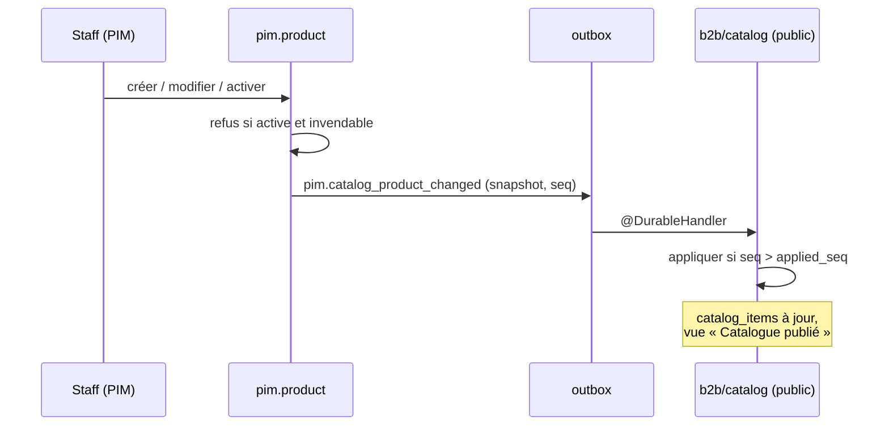

# Plan — un catalogue synchronisé, activé par audience

> 📐 **Doc-first, rien n'est bâti** (rédigé le 2026-10-15). Remplace deux
> plans, qui restent en place avec un bandeau :
> [`plan-audience-par-heritage.md`](plan-audience-par-heritage.md) (même jour)
> et [`plan-publication-par-faits-versionnes.md`](plan-publication-par-faits-versionnes.md)
> (2026-10-13). Leurs relevés de l'existant et les contradictions de `vitruve`
> y sont toujours ; ce document ne les recopie pas, il y renvoie.
>
> Touche **l'argent** (le prix part en continu) et porte une **migration de
> données** : `vitruve` est obligatoire avant Hugo (CLAUDE.md §9 bis).
> Comptes : base de **dev** seulement, la production n'a pas été mesurée.

## 0. La demande (Hugo, 2026-10-15)

> « Quand on fait la création d'un produit ou d'une catégorie, ça s'ajoute en
> simultané à b2b, évidemment non vendu […] que le geste de publication
> disparaisse un peu et qu'on revienne au final à activer le produit pour
> l'audience définie. Là j'ai trop d'étapes pour un truc bête. »

Décisions déjà prises le même jour :

| #   | Décision                                                                                                                                  |
| --- | ----------------------------------------------------------------------------------------------------------------------------------------- |
| H1  | Audience `pro` / `public` / `both`, posée sur la famille, une fiche peut l'élargir ou la restreindre                                      |
| H2  | Les contextes de vente restent, comme régimes de TVA                                                                                      |
| H3  | Une modification d'une fiche active part **tout de suite**, sans relecture                                                                |
| H4  | Les schémas `pim` et `public` restent séparés                                                                                             |
| H5  | Le masquage de la plateforme ne fait que retirer, et n'a qu'une route                                                                     |
| H6  | Une vue « Catalogue publié » : une ligne par article, une colonne par audience                                                            |
| H7  | Une fiche publiée mais invisible aujourd'hui est dépubliée à la bascule                                                                   |
| H9  | La vue « Catalogue publié » va dans **Gestion Boutique** (aujourd'hui « Catalogue actuel en ligne », section Catalogue, `/b2b/catalogue`) |
| H10 | **Aucune perte de donnée** : des gens remplissent le catalogue en ce moment — §4 bis                                                      |
| H8  | Les tables à QR iront sur le site, comme capacité « sur place » (plan à venir)                                                            |

## 1. Avant / après, vu du staff

| Avant                                                                                                         | Après                                                    |
| ------------------------------------------------------------------------------------------------------------- | -------------------------------------------------------- |
| créer → remplir → publier → lier au canal B2B → cocher la case B2B → aperçu → envoyer → accepter la livraison | **créer → remplir → activer**                            |
| la plateforme ignore une fiche tant qu'elle n'a pas été envoyée                                               | la fiche est sur la plateforme dès sa création, inactive |
| rien ne se vend au public seul                                                                                | l'audience le dit                                        |

## 2. Décisions

### C1 — Deux états : inactive, active ; la garde est dans la projection

`ProductStatus` garde ses valeurs en base (`draft`, `published`, `archived` —
une valeur d'enum Postgres ne se renomme pas, CLAUDE.md §8) ; l'écran et le
domaine disent **inactive / active / archivée**. `publish()` devient
`activate()`, `unpublish()` devient `deactivate()`.

**Ce qui se vend se décide déclinaison par déclinaison, comme aujourd'hui.**
La projection écarte déjà une déclinaison sans prix, sans taux ou sans
allergènes (`variant_sans_prix`, `variant_sans_taux`, refus de `publish()`).
Ce plan généralise ce tri au lieu d'ajouter des refus sur chaque geste :

- **une déclinaison incomplète n'est jamais vendue** — sans allergènes, sans
  prix ou sans taux, elle part dans le snapshot marquée `incomplete` avec ce
  qui lui manque, et la plateforme la range non vendable ;
- **activer** refuse une fiche qui n'a **aucune** déclinaison complète, avec
  la liste de ce qui manque ;
- **aucune modification d'une fiche active n'est refusée** pour cause
  d'incomplétude : une déclinaison neuve (`Variant.open` naît sans prix,
  `variant.ts:262-280`) arrive non vendable, celle dont on vide les
  allergènes sort de la vente, une famille dont on retire le taux sort ses
  fiches de la vente. Chacune se voit dans la vue « Catalogue publié »
  (« incomplète : allergènes »).

Pourquoi pas des refus sur chaque geste (version précédente) : la
vendabilité dépend de choses que `Product` ne voit pas — taux de la famille
(`set-category-vat`), suppression d'un taux (`remove-vat-rate`),
`reclassify`, `setChannels` qui efface des taux (`product.ts:230-245`),
rapport pro. Les énumérer laisserait toujours un trou ; la projection, elle,
lit l'état final, quel que soit le geste. C'est la règle « interdire plutôt
que vérifier » : une déclinaison incomplète n'a pas de prix servi, elle est
**invendable par construction**.

Ce qui reste vendu sans relecture, choisi par Hugo (H3) : une valeur
**fausse mais complète** — un prix mal tapé.

### C2 — L'audience (H1)

Reprise telle quelle de [`plan-audience-par-heritage.md`](plan-audience-par-heritage.md)
D1 et D3 : `category.audience` obligatoire, `product.audience` nullable
(hérite), `OPERATION_AUDIENCES` réutilisée, et une règle `servedTo(item,
viewer)` qui remplace les **quatre** lectures directes du masquage côté
plateforme (D3 du plan d'audience, relevé `vitruve`).

### C3 — La synchronisation : un fait par fiche, à chaque enregistrement

- Toute écriture sur une fiche ou une famille — création comprise, active ou
  non — émet, **dans sa transaction**, un fait durable
  `pim.catalog_product_changed` portant le **snapshot complet** de la fiche :
  ce que `projection.ts` fabrique aujourd'hui par produit, plus `status` et
  `audience`. Un snapshot, pas un diff : il se rejoue seul.
- Même chose pour la famille (`pim.catalog_category_changed`) et pour les
  opérations (`pim.catalog_operation_changed`).
- **Les règles globales voyagent comme règles, pas recopiées par fiche.**
  Les limites de commande traversent déjà en règles depuis la v7 du fil
  (`projection.ts:307-315`) : elles deviennent un fait global
  `pim.catalog_rules_changed`, avec le rapport pro. Recopier une règle
  globale sur chaque fiche réémettrait tout le catalogue à chaque réglage.
- **Ce qui change des prix ou des taux sur plusieurs fiches** — taux d'une
  famille, pourcentage d'un taux (`update-vat-rate.ts:37-47`), suppression
  d'un taux, rapport pro (le HT pro est calculé par fiche), allergènes d'un
  ingrédient (`set-ingredient-allergens.ts`), description d'une image venue de
  la médiathèque (`on-media-asset-described.ts`), renommage ou déplacement de
  famille si le snapshot les porte — émet **une tâche de réémission** des
  fiches concernées, exécutée hors de la transaction du geste, **une
  transaction par fiche**. Aucun geste ne verrouille le catalogue entier.
  La liste exacte des émetteurs se dresse au lot 4, par grep sur les
  écritures des tables que la projection lit.
- Le fait est déclaré dans `pim/channels/b2b-platform/` ; le récepteur est un
  `@DurableHandler` par fait dans `b2b/catalog/application/handlers/`
  (`lint:durable-cross-block`), sur le modèle de
  `on-product-media-changed.handler.ts`.
- **Une fiche inactive arrive aussi**, et la plateforme la range non vendue :
  c'est ce qui fait « apparaître » le catalogue en cours de saisie.

### C4 — L'ordre : deux enregistrements simultanés

Objection BLOQUANT n° 2 de `vitruve` (2026-10-13), et sa précision du
2026-10-15 : les handlers chargent l'agrégat **hors** transaction
(`save-variant-allergens.ts:46` avant `uow.run` l. 79), et les satellites
(allergènes, rédactionnel, médias) s'écrivent par des ports qui ne passent
pas par `products.save`.

Proposé : **le snapshot n'est jamais pris dans l'agrégat en mémoire.** Un
seul émetteur, `CatalogEmitter.emit(productIds, tx)`, appelé en **dernière
instruction** de la transaction de chaque geste :

1. `SELECT … FOR UPDATE` sur les lignes `pim.product` concernées, **triées par
   id** — le seul verrou du mécanisme, toujours dans le même ordre, sur la
   même table : pas d'interblocage possible entre deux émetteurs ;
2. tire le numéro d'ordre **après** le verrou ;
3. **relit la fiche en base** dans la transaction et la projette ;
4. écrit le fait dans l'outbox.

En `READ COMMITTED`, l'instruction qui suit l'obtention du verrou voit ce
que la transaction précédente a validé : le snapshot émis sous le numéro
`n+1` contient donc forcément l'écriture émise sous `n`. Les handlers n'ont
pas à changer d'ordre de chargement ; ils ajoutent l'appel, et un geste qui
ne l'ajoute pas est rattrapé par la parité (§4). Le refus de C1 ne juge plus
un état en mémoire : il n'y a plus de refus sur fiche active.

⚠️ **À vérifier au lot 2** : que tous les handlers d'écriture passent par
une transaction `uow` qui porte l'outbox (vu pour `set-product-media.ts:72-85`
seulement), et en compter le nombre (≈ 22 dans `catalogue/product/application/`,
plus `category/`).

Côté plateforme : `catalog_items.applied_seq`, écriture **conditionnée en
base** (`WHERE applied_seq < :seq`), comme `showIfNewer`.

### C5 — Ce qui disparaît

- Le push, l'aperçu, l'empreinte comme verrou, la boîte `catalog_delivery` et
  l'acceptation (liste dans le plan de publication, P5). La boîte se vide
  avant la bascule (aucune livraison `pending`).
- Le lien au canal B2B, la matrice des canaux, le point de vente sauf sa
  grille de tables (plan d'audience, D5 et Q4).
- Les deux routes de masquage, remplacées par une (H5, plan d'audience D7).
- **Les tables restent en base** (CLAUDE.md §0), plus lues ni écrites.

### C6 — Ce qui reste

- **Les révisions, comme historique** : une photographie du catalogue, prise
  automatiquement une fois par jour où quelque chose a changé, et à la main
  avec un nom ; le diff entre deux révisions. **Pas de « revenir à R »
  automatique dans ce plan** : réémettre d'anciens snapshots sans réécrire le
  référentiel contournerait la projection et serait annulé par la prochaine
  édition (`vitruve`, 2026-10-15). Restaurer une fiche se fait dans le
  référentiel, à la main, révision sous les yeux. → Q1.
- **Le masquage**, comme frein d'urgence : une faute de prix sur une fiche
  active se retire en un clic le temps de corriger (H3).
- **L'interrupteur `PIM_PUBLICATION_ENABLED`** : fermé, les faits ne
  s'émettent pas ; « réémettre tout » rattrape à la réouverture.
- **`catalog_versions` et `orders.catalog_version_id`** : la colonne n'a aucun
  lecteur hors son écriture (`vitruve`, grep du 2026-10-15) et chaque ligne de
  commande copie déjà prix et TVA. **Aucune estampille neuve** : la colonne
  reste, plus écrite. Un `max(applied_seq)` ne désignerait de toute façon
  aucun état du catalogue.

### C7 — La bascule

1. Comptage en prod : fiches publiées non liées, liées non publiées,
   dérogations sans case `b2b`, livraisons en attente.
2. Les fiches invisibles aujourd'hui repassent inactives (H7) ; la liste est
   rendue.
3. Audiences posées : `both` sur tout ce qui est vendu aujourd'hui (plan
   d'audience, D6).
4. « Réémettre tout » : chaque fiche, active ou non, émet son snapshot ; la
   plateforme se remplit, y compris des fiches inactives.

## 3. Lots

| Lot   | Contenu                                                                                                                                  | Donne                             |
| ----- | ---------------------------------------------------------------------------------------------------------------------------------------- | --------------------------------- |
| **1** | Comptage ; colonnes d'audience ; activer/désactiver avec le refus complet (C1) ; refus sur fiche active                                  | l'agrégat tient la règle          |
| **2** | Faits fiche + famille, verrou et `seq` (C3, C4) ; récepteur conditionné ; `servedTo` ; réémettre tout                                    | **créer → la plateforme le voit** |
| **3** | Écrans : bouton Activer, audience famille et fiche, vue « Catalogue publié » déplacée en Gestion Boutique (H9), route unique de masquage | **le parcours en trois gestes**   |
| **4** | Opérations en faits ; émissions en lot (TVA, limites, rapport pro) ; révisions automatiques                                              | plus aucun besoin du push         |
| **5** | Retraits (C5) ; estampille de commande par `seq`                                                                                         | le ménage                         |

**Le push est coupé dès que le lot 2 est en service.** Il envoie un
instantané complet et efface ce qui n'y figure pas — il effacerait les fiches
inactives que les faits posent, sans `applied_seq`. Le filet n'est pas le
push, c'est « réémettre tout ». Retour arrière avant le lot 5 : redéployer la
version précédente rouvre le push (son code est encore là), et les fiches
dépubliées par H7 se réactivent depuis la liste rendue en C7.

### Lot 1 — ce qui se bâtit (détaillé le 2026-10-15)

> ✅ **Bâti le 2026-10-15.** Trois écarts au texte ci-dessous, tous assumés :
> les routes d'audience sont sous `/pim/catalogue/categories/:id/audience` et
> `/pim/catalogue/products/:id/audience` (le voisinage) ; l'aperçu de bascule
> est `GET /pim/channels/b2b/audience-switch-preview`, dans le canal, parce
> qu'il lit le lien au canal et que le catalogue n'importe pas ses canaux
> (ADR-13) ; un changement d'audience entre dans `content-facts` (il périme la
> signature) mais ne déclenche **pas** de révision automatique — c'est le
> lot 4. Une famille archivée refuse un changement d'audience.

**Le lot 1 ne change aucun comportement servi.** Le push lit encore le lien
et la matrice ; l'audience existe, se règle par l'API, et n'est lue par
aucune émission. Il n'écrit aucun statut de fiche.

| #   | Quoi                                                                                                                                                                                                                                                                                                                                                                                                                                                                                                                                                                                                                                                                                                                                                         |
| --- | ------------------------------------------------------------------------------------------------------------------------------------------------------------------------------------------------------------------------------------------------------------------------------------------------------------------------------------------------------------------------------------------------------------------------------------------------------------------------------------------------------------------------------------------------------------------------------------------------------------------------------------------------------------------------------------------------------------------------------------------------------------ |
| 1a  | **Migration** `…_l_audience_du_catalogue` (additive) : `pim.category.audience text NOT NULL DEFAULT 'both'` et `pim.product.audience text NULL`, chacune avec un `CHECK (audience IN ('pro','public','both'))`. Toutes les familles à `both` — c'est ce qu'elles font aujourd'hui (§1.2 du plan d'audience). Aucune fiche n'est touchée.                                                                                                                                                                                                                                                                                                                                                                                                                     |
| 1b  | **Domaine** : value object `Audience` (`pim/catalogue/shared/domain/value-objects/audience.ts`), type tiré de `OPERATION_AUDIENCES` de `@lfd/pim-contracts`, refus `InvalidAudienceError` (400). `Category.changeAudience(a)` et `Product.changeAudience(a \| null)`, rendant `changed: boolean` comme les autres mutations. Fonction pure `effectiveAudience(productAudience, categoryAudience)`.                                                                                                                                                                                                                                                                                                                                                           |
| 1c  | **Commandes et routes** (style PIM colocalisé) : `set-category-audience.ts` → `PUT /pim/categories/:id/audience { audience }` ; `set-product-audience.ts` → `PUT /pim/products/:id/audience { audience: … \| null }` (`null` = hérite). Mêmes permissions que leurs voisines (`:id/vat`). Faits de journal `product_category.audience_changed` et `product.audience_changed` ; les deux entrent dans `global-causes.ts` / `content-facts.ts` là où entrent les `channels_changed` (une audience changée déclenche une révision).                                                                                                                                                                                                                             |
| 1d  | **Lectures** : le détail d'une famille et d'une fiche, et la liste des fiches, exposent `audience`, et pour la fiche `effectiveAudience` et `audienceInherited`. Contrats dans `@lfd/pim-contracts`.                                                                                                                                                                                                                                                                                                                                                                                                                                                                                                                                                         |
| 1e  | **Activer** : `Product.publish()` → `activate()`, `unpublish()` → `deactivate()` (domaine et handlers). Routes `/publish` `/unpublish` et valeurs de journal **inchangées** (le front n'est touché qu'au lot 3 ; une valeur de journal ne se renomme pas). Refus **en plus** de celui des allergènes, qui reste par déclinaison jusqu'au lot 2 (§ ci-dessous) : `activate` exige au moins une déclinaison non arrêtée **avec un prix** et, pour chaque audience effective, **un taux** au contexte qui la facture (`pro` → `b2b`, `public` → `takeaway`). Le taux est résolu par le handler (lecteur déjà utilisé par la projection, `vatPercents`) et passé à `activate(resolvedVat, audience)`. L'erreur nomme ce qui manque, déclinaison par déclinaison. |
| 1f  | **Le comptage de la bascule** : `GET /pim/catalogue/audience-switch-preview`, lecture seule, permission de lecture du référentiel. Rend trois listes (id, SKU, nom) : publiées non liées au canal, liées non publiées, publiées dont la case `b2b` effective est fermée. C'est ce qui mesure la production sans accès direct à sa base.                                                                                                                                                                                                                                                                                                                                                                                                                      |

⚠️ **Pourquoi le refus des allergènes reste par déclinaison au lot 1** : C1
assouplit la règle (« au moins une déclinaison complète ») parce que la
projection du lot 2 écartera une déclinaison sans allergènes. Aujourd'hui
elle ne l'écarte pas — elle compte sur `publish()`. Assouplir avant le lot 2
mettrait en vente une déclinaison sans déclaration.

Tests : unitaires domaine (`Audience`, `effectiveAudience`, `activate` et ses
refus), handlers à ports mockés, e2e : régler l'audience d'une famille et
d'une fiche puis relire, refus d'une valeur inconnue, activation refusée sans
prix et sans taux, aperçu de bascule sur un semis.

### Lot 2 — ce qui se bâtit (détaillé le 2026-10-15)

Ouvert avant d'écrire : `set-product-media.ts:60-95` (le fait durable écrit
dans la transaction, relu après l'écriture), `on-product-media-changed.handler.ts`
(le récepteur `@DurableHandler`), `catalog.prisma` (`CatalogItem.priceMillicents`
est `NOT NULL`, `withdrawnAt` dit « plus vendu », `sellable-filter.ts` le
tient en un seul `STILL_SOLD`), et les onze lecteurs de `catalog_items`.

**Décision de forme — la plateforme ne change pas ce que `catalog_items`
veut dire.** Elle reste la table de ce qui **se vend** : onze lecteurs, dont
les commandes et la tarification, la lisent comme telle, et un prix n'y est
jamais nul. Ce qui manquait — une fiche inactive, une déclinaison incomplète,
l'audience — va dans une table neuve, par **fiche** :

`public.catalog_entries` : `product_id` (clé), `product_sku`, `name`,
`category_id`, `status` (`inactive` | `active` | `archived`), `audience`
(effective), `gaps` (jsonb : déclinaison → ce qui manque), `applied_seq`,
`received_at`. C'est elle que la vue « Catalogue publié » lit pour montrer le
catalogue en train de se construire ; `catalog_items` garde les seules
déclinaisons vendables d'une fiche active, avec `audience` en colonne neuve.

Découpé en deux, parce que 2a se déploie sans rien changer de servi :

**2a — les rails, interrupteur fermé**

> ✅ **Bâti le 2026-10-15, non commité à l'écriture de ce bandeau.** Écarts au
> texte, tous à relire :
>
> - **le taux `b2b` est exigé de toute déclinaison vendable**, audience
>   `public` comprise : `catalog_items.price_millicents` (prix pro HT) est
>   `NOT NULL` et ne se calcule pas sans lui. Une fiche « public » sans taux
>   `b2b` reste dans `gaps` (`vat:b2b`) — l'activation du lot 1, elle,
>   l'accepte ;
> - **les limites de commande** ne sont pas réécrites par un fait sur un
>   article existant (règles globales, lot 4) ; un article NEUF reçu par un
>   fait naît sans limite tant que le lot 4 n'est pas bâti ;
> - **une famille archivée** n'est pas marquée côté plateforme :
>   `catalog_categories` n'a pas de colonne de retrait, et aucune migration du
>   lot ne l'ajoute ; l'audience de la famille n'y est pas rangée non plus ;
> - `set-ingredient-allergens` n'émet pas : la projection ne lit pas les
>   allergènes d'un ingrédient (vérifié le 2026-10-15) ; les créations de taux,
>   de contexte et d'entrée d'allergène non plus (rien ne les cite encore) ;
> - les gestes « plusieurs fiches » hors famille (taux, contextes, référentiel
>   d'allergènes, réglages comptables) réémettent **tout** le catalogue, une
>   transaction par fiche, après la transaction du geste — « les fiches
>   concernées » reste à affiner (lot 4, mesure du délai) ;
> - la réémission « plusieurs fiches » est **attendue** par la requête du
>   geste (pas une tâche détachée) ; une fiche en échec est journalisée et
>   n'échoue pas le geste ;
> - `CATALOG_FACTS_ENABLED` traverse le Worker (`container/worker.ts`) et le
>   workflow de déploiement, sinon la poser ne l'ouvrirait pas.

| #   | Quoi                                                                                                                                                                                                                                                                                                                                                                                                                                                                                                                                                                                         |
| --- | -------------------------------------------------------------------------------------------------------------------------------------------------------------------------------------------------------------------------------------------------------------------------------------------------------------------------------------------------------------------------------------------------------------------------------------------------------------------------------------------------------------------------------------------------------------------------------------------- |
| 2a1 | **Le fait** `pim.catalog_product_changed` dans `pim/channels/b2b-platform/products/` : snapshot d'une fiche = ce que `projectCatalog` produit pour elle, plus `status`, `audience` effective, `gaps`, `seq`. Une déclinaison incomplète (sans prix, sans taux, **ou sans allergènes déclarés**) part dans `gaps`, pas dans les vendables. Même chose pour la famille : `pim.catalog_category_changed`.                                                                                                                                                                                       |
| 2a2 | **L'émetteur** `CatalogEmitter.emit(productIds)` : dans la transaction ambiante, `SELECT … FOR UPDATE` sur `pim.product` trié par id, `nextval` d'une séquence `pim.catalog_publication_seq`, relecture et projection, écriture du fait par le port durable existant. Ne fait rien si `PIM_PUBLICATION_ENABLED` est fermé, ou si `CATALOG_FACTS_ENABLED` (nouveau, fermé par défaut) l'est.                                                                                                                                                                                                  |
| 2a3 | **Les appels** : chaque handler d'écriture de `catalogue/product/application/` et `catalogue/category/application/` appelle l'émetteur en dernière instruction de son `uow.run` (fiche : elle-même ; famille : la famille, et ses fiches si le geste change ce que leur snapshot porte — taux, audience, nom). Inventaire des handlers rendu avec le lot ; un handler qui n'écrit pas dans une `uow` est une faille à signaler, pas à combler en douce.                                                                                                                                      |
| 2a4 | **Le récepteur** un abonné « on-catalog-product-changed » dans `b2b/catalog/application/handlers/` : une transaction ; `INSERT … ON CONFLICT (product_id) DO UPDATE … WHERE catalog_entries.applied_seq < EXCLUDED.applied_seq` ; si la ligne n'a pas bougé, rien d'autre. Sinon : upsert des déclinaisons vendables (`withdrawnAt = null`), `withdrawnAt` posé sur les autres déclinaisons de la fiche ; **jamais** une écriture sur `catalog_item_overrides`. Validation par article reprise d'`IngestCatalogService`. Même schéma pour la famille (`catalog_categories` + `applied_seq`). |
| 2a5 | **`servedTo(item, viewer)`** : audience de l'article contient le lecteur ET pas de masquage pour lui. Remplace les quatre lectures directes (D3 du plan d'audience). `audience` `NULL` = `both`.                                                                                                                                                                                                                                                                                                                                                                                             |
| 2a6 | **Réémettre** : `POST /pim/channels/b2b/reemit` (tout, ou une fiche), marqué `@PublicationGesture()`. Une transaction par fiche.                                                                                                                                                                                                                                                                                                                                                                                                                                                             |

Migrations : `pim.catalog_publication_seq` (séquence) ; `public.catalog_entries` ;
`catalog_categories.applied_seq` ; `catalog_items.audience` nullable. Toutes
additives.

Tests : e2e de bout en bout **en processus** (créer une fiche au PIM, relayer
l'outbox, la lire dans `catalog_entries`) ; ordre (deux faits appliqués à
l'envers : le plus ancien n'écrit rien) ; décisions qui survivent à dix faits ;
fiche désactivée → déclinaisons retirées, décisions intactes ; commande pro
refusée sur un article `public`.

**Corrections après `vitruve` (2026-10-15), qui priment sur les tables
ci-dessus :**

- **Tous les émetteurs avant la bascule** (BLOQUANT). 2a3 couvre aussi ce qui
  change un snapshot hors de `catalogue/` : `ingredients/application/set-product-ingredients.ts`
  (par fiche, émetteur direct) ; `vat-rates/*`, `sales-contexts/*`,
  `allergens/*` (révision, archivage), `accounting-rules/application/set-pro-price-ratio.ts`
  et `choose-pro-price-method.ts` (plusieurs fiches : tâche de réémission des
  fiches concernées, une transaction par fiche). Sans eux, ouvrir
  l'interrupteur figerait les prix servis. Le lot 4 ne garde que les
  opérations, les limites de commande et les révisions automatiques.
- **Une fiche apporte sa famille** (SÉRIEUX). Les faits fiche et famille vont à
  deux abonnés sans ordre entre eux, et `catalog_items.category_id` est une clé
  étrangère. Le snapshot d'une fiche porte donc sa famille (nom, parent,
  position, taux) ; le récepteur la crée si la plateforme ne la connaît pas, et
  ne la met jamais à jour — c'est le fait famille, sous son propre
  `applied_seq`, qui le fait. `catalog_entries.category_id` sans clé
  étrangère. « Réémettre tout » émet les familles d'abord.
- **Un seul écrivain à la fois** (SÉRIEUX). Dès 2a, `IngestCatalogService.apply`
  lit `CATALOG_FACTS_ENABLED` : ouvert, le push ne touche plus fiches ni
  familles (il ne porte plus qu'opérations et règles). 2b2 est donc bâti en
  2a, et ne fait plus qu'être ouvert.
- **Le retrait se fait par fiche, sur les SKU** (SÉRIEUX). Le récepteur pose
  `withdrawnAt` sur toute ligne de `catalog_items` dont le `product_id` est la
  fiche et dont le SKU n'est pas dans les vendables du fait : une fiche
  archivée ou inactive retire toutes les siennes, un SKU renommé retire
  l'ancien. Les décisions restent sur l'ancien SKU, inertes.
- **Le comptage de bascule compte aussi les allergènes** (SÉRIEUX) : l'aperçu
  gagne la liste des déclinaisons vendues aujourd'hui **sans déclaration**,
  qui sortiront de la vente à la bascule (2b3).
- « Réémettre » est un `@PublicationGesture()` : impossible tant que
  `PIM_PUBLICATION_ENABLED` est fermé, et c'est voulu.
- Tests ajoutés : fiche reçue avant sa famille ; même fait livré deux fois.

**Ce que 2a a appris, et qui devient un préalable de 2b (2026-10-15) :**

- ~~**Le taux `b2b` est exigé pour toute fiche, même `public`.**~~ **Tranché
  plus large (Hugo, 2026-10-15)** : « n'importe quelle fiche devrait être en
  capacité de servir n'importe quel contexte, qu'il soit servi à l'instant T
  ou non ». Une fiche est complète quand elle a un prix, ses allergènes, et un
  taux pour **chaque contexte de vente en service** (`SalesContext.active`) —
  pas seulement ceux de son audience. L'audience dit à qui on vend
  aujourd'hui ; changer d'audience ne doit jamais rendre une fiche
  invendable. 2b aligne l'activation du lot 1 (`activation-gaps.ts`) et les
  `gaps` de la projection (`catalog-facts.ts`) sur cette règle, et l'aperçu de
  bascule compte les fiches actives auxquelles il manque un taux.
- **Les limites de commande passent avant l'ouverture.** Un article neuf reçu
  par un fait naît sans limite (le récepteur ne les écrit pas). Le fait global
  `pim.catalog_rules_changed` (C3) remonte donc du lot 4 au lot 2b.
- **La famille sur la plateforme ne range encore ni son retrait ni son
  audience** : le fait les porte, `catalog_categories` n'a pas les colonnes. 2b
  les ajoute (additif).
- Les gestes multi-fiches (taux, contextes, allergènes, rapport pro) réémettent
  **tout** le catalogue, dans la requête du geste : correct, plus lent qu'il
  ne faut. À mesurer à l'ouverture ; resserrer aux fiches concernées si la
  réponse dépasse quelques secondes.
- Les faits ignorent la matrice des canaux (`canal_ferme`) : c'est l'audience
  qui décide, comme prévu (C2, C5).

**2b — la bascule**, une fois 2a en service et l'aperçu de bascule relu par Hugo

| #   | Quoi                                                                                                                 |
| --- | -------------------------------------------------------------------------------------------------------------------- |
| 2b1 | Commande `ApplyAudienceSwitch` : désactive les fiches que l'aperçu liste (H7), journalisé par fiche.                 |
| 2b2 | ~~Bâti en 2a~~ (garde dans `apply`) : il ne reste qu'à ouvrir.                                                       |
| 2b3 | Le refus des allergènes passe à « au moins une déclinaison complète » (C1) : la projection 2a1 les écarte désormais. |
| 2b4 | Ouverture de `CATALOG_FACTS_ENABLED`, puis « réémettre tout ». Le geste est écrit au runbook.                        |

## 4. Risques

- **Une faute de prix vendue tout de suite** (H3, choisi en connaissance de
  cause). Filets : masquage en un clic, révisions.
- **Un fait perdu** laisse une fiche en retard : la parité
  (`check-catalog-parity.service.ts`) devient le filet, « réémettre la
  fiche » la réparation.
- **Les allergènes** : l'acceptation humaine disparaît ; le garde est la
  projection (C1). Un e2e le prouve : vider les allergènes d'une déclinaison
  vendue la sort de la vente au fait suivant, et la commande est refusée.
- **Les réémissions en lot** (TVA d'une famille de 40 fiches) : 40
  transactions courtes, une par fiche ; mesurer le délai total au lot 4.

## 4 bis. Aucune perte de donnée (H10)

> « Attention à la perte de donnée, des gens remplissent le catalogue. » —
> Hugo, 2026-10-15

Ce qui est saisi en ce moment vit à deux endroits, et aucun des deux ne doit
perdre une ligne.

**Dans le référentiel (`pim`)**

- Les migrations n'ajoutent que des colonnes (`audience`, le numéro d'ordre).
  Aucune ne réécrit le contenu d'une fiche : noms, prix, allergènes, visuels,
  textes ne sont touchés par aucune étape de la bascule.
- La seule écriture de la bascule est le **statut** des fiches invisibles
  aujourd'hui (H7). Elle est réversible (réactiver), et la liste des fiches
  concernées est rendue **avant** d'être appliquée, pour que Hugo la relise.
- Une **révision nommée** « avant la bascule » est prise juste avant :
  c'est la photographie à laquelle revenir.
- Rien n'impose d'arrêter la saisie. Le déploiement se fait hors des heures de
  saisie, annoncé : une page ouverte au moment du déploiement doit se
  recharger, et un formulaire non enregistré serait perdu à ce rechargement.

**Sur la plateforme (`public`)**

- Ce que la plateforme décide seule — prix pro et public remplacés, masquage,
  mise en avant (`catalog_item_overrides`), mercuriales — **n'est jamais écrit
  par un fait**. Un fait réécrit les colonnes reçues du référentiel, rien
  d'autre. C'est le piège que `prisma-catalog-item.repository.ts:160` nomme
  déjà (« le seul endroit du dépôt où un champ oublié compile et perd une
  donnée ») : le récepteur ne passe pas par cette écriture-là, il a la sienne,
  qui ne contient pas les décisions. Un e2e le prouve : une décision de prix
  survit à dix faits sur la même fiche.
- **Rien n'est supprimé.** Une fiche désactivée ou archivée pose
  `withdrawn_at` ; la ligne et ses décisions restent, et reviennent à la
  réactivation. Le chemin actuel qui efface une décision
  (`prisma-catalog-item.repository.ts:158`, quand l'agrégat n'en porte plus)
  n'est appelé par aucun fait.
- **Une famille ne se supprime jamais** côté plateforme : `catalog_items` la
  référence en `onDelete: Cascade` (`catalog.prisma:129`), et la supprimer
  emporterait ses articles et leurs décisions. Une famille retirée pose une
  date, comme un article.
- Un fait **plus ancien** que la ligne ne l'écrase pas (`applied_seq`, C4).

## 5. Questions ouvertes

1. ~~**Q1**~~ — **À la main suffit (Hugo, 2026-10-15)** : restaurer une fiche
   se fait dans le référentiel, révision sous les yeux. Pas de bouton.
2. ~~**Q2**~~ — **Grisée (Hugo, 2026-10-15)** : une famille sans fiche active
   est visible sur la plateforme, grisée, comme une fiche inactive.

## Contradiction de `vitruve` (2026-10-15) — intégrée

Trois BLOQUANT, traités dans le corps :

1. **Une déclinaison neuve naît sans prix** : la règle « une fiche active
   refuse ce qui la rend invendable » aurait interdit d'ajouter une
   déclinaison à une fiche en vente → C1 ne refuse plus rien sur une fiche
   active ; une déclinaison incomplète est invendable par construction.
2. **L'agrégat est chargé hors transaction** → C4 : le snapshot est relu en
   base sous verrou, par un émetteur unique en fin de transaction.
3. **La vendabilité dépend de gestes que `Product` ne voit pas** (taux de
   famille, suppression de taux, reclassement, rapport pro) → même réponse
   que 1 : la projection juge l'état final.

Sérieux intégrés : liste des émetteurs complétée et émission en tâche, une
transaction par fiche (C3) ; règles globales en fait global (C3) ; un seul
verrou, trié (C4) ; pas d'estampille de commande (C6) ; pas de retour
automatique à une révision (C6, Q1) ; push coupé au lot 2 et retour arrière
écrit (§3).

Restent **non vérifiés** : que tous les handlers portent l'outbox dans leur
transaction ; que `catalog_items` sait déjà ranger un article non vendable ;
la forme de l'écriture conditionnée ; les volumes de production.
