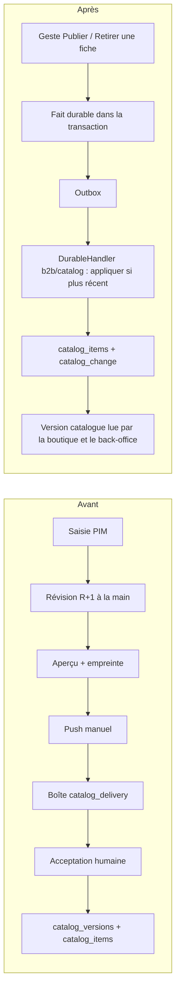

# Plan — la publication par faits versionnés, et le retrait du point de vente

> 🔁 **Remplacé le 2026-10-15** par
> [`plan-catalogue-synchronise-par-audience.md`](plan-catalogue-synchronise-par-audience.md),
> qui fusionne ce plan et son voisin. Gardé pour son relevé de l'existant et
> sa contradiction par `vitruve`, que le nouveau plan cite au lieu de les
> recopier.

> 📐 **Doc-first, rien n'est bâti** (rédigé le 2026-10-13). Touche l'argent
> (prix, TVA copiés dans chaque fait) et porte une migration de données :
> **`vitruve` est obligatoire avant Hugo** (CLAUDE.md §9 bis).
>
> Ce plan vit dans `pim/` parce que l'émission (brouillon/publié, faits,
> révisions) est au référentiel ; le côté plateforme (réception) est décrit
> aujourd'hui dans [`b2b/architecture-catalogue-synchronise.md`](../b2b/architecture-catalogue-synchronise.md)
> et [`b2b/push-catalogue-pim-vers-boutique.md`](../b2b/push-catalogue-pim-vers-boutique.md).

## 0. Le souhait (Hugo, 2026-10-13)

> « Les modifications du catalogue envoient des messages, la plateforme fait
> les changements avec un numéro de version comme pour la journée, avec une
> auto-actualisation. » — « garder juste le système de révision en rollback ».

Motivation : quand quelqu'un ajoute produits et familles, **voir la plateforme
prendre forme au fur et à mesure**. Et : le **point de vente** (`PointOfSale`)
n'a plus d'intérêt ; les contextes de vente (cartes) restent.

## 1. Ce qui existe (ouvert le 2026-10-13)

| Fait                                                                                                                                                                                                                              | Où                                                                                                                                                                             |
| --------------------------------------------------------------------------------------------------------------------------------------------------------------------------------------------------------------------------------- | ------------------------------------------------------------------------------------------------------------------------------------------------------------------------------ |
| La fiche a déjà un statut `draft / published / archived` ; `PublishProductHandler` refuse sans allergènes déclarés et journalise `productPublished`.                                                                              | `prisma/schema/pim/product.prisma` (`enum ProductStatus`), `catalogue/product/application/activate-product.ts` (ex-publish-product.ts, renommé le 2026-10-15)                  |
| **La projection B2B ne lit pas ce statut** : elle part de `b2b_channel_binding` (`membership.service.ts` `publishedProductIds`) puis filtre sur la carte `"b2b"` de la matrice (`projection.ts`, `canal_ferme`).                  | `pim/channels/b2b-platform/products/feed-projection.service.ts`, `projection.ts`, `membership/membership.service.ts`                                                           |
| La famille n'a **pas** de statut, seulement `isArchived`.                                                                                                                                                                         | `prisma/schema/pim/categories.prisma`                                                                                                                                          |
| Push manuel : `POST push` (`dryRun` par défaut vrai, `fingerprint`, `label`, `note`), marqué `@PublicationGesture()` (interrupteur `PublicationEnabledGuard`).                                                                    | `pim/channels/b2b-platform/products/push.controller.ts`, `pim/publication/publication-switch.ts`                                                                               |
| Le driver en processus : boîte `catalog_delivery` si `deliveryInboxEnabled()`, sinon `IngestCatalogService.apply`.                                                                                                                | `b2b/catalog/infrastructure/in-process-catalog.driver.ts`                                                                                                                      |
| `apply` retire ce qui est **absent** du snapshot (SKU et opérations) : le modèle est « instantané complet ».                                                                                                                      | `b2b/catalog/application/ingest-catalog.service.ts`                                                                                                                            |
| `catalog_versions` est **lu par les commandes** : `orders.catalog_version_id` (FK `Restrict`), posé par `OrderDraftingService` via `CatalogVersionReader.currentId()`.                                                            | `prisma/schema/public/orders.prisma`, `b2b/orders/application/services/order-drafting.service.ts`                                                                              |
| Deux faits durables déjà automatiques, ordonnés par geste : `pim.product_media_changed` et l'image d'opération, appliqués par `showIfNewer` (écriture conditionnée en base).                                                      | `b2b/catalog/application/handlers/on-product-media-changed.handler.ts`, `on-operation-image-changed.handler.ts`, `infrastructure/prisma-catalog-visuals.projection.ts`         |
| Le modèle « version » : tables en ajout seul `day_change` alimentées par **déclencheur**, version = `max(id)`, veilleur front 15 s + filet 5 min.                                                                                 | [`caching-usage/plan-version-par-journee.md`](../caching-usage/plan-version-par-journee.md) D1–D4, `lfd-backoffice-frontend/src/app/shared/day-version/day-version-watcher.ts` |
| Point de vente : `PointOfSale`, `PointOfSaleContext`, `PointOfSaleTable`, `baseUrl` ; `CategoryChannel` et `ProductChannel` portent `pointOfSaleId` ; `sellable-channels.ts` refuse un couple (point de vente, carte) non offert. | `prisma/schema/pim/sales-contexts.prisma`, `categories.prisma`, `product.prisma`, `pim/points-of-sale/`, `catalogue/shared/application/sellable-channels.ts`                   |

Le commentaire de `on-product-media-changed.handler.ts` l'annonçait déjà : « le
jour où la publication devient automatique, il faudra dater les deux écritures
et faire gagner la plus récente ». C'est ce plan.

## 2. Avant / après

## 3. Décisions proposées

### P1 — Brouillon / publié : le statut existant devient la porte d'émission

On ne crée pas de deuxième notion. **Seuls trois gestes émettent** : publier,
retirer (dépublier / archiver), et « republier » une fiche déjà publiée après
modification. Une frappe sur une fiche publiée **n'émet rien** : la fiche porte
un indicateur dérivé « modifiée depuis la publication » (empreinte de sa
projection ≠ empreinte du dernier fait émis), et le bouton devient
« Publier les modifications ». Une erreur d'allergène en cours de saisie ne
part donc jamais ; elle part au geste, qui repasse le refus de l'agrégat.

Conséquence : `b2b_channel_binding` cesse d'être la liste d'appartenance
(doublon déjà signalé par [`ecrans-du-cycle-catalogue.md`](ecrans-du-cycle-catalogue.md)) —
est émise une fiche **publiée ET cochée sur la carte `b2b`**. Décocher la
carte d'une fiche publiée = un fait « retirée ».

**Familles** : pas de statut propre (proposition). Une famille est émise (fait
`category_published`, nom, ordre, chemin, TVA par défaut) dès qu'une fiche
publiée y entre, et retirée quand sa dernière fiche sort ou qu'elle est
archivée. Renommer une famille émet sa nouvelle version. → Q2.

### P2 — Les faits, dans `pim/channels/b2b-platform/`

| Fait                                           | Charge                                                                                                                                                                                                                                                  |
| ---------------------------------------------- | ------------------------------------------------------------------------------------------------------------------------------------------------------------------------------------------------------------------------------------------------------- |
| `pim.catalog_product_published`                | **snapshot complet** de la projection d'UNE fiche, tel que `projection.ts` le fabrique aujourd'hui : variantes vendables et exclues, prix, **taux de TVA résolu**, allergènes, visuels, limites de commande résolues (`order-time-limits.ts`), famille. |
| `pim.catalog_product_withdrawn`                | `productId`, SKU                                                                                                                                                                                                                                        |
| `pim.catalog_category_published / _withdrawn`  | la famille projetée                                                                                                                                                                                                                                     |
| `pim.catalog_operation_published / _withdrawn` | l'opération projetée (`operation-projection.ts`)                                                                                                                                                                                                        |

- **Snapshot, pas diff** : un diff demande l'état précédent chez le récepteur
  et casse au premier fait perdu ; un snapshot par fiche se rejoue seul.
- **Version** : un `bigserial` global du référentiel, `catalog_publication.seq`,
  tiré dans la transaction du geste et porté par le fait. Il sert deux choses :
  l'ordre par fiche (« appliquer si `seq` > `applied_seq` de la ligne »,
  écriture conditionnée en base comme `showIfNewer`) et la traçabilité (une
  ligne de catalogue dit de quel geste elle vient). Clé d'idempotence
  `pim.catalog_product_published:<productId>:<seq>`.
- **Les visuels** entrent dans le snapshot ; `showIfNewer` se range sous le même
  `seq` (le fait média devient un cas du fait fiche, ou garde son geste et la
  comparaison se fait sur l'horodatage du geste — à trancher au lot 2).
- **Les limites de commande** sont copiées dans chaque fait de fiche ; changer
  une règle de limite émet les fiches qu'elle couvre (même geste que changer
  une TVA de famille : émission en lot, un fait par fiche concernée).
- **L'interrupteur `PIM_PUBLICATION_ENABLED`** reste, à l'**émission** : fermé,
  le geste publier change le statut mais n'écrit pas le fait ; à la
  réouverture, une commande « réémettre le publié » (P4) rattrape.
- Côté plateforme, un `@DurableHandler` par fait dans
  `b2b/catalog/application/handlers/` (exigé par `lint:durable-cross-block`),
  qui réutilise la validation par article d'`IngestCatalogService` (refus d'un
  article sans TVA, etc.) **par fiche** au lieu de par instantané. Un article
  refusé ne bloque plus les autres et se voit dans la santé.

### P3 — La version du catalogue et l'auto-actualisation

- Table `public.catalog_change` en ajout seul (comme `day_change`, D1/D2),
  remplie par **déclencheur d'instruction** sur `catalog_items`,
  `catalog_categories`, les opérations et les prix B2B (une altération locale
  doit aussi faire avancer la version). Version = `max(id)`.
- `GET /shop/catalogue/version` (public, sans corps) et la même lecture pour le
  back-office. La boutique interroge toutes les 30 s onglet visible et ne relit
  `GET /shop/catalogue` que si la version a changé ; le back-office réutilise
  le veilleur (variante sans date).
- Cache : `GET /shop/catalogue?v=<version>` devient cachable longtemps
  (l'URL change avec la version), ce qui ouvre le cache CDN sans invalidation.
  ⚠️ Non vérifié : la politique de cache actuelle de `shop-catalogue.controller.ts`
  (aucun `Cache-Control` trouvé) et le rafraîchissement actuel du store boutique.

### P4 — Les révisions en retour arrière

- La révision reste une photographie du catalogue entier identifiée par son
  empreinte ([`mecanique-revisions-catalogue.md`](mecanique-revisions-catalogue.md)).
  Proposition : **prise automatiquement** au premier geste de publication de
  chaque journée **et** à la main avec un nom ; plus de révision anonyme par push.
- « Revenir à R » : pour chaque fiche, réémet le snapshot que R portait comme
  **nouveau fait au `seq` courant** (jamais un ancien `seq`, que l'ordre
  rejetterait) ; les fiches publiées absentes de R reçoivent un fait retirée.
  Le retour ne réécrit **pas** le référentiel : il republie l'état de R. → Q4.
- L'empreinte survit pour : identifier une révision, le diff entre révisions,
  l'indicateur « modifiée depuis la publication ». Elle disparaît comme verrou
  aperçu→envoi.

### P5 — Ce qui disparaît

Push manuel et aperçu (`push.controller.ts`, `push.service.ts`,
`feed-preview.ts`, `PushB2bCatalogHandler`), `B2B_DELIVERY_INBOX`, la boîte
`catalog_delivery` et `admin/catalog/delivery/accept` (`accept-delivery.handler.ts`,
`admin-catalog-delivery.controller.ts`), les écrans front correspondants.

`catalog_versions` **ne disparaît pas** au premier temps : `orders.catalog_version_id`
le référence en `Restrict`. Proposition : la commande s'estampille désormais du
**numéro de version du catalogue** (`catalog_change.id` lu à la passation),
colonne neuve ; `catalog_version_id` reste en base, nullable, plus écrit ; la
table et la colonne restent (§0 : pas de suppression de données sans ordre).

### P6 — Retrait du point de vente

- `CategoryChannel` et `ProductChannel` perdent `pointOfSaleId` : une cellule
  devient (fiche|famille, carte). Migration de données : dédoublonner par
  (sujet, `context_key`) — une carte cochée sur au moins un point de vente
  reste cochée. ⚠️ À compter avant : combien de sujets ont des cellules sur
  plusieurs points de vente (non mesuré).
- Ce qui borne désormais les cartes cochables : `SalesContext.active`.
  `sellable-channels.ts` ne vérifie plus que l'existence et l'activité de la carte.
- Retirés : `pim/points-of-sale/` entier (dont `generate-table-qr`,
  `remove-table-qr`, `close-shop`), l'écran `points-of-sale` du back-office
  (route `/pim/emplacements` à confirmer), `PointOfSaleContext`,
  `PointOfSaleTable`, `baseUrl`, `PointOfSaleKind`.
- Pré-release (§0, corrigé 2026-10-04) : le code et le contrat se cassent dans
  un déploiement. Les **tables** restent en base, plus lues ni écrites ; leur
  `DROP` attend un ordre explicite de Hugo. La colonne `point_of_sale_id`
  passe nullable puis cesse d'être écrite.

## 4. Lots

| Lot   | Contenu                                                                                                                                                                   | Donne                                                                 |
| ----- | ------------------------------------------------------------------------------------------------------------------------------------------------------------------------- | --------------------------------------------------------------------- |
| **1** | Faits fiche publiée/retirée + `@DurableHandler` + `applied_seq` conditionné ; émission au geste publier/dépublier/archiver ; boîte de réception contournée pour ces faits | **« La plateforme prend forme au fur et à mesure »** — le plus rapide |
| 2     | Familles et opérations en faits ; limites et TVA de famille émettent en lot ; visuels rangés sous le même ordre                                                           | plus aucun besoin du push au quotidien                                |
| 3     | `catalog_change` + déclencheurs + `GET …/version` + veilleur boutique et back-office                                                                                      | l'écran se met à jour seul                                            |
| 4     | Révisions automatiques nommées + « revenir à R »                                                                                                                          | le filet de retour                                                    |
| 5     | Retrait du push, de l'aperçu, de la boîte, de l'acceptation ; estampille de commande par version                                                                          | la mécanique simplifiée                                               |
| 6     | Retrait du point de vente (indépendant, peut passer en premier)                                                                                                           | matrice à une dimension                                               |

Migrations : `catalog_publication_seq` (pim), `catalog_items.applied_seq`
(public), `catalog_change` + déclencheurs (public), `orders.catalog_seq`
(public), `point_of_sale_id` nullable puis non écrit (pim). Aucune ne supprime.

## 5. Risques

- **Argent** : chaque fait porte prix et TVA résolus ; un fait appliqué hors
  d'ordre remettrait un ancien prix — d'où l'écriture conditionnée en base, pas
  un test applicatif. Une commande en cours de panier peut voir un prix changer
  entre deux lectures : le prix facturé reste celui relu à la passation
  (comportement actuel, à vérifier dans `order-drafting.service.ts`).
- **Allergènes (réglementaire)** : l'acceptation humaine disparaît. La seule
  garde restante est le refus de l'agrégat au geste publier ; « Publier les
  modifications » doit repasser ce refus, et la santé doit montrer un article
  refusé à l'arrivée.
- **Perte de la vue d'ensemble** : le push donnait un « tout d'un coup »
  relisible. La révision automatique quotidienne et le diff la remplacent.
- **Rattrapage** : un fait perdu ou en lettre morte laisse une fiche en retard ;
  la parité existante (`check-catalog-parity.service.ts`) devient le filet, et
  « réémettre le publié » la réparation.

## 6. Questions à Hugo

1. **Q1** — Une fiche publiée modifiée : émission au clic « Publier les
   modifications » (proposé) ou à chaque enregistrement de section ?
2. **Q2** — Familles : publiées par dérivation de leurs fiches (proposé), ou un
   statut à elles ?
3. **Q3** — Révision : automatique une fois par jour de publication + à la main
   (proposé), ou seulement à la main ?
4. **Q4** — « Revenir à R » republie l'état de R sans toucher le référentiel
   (proposé), ou réécrit aussi les fiches du référentiel ?
5. **Q5** — Les commandes passent à une estampille par numéro de version ;
   `catalog_versions` reste en base, plus écrite : d'accord ?
6. **Q6** — Point de vente : tables gardées en base non lues (proposé), ou
   `DROP` ordonné ?

## 7. Docs que ce plan rendra obsolètes une fois bâti

[`cycle-catalogue-du-pim-a-la-vente.md`](cycle-catalogue-du-pim-a-la-vente.md),
[`du-catalogue-a-la-vente.md`](du-catalogue-a-la-vente.md),
[`mecanique-revisions-catalogue.md`](mecanique-revisions-catalogue.md) (en partie),
[`flux-catalogue-et-versionnement.md`](flux-catalogue-et-versionnement.md),
[`contextes-et-points-de-vente.md`](contextes-et-points-de-vente.md),
[`ecrans-du-cycle-catalogue.md`](ecrans-du-cycle-catalogue.md),
[`b2b/push-catalogue-pim-vers-boutique.md`](../b2b/push-catalogue-pim-vers-boutique.md),
[`b2b/architecture-catalogue-synchronise.md`](../b2b/architecture-catalogue-synchronise.md).
Chacun reçoit un bandeau daté au lot qui le périme, pas avant.

## Contradiction de `vitruve` (2026-10-13) — non intégrée

Le plan est **mis de côté jusqu'au week-end** (Hugo). `vitruve` a rendu trois
objections BLOQUANT, à reprendre avant toute construction :

1. « Publier les modifications » ne repasse pas la garde des allergènes :
   `Product.publish()` rend `false` sur une fiche déjà publiée, sans
   vérifier — il faut un verbe `republish()` qui refait le contrôle ;
2. le numéro de séquence tiré dans la transaction n'ordonne pas les données
   (MVCC) : deux publications concurrentes peuvent appliquer une ancienne
   TVA ou un ancien prix sous un numéro plus récent — il faut sérialiser la
   publication (verrou) ;
3. le dédoublonnage des cellules sans contrainte d'unicité laisse revenir
   les doublons, et supprime des lignes — un geste à ordonner par Hugo.

Sérieux aussi : santé et parité du catalogue à réécrire, historique des prix
par `saveMany`, pierre tombale d'un SKU retiré, sens de l'estampille d'une
commande, irréversibilité du lot 5.
