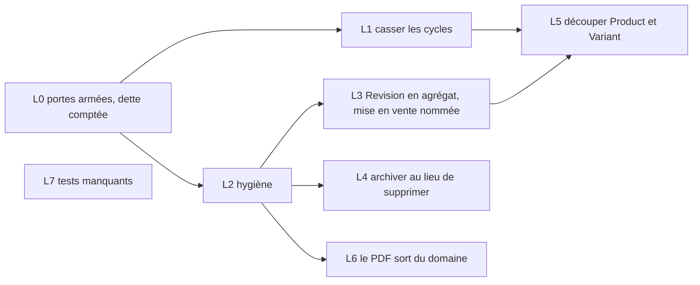

# Le référentiel à 9/10 — plan

> 📐 **Plan, doc-first (2026-11-18).** Demande de Hugo le 2026-11-18, après
> l'audit du même jour (6,5/10 : qualité 7, SOLID 6, isolation 6, DDD 6) :
> « fais-moi un plan pour 9/10 ». Contradiction de `vitruve` obligatoire : le
> lot L4 porte une migration de données et touche la TVA. Contredit le
> 2026-11-18 (§ 4 bis). Chemins relatifs à
> `apps/lfd-api/src/pim/` sauf mention ; affirmations ouvertes le 2026-11-18.
>
> ✅ **Bâtis le 2026-11-18** : L0 (portes armées), L1 bis (rangement par
> capacité) et L2 (hygiène — sauf le point « produit archivé », en attente de
> la décision de Hugo).
>
> ✅ **L1 bâti le 2026-11-18** : la dette de `lint:pim-subcontexts` est à zéro (48 imports au départ). Noyau `pim/shared/` (réémission, émetteur, `json-readers`, langues du catalogue) ; les ports de citation chez `ingredients` ; les trois routes de propagation dans un contrôleur du catalogue (mêmes URL) ; le catalogue et la limite de commande déclarent leurs ports et le fait des visuels, `channels/` les ré-exporte comme porte publiée aux autres blocs.
>
> ✅ **L3 bâti le 2026-11-18.** `CatalogRevision` est un agrégat (`name` refuse
> « déjà nommée », port `load`/`save`/`add`, plus de `rename` à primitives) ;
> `ProductReadiness` aussi (`declare(at, by, contentUpdatedAt)`, `withdraw()`),
> son port d'écriture `load`/`save` séparé de `ReadinessReader` (les lectures,
> dont `contentUpdatedAt` réutilisée comme fraîcheur). Un seul refus est neuf :
> une fiche plus récente que sa preuve (`ProductChangedAfterReadinessError`).
> Les porteurs d'images gardaient leur SQL ; L9.b les a rendus à leurs propriétaires.
>
> 🟨 **L4 bâti le 2026-11-18, non commité** — en attente de `vitruve` sur le lot
> bâti (§ L4, « Tel que bâti »).
>
> ✅ **L7 et L6 bâtis le 2026-11-18.** L7 : entité, handlers et `sale-terms` testés ;
> les gestes d'`allergens/application` l'étaient déjà. L6 : le PDF vit dans
> `allergen-matrix/infrastructure/` derrière `AllergenMatrixRenderer` ; octets inchangés.
>
> ✅ **L5 bâti le 2026-11-18** : `product.ts` (1057 → 291 lignes) et `variant.ts`
> (1037 → 297) sont découpés en objets que l'agrégat possède, chacun ≤300 et testé
> seul ; `snapshot()`, `persistenceSnapshot()` et `reconstitute()` gardent leur
> forme et leur ordre de clés, aucun handler ni test existant ne change. Écarts au
> tableau (§ L5, « Tel que bâti »).

## 1. En deux mots

Le référentiel est propre dans le détail (aucun `any`, aucun cast, des
contrôleurs qui n'injectent que les bus, un domaine sans framework) et faible
dans les grandes masses : deux classes de plus de mille lignes, des
sous-contextes qui se tiennent l'un l'autre, quelques objets métier qui
s'écrivent sans agrégat et se suppriment pour de bon.

Le plan ne réécrit rien de ce qui marche. Il fait trois choses, dans cet
ordre : **armer des portes** qui empêchent d'empirer (cycles et tailles, en
dette comptée), **corriger les écarts bon marché**, puis **casser les cycles
et découper les deux géants**.



| Axe             | Aujourd'hui | Visé | Ce qui le fait monter |
| --------------- | ----------- | ---- | --------------------- |
| Qualité de code | 7           | 9    | L0, L2, L5, L7        |
| SOLID           | 6           | 9    | L1, L2, L5, L6        |
| Isolation       | 6           | 9    | L0, L1, L6            |
| DDD             | 6           | 9    | L3, L4, L5            |

Pourquoi pas 10 : `pim-journal.ts` (551 lignes de vocabulaire) et
`product.controller.ts` (52 routes) restent gros par nature — un catalogue
d'événements et une surface HTTP —, et les découper ne lirait pas mieux.

## 2. Ce qui existe (ouvert le 2026-11-18)

- **Les cycles** (compte complet en § L1) : `vat-rates`, `sales-contexts` et
  `allergens` importent `catalogue/` surtout pour deux choses — le port
  `shared/catalog-reemission.ts` (11 imports, rangé dans le catalogue avant L1) et
  l'utilitaire `shared/json-readers.ts` (4, idem) —, et
  `catalogue/` les importe en retour. `order-time-limitation` ↔ `channels`
  par `channels/b2b-platform/catalog-facts.module.ts`. La porte
  `context-boundaries` ne raisonne qu'au premier niveau de `src/`
  (`dev-toolbox/gates/context-boundaries.mjs`, `topOf`).
- **Les tailles** : `catalogue/product/domain/entities/product.ts` 1058 lignes,
  `variant.ts` 1037 ; puis `journal/pim-journal.ts` 551,
  `catalogue/product/http/product.controller.ts` 518,
  `catalogue/product/infrastructure/prisma-product.repository.ts` 420,
  `catalogue/product/domain/errors/product-errors.ts` 331,
  `channels/b2b-platform/products/catalog-facts.ts` 306.
- **`Product`** porte à la fois : l'identité et le cycle de vie (`rename`,
  `changeKind`, `reclassify`, `activate`, `archive`, `restore`, `delete`), les
  options du commerce (`reserveForOperations`, `declareColdRequirement`,
  `showVariantsAsTiles`, `changeAudience`, `changeMinQuantities`), la TVA par
  contexte (`setVat`), la complétude (`activationGapsWith`, `complianceWith`,
  `isActivatableWith`), et la gestion des déclinaisons (`addVariant`,
  `detachVariant`, `restoreVariant`, `makeVariantDefault`, `alignVariant`,
  `priceVariant`, `declareAllergens`, `declareNutritionValues`,
  `declareVariantCustomRecipe`…).
- **`Variant`** porte : le cycle de vie (`discontinue`, `restore`, `demote`,
  `promoteToDefault`, `detachTo`), le réglementaire et ses alignements
  (`declareAllergens`, `declareNutritionValues`, `alignOnDefault`, `follows`),
  la vente (`price`, `changeSaleTerms`, `pricePerKg`, `hasOwnProPrice`,
  `changeMinQuantities`, `saleUnit`), les noms et le sur mesure.
- **Les écarts aux couches** : le jeton `SKU_AVAILABILITY` et l'adaptateur
  de séquence de publication, qui étaient hors de leur couche, ont été remis en
  place par L2 (2026-11-18) ; la mise en page du PDF de la matrice est sortie du
  domaine par L6 (2026-11-18).
- **Les écritures sans agrégat** : `Revision` est une interface
  (`catalogue/revision/domain/revision.ts:204`), la règle « déjà nommée » est
  dans le handler (`catalogue/revision/application/rename-catalog-revision.ts:66`)
  et l'écriture passe par `rename(id, label, note)`. La mise en vente aussi
  (`catalogue/product/domain/ports/readiness.repository.ts:44,52`, règles dans
  `declare-product-ready.ts` et `withdraw-product-readiness.ts`).
- **Les suppressions physiques** : `remove` dans `vat-rates`, `sales-contexts`,
  `ingredients` (ingrédient et appellation) et `order-time-limitation`
  (`*/application/remove-*.ts`), refusées en base par clé étrangère quand
  l'objet sert. Aucun de ces cinq modèles n'a de colonne d'archivage
  (`prisma/schema/pim/vat.prisma`, `sales-contexts.prisma`,
  `regulatory-sheet.prisma`).

## 3. Les lots

### L0 — Les portes d'abord, la dette comptée (isolation, qualité)

Armées **avant** tout déménagement (sinon elles ne voient rien), et sans rien
corriger : ce qui viole aujourd'hui entre dans une dette **comptée qui ne peut
que décroître**, comme `lint:production-subcontexts` et `lint:code-language`.

- `lint:pim-subcontexts` : la carte fichier → sous-contexte de `src/pim`, les
  **arêtes admises** (§ L1), aucun cycle ; chaque import qui viole est listé.
- `lint:pim-file-size` : aucun fichier au-delà de 300 lignes hors liste admise
  et datée (`journal/pim-journal.ts`, `catalogue/product/http/product.controller.ts`,
  avec leur raison) ; les sept qui dépassent sont la dette de départ. Ainsi
  rien ne grossit pendant que les autres lots avancent.
- La phrase du CLAUDE.md § 5 (« 15 fichiers e2e ») se corrige : il y en a 32.

### L1 — Casser les cycles (isolation)

Le sens admis est celui des **référentiels de base vers ce qui les cite** :
`catalogue` lit `vat-rates`, `sales-contexts`, `allergens` et `ingredients`
(29, 16, 20 imports — légitimes, ce sont ses fournisseurs), jamais l'inverse.
`channels` lit `catalogue` (il publie la fiche), jamais l'inverse. Pour y
arriver :

- **Noyau `pim/shared/`** : `CatalogReemission`, `CatalogEmitter` et
  `json-readers.ts` y déménagent. C'est ce que `vat-rates`, `sales-contexts`,
  `allergens` et `ingredients` importent du catalogue pour la plupart.
- **`ingredients` → `catalogue`** : les trois ports `ingredient-citations.reader`,
  `cited-allergens.reader`, `product-composition.copier` que `catalogue/product`
  déclare et qu'`ingredients` implémente changent de sens : `ingredients`
  les **déclare** (ce que la composition lui demande), `catalogue` les
  implémente, `appBootstrap`/le module les relie. Le contrôleur
  `ingredients/http/ingredient.controller.ts:23,24,29` cesse d'importer des
  handlers de `product/application` : les deux lectures concernées
  (`read-product-ingredient-allergens`, `preview-ingredient-allergen-propagation`)
  passent par le bus, par leur `Query`, déplacée dans `ingredients` si c'est
  sa question.
- **`catalogue` → `channels`** (vérifié le 2026-11-18 : `channels/media/image-catalogue.ts`
  ×5, `channels/b2b-platform/sale-reference-usage/sale-reference-usage.ts` ×4,
  `channels/b2b-platform/products/product-media-changed.fact.ts` ×2) : le
  catalogue déclare ce qu'il demande (`ImageCatalogue`, `SaleReferenceUsage`)
  dans ses propres ports, le canal les implémente ; le fait `product-media-changed`
  part par `CatalogEmitter`.
- **`order-time-limitation` ↔ `channels`** : `get-general-order-cutoff.ts:4`
  importe `channels/b2b-platform/general-order-cutoff/general-order-cutoff.reader.js`
  et le canal importe l'entité et deux ports d'`order-time-limitation`. Le
  lecteur devient un port d'`order-time-limitation`, le canal ne lit plus que
  ses ports.

Coût réel : **1 à 2 jours**, pas ½ ; la dette de `lint:pim-subcontexts` dit
où on en est à chaque pas.

### L1 bis — Ranger par capacité (clarté)

Décidé par Hugo le 2026-11-18. Du **déplacement pur** : aucune logique ne
change, aucune route, aucun contrat, aucune table. `catalogue/product/application/`
compte 48 fichiers à plat (2026-11-18) ; l'arborescence suit désormais les
capacités du métier :

```
pim/
├── shared/                  noyau : réémission, émetteur, json-readers, garde d'unicité
├── reference/               les référentiels de base, que le catalogue cite
│   ├── vat-rates/  sales-contexts/  allergens/  ingredients/
├── catalogue/
│   ├── product/
│   │   ├── lifecycle/       créer, activer, archiver, restaurer, supprimer, identité
│   │   ├── variants/        ajouter, détacher, défaut, aligner, noms, sur mesure
│   │   ├── sale/            prix, unité, minimums, TVA, audience, froid, opération, vignettes
│   │   ├── regulatory/      allergènes, nutrition, propagation des ingrédients, conformité
│   │   ├── media/           visuels, éditorial
│   │   ├── readiness/       mise en vente
│   │   └── domain/          Product, Variant (et les objets de L5)
│   ├── category/  revision/  history/  allergen-matrix/
├── order-time-limitation/
├── channels/
└── journal/  changes/  infra/
```

- La carte de `lint:pim-subcontexts` (L0) connaît la nouvelle arborescence
  **avant** le déménagement ; `reference/*` n'importe jamais `catalogue/`.
- Un sous-dossier par commit, `git mv`, la suite du dossier verte à chaque
  pas ; les docs qui citent un chemin déplacé suivent (`lint:doc-references`).
- Avant L5, et quand personne d'autre ne travaille dans le référentiel.
- Coût : ~1 jour.

### L2 — L'hygiène (qualité, SOLID)

- `SKU_AVAILABILITY` et son port dans `domain/ports/` ;
  `prisma-publication-sequence.ts` dans `channels/b2b-platform/infrastructure/`.
- `prisma-product.repository.ts:282` : `TechnicalError` au lieu de `Error`.
- `get-product-detail.ts:163` : plus de `new Date(0)` inventée — le champ
  devient nullable dans la vue.
- La garde d'unicité recopiée cinq fois (`vat-support.ts:11`,
  `sales-context-support.ts:25`, `category-support.ts`,
  `allergen-support.ts:65,75`) : un helper unique dans `pim/shared/`.
- `create-product.ts:116-207` (92 lignes) : découpé en étapes nommées.
- 🔴 **À trancher par Hugo** : `rename`, `changeKind`, `reclassify` acceptent
  un produit **archivé** (`product.ts:415-427`, `product-support.ts:45` ne
  refuse que `deleted`). Recommandation : les refuser — un archivé se
  restaure avant de se modifier. **Décidé par Hugo le 2026-11-18 : refusé**
  (`ArchivedProductNotEditableError`, bâti le même jour).

### L3 — `Revision` en agrégat, la mise en vente nommée (DDD)

- `CatalogRevision` : factory, `name(label, note)` qui refuse « déjà nommée »,
  port `load`/`save`. Le handler charge, appelle, sauve.
- **La mise en vente** vit dans sa table, `ProductReadiness`
  (`prisma/schema/pim/product.prisma:408-418`, clé `productId`, cascade), et
  sa péremption se lit en comparant les dates de modification de quatre
  tables (`:400-407`). La faire porter par `Product` chargerait l'agrégat
  entier pour écrire une ligne. Décision : un **agrégat `ProductReadiness`** (`declare(at, by)`,
  `withdraw()`), mêmes refus qu'avant ; la péremption se lit après coup, par
  un port de lecture à part (`ReadinessReader`). Plus d'écriture par
  primitives. Un refus « fiche plus récente que sa preuve » à la déclaration
  a été essayé puis retiré le 2026-11-18 : l'instant de la signature est
  toujours le plus récent, il ne pouvait se déclencher que sur un décalage
  d'horloges.
- `catalogue/shared/infrastructure/prisma-media-carriers.ts:139-157` : passer
  par le port éditorial, ou écrire la raison au-dessus.

### L4 — Archiver au lieu de supprimer (DDD, migration, argent)

Une colonne `archived_at timestamptz NULL` (additive) sur les cinq tables.
La règle n'est **pas** la même pour les cinq, parce qu'ils ne servent pas de
la même façon :

| Objet                   | Archiver…                                                                                                                                                                                                                                 | Effet de l'archive                                                       | Lecteur qui filtre                                                          |
| ----------------------- | ----------------------------------------------------------------------------------------------------------------------------------------------------------------------------------------------------------------------------------------- | ------------------------------------------------------------------------ | --------------------------------------------------------------------------- |
| Taux de TVA             | **refusé tant qu'une fiche ou une famille le porte** (`product_vat`, `category_vat`, `product.prisma:160-162`, `categories.prisma:92-94`) — même règle qu'aujourd'hui, dite par le domaine via un port d'usage, plus par la clé étrangère | ne se propose plus                                                       | le choix de taux à l'écran                                                  |
| Contexte de vente       | refusé tant qu'une fiche y est vendue (règle actuelle, à confirmer au bâti)                                                                                                                                                               | ne se propose plus                                                       | les listes de choix                                                         |
| Ingrédient, appellation | permis ; la composition qui le cite le **garde** (plus de `onDelete: Cascade` atteint, `regulatory-sheet.prisma:274`, puisqu'on ne supprime plus)                                                                                         | ne se propose plus à la saisie                                           | la recherche d'ingrédients                                                  |
| Limite horaire          | permis                                                                                                                                                                                                                                    | **cesse de s'appliquer** : une limite est une règle, pas une proposition | le lecteur des limites et le fil vers le commerce (`catalog-rules.emitter`) |

Ainsi **aucune fiche n'est jamais facturée à un taux archivé** : la TVA reste
l'objet le plus strict, et rien ne change pour l'argent.

À faire dans le lot : les faits de journal `*.archived` / `*.restored` dans
`pim-journal.ts` ; les routes `DELETE` gardées et qui archivent ; les écrans
qui disent « Archiver » ; `lint:context-version-columns` si une de ces tables
est lue par l'instantané du catalogue (à vérifier au premier pas du lot) ;
`vitruve` sur le lot bâti avant le commit.

- 🔴 **À trancher par Hugo** : un taux ou un contexte **jamais utilisé** se
  supprime-t-il encore pour de bon ? Recommandation : non, l'archive suffit.
  **Décidé par Hugo le 2026-11-18 : non, l'archive seulement.**

#### Tel que bâti (2026-11-18, non commité)

- **Migration** `20261118170000_l_archive_des_referentiels` : `archived_at
TIMESTAMPTZ NULL` sur `tva_rate`, `sales_context`, `ingredient`,
  `appellation`, `order_time_limit` ; retour arrière dans
  `prisma/rollback/` (le code seul, et la liste des lignes archivées à relever
  d'abord). Les clés étrangères `RESTRICT` restent, en filet.
- **Domaine** : `archive(at…)` / `restore()` sur `VatRate`,
  `SalesContextAggregate`, `IngredientAggregate`, `AppellationAggregate`,
  `OrderTimeLimit` — rejoués, ils rendent `false` et le handler n'écrit, ne
  trace ni n'émet rien.
  - **TVA** : `VatRate.archive(at, holders)` refuse (`commerce.tva_rate_in_use`,
    même code qu'avant) tant qu'une famille ou une fiche le porte ; le compte
    vient d'un port d'usage, `VatRateUsageReader` (deux `count`), lu dans la
    transaction. Un taux archivé ne se pose plus (`requireRateInService` dans
    `set-category-vat` et `set-product-vat`, `commerce.tva_rate_archived`) ;
    recréer son pourcentage est refusé en disant de le restaurer.
  - **Contexte de vente** : refusé pour la racine et tant qu'un taux y est
    réglé (`catalogue.sales_context.in_use`, port `SalesContextUsageReader`) ;
    archivé, il sort de `SalesContextRegistry.active()` (requête `archived_at
IS NULL`), donc ni réglage de taux ni facturation ; `all()` le garde pour
    nommer les faits passés.
  - **Ingrédient, appellation** : toujours permis ; ce qui le cite le garde.
    Une NOUVELLE citation est refusée (`catalogue.ingredient.archived` dans
    `set-product-ingredients`, `catalogue.appellation.archived` dans
    `resolveAppellation`), une citation déjà portée passe.
  - **Limite horaire** : toujours permise ; archivée, elle cesse de
    s'appliquer — `OrderTimeLimitRepository.inForce()` filtre dans la requête,
    et `B2bCatalogRulesEmitter` ne lit plus que lui. Reposer la portée d'une
    limite archivée la remet en vigueur (une ligne par portée). Le commerce ne
    relit pas la table du référentiel : il ne connaît que l'échelle émise.
- **Routes** : les `DELETE` gardent leur URL et leur réponse et archivent ;
  `POST …/:id/restore` (`:key`, `:code`) restaure. `@Idempotent` sur toutes.
  Les handlers `remove-*` sont devenus `archive-*`, plus `restore-*`.
- **Journal** : `*.archived` / `*.restored` pour les cinq (`pim-journal.ts`,
  `@lfd/contracts` `referential-settings.ts`, phrases du back-office) ; les
  `*.deleted` / `order_time_limit.removed` restent pour les faits passés.
- **Écrans** : « Supprimer » devient « Archiver » dans les cinq panneaux (plus
  de nom retapé : le geste se défait) ; chaque liste replie ses archivés sous
  le tableau avec « Restaurer » (`pim/shared/archived-list/`, sur le modèle des
  déclinaisons archivées). Les listes de choix écartent les archivés
  (`VatRateStore.items`, `offeredIngredients`, `offeredAppellations`, la
  surtaxe tardive, l'outil d'agent des taux) ; la fiche relit ce qu'elle cite.
- **Instantané du catalogue** : aucune des cinq tables n'est lue par
  `CATALOGUE_SNAPSHOT_COLUMNS` ; `lint:context-version-columns` passe sans
  classement.
- **La course archive ↔ pose est fermée par un verrou de ligne**, des deux
  côtés, dans la transaction du geste. La clé étrangère ne la fermait pas :
  l'insertion qui vise un taux prend `FOR KEY SHARE`, compatible avec le
  `FOR NO KEY UPDATE` de la mise à jour de `archived_at`. Deux ports,
  `VatRateLock` et `SalesContextLock` (`forArchival` / `forUse`), en SQL dans
  l'adaptateur, qui refusent d'être pris hors d'une unité de travail :
  - l'archive et la restauration prennent `SELECT … FOR UPDATE` sur la ligne,
    PUIS chargent l'agrégat et comptent ses usages ;
  - `set-category-vat` et `set-product-vat` prennent `SELECT … FOR SHARE` sur
    les taux et les contextes visés (triés), PUIS relisent le taux
    (`requireRateInService`) et les contextes proposés (`active()`) — tout
    dans la même transaction que l'écriture.
    Deux e2e le prouvent (`pim-vat-rates`, `pim-sales-contexts`) : une
    transaction tient la ligne et pose `archived_at`, la pose se met en file,
    puis refuse (409) ; sans le verrou, elle répondait 200.
- **Mise à jour perdue fermée** : les cinq archives et restaurations chargent
  l'agrégat dans la transaction et écrivent par `saveArchival`, qui n'écrit
  QUE `archived_at` — un renommage concurrent n'est plus effacé. Le `save`
  ordinaire réécrit toujours la ligne entière, `archived_at` compris : un
  renommage chargé AVANT une archive et écrit APRÈS la défait (voir « Reste »).
- **Fiche produit** : le panneau de dérogation de TVA ne propose plus un taux
  archivé ; celui que la fiche porte déjà reste affiché.
- **Contexte archivé, complétude et canaux** : l'archive d'un contexte réémet
  tout le catalogue après validation (`CatalogReemission.everything`, comme
  les autres gestes du référentiel — ce port s'appelle HORS de la
  transaction, par construction). Le canal `b2b-platform` ne lit pas le
  registre : il sert les pourcentages par clé de contexte tirés des taux
  réglés, et un contexte archivé n'en porte aucun. Le commerce ne lit pas le
  registre du référentiel.
- **Reste** : le `save` des mises à jour (taux, contexte, ingrédient,
  appellation, limite) charge hors transaction et réécrit `archived_at` ;
  le retour arrière (`prisma/rollback/`) attend une décision de Hugo.

**Décisions et suites du 2026-11-18, après vitruve :**

- **Pas de retour arrière après L4** (Hugo) : on corrige en avant. Le code
  d'avant ignore `archived_at` et remettrait en service tout ce qui est
  archivé ; `prisma/rollback/20261118170000_l_archive_des_referentiels.sql`
  le dit et liste ce qu'il faudrait relever.
- **Course archive ↔ pose fermée** (TVA, contexte) : `VatRateLock` /
  `SalesContextLock`, `FOR UPDATE` à l'archive, `FOR SHARE` à la pose, lecture
  et écriture dans la même transaction ; deux e2e de concurrence.
- **Une édition ne défait plus une archive** : `save` n'écrit plus
  `archived_at`, seul `saveArchival` l'écrit ; e2e de régression du renommage
  concurrent.
- **La réémission** qui suit l'archive d'un contexte part après validation,
  comme pour tous les gestes du référentiel (`CatalogReemission` : appelée
  dans le geste, elle verrouillerait toutes les fiches).

### L5 — Découper `Product` et `Variant` (qualité, SOLID, DDD)

L'agrégat reste un : `Product` est la racine et garde ses invariants. Ce qui
sort, ce sont des **objets du domaine qu'il possède**, chacun ≲300 lignes et
testé seul :

| Sort de   | Vers                                                  | Ce qu'il porte                                                                      |
| --------- | ----------------------------------------------------- | ----------------------------------------------------------------------------------- |
| `Product` | `ProductCommerceOptions` (value object)               | opération, froid, vignettes, audience, minimums                                     |
| `Product` | `VatByContext` (value object)                         | la TVA par contexte et sa règle                                                     |
| `Product` | `ProductCompleteness` (service de domaine)            | `activationGapsWith`, `complianceWith`, `isActivatableWith`                         |
| `Product` | `VariantLineup` (collection interne)                  | ajout, détachement, défaut, alignement, restauration, garde du sur mesure du défaut |
| `Product` | `ProductSnapshotMapper` (pur)                         | `snapshot`, `persistenceSnapshot`, `resolvedSnapshot`                               |
| `Variant` | `VariantRegulatory` (value object)                    | allergènes, nutrition, « suit le défaut »                                           |
| `Variant` | `VariantSale` (value object, absorbe `sale-terms.ts`) | prix, unité, prix au kilo, prix pro, minimums, `ensureUnused`, `refuseOnWeight`     |
| `Variant` | `VariantLifecycle` (value object)                     | arrêt, restauration, défaut, détachement, réveil                                    |
| `Variant` | `VariantSnapshotMapper` (pur)                         | `snapshot`, `reconstitute`, `openDefaultFrom`                                       |

Ce qui tient la promesse « aucun handler ne change » :

- **La persistance ne bouge pas** : `snapshot()` / `persistenceSnapshot()` /
  `reconstitute()` gardent leur forme ; seuls leurs corps passent dans les
  mappers. `prisma-product.repository.ts` ne voit pas la différence.
- **Les deux imports de `channels` vers `entities/product.js`** passent,
  dans L1, par le type `ProductSnapshot` publié, pas par la classe.
- **Un pas = un objet extrait, la suite de `catalogue/product` verte** (577
  tests au 2026-11-18) et `lint:pim-file-size` qui raye une ligne.

Coût : **3 à 4 jours**, une dizaine de fichiers neufs, `product.ts` et
`variant.ts` réécrits en délégation.

**Tel que bâti (2026-11-18)** — tout est dans `catalogue/product/domain/` :

| Objet                                                  | Fichier                                           |
| ------------------------------------------------------ | ------------------------------------------------- |
| `ProductCommerceOptions`                               | `value-objects/product-commerce-options.ts`       |
| `VatByContext`                                         | `value-objects/vat-by-context.ts`                 |
| `ProductCompleteness`                                  | `services/product-completeness.ts`                |
| `VariantLineup`                                        | `entities/variant-lineup.ts`                      |
| `ProductSnapshotMapper` (champs, fabriques)            | `entities/product-snapshot-mapper.ts`             |
| `VariantRegulatory`, `VariantSale`, `VariantLifecycle` | `entities/variant-{regulatory,sale,lifecycle}.ts` |
| `VariantSnapshotMapper`                                | `entities/variant-snapshot-mapper.ts`             |

Ce que le tableau ne disait pas, et que le code a demandé :

- **`product-lifecycle.ts`** : les cinq transitions de statut, en fonctions
  pures qui rendent le statut d'après ou refusent. Sans elles `Product` restait
  à 560 lignes.
- **`product-variant-gestures.ts`** : une classe de base abstraite qui porte les
  dix-sept gestes de `Product` adressés à une déclinaison (« trouver dans la
  collection, puis lui parler »). C'est l'API publique de `Product`, donc elle ne
  pouvait pas disparaître ; la base ne reçoit de lui que `status` et
  `variantsAsTiles`.
- **`product-state.ts`**, **`variant-snapshot.ts`**, **`variant-aspect.ts`**,
  **`variant-resolution.ts`** : les types d'instantané, la table
  `regulatory ↔ allergens` et la résolution de l'héritage (`resolveVariant`),
  que la collection et le mapper lisent tous deux. `product.ts` et `variant.ts`
  les ré-exportent : aucun import ailleurs ne bouge.
- **`sale-terms.ts` n'est pas absorbé** par `VariantSale` : cinq autres
  fichiers l'importent et c'est déjà un objet net.
- **« Réveil »** (refus de réveiller une saisie dormante à la bascule en défaut)
  vit dans `VariantRegulatory.promote`, pas dans `VariantLifecycle` : il ne
  juge que la fiche réglementaire.
- **Un refus ne laisse plus rien à moitié posé** : `VariantSale.price` est
  immuable, donc un refus au milieu d'un tarif ne mute plus rien. L'agrégat
  n'était jamais sauvé après un refus : rien ne change en base.

### L6 — Le PDF sort du domaine (isolation)

Le domaine garde le modèle de la matrice des allergènes (lignes, colonnes,
mentions) ; la mise en page part dans `allergen-matrix/infrastructure/`
derrière un port `AllergenMatrixRenderer`. Le domaine n'importe plus
`platform/pdf`.

### L7 — Les tests qui manquent (qualité)

Unitaires de domaine et d'application pour `sales-contexts` (entité,
création, mise à jour, archivage), `sale-terms` (ou `VariantSale`), et les
gestes d'`allergens/application` (archiver, restaurer, déplacer, renommer).

### L9 — L'intérieur du catalogue (isolation, DDD, qualité)

Ajouté le 2026-11-19 après le second audit (≈ 7/10). La porte
`lint:pim-subcontexts` traite `catalogue/` comme un seul bloc : ce qui s'y
tient à contresens ne se voyait pas. Constats ouverts le 2026-11-19.

**L9.a — La porte descend dans `catalogue/`, dette comptée d'abord.**
`pim-subcontexts.mjs` apprend les sous-blocs `catalogue/{shared,category,
product,revision,history,allergen-matrix}` et le sens admis : `shared` ne lit
personne du catalogue ; `product` lit `category` par son `index.ts` (ou un
port), jamais son `application/` ; `revision`, `history` et
`allergen-matrix` lisent `product` par sa porte ; `channels` lit le catalogue
par des ports ou des `index.ts`, jamais un fichier d'application. Ce qui
viole est compté en dette décroissante, comme L0.

**L9.b et L9.c — Bâtis le 2026-11-19.** Décidé par Hugo ce jour-là : pas de
module de lecture partagé. Chaque consommateur déclare son port étroit et
l'implémente en composant les lectures que les propriétaires publient.

- **Ce que les propriétaires publient** (ports de lecture dans leur
  `domain/ports/`, adaptateurs dans leur `infrastructure/`) : `category` —
  `AllCategoriesReader`, `FamilyVatReader`, `CategorySnapshotsReader`,
  `CategoryImageHolders` ; `product` — `AllProductsReader`,
  `EffectiveVatReader`, `ProductRecordsReader`, `ProductImageHolders`. Le
  repointage des images est une écriture étroite par propriétaire
  (`*ImageRepointing`).
- **`listAll` a quitté** `ProductRepository` et `CategoryRepository`.
- **Les consommateurs** : la révision et la matrice des allergènes
  composent ces lectures ; le canal B2B déclare `CatalogFactsReader` chez lui
  (`channels/b2b-platform/domain/ports/`) ; le port des porteurs d'images de
  la médiathèque est implémenté à la racine
  (`appBootstrap/pim-catalogue-media-carriers.ts`), qui compose les deux
  propriétaires.
- **Supprimés** : `CatalogueReader` et son adaptateur, le lecteur des faits
  partagé, `shared/application/`. `requireCategory` vit dans
  `category/domain/services/`, les règles de complétude dans
  `product/domain/services/`, `vatChangePayload` dans `shared/domain/`.
- **Porte** : `pim-subcontexts` à dette nulle, sous-contextes du catalogue
  compris.

**Reste pour la suite de L9** (constaté au bâti) : trois adaptateurs lisent
encore des tables d'un voisin — `revision/infrastructure/prisma-catalog-revision.source.ts`
(médias), `revision/infrastructure/prisma-catalog-overview.reader.ts`
(fiches et familles), `history/infrastructure/prisma-product-lineage.reader.ts`
(fiche, TVA de famille, taux) ; la porte d'appartenance des modèles ne les
voit pas, elle raisonne au niveau du bloc. Et `vatChangePayload` lit
`contextLabelsOf` dans l'application des contextes de vente.

**L9.d — Les satellites portés par leur agrégat.** Médias
(`EditorialRepository.replaceMedia`), textes éditoriaux, composition et
allergènes d'une déclinaison s'écrivent aujourd'hui par primitives depuis le
handler. Chacun passe en `load` → méthode métier → `save` : sur `Product`
quand l'invariant est celui de la fiche (archivée refusée, déclinaison
connue), sur un petit agrégat propre sinon. Question de tri inchangée
(§ 3.1 du CLAUDE.md) : s'il n'existe aucune règle qui refuse l'écriture, le
satellite reste un CRUD, et sa justification s'écrit au-dessus.

**L9.e — Composition au lieu d'héritage.** `ProductVariantGestures` est une
base abstraite à une seule sous-classe, créée pour passer `product.ts` sous
300 lignes. Les gestes de déclinaison deviennent un objet possédé
(`ProductLineup`, nom à trancher au bâti) que `Product` délègue ; l'API
publique de `Product` ne change pas. De même, `pricingOf`
(`sale/update-variant-pricing.ts`), qui énumère les onze champs tracés de la
section « Tarif & logistique », devient une méthode de `VariantSale`.

**L9.f — Petites dettes.**

- Les trois fichiers de plus de 300 lignes (`prisma-product.repository.ts`
  420, `product-errors.ts` 331, `catalog-facts.ts` 306) passent sous la borne
  — erreurs rangées par capacité, `save` du dépôt découpé.
- Les fonctions de plus de 40 lignes du catalogue : `save` du dépôt des
  fiches (~89), `execute` de la prise de révision (~85), `create` (~57),
  `projectVariant` (~49). L9 les compte d'abord (la mesure manque, § 5).
- `isUniqueViolation` est défini quatre fois (révision, TVA, contextes de
  vente, ingrédients) et `traced` quatre fois : un seul exemplaire dans
  `pim/shared/`. `isRecord` trois fois dans `revision/` : un seul.
- `revision/domain/fingerprint.ts` lève trois `TypeError` bruts : ils
  deviennent une `TechnicalError` nommée (un payload non sérialisable est un
  bug, pas un refus métier).
- Deux ports d'identifiant (`IdGenerator`, 3 fichiers ; `UuidGenerator`, 12) : un seul, celui que le reste de l'API utilise — à vérifier au bâti.
- Les commentaires historiques croisés en route se réécrivent au présent
  (CLAUDE.md § 8) ; pas de grand ménage à part.

**Critère de fin** : `lint:pim-subcontexts` à dette nulle sur les sous-blocs
du catalogue, `lint:pim-file-size` à dette nulle, aucun `listAll` dans un
port d'écriture lu par un lecteur, aucune classe abstraite à sous-classe
unique dans `domain/`. Puis un audit à l'aveugle, sans lui donner les notes
précédentes.

**Ce que L9 ne fait pas** : aucune migration, aucun contrat servi changé,
aucune route renommée. D'où pas de `vitruve` d'office (ni argent, ni
migration, ni sécurité, ni runbook) : chaque affirmation ci-dessus a été
ouverte le 2026-11-19.

## 4. Ordre et coût

| Lot    | Coût      | Risque                         | Pré-requis                  |
| ------ | --------- | ------------------------------ | --------------------------- |
| L0     | ½ jour    | nul (portes, dette comptée)    | —                           |
| L2     | ½ jour    | faible                         | L0                          |
| L7     | ½ jour    | nul                            | —                           |
| L6     | ½ jour    | faible                         | L2                          |
| L1 bis | 1 jour    | nul (déplacement pur)          | L0                          |
| L1     | 1–2 jours | moyen (modules, liaisons)      | L0                          |
| L3     | 1 jour    | moyen                          | L2                          |
| L4     | 1–1½ jour | moyen (migration, écrans, TVA) | L2, vitruve sur le lot bâti |
| L5     | 3–4 jours | moyen (le cœur, API inchangée) | L1, L3                      |
| L9     | 3–4 jours | moyen (modules, agrégats)      | L5                          |

Total : **9 à 11 jours** pour L0–L7 (bâtis), puis **3 à 4 jours** pour L9.

## 4 bis. Contradiction de vitruve (2026-11-18), et ce qu'elle change

- **Bloquant — L1 ne cassait pas les cycles** : il oubliait `ingredients` →
  `catalogue/product` (contrôleur et trois ports) et le cycle complet
  `catalogue` ↔ `channels`. L1 est réécrit, nomme le sens admis et coûte
  1 à 2 jours.
- **Bloquant — la limite horaire** n'est pas « proposée », elle s'applique :
  archivée, elle cesse de s'appliquer, et son lecteur filtre.
- **Bloquant — la TVA** : archiver un taux qui sert aurait laissé des fiches
  à un taux archivé. L'archive d'un taux est refusée tant qu'il sert.
- **Sérieux** : la mise en vente est une table à part — décidé : agrégat
  propre, fraîcheur passée en argument. L5 dit comment la persistance reste
  intacte et chiffre les fichiers. Les compositions gardent un ingrédient
  archivé. Les portes passent en tête (L0), en dette comptée, pour que rien
  ne grossisse pendant le chantier.

## 5. Ce qui n'est pas vérifié

- La longueur des fonctions (≲40 lignes) n'a été mesurée que sur
  `create-product.ts` : L8 pourrait aussi compter les fonctions.
- Les écrans qui suppriment les cinq objets de L4 : inventoriés au bâti (cinq panneaux, quatre listes, la fiche produit pour la limite).
