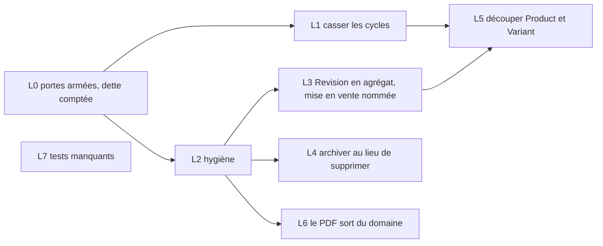

# Le référentiel à 9/10 — plan

> 📐 **Plan, doc-first (2026-11-18).** Demande de Hugo le 2026-11-18, après
> l'audit du même jour (6,5/10 : qualité 7, SOLID 6, isolation 6, DDD 6) :
> « fais-moi un plan pour 9/10 ». Contradiction de `vitruve` obligatoire : le
> lot L4 porte une migration de données et touche la TVA. Contredit le
> 2026-11-18 (§ 4 bis). Chemins relatifs à
> `apps/lfd-api/src/pim/` sauf mention ; affirmations ouvertes le 2026-11-18.
>
> ✅ **Bâtis le 2026-11-18** : L0 (portes armées), L1 bis (rangement par
> capacité) et L2 (hygiène — sauf le point « produit archivé », en attente de
> la décision de Hugo).
>
> ✅ **L1 bâti le 2026-11-18** : la dette de `lint:pim-subcontexts` est à zéro (48 imports au départ). Noyau `pim/shared/` (réémission, émetteur, `json-readers`, langues du catalogue) ; les ports de citation chez `ingredients` ; les trois routes de propagation dans un contrôleur du catalogue (mêmes URL) ; le catalogue et la limite de commande déclarent leurs ports et le fait des visuels, `channels/` les ré-exporte comme porte publiée aux autres blocs.
>
> ✅ **L3 bâti le 2026-11-18.** `CatalogRevision` est un agrégat (`name` refuse
> « déjà nommée », port `load`/`save`/`add`, plus de `rename` à primitives) ;
> `ProductReadiness` aussi (`declare(at, by, contentUpdatedAt)`, `withdraw()`),
> son port d'écriture `load`/`save` séparé de `ReadinessReader` (les lectures,
> dont `contentUpdatedAt` réutilisée comme fraîcheur). Un seul refus est neuf :
> une fiche plus récente que sa preuve (`ProductChangedAfterReadinessError`).
> `prisma-media-carriers.ts` garde son SQL, la raison est écrite au-dessus.
>
> ✅ **L7 et L6 bâtis le 2026-11-18.** L7 : entité, handlers et `sale-terms` testés ;
> les gestes d'`allergens/application` l'étaient déjà. L6 : le PDF vit dans
> `allergen-matrix/infrastructure/` derrière `AllergenMatrixRenderer` ; octets inchangés.

## 1. En deux mots

Le référentiel est propre dans le détail (aucun `any`, aucun cast, des
contrôleurs qui n'injectent que les bus, un domaine sans framework) et faible
dans les grandes masses : deux classes de plus de mille lignes, des
sous-contextes qui se tiennent l'un l'autre, quelques objets métier qui
s'écrivent sans agrégat et se suppriment pour de bon.

Le plan ne réécrit rien de ce qui marche. Il fait trois choses, dans cet
ordre : **armer des portes** qui empêchent d'empirer (cycles et tailles, en
dette comptée), **corriger les écarts bon marché**, puis **casser les cycles
et découper les deux géants**.



| Axe             | Aujourd'hui | Visé | Ce qui le fait monter |
| --------------- | ----------- | ---- | --------------------- |
| Qualité de code | 7           | 9    | L0, L2, L5, L7        |
| SOLID           | 6           | 9    | L1, L2, L5, L6        |
| Isolation       | 6           | 9    | L0, L1, L6            |
| DDD             | 6           | 9    | L3, L4, L5            |

Pourquoi pas 10 : `pim-journal.ts` (551 lignes de vocabulaire) et
`product.controller.ts` (52 routes) restent gros par nature — un catalogue
d'événements et une surface HTTP —, et les découper ne lirait pas mieux.

## 2. Ce qui existe (ouvert le 2026-11-18)

- **Les cycles** (compte complet en § L1) : `vat-rates`, `sales-contexts` et
  `allergens` importent `catalogue/` surtout pour deux choses — le port
  `shared/catalog-reemission.ts` (11 imports, rangé dans le catalogue avant L1) et
  l'utilitaire `shared/json-readers.ts` (4, idem) —, et
  `catalogue/` les importe en retour. `order-time-limitation` ↔ `channels`
  par `channels/b2b-platform/catalog-facts.module.ts`. La porte
  `context-boundaries` ne raisonne qu'au premier niveau de `src/`
  (`dev-toolbox/gates/context-boundaries.mjs`, `topOf`).
- **Les tailles** : `catalogue/product/domain/entities/product.ts` 1058 lignes,
  `variant.ts` 1037 ; puis `journal/pim-journal.ts` 551,
  `catalogue/product/http/product.controller.ts` 518,
  `catalogue/product/infrastructure/prisma-product.repository.ts` 420,
  `catalogue/product/domain/errors/product-errors.ts` 331,
  `channels/b2b-platform/products/catalog-facts.ts` 306.
- **`Product`** porte à la fois : l'identité et le cycle de vie (`rename`,
  `changeKind`, `reclassify`, `activate`, `archive`, `restore`, `delete`), les
  options du commerce (`reserveForOperations`, `declareColdRequirement`,
  `showVariantsAsTiles`, `changeAudience`, `changeMinQuantities`), la TVA par
  contexte (`setVat`), la complétude (`activationGapsWith`, `complianceWith`,
  `isActivatableWith`), et la gestion des déclinaisons (`addVariant`,
  `detachVariant`, `restoreVariant`, `makeVariantDefault`, `alignVariant`,
  `priceVariant`, `declareAllergens`, `declareNutritionValues`,
  `declareVariantCustomRecipe`…).
- **`Variant`** porte : le cycle de vie (`discontinue`, `restore`, `demote`,
  `promoteToDefault`, `detachTo`), le réglementaire et ses alignements
  (`declareAllergens`, `declareNutritionValues`, `alignOnDefault`, `follows`),
  la vente (`price`, `changeSaleTerms`, `pricePerKg`, `hasOwnProPrice`,
  `changeMinQuantities`, `saleUnit`), les noms et le sur mesure.
- **Les écarts aux couches** : le jeton `SKU_AVAILABILITY` et l'adaptateur
  de séquence de publication, qui étaient hors de leur couche, ont été remis en
  place par L2 (2026-11-18) ; la mise en page du PDF de la matrice est sortie du
  domaine par L6 (2026-11-18).
- **Les écritures sans agrégat** : `Revision` est une interface
  (`catalogue/revision/domain/revision.ts:204`), la règle « déjà nommée » est
  dans le handler (`catalogue/revision/application/rename-catalog-revision.ts:66`)
  et l'écriture passe par `rename(id, label, note)`. La mise en vente aussi
  (`catalogue/product/domain/ports/readiness.repository.ts:44,52`, règles dans
  `declare-product-ready.ts` et `withdraw-product-readiness.ts`).
- **Les suppressions physiques** : `remove` dans `vat-rates`, `sales-contexts`,
  `ingredients` (ingrédient et appellation) et `order-time-limitation`
  (`*/application/remove-*.ts`), refusées en base par clé étrangère quand
  l'objet sert. Aucun de ces cinq modèles n'a de colonne d'archivage
  (`prisma/schema/pim/vat.prisma`, `sales-contexts.prisma`,
  `regulatory-sheet.prisma`).

## 3. Les lots

### L0 — Les portes d'abord, la dette comptée (isolation, qualité)

Armées **avant** tout déménagement (sinon elles ne voient rien), et sans rien
corriger : ce qui viole aujourd'hui entre dans une dette **comptée qui ne peut
que décroître**, comme `lint:production-subcontexts` et `lint:code-language`.

- `lint:pim-subcontexts` : la carte fichier → sous-contexte de `src/pim`, les
  **arêtes admises** (§ L1), aucun cycle ; chaque import qui viole est listé.
- `lint:pim-file-size` : aucun fichier au-delà de 300 lignes hors liste admise
  et datée (`journal/pim-journal.ts`, `catalogue/product/http/product.controller.ts`,
  avec leur raison) ; les sept qui dépassent sont la dette de départ. Ainsi
  rien ne grossit pendant que les autres lots avancent.
- La phrase du CLAUDE.md § 5 (« 15 fichiers e2e ») se corrige : il y en a 32.

### L1 — Casser les cycles (isolation)

Le sens admis est celui des **référentiels de base vers ce qui les cite** :
`catalogue` lit `vat-rates`, `sales-contexts`, `allergens` et `ingredients`
(29, 16, 20 imports — légitimes, ce sont ses fournisseurs), jamais l'inverse.
`channels` lit `catalogue` (il publie la fiche), jamais l'inverse. Pour y
arriver :

- **Noyau `pim/shared/`** : `CatalogReemission`, `CatalogEmitter` et
  `json-readers.ts` y déménagent. C'est ce que `vat-rates`, `sales-contexts`,
  `allergens` et `ingredients` importent du catalogue pour la plupart.
- **`ingredients` → `catalogue`** : les trois ports `ingredient-citations.reader`,
  `cited-allergens.reader`, `product-composition.copier` que `catalogue/product`
  déclare et qu'`ingredients` implémente changent de sens : `ingredients`
  les **déclare** (ce que la composition lui demande), `catalogue` les
  implémente, `appBootstrap`/le module les relie. Le contrôleur
  `ingredients/http/ingredient.controller.ts:23,24,29` cesse d'importer des
  handlers de `product/application` : les deux lectures concernées
  (`read-product-ingredient-allergens`, `preview-ingredient-allergen-propagation`)
  passent par le bus, par leur `Query`, déplacée dans `ingredients` si c'est
  sa question.
- **`catalogue` → `channels`** (vérifié le 2026-11-18 : `channels/media/image-catalogue.ts`
  ×5, `channels/b2b-platform/sale-reference-usage/sale-reference-usage.ts` ×4,
  `channels/b2b-platform/products/product-media-changed.fact.ts` ×2) : le
  catalogue déclare ce qu'il demande (`ImageCatalogue`, `SaleReferenceUsage`)
  dans ses propres ports, le canal les implémente ; le fait `product-media-changed`
  part par `CatalogEmitter`.
- **`order-time-limitation` ↔ `channels`** : `get-general-order-cutoff.ts:4`
  importe `channels/b2b-platform/general-order-cutoff/general-order-cutoff.reader.js`
  et le canal importe l'entité et deux ports d'`order-time-limitation`. Le
  lecteur devient un port d'`order-time-limitation`, le canal ne lit plus que
  ses ports.

Coût réel : **1 à 2 jours**, pas ½ ; la dette de `lint:pim-subcontexts` dit
où on en est à chaque pas.

### L1 bis — Ranger par capacité (clarté)

Décidé par Hugo le 2026-11-18. Du **déplacement pur** : aucune logique ne
change, aucune route, aucun contrat, aucune table. `catalogue/product/application/`
compte 48 fichiers à plat (2026-11-18) ; l'arborescence suit désormais les
capacités du métier :

```
pim/
├── shared/                  noyau : réémission, émetteur, json-readers, garde d'unicité
├── reference/               les référentiels de base, que le catalogue cite
│   ├── vat-rates/  sales-contexts/  allergens/  ingredients/
├── catalogue/
│   ├── product/
│   │   ├── lifecycle/       créer, activer, archiver, restaurer, supprimer, identité
│   │   ├── variants/        ajouter, détacher, défaut, aligner, noms, sur mesure
│   │   ├── sale/            prix, unité, minimums, TVA, audience, froid, opération, vignettes
│   │   ├── regulatory/      allergènes, nutrition, propagation des ingrédients, conformité
│   │   ├── media/           visuels, éditorial
│   │   ├── readiness/       mise en vente
│   │   └── domain/          Product, Variant (et les objets de L5)
│   ├── category/  revision/  history/  allergen-matrix/
├── order-time-limitation/
├── channels/
└── journal/  changes/  infra/
```

- La carte de `lint:pim-subcontexts` (L0) connaît la nouvelle arborescence
  **avant** le déménagement ; `reference/*` n'importe jamais `catalogue/`.
- Un sous-dossier par commit, `git mv`, la suite du dossier verte à chaque
  pas ; les docs qui citent un chemin déplacé suivent (`lint:doc-references`).
- Avant L5, et quand personne d'autre ne travaille dans le référentiel.
- Coût : ~1 jour.

### L2 — L'hygiène (qualité, SOLID)

- `SKU_AVAILABILITY` et son port dans `domain/ports/` ;
  `prisma-publication-sequence.ts` dans `channels/b2b-platform/infrastructure/`.
- `prisma-product.repository.ts:282` : `TechnicalError` au lieu de `Error`.
- `get-product-detail.ts:163` : plus de `new Date(0)` inventée — le champ
  devient nullable dans la vue.
- La garde d'unicité recopiée cinq fois (`vat-support.ts:11`,
  `sales-context-support.ts:25`, `category-support.ts:43`,
  `allergen-support.ts:65,75`) : un helper unique dans `pim/shared/`.
- `create-product.ts:116-207` (92 lignes) : découpé en étapes nommées.
- 🔴 **À trancher par Hugo** : `rename`, `changeKind`, `reclassify` acceptent
  un produit **archivé** (`product.ts:415-427`, `product-support.ts:45` ne
  refuse que `deleted`). Recommandation : les refuser — un archivé se
  restaure avant de se modifier. **Décidé par Hugo le 2026-11-18 : refusé**
  (`ArchivedProductNotEditableError`, bâti le même jour).

### L3 — `Revision` en agrégat, la mise en vente nommée (DDD)

- `CatalogRevision` : factory, `name(label, note)` qui refuse « déjà nommée »,
  port `load`/`save`. Le handler charge, appelle, sauve.
- **La mise en vente** vit dans sa table, `ProductReadiness`
  (`prisma/schema/pim/product.prisma:408-418`, clé `productId`, cascade), et
  sa péremption se lit en comparant les dates de modification de quatre
  tables (`:400-407`). La faire porter par `Product` chargerait l'agrégat
  entier pour écrire une ligne. Décision : un **agrégat `ProductReadiness`**
  (`declare(at, by, freshness)`, `withdraw()`), qui reçoit en argument la
  fraîcheur que le handler lit par un port de lecture nommé
  (`ProductFreshness.of(productId)`) ; l'agrégat refuse de se déclarer prêt
  sur une fiche plus récente que sa preuve. `load`/`save`, plus d'écriture
  par primitives (`readiness.repository.ts:44,52`).
- `catalogue/shared/infrastructure/prisma-media-carriers.ts:139-157` : passer
  par le port éditorial, ou écrire la raison au-dessus.

### L4 — Archiver au lieu de supprimer (DDD, migration, argent)

Une colonne `archived_at timestamptz NULL` (additive) sur les cinq tables.
La règle n'est **pas** la même pour les cinq, parce qu'ils ne servent pas de
la même façon :

| Objet                   | Archiver…                                                                                                                                                                                                                                 | Effet de l'archive                                                       | Lecteur qui filtre                                                          |
| ----------------------- | ----------------------------------------------------------------------------------------------------------------------------------------------------------------------------------------------------------------------------------------- | ------------------------------------------------------------------------ | --------------------------------------------------------------------------- |
| Taux de TVA             | **refusé tant qu'une fiche ou une famille le porte** (`product_vat`, `category_vat`, `product.prisma:160-162`, `categories.prisma:92-94`) — même règle qu'aujourd'hui, dite par le domaine via un port d'usage, plus par la clé étrangère | ne se propose plus                                                       | le choix de taux à l'écran                                                  |
| Contexte de vente       | refusé tant qu'une fiche y est vendue (règle actuelle, à confirmer au bâti)                                                                                                                                                               | ne se propose plus                                                       | les listes de choix                                                         |
| Ingrédient, appellation | permis ; la composition qui le cite le **garde** (plus de `onDelete: Cascade` atteint, `regulatory-sheet.prisma:274`, puisqu'on ne supprime plus)                                                                                         | ne se propose plus à la saisie                                           | la recherche d'ingrédients                                                  |
| Limite horaire          | permis                                                                                                                                                                                                                                    | **cesse de s'appliquer** : une limite est une règle, pas une proposition | le lecteur des limites et le fil vers le commerce (`catalog-rules.emitter`) |

Ainsi **aucune fiche n'est jamais facturée à un taux archivé** : la TVA reste
l'objet le plus strict, et rien ne change pour l'argent.

À faire dans le lot : les faits de journal `*.archived` / `*.restored` dans
`pim-journal.ts` ; les routes `DELETE` gardées et qui archivent ; les écrans
qui disent « Archiver » ; `lint:context-version-columns` si une de ces tables
est lue par l'instantané du catalogue (à vérifier au premier pas du lot) ;
`vitruve` sur le lot bâti avant le commit.

- 🔴 **À trancher par Hugo** : un taux ou un contexte **jamais utilisé** se
  supprime-t-il encore pour de bon ? Recommandation : non, l'archive suffit.
  **Décidé par Hugo le 2026-11-18 : non, l'archive seulement.**

### L5 — Découper `Product` et `Variant` (qualité, SOLID, DDD)

L'agrégat reste un : `Product` est la racine et garde ses invariants. Ce qui
sort, ce sont des **objets du domaine qu'il possède**, chacun ≲300 lignes et
testé seul :

| Sort de   | Vers                                                  | Ce qu'il porte                                                                      |
| --------- | ----------------------------------------------------- | ----------------------------------------------------------------------------------- |
| `Product` | `ProductCommerceOptions` (value object)               | opération, froid, vignettes, audience, minimums                                     |
| `Product` | `VatByContext` (value object)                         | la TVA par contexte et sa règle                                                     |
| `Product` | `ProductCompleteness` (service de domaine)            | `activationGapsWith`, `complianceWith`, `isActivatableWith`                         |
| `Product` | `VariantLineup` (collection interne)                  | ajout, détachement, défaut, alignement, restauration, garde du sur mesure du défaut |
| `Product` | `ProductSnapshotMapper` (pur)                         | `snapshot`, `persistenceSnapshot`, `resolvedSnapshot`                               |
| `Variant` | `VariantRegulatory` (value object)                    | allergènes, nutrition, « suit le défaut »                                           |
| `Variant` | `VariantSale` (value object, absorbe `sale-terms.ts`) | prix, unité, prix au kilo, prix pro, minimums, `ensureUnused`, `refuseOnWeight`     |
| `Variant` | `VariantLifecycle` (value object)                     | arrêt, restauration, défaut, détachement, réveil                                    |
| `Variant` | `VariantSnapshotMapper` (pur)                         | `snapshot`, `reconstitute`, `openDefaultFrom`                                       |

Ce qui tient la promesse « aucun handler ne change » :

- **La persistance ne bouge pas** : `snapshot()` / `persistenceSnapshot()` /
  `reconstitute()` gardent leur forme ; seuls leurs corps passent dans les
  mappers. `prisma-product.repository.ts` ne voit pas la différence.
- **Les deux imports de `channels` vers `entities/product.js`** passent,
  dans L1, par le type `ProductSnapshot` publié, pas par la classe.
- **Un pas = un objet extrait, la suite de `catalogue/product` verte** (577
  tests au 2026-11-18) et `lint:pim-file-size` qui raye une ligne.

Coût : **3 à 4 jours**, une dizaine de fichiers neufs, `product.ts` et
`variant.ts` réécrits en délégation.

### L6 — Le PDF sort du domaine (isolation)

Le domaine garde le modèle de la matrice des allergènes (lignes, colonnes,
mentions) ; la mise en page part dans `allergen-matrix/infrastructure/`
derrière un port `AllergenMatrixRenderer`. Le domaine n'importe plus
`platform/pdf`.

### L7 — Les tests qui manquent (qualité)

Unitaires de domaine et d'application pour `sales-contexts` (entité,
création, mise à jour, archivage), `sale-terms` (ou `VariantSale`), et les
gestes d'`allergens/application` (archiver, restaurer, déplacer, renommer).

## 4. Ordre et coût

| Lot    | Coût      | Risque                         | Pré-requis                  |
| ------ | --------- | ------------------------------ | --------------------------- |
| L0     | ½ jour    | nul (portes, dette comptée)    | —                           |
| L2     | ½ jour    | faible                         | L0                          |
| L7     | ½ jour    | nul                            | —                           |
| L6     | ½ jour    | faible                         | L2                          |
| L1 bis | 1 jour    | nul (déplacement pur)          | L0                          |
| L1     | 1–2 jours | moyen (modules, liaisons)      | L0                          |
| L3     | 1 jour    | moyen                          | L2                          |
| L4     | 1–1½ jour | moyen (migration, écrans, TVA) | L2, vitruve sur le lot bâti |
| L5     | 3–4 jours | moyen (le cœur, API inchangée) | L1, L3                      |

Total : **9 à 11 jours**.

## 4 bis. Contradiction de vitruve (2026-11-18), et ce qu'elle change

- **Bloquant — L1 ne cassait pas les cycles** : il oubliait `ingredients` →
  `catalogue/product` (contrôleur et trois ports) et le cycle complet
  `catalogue` ↔ `channels`. L1 est réécrit, nomme le sens admis et coûte
  1 à 2 jours.
- **Bloquant — la limite horaire** n'est pas « proposée », elle s'applique :
  archivée, elle cesse de s'appliquer, et son lecteur filtre.
- **Bloquant — la TVA** : archiver un taux qui sert aurait laissé des fiches
  à un taux archivé. L'archive d'un taux est refusée tant qu'il sert.
- **Sérieux** : la mise en vente est une table à part — décidé : agrégat
  propre, fraîcheur passée en argument. L5 dit comment la persistance reste
  intacte et chiffre les fichiers. Les compositions gardent un ingrédient
  archivé. Les portes passent en tête (L0), en dette comptée, pour que rien
  ne grossisse pendant le chantier.

## 5. Ce qui n'est pas vérifié

- La longueur des fonctions (≲40 lignes) n'a été mesurée que sur
  `create-product.ts` : L8 pourrait aussi compter les fonctions.
- Les écrans qui suppriment les cinq objets de L4 : à inventorier au bâti.
