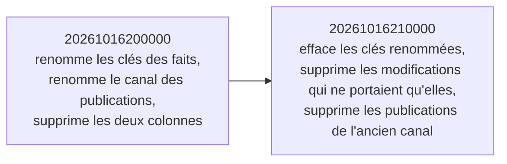

# Le retrait de l'ancien canal de vente en ligne

> ✅ **Implémenté** le 2026-10-16 (commits `4a6212442`, `168b70ca2`). Ce
> document remplace le plan du retrait, supprimé une fois le chantier bâti.

## Ce qui a été retiré, et quand

Le canal lui-même est parti le **2026-09-21** : son driver, son paquet de
transport, ses secrets de CI, ses quatre tables et ses trois types
(`20260921220000`). Son vocabulaire avait survécu trois semaines : deux
champs des points de vente (`pim.sales_context`), leurs contrats, la bascule
« projeté » de l'écran des points de vente, les libellés du journal, le
semis, les schémas statiques de la doc embarquée et une cinquantaine de
commentaires.

Le **2026-10-16**, Hugo : plus un seul bout de code de ce canal, front, back,
administration. Tout est sorti le même jour, en un seul lot (pré-release,
CLAUDE.md §0).

## Pourquoi un effacement plutôt qu'un renommage

Le plan prévoyait d'abord de **renommer** les faits passés sous des noms
neutres (l'exception du §8 de CLAUDE.md pour les valeurs du journal). Hugo a
tranché pour l'effacement : ces faits n'ont jamais servi en activité réelle.
Plus aucune forme historique ne porte de nom propre à l'ancien canal ; une
ligne nettoyée se relit sous la forme courante.

## Les deux migrations

- **`20261016200000`** : clés des faits `sales_context.created` (premier
  niveau) et `.updated` (sous `changes`) renommées ; `channel` des
  publications de révision mis à `former_channel` ; les deux colonnes de
  `pim.sales_context` (le suffixe de handle et la colonne de projection de
  l'ancien canal) supprimées. Déjà appliquée en dev quand l'effacement a été
  décidé : elle ne se touche pas.
- **`20261016210000`** : retire les clés renommées des faits ; supprime les
  faits `sales_context.updated` dont `changes` ne portait qu'elles ; supprime
  les publications `channel = 'former_channel'`.

**Irréversibles** l'une et l'autre. Vérifié le 2026-10-16 avant de les
écrire : aucune clé étrangère ne pointe vers ces tables, aucun hachage ni
chaînage ne porte sur `payload`, et `lastPublished` ne filtre pas sur
`channel` — la « dernière publication » devient la dernière vers la
plateforme. (Cette lecture est retirée le 2026-10-17, avec le repère
« depuis la dernière publication ».)

## Ce qui reste en base

**Rien.** Mesure en lecture seule sur la production, faite par Hugo le
2026-10-16 avant la promotion :

| Mesure                                       | Production |
| -------------------------------------------- | ---------- |
| faits des points de vente à nettoyer         | 0          |
| publications de révision vers l'ancien canal | 0          |
| points de vente avec un suffixe de handle    | 1          |
| points de vente « projetés »                 | 1          |

Le seul point de vente concerné perd son suffixe et son drapeau : aucun
lecteur ne les lisait plus.

## La porte

`pnpm lint:former-channel-name` (`dev-toolbox/gates/former-channel-name.mjs`)
refuse le nom de l'ancien canal, insensible à la casse, dans tout ce que git
suit. **Seule admission** : `apps/lfd-api/prisma/migrations/**` — les
`migration.sql` appliquées ne se touchent pas (checksum Prisma). Le nom de la
porte et de son script évitent le mot, faute de quoi elle se refuserait
elle-même.

La procédure de promotion (fenêtre, vérification d'après) est au
[runbook](../ops/runbook.md).

## Reste à faire

Rien. La notion de canal elle-même est reprise au lot 5 du catalogue.
