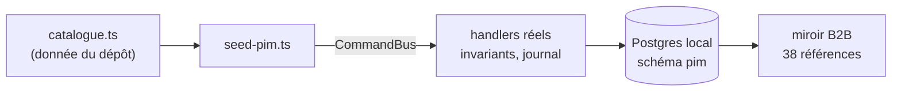

# Le seed du référentiel — un catalogue rejoué par le bus

`pnpm --filter lfd-api seed:pim` fabrique un catalogue de développement **en
passant par les commandes de l'application**. Aucune écriture directe, aucune
lecture d'une base d'exploitation.

```bash
pnpm dev:infra                                     # Postgres local (5433)
pnpm --filter lfd-api db:migrate                   # le schéma
SEED_PIM_SYNTHETIC_SHEETS=1 SEED_PIM_PUBLISH_ALL=1 \
  pnpm --filter lfd-api seed:pim
```

## Ce qu'il produit

Sur une base vide, à partir du catalogue figé dans
`apps/lfd-api/prisma/seed-pim/catalogue.ts` :

| Ce qui est posé                        | Combien                             |
| -------------------------------------- | ----------------------------------- |
| taux de TVA                            | 3                                   |
| points de vente                        | 2 (+ `pos_b2b`, posé par migration) |
| familles                               | 19 (5 têtes, 14 sous-familles)      |
| fiches produit                         | 99                                  |
| fiches mises en vente                  | 99 (les deux drapeaux levés)        |
| fiches vendues aux pros (matrice)      | 41                                  |
| **références acceptées au miroir B2B** | **38**                              |

Les 3 manquantes sont écartées pour `variant_sans_prix` : le catalogue de départ
ne les tarife pas. Le seed ne comble pas ce trou — il le **rapporte**.

⚠️ Familles et fiches recomptées le 2026-10-29 sur `catalogue.ts` et sur le
rejeu de la base de développement ; les deux lignes du canal B2B (41, 38) ne
l'ont pas été.

## Ce que le corpus montre de ce qui est bâti (2026-10-29)

Le corpus porte au moins un exemple de chaque geste de fiche livré, rejoué par
le VRAI handler (`apps/lfd-api/prisma/seed-pim/capabilities.ts`, appelé par `replay.ts` avant la
signature). Chaque geste est idempotent au rejeu : une déclinaison se retrouve
par sa référence, une archivée ne reçoit plus rien, un nom ou un minimum
inchangé n'écrit pas de fait.

| Capacité                                                    | Où dans le corpus                                                                                                                                                                               | Commande rejouée                                                                                  |
| ----------------------------------------------------------- | ----------------------------------------------------------------------------------------------------------------------------------------------------------------------------------------------- | ------------------------------------------------------------------------------------------------- |
| Familles imbriquées                                         | « Salé & traiteur » → Sandwichs & tranches, Parts salées, Salades, **Traiteur de la mer** (en plus des Pains, Viennoiseries, Pâtisseries)                                                       | `CreateCategoryCommand` (parent), `UpdateProductIdentityCommand` pour ranger une fiche déjà semée |
| Vente au poids                                              | SAL-025 saumon gravlax, SAL-026 saumon fumé, SAL-027 rillettes de saumon (pas 50 g, minimum 100 g), SAL-028 salade de la mer (pas 100 g, minimum 200 g) — prix public TTC et pro HT **au kilo** | `UpdateVariantPricingCommand` (`saleUnit: weight`)                                                |
| Prix au kilo sous une pièce                                 | chaque pain (`price-per-kg.ts`)                                                                                                                                                                 | `UpdateVariantPricingCommand`                                                                     |
| Quantité minimale par audience                              | PAT-001 tartelette myrtilles (pro 6), VIE-012 abricotin (pro 10, public 2)                                                                                                                      | `SetProductMinQuantitiesCommand`                                                                  |
| Déclinaisons en vignette, nom de boutique ≠ libellé interne | PAT-015 tarte myrtille : `-2` « Tarte aux myrtilles — 6 personnes » (interne « Tarte myrtille T2 »), `-3` 8 personnes                                                                           | `AddProductVariantCommand`, `SetVariantShopNameCommand`, `SetProductVariantsAsTilesCommand`       |
| Déclinaison archivée                                        | PAT-015-4, 10 personnes                                                                                                                                                                         | `DiscontinueProductVariantCommand`                                                                |

**Pas montré, et pourquoi** : la case « afficher le prix au kilo » par audience
(`price_per_kg_shown_public` / `_pro`) était en cours de création dans l'arbre
le 2026-10-29 ; le semis ne la touche pas, toutes les cases restent cochées.

La fiche réglementaire inventée (`SEED_PIM_SYNTHETIC_SHEETS=1`) se lit sur la
famille **propre** avant sa tête : le traiteur de la mer déclare du poisson, pas
le gluten des sandwichs (`declarations.ts`).

Le scénario de commandes de dev s'en sert : l'Hôtel des Pins commande, pour la
journée jouée, ses viennoiseries à la pièce **et** 1 500 g de gravlax et 850 g
de saumon fumé (`src/dev/seeding/delivery-day.seed.ts`). Le fournil compte
chaque lot au poids entier, le colisage le met au bac en un lot, le bon de
livraison dit l'unité — `test/dev-scenario.e2e-spec.ts` le vérifie. Les lignes
que le semis tire de tout le miroir (le sac long, le catalogue étalé) se posent
dans l'unité et au-dessus du minimum de chaque article
(`apps/lfd-api/src/dev/seeding/catalog-quantities.seed.ts`).

## Pourquoi pas en SQL

prisma/pim-seed.ts, son prédécesseur, écrivait par `upsert`. Les `upsert` ne
connaissent pas les invariants : c'est pour ça que la base de développement
portait 95 déclinaisons actives dont **une seule** avec fiche réglementaire,
c'est-à-dire un catalogue que `Product.publish()` refuse. Tout ce qu'on
développait dessus reposait sur un état que la production ne verra jamais.

Ici, chaque étape est la commande que l'écran envoie — ouvrir, tarifer, décrire,
déclarer les allergènes, placer sur la matrice, régler les taux, signer, mettre
en vente. Ce qui entre est, par construction, un état atteignable.



## Les deux drapeaux, tous deux éteints par défaut

- **`SEED_PIM_SYNTHETIC_SHEETS=1`** — pose des allergènes et des valeurs
  nutritionnelles **INVENTÉS** sur les fiches qui n'en déclarent pas. Sans lui,
  94 fiches sur 95 restent brouillon (invariant 7) et le miroir B2B est vide.
  La donnée inventée porte sa marque : `glycemic_index = 0`, impossible pour un
  aliment réel et distinct de `NULL`.
- **`SEED_PIM_PUBLISH_ALL=1`** — met en vente tout ce qui est publiable, au lieu
  de recopier le statut du catalogue de départ (tout y est brouillon).

Ni l'un ni l'autre ne contourne un refus : `publish()` juge dans les deux cas.

## Trois refus délibérés

**Le seed refuse toute cible qui n'est pas un Postgres local.** Une URL
Accelerate, ou un hôte qui n'est ni `localhost` ni `127.0.0.1`, arrête le script
avant la première écriture. Il pose des allergènes inventés : une donnée
réglementaire fausse en production n'est pas une gêne de développement.

C'est l'**hôte** qui tient la ligne, pas le schéma : une fois sortie
d'Accelerate, la production s'écrit elle aussi `postgres://`
(`pooled.db.prisma.io`, [`../ops/base-de-production.md`](../ops/base-de-production.md)),
et seul son hôte la distingue du poste (`prisma/local-target.ts`).

**Aucun outil ne lit une base pour fabriquer la donnée.** Le catalogue est du
**code** — relu en revue, modifié à la main. Un extracteur qui irait le chercher
dans une base d'exploitation ouvrirait une porte vers la production à chaque
`pnpm seed`.

**Le seed ne double ni le domaine, ni la persistance, ni le journal.** Une seule
doublure, `DocumentStore` : R2 n'est pas configuré en développement.

## Le canal B2B, et pourquoi cette phase existe

« Vendu aux pros » est écrit à deux endroits — la matrice des contextes de vente,
et `pim.b2b_channel_binding`. La projection consulte **les deux**. Sans
alignement, un catalogue rejoué donne un PIM juste et un miroir vide, ce qui
ressemble à une panne du canal alors que c'est un désaccord entre deux tables.

seed-pim/b2b-channel.ts (retiré en X4) aligne la copie sur l'original : la matrice fait foi.
Le jour où la table disparaît (cf.
[`ecrans-du-cycle-catalogue.md`](ecrans-du-cycle-catalogue.md)), ce fichier
disparaît avec elle.

## Pourquoi une compilation

`seed:pim` fait `tsc -p tsconfig.seed.json` avant de lancer le JS. Le seed boote
l'`AppModule`, donc la DI Nest **par type**, donc `design:paramtypes` :

- esbuild (`tsx`) ne supporte pas `emitDecoratorMetadata` — la DI échoue sur
  `CreateCategoryHandler (?, UuidGenerator)` ;
- `ts-node` 10.9 ne tourne plus sur le TypeScript 6.x épinglé ici.

⚠️ C'est la seconde raison qui a cassé **`pnpm seed:growth`**, aujourd'hui
inutilisable pour deux motifs indépendants : son runner, et un import de
platform/auth/customer-user.resolver.js, supprimé depuis. Non traité ici.

`tsconfig.seed.json` sert aussi de garde de types : `tsconfig.json` n'inclut que
`src`, donc **rien dans `prisma/` n'était typé** jusqu'à ce chantier. ESLint ne
le couvre toujours pas (`pnpm lint` ne vise que `{src,apps,libs,test}`).

## Signer n'est pas idempotent — le seed l'est

`DeclareProductReadyCommand` redate à chaque appel, et elle a raison : une
signature qu'on redate perd la seule chose qu'elle porte — depuis quand
quelqu'un affirme que cette fiche est juste. L'idempotence vit donc dans le
seed, qui **signe ce qui n'est pas signé, et rien d'autre**. Deux passages
inscrivaient 190 signatures pour 95 fiches ; ils en inscrivent 95.

⚠️ Corollaire assumé : si un passage modifie une fiche **déjà signée** — un prix
changé dans `catalogue.ts` — la signature devient périmée et l'écran le dit.
C'est le bon comportement : le seed a changé la fiche, personne ne l'a
revalidée. Re-signer d'office affirmerait le contraire.

## Modifier le catalogue

À la main, dans `catalogue.ts`. Tout s'y désigne par **clé portable** — nom de
famille, libellé de point de vente, clé de contexte, nom de taux, SKU — jamais
par identifiant : le rejeu passe par les commandes, qui frappent leurs propres
ULID. Le SKU fait exception, et c'est lui qui rend le rejeu idempotent : une
fiche déjà présente est retrouvée, pas dupliquée.
