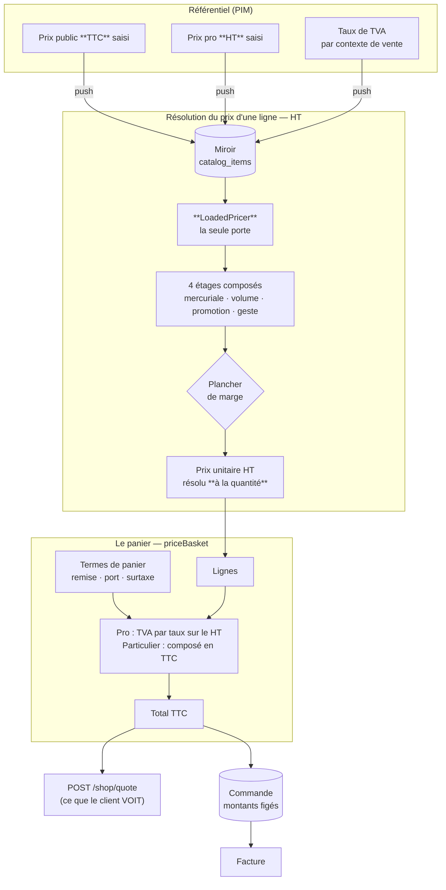

# Le prix — de l'étiquette à la facture

L'entrée du dossier : de quoi la chaîne du prix est faite, par quelle porte
entrer, et dans quel état est chaque document. La chaîne traverse le
référentiel, la boutique et la caisse ; elle est rangée ici en un seul dossier
pour se lire d'un bout à l'autre.

> |                            |                                                                                                                |
> | -------------------------- | -------------------------------------------------------------------------------------------------------------- |
> | **Ce que le système fait** | [`comment-un-prix-se-fabrique.md`](comment-un-prix-se-fabrique.md) — la référence courte, avec 19 cas chiffrés |
> | **Ce qui reste à faire**   | [`ce-qui-reste-a-faire.md`](ce-qui-reste-a-faire.md) — le registre des points ouverts du prix                  |

---

## 0. Le dossier, rangé par rôle

| Dossier                                      | Qui fait quoi                                                                                                                | Ce qu'il contient                                                                                                                                                                                                                                                                          |
| -------------------------------------------- | ---------------------------------------------------------------------------------------------------------------------------- | ------------------------------------------------------------------------------------------------------------------------------------------------------------------------------------------------------------------------------------------------------------------------------------------ |
| _(racine)_                                   | **Entrer**, et ce qui traverse tout                                                                                          | ce README, `comment-un-prix-se-fabrique`, `ce-qui-reste-a-faire`, `journal-de-remediation`, `vente-au-poids`, `export-grille-de-prix`                                                                                                                                                      |
| [`saisie/`](saisie/)                         | **Le commercial définit un prix** : la fiche produit, les écrans de tarification, l'unité de vente, le report d'une décision | `saisir-un-prix`                                                                                                                                                                                                                                                                           |
| [`mercuriales/`](mercuriales/)               | **Un client a son tarif négocié**                                                                                            | `comprendre-une-mercuriale`, `etat-des-lieux-mercuriale-client`, `l-avenant-date`, `la-remise-generale`                                                                                                                                                                                    |
| [`moteur/`](moteur/)                         | **Le serveur calcule le prix d'une ligne** : les étages, la porte unique, le chargement, le coût, la trace                   | `architecture-resolution-de-prix`, `architecture-pricer`, `architecture-la-porte-du-prix`, `architecture-clore-nest-pas-ranger`, `le-tableau-et-la-porte`, `la-trace-qui-explique`, `optimisation-resolution-de-prix`, `durcir-le-calcul-des-prix`, `architecture-prix-vivant-prix-bloque` |
| [`boutique-et-panier/`](boutique-et-panier/) | **Le client voit un prix et remplit son panier**                                                                             | `architecture-prix-boutique`, `chemin-du-prix-public`, `ajouter-un-terme-au-panier`                                                                                                                                                                                                        |
| [`centime-et-tva/`](centime-et-tva/)         | **L'arrondi et la TVA tombent juste**                                                                                        | `architecture-prix-ancre-ttc`, `le-prix-d-un-panier`, `le-ttc-fait-foi`, `inventaire-c0-assemblages`                                                                                                                                                                                       |
| [`obsolete/`](obsolete/)                     | une conception périmée, gardée parce que le code la cite                                                                     | `architecture-conditionnements-pricing`                                                                                                                                                                                                                                                    |
| [`../promotions/`](../promotions/)           | **Qui a droit à quelle réduction**                                                                                           | la doc d'état, les plans, la décision « qui pose une promotion »                                                                                                                                                                                                                           |

## 1. La chaîne, en un schéma

| Étage           | Ce qu'il décide                                                        | Où c'est écrit                                                                      |
| --------------- | ---------------------------------------------------------------------- | ----------------------------------------------------------------------------------- |
| **Saisie**      | deux prix saisis : le public en TTC, le pro en HT                      | [`architecture-prix-ancre-ttc.md`](centime-et-tva/architecture-prix-ancre-ttc.md)   |
| **Résolution**  | quatre étages composent un prix unitaire HT **à la quantité demandée** | [`comment-un-prix-se-fabrique.md`](comment-un-prix-se-fabrique.md)                  |
| **Panier**      | charger, calculer (`priceBasket`, une fois, par l'agrégat), juger      | [`le-prix-d-un-panier.md`](centime-et-tva/le-prix-d-un-panier.md)                   |
| **Particulier** | la commande se compose en TTC ; il paie la somme de ses étiquettes     | [`le-ttc-fait-foi.md`](centime-et-tva/le-ttc-fait-foi.md)                           |
| **Devis**       | le serveur — jamais le navigateur — dit ce que ça coûtera              | [`architecture-prix-boutique.md`](boutique-et-panier/architecture-prix-boutique.md) |

---

## 2. Le vocabulaire, en neuf lignes

Ces mots reviennent partout et ne veulent pas dire ce qu'on croit.

| Mot                      | Ce qu'il désigne ici                                                                                         |
| ------------------------ | ------------------------------------------------------------------------------------------------------------ |
| **Canonique**            | le prix HT du référentiel, avant toute règle. Le prix d'entrée.                                              |
| **Mercuriale**           | un prix négocié pour un client. Elle **scelle** : posée, elle rend les étages suivants transparents.         |
| **Étage**                | un des quatre niveaux de règle. Ils se **composent**, ils ne s'additionnent pas.                             |
| **Plancher**             | la marge minimale. Une **post-condition** : il n'entre pas dans le calcul, il le refuse.                     |
| **Barème**               | une grille de paliers de volume, ouverte à tous. À ne pas confondre avec une mercuriale, qui vise UN client. |
| **Millicentime**         | 10⁻⁵ €. L'unité d'un **prix unitaire**, qui se dérive. Un **montant** encaissé est en centimes.              |
| **Terme de panier**      | remise de retrait, frais de zone, surtaxe de retard. Par commande, jamais par ligne.                         |
| **Ventilation**          | la TVA calculée par **taux**, remise déduite au prorata, arrondie une fois par groupe.                       |
| **Résolu à la quantité** | le prix d'une ligne dépend de sa quantité. C'est pourquoi le front **ne multiplie jamais**.                  |

---

## 3. Par quelle porte entrer

**Je veux COMPRENDRE.**

| La question                                                   | Le document                                                                            |
| ------------------------------------------------------------- | -------------------------------------------------------------------------------------- |
| **Comment un prix se fabrique, concrètement ?**               | [`comment-un-prix-se-fabrique.md`](comment-un-prix-se-fabrique.md) — **commencer ici** |
| Pourquoi il n'y a qu'un seul objet qui fabrique un prix ?     | [`architecture-pricer.md`](moteur/architecture-pricer.md)                              |
| Que veulent dire « étage », « spécificité », « scellement » ? | [`architecture-resolution-de-prix.md`](moteur/architecture-resolution-de-prix.md)      |
| Pourquoi un particulier paie exactement ses étiquettes ?      | [`le-ttc-fait-foi.md`](centime-et-tva/le-ttc-fait-foi.md)                              |
| Pourquoi la TVA se calcule par taux et pas sur le total ?     | [`ajouter-un-terme-au-panier.md`](boutique-et-panier/ajouter-un-terme-au-panier.md)    |
| Qu'est-ce que la boutique a le droit de montrer ?             | [`architecture-prix-boutique.md`](boutique-et-panier/architecture-prix-boutique.md)    |
| Qu'est-ce qu'un commercial voit quand il pose une règle ?     | [`saisir-un-prix.md`](saisie/saisir-un-prix.md)                                        |
| **Qu'est-ce qu'une mercuriale, exactement ?**                 | [`comprendre-une-mercuriale.md`](mercuriales/comprendre-une-mercuriale.md)             |
| Qui décide de poser une promotion, et où ?                    | [`promotions.md` § 2.16](../promotions/promotions.md)                                  |

**Je veux IMPLÉMENTER.**

| Ce que je m'apprête à faire                                | Le document                                                                                            |
| ---------------------------------------------------------- | ------------------------------------------------------------------------------------------------------ |
| **Obtenir un prix, où que je sois**                        | [`architecture-la-porte-du-prix.md`](moteur/architecture-la-porte-du-prix.md)                          |
| Chiffrer un panier ou une commande                         | [`le-prix-d-un-panier.md`](centime-et-tva/le-prix-d-un-panier.md)                                      |
| Ajouter une remise, un frais, une taxe au panier           | [`ajouter-un-terme-au-panier.md`](boutique-et-panier/ajouter-un-terme-au-panier.md)                    |
| Afficher un montant quelque part                           | [`le-prix-d-un-panier.md`](centime-et-tva/le-prix-d-un-panier.md) § 8 — l'écran lit, il ne calcule pas |
| Toucher au chargement des règles, mesurer la résolution    | [`optimisation-resolution-de-prix.md`](moteur/optimisation-resolution-de-prix.md)                      |
| Toucher à la grille, la frise, le simulateur, les gabarits | [`saisir-un-prix.md`](saisie/saisir-un-prix.md)                                                        |
| Exporter une grille de prix                                | [`export-grille-de-prix.md`](export-grille-de-prix.md)                                                 |

**Je veux savoir CE QUI CLOCHE** : [`ce-qui-reste-a-faire.md`](ce-qui-reste-a-faire.md).

---

## 4. L'état de chaque document

Vérifié contre le code le **2026-11-11** (hors `saisie/` et
`ce-qui-reste-a-faire.md`, tenus à part). ✅ doc d'état · 📝 plan en cours ·
🔵 note de conception, rien de bâti · 🟢 raisonnement de points ouverts ·
🔴 périmé.

| Document                                                                                                 | État | Ce qu'il porte                                                                                                                                                                                              |
| -------------------------------------------------------------------------------------------------------- | ---- | ----------------------------------------------------------------------------------------------------------------------------------------------------------------------------------------------------------- |
| [`comment-un-prix-se-fabrique.md`](comment-un-prix-se-fabrique.md)                                       | ✅   | Le prix d'un article : les quatre étages, le scellement, le plancher ; 19 cas chiffrés.                                                                                                                     |
| [`vente-au-poids.md`](vente-au-poids.md)                                                                 | ✅   | Pièce ou poids par déclinaison ; quantité en grammes ; de la fiche à Factur-X.                                                                                                                              |
| [`export-grille-de-prix.md`](export-grille-de-prix.md)                                                   | ✅   | La grille CSV d'un public, par la porte du prix ; le « pro type » du staff.                                                                                                                                 |
| [`ce-qui-reste-a-faire.md`](ce-qui-reste-a-faire.md)                                                     | 📝   | Le registre des points ouverts du prix.                                                                                                                                                                     |
| [`journal-de-remediation.md`](journal-de-remediation.md)                                                 | 🟢   | Le raisonnement de R15 et R16, encore ouverts : branches écartées et contradictions.                                                                                                                        |
| [`moteur/architecture-resolution-de-prix.md`](moteur/architecture-resolution-de-prix.md)                 | ✅   | La sémantique des étages datés ; exemples vérifiés par `resolve-price.spec.ts`.                                                                                                                             |
| [`moteur/architecture-pricer.md`](moteur/architecture-pricer.md)                                         | ✅   | `LoadedPricer`, le seul appelant de `resolvePrice`.                                                                                                                                                         |
| [`moteur/architecture-la-porte-du-prix.md`](moteur/architecture-la-porte-du-prix.md)                     | ✅   | La porte unique : qui l'emprunte, ce qu'elle rend impossible.                                                                                                                                               |
| [`moteur/architecture-clore-nest-pas-ranger.md`](moteur/architecture-clore-nest-pas-ranger.md)           | ✅   | Ranger une décision n'efface pas la période où elle a agi.                                                                                                                                                  |
| [`moteur/le-tableau-et-la-porte.md`](moteur/le-tableau-et-la-porte.md)                                   | ✅   | Ce qui s'applique et ce qui est décidé : deux lectures, un calcul.                                                                                                                                          |
| [`moteur/la-trace-qui-explique.md`](moteur/la-trace-qui-explique.md)                                     | ✅   | « Pourquoi ce prix ? » sur une ligne de commande, au back-office.                                                                                                                                           |
| [`moteur/optimisation-resolution-de-prix.md`](moteur/optimisation-resolution-de-prix.md)                 | ✅   | Ce que coûte un prix : des lectures par lot, pas du temps.                                                                                                                                                  |
| [`moteur/durcir-le-calcul-des-prix.md`](moteur/durcir-le-calcul-des-prix.md)                             | ✅   | Ce que le durcissement du calcul a laissé, et les portes qui le tiennent.                                                                                                                                   |
| [`moteur/architecture-prix-vivant-prix-bloque.md`](moteur/architecture-prix-vivant-prix-bloque.md)       | 🔵   | Qui porte le risque d'un prix qui bouge ? Zéro code.                                                                                                                                                        |
| [`mercuriales/comprendre-une-mercuriale.md`](mercuriales/comprendre-une-mercuriale.md)                   | ✅   | La définition : le tarif négocié d'un client, qui scelle la chaîne.                                                                                                                                         |
| [`mercuriales/etat-des-lieux-mercuriale-client.md`](mercuriales/etat-des-lieux-mercuriale-client.md)     | ✅   | Comment l'équipe établit une mercuriale : deux chemins, un résultat.                                                                                                                                        |
| [`mercuriales/l-avenant-date.md`](mercuriales/l-avenant-date.md)                                         | ✅   | Ajouter un prix daté sans réécrire la mercuriale.                                                                                                                                                           |
| [`mercuriales/la-remise-generale.md`](mercuriales/la-remise-generale.md)                                 | ✅   | Un taux par famille ou par déclinaison à côté des prix fermes.                                                                                                                                              |
| [`boutique-et-panier/architecture-prix-boutique.md`](boutique-et-panier/architecture-prix-boutique.md)   | ✅   | Le prix que la boutique montre, au rayon et au devis.                                                                                                                                                       |
| [`boutique-et-panier/chemin-du-prix-public.md`](boutique-et-panier/chemin-du-prix-public.md)             | ✅   | Qui donne quel prix, à qui, du référentiel au panier.                                                                                                                                                       |
| [`boutique-et-panier/ajouter-un-terme-au-panier.md`](boutique-et-panier/ajouter-un-terme-au-panier.md)   | ✅   | Les quatre questions avant d'ajouter une remise, un frais ou une taxe.                                                                                                                                      |
| [`centime-et-tva/architecture-prix-ancre-ttc.md`](centime-et-tva/architecture-prix-ancre-ttc.md)         | ✅   | Deux prix saisis, chacun dans sa forme naturelle.                                                                                                                                                           |
| [`centime-et-tva/le-prix-d-un-panier.md`](centime-et-tva/le-prix-d-un-panier.md)                         | ✅   | Charger, calculer (`priceBasket`), juger ; le total vu est le total facturé.                                                                                                                                |
| [`centime-et-tva/le-ttc-fait-foi.md`](centime-et-tva/le-ttc-fait-foi.md)                                 | ✅   | Un particulier paie la somme de ses étiquettes : composition en TTC.                                                                                                                                        |
| [`centime-et-tva/inventaire-c0-assemblages.md`](centime-et-tva/inventaire-c0-assemblages.md)             | ✅   | Les écarts É1 à É18 que le golden master cite.                                                                                                                                                              |
| [`obsolete/architecture-conditionnements-pricing.md`](obsolete/architecture-conditionnements-pricing.md) | 🔴   | Conception des conditionnements, périmée ; gardée parce que `Packaging` la cite.                                                                                                                            |
| [`saisie/saisir-un-prix.md`](saisie/saisir-un-prix.md)                                                   | ✅   | Définir un prix : écrans, fiche, unité de vente, report. Le prix pendant une commande de l'équipe est dans [`commande-passee-par-l-equipe.md`](../commandes/passation/commande-passee-par-l-equipe.md) § 8. |

---

## 5. Les six règles qui ne se négocient pas

Chacune a déjà été enfreinte une fois, et chaque infraction a coûté.

1. **Il n'y a qu'un seul fabricant de prix.** `LoadedPricer` est le seul
   appelant de `resolvePrice`, et `lint:price-pipeline` le tient à **une**
   entrée. Une variante de la question est une **méthode** de plus, jamais un
   appel de plus.
2. **Le front ne multiplie jamais.** Il demande une route qui résout chaque
   ligne à sa quantité réelle. Une multiplication est exacte tant qu'aucun
   palier n'existe, et fausse **en silence** le jour où il en existe un.
3. **Un montant ne se calcule qu'à un seul endroit.** Le total d'un panier
   sort de `priceBasket`, appelé par l'agrégat — TVA par `ventilateVat` pour
   un pro, par `composeTtcOrder` pour un particulier —, jamais recomposé à
   côté. Un écran lit ses montants, il ne les calcule pas
   (`lint:front-money-reads`).
4. **Un prix unitaire est en millicentimes, un montant encaissé en centimes.**
   Un nom en `*Cents` qui porte des millicentimes est un défaut, pas un
   raccourci — la porte `lint:money-units` le refuse.
5. **L'arrondi a lieu une fois par ligne, et une fois par taux.** Jamais deux
   fois sur le même nombre. Pour un particulier, c'est le TTC de la ligne qui
   s'arrondit, et le HT est la différence
   ([`le-ttc-fait-foi.md`](centime-et-tva/le-ttc-fait-foi.md)).
6. **Un taux de TVA ne s'invente pas.** Constante quand la loi ne laisse pas le
   choix, réglage quand personne ne sait, jamais un défaut : un taux inventé
   facture rétroactivement toutes les commandes concernées.

---

## 6. Ce que ce dossier ne couvre pas

- **La facturation** — l'émission des documents comptables :
  [`../b2b/architecture-facturation.md`](../b2b/architecture-facturation.md).
- **Le catalogue** — comment les articles arrivent du référentiel :
  [`../catalogue/catalogue-synchronise.md`](../catalogue/catalogue-synchronise.md).
- **Le paiement** — Stripe, mandats SEPA, termes négociés : `../b2b/`.
