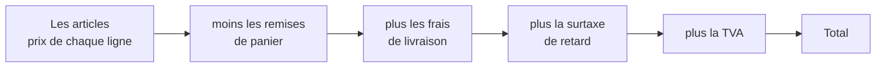
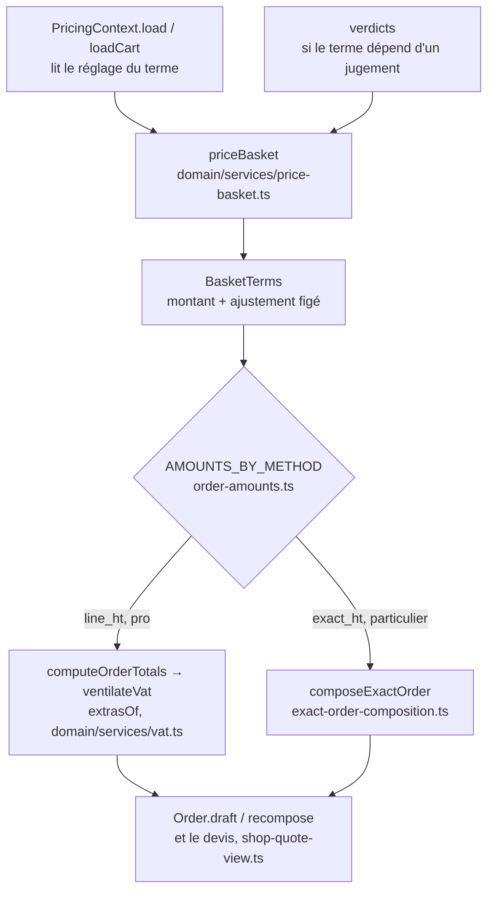

# Ajouter un terme au panier

> ✅ **Décrit le code au 2026-11-04**, réécrit ce jour-là contre le code, après
> la refonte du chiffrage
> ([`../centime-et-tva/le-prix-d-un-panier.md`](../centime-et-tva/le-prix-d-un-panier.md)).
> Partie 1 : comprendre. Partie 2 : le faire.

# Partie 1 — Comprendre

## Qu'est-ce qu'un terme de panier ?

Un **terme de panier** est un montant qui s'applique à **la commande
entière**, et pas au prix d'un article. Aujourd'hui, il y en a trois :

- **les remises de panier** : la remise d'un point de retrait, une
  promotion ;
- **les frais de livraison** d'une zone ;
- **la surtaxe** d'une commande passée après l'heure limite.

Une éco-contribution serait un quatrième terme.



## Les quatre questions à se poser

Avant d'ajouter un terme, on répond à quatre questions, dans cet ordre.

1. **Est-ce vraiment un terme de panier, ou le prix d'un article ?** « Ce que
   ce croissant vaut pour ce client » est un prix d'article. « Comment, où ou
   quand cette commande est passée » est un terme de panier.
2. **Par commande, ou par article ?** Les trois termes actuels sont par
   commande. Un terme par article n'a aucun précédent ici.
3. **Avant ou après les remises ?** On ne fait pas de remise sur une
   pénalité de retard ni sur un transport : ces termes viennent **après** les
   remises, et les remises ne les touchent pas.
4. **Quel taux de TVA, et d'où vient-il ?**
   - une **constante**, si la loi ne laisse pas le choix ;
   - un **réglage** de l'équipe, si personne ne sait encore ;
   - **jamais une valeur par défaut** : si le taux manque, on refuse la
     commande plutôt que d'inventer un taux.

## Ce qui garantit que le client paie ce qu'il a vu

Il n'y a **qu'un seul calcul** du prix d'un panier. Le devis que voit le
client et la commande qui est enregistrée sortent de la même fonction. Un
terme ajouté à ce calcul apparaît donc automatiquement au devis, à la
commande et à la révision : il ne peut pas être « oublié » sur l'un d'eux.

Ce qui reste à faire à la main, ce sont les endroits qui **lisent** le terme
ensuite : les écrans, le bon, la facture du mois.

# Partie 2 — Technique

## 1. Où un terme entre dans l'argent



- **Charger** : un terme qui dépend d'un réglage ou de l'acheminement se lit
  dans `PricingContext` (`application/services/pricing-context.service.ts`).
  Le port, par exemple, vient de la route (`deliveryFeeOf`, dans
  `price-basket.ts`). Un terme qui dépend d'un **jugement** arrive par
  `verdicts`, comme la surtaxe (`verdicts.lateFee`, jugée par
  `LateFeeJudgement`, `application/services/late-fee-judgement.service.ts`).
- **Calculer** : `priceBasket` assemble les termes (`basketTermsOf`,
  `domain/services/basket-terms.ts`, plus `lateFeeOf` dans
  `price-basket.ts`). L'agrégat l'appelle (`Order.draft`, `recompose`) et le
  devis aussi : c'est ce qui rend « devis = commande » structurel.
- **Deux méthodes de TVA**, choisies par l'absence de société
  (`AMOUNTS_BY_METHOD`, `domain/entities/order-amounts.ts`) :
  - `line_ht` (pro) : `computeOrderTotals` (`domain/services/vat.ts`) appelle
    `ventilateVat` (`packages/money/src/vat.ts`) ; un terme hors remise passe
    par **`extrasOf`**, et nulle part ailleurs ;
  - `exact_ht` (particulier) : `composeExactOrder` compose en TTC. Un terme
    qu'un particulier ne peut pas porter y est **refusé**
    (`LateFeeOnPersonalOrderError`, `order-exact-amounts.ts`).

## 2. La ventilation (`line_ht`)

```
ventilateVat({ lines, eligibleDiscountCents | eligibleDiscounts, discountCents, extras })
  → { subtotalHtCents, discountCents, extrasHtCents, vat[], vatTotalCents, totalCents }
```

|                        | `lines` (marchandises) | `extras` (termes hors remise) |
| ---------------------- | ---------------------- | ----------------------------- |
| Touchées par la remise | oui, au prorata        | non                           |
| Comptées au sous-total | oui                    | non (`extrasHtCents`)         |
| Taux                   | celui de la ligne      | `vatRate`, ou `followsGoods`  |

- **Les remises** : la remise de retrait ou une promotion ne touche que ses
  lignes éligibles (`eligibleDiscountCents`), ou chacune ses lignes quand
  plusieurs se cumulent (`eligibleDiscounts`, dans l'ordre) ; le **bon de
  fidélité** (`discountCents`) se prend ensuite, sur toutes les lignes.
- **Un extra** porte son taux (`vatRate`) ou suit la marchandise
  (`followsGoods: true`, le port en mode `follows_goods` : TVA au prorata de
  la base brute de chaque taux — `deliveryExtraOf`, réglage décrit dans
  [`../../commandes/bon-et-pieces/architecture-tva-des-frais-de-port.md`](../../commandes/bon-et-pieces/architecture-tva-des-frais-de-port.md)).
- **La TVA** se groupe par taux et s'arrondit une fois par groupe ; les
  numérateurs sont en `bigint`, l'arrondi n'a lieu qu'à la fin.
- **Le total ne se recompose jamais** : `computeOrderTotals` rend
  `totalCents` de la ventilation, et `Order` le prend.
- **Bornes** : une remise est bornée au sous-total (`discountCentsOf`,
  `packages/contracts/src/cart-adjustment.ts`) ; des frais ne le sont pas
  (`cartAdjustmentCents`).

**Exemple, tenu par un test** (`packages/money/src/__tests__/exemple-doc.spec.ts`) :
douze croissants à 1,00 € HT (5,5 %), quatre jus à 2,00 € HT (10 %), 10,00 €
HT de course (20 %).

| Groupe     | Sans remise : assiette → TVA | Avec 2,00 € de remise : assiette → TVA      |
| ---------- | ---------------------------- | ------------------------------------------- |
| croissants | 12,00 € → 0,66 €             | 10,80 € → 0,59 €                            |
| jus        | 8,00 € → 0,80 €              | 7,20 € → 0,72 €                             |
| course     | 10,00 € → 2,00 €             | 10,00 € → 2,00 € (la remise n'y touche pas) |
| **Total**  | **33,46 €**                  | **31,31 €**                                 |

## 3. Ajouter un terme : ce qu'il faut toucher

Exemple : une éco-contribution de 0,15 € par commande — terme de panier, par
commande, hors remise, taux par réglage.

1. **Le réglage** — table, port de lecture, adaptateur Prisma, contrat Zod,
   contrôleur et écran d'administration, sur le modèle de la surtaxe
   (`order_late_fee`). Un `CartAdjustment` (`mode` + `value`, entiers) et son
   taux. Un réglage absent veut dire « pas de terme », pas une erreur.
2. **Le chargement** — `PricingContext` lit le réglage (ou un verdict s'il
   dépend d'un jugement).
3. **Le calcul** — `BasketTerms` porte le montant et l'ajustement figé ;
   `extrasOf` le pousse en `extras` (`line_ht`) ; `composeExactOrder` le porte
   en TTC ou le refuse explicitement (`exact_ht`).
4. **La commande** — deux colonnes (`orders.prisma` + migration
   additive) : le montant, et l'ajustement **avec son taux**, figés. Écriture
   (`prisma-order.repository.ts`), relecture (`prisma-order.reader.ts`,
   `revisable-order.row.ts` pour la révision).
5. **Les lecteurs** — c'est là qu'on oublie :
   - le **devis** : `ShopQuoteView` (`shop-quote-view.ts`) et le test qui
     énumère ses clés (`test/shop-quote.e2e-spec.ts`) ;
   - le **« Total HT »** d'un pro : `orderPretaxCents`
     (`packages/money/src/order-pretax.ts`) additionne articles, remises,
     livraison et surtaxe — **un terme oublié ici fausse le HT** de la fiche,
     du bon, de l'e-mail et du panier ;
   - le **pied de montants** : `orderTotalRows`
     (`packages/b2b-ui/src/order/order-pricing.ts`), une ligne dans l'ordre
     d'addition, absente quand le montant est nul ; le bon PDF
     (`order-sheet-pdf-totals.ts`) et le texte (`order-sheet-text.ts`) ;
   - la **facture du mois** : `invoice-order-split.ts` et
     `invoice-dossier.ts` (`b2b/accounting/`) découpent chaque terme par taux
     (`lateFeeOf`, `standardDeliveryOf`) ; le contrôle de cohérence
     (`invoice-order-consistency.ts`) recompose le total d'un bon terme par
     terme ;
   - le **bon de livraison partiel** et ses montants facturables
     (`billable_*`).
6. **Les tests** — le terme n'est **pas** remisé ; le devis égale la commande
   sur le même panier (golden master, `test/pricing-golden-master.e2e-spec.ts`) ;
   un taux manquant est refusé.

## 4. Les pièges

| Piège                                    | Ce qui l'évite                                                                                                    |
| ---------------------------------------- | ----------------------------------------------------------------------------------------------------------------- |
| Le terme dans `lines` au lieu d'`extras` | Il se ferait remiser ; un test doit dire « n'est pas remisé ».                                                    |
| Un taux par défaut                       | Lever : `MissingLateFeeVatRateError` (`domain/services/vat.ts`) est le modèle.                                    |
| Un terme à zéro dans la ventilation      | `extrasOf` saute les montants nuls, sans quoi il exigerait un taux.                                               |
| Le taux recalculé à la relecture         | Figé sur la commande, à côté du montant (`LateFeeAdjustment`, `packages/contracts/src/order-late-fee.ts`).        |
| Le particulier oublié                    | `exact_ht` ne passe pas par `extrasOf` : le porter dans `composeExactOrder`, ou le refuser par une erreur nommée. |
| Le « Total HT » faux                     | Ajouter le terme à `orderPretaxCents`.                                                                            |
| La facture qui ne le connaît pas         | Le découper dans `invoice-order-split.ts`, sinon le contrôle de cohérence signale chaque bon.                     |
| Un écran qui le recalcule                | Interdit : le serveur sert les montants (`lint:front-money-reads`).                                               |
| Un montant en euros flottants            | `CartAdjustment` en entiers ; `lint:money-units` garde les noms.                                                  |

## 5. La liste, à cocher

- [ ] Les quatre questions ont une réponse écrite
- [ ] Le montant est un `CartAdjustment`, le taux une constante ou un réglage, jamais un défaut
- [ ] Le terme est chargé par `PricingContext` ou reçu en verdict, calculé par `priceBasket`
- [ ] `extrasOf` (`line_ht`) et `composeExactOrder` (`exact_ht`) le traitent — ou il est refusé
- [ ] Deux colonnes figées : le montant, l'ajustement avec son taux
- [ ] `orderPretaxCents`, `orderTotalRows`, le bon, la facture du mois le lisent
- [ ] Le test des clés de `/shop/quote` est à jour
- [ ] Un test prouve qu'il n'est pas remisé ; le golden master est régénéré et relu
