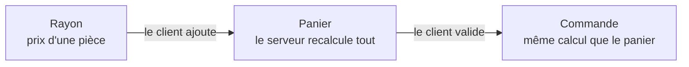
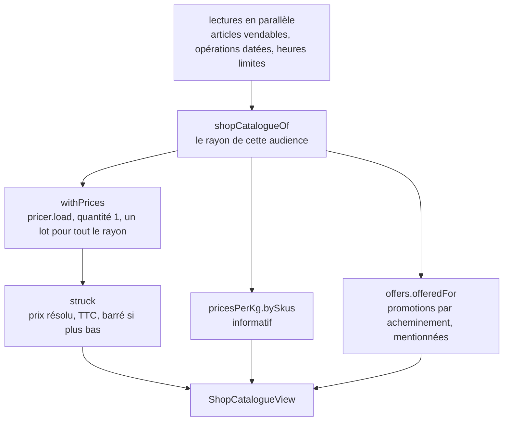

# Le prix, tel que la boutique le montre

> ✅ **Décrit le code au 2026-11-04**, réécrit ce jour-là contre le code. La
> version d'origine (un plan du 2026-09-03, dont deux décisions ont ensuite été
> renversées : un rayon muré, un prix barré absent) reste dans l'historique
> git. Partie 1 : comprendre. Partie 2 : le code.

# Partie 1 — Comprendre

## Deux moments, deux prix

La boutique montre un prix à **deux moments**, et ce ne sont pas les mêmes
calculs :

1. **Au rayon** : le prix d'**une pièce** de chaque article. C'est une
   vitrine, qui n'engage à rien.
2. **Au panier** : le prix **réel**, calculé par le serveur à la quantité
   demandée, avec les remises, la livraison et la TVA. C'est ce prix-là qui
   sera facturé.

Le navigateur **ne calcule jamais** un prix : il ne multiplie pas, n'additionne
pas, ne retire pas la TVA. Il affiche ce que le serveur lui envoie.

## Trois rayons, selon qui regarde

| Qui regarde                                     | Ce qu'il voit                                                                       |
| ----------------------------------------------- | ----------------------------------------------------------------------------------- |
| **Un visiteur**, sans compte                    | le prix public, taxe comprise, avec les promotions ouvertes à tous                  |
| **Un pro sans compte** (venu de la page `/pro`) | le tarif pro de base, hors taxe — rien de négocié                                   |
| **Un client connecté**                          | **son** prix : sa mercuriale, ses engagements, les promotions auxquelles il a droit |

## Le prix barré

Un prix est barré **seulement s'il baisse** par rapport au tarif. Un prix qui
monte (une règle, un plancher) n'est jamais barré : barrer le plus bas des deux
serait mensonger. Et un client sous mercuriale ne voit jamais un prix
promotionnel barré : sa mercuriale lui retire de toute façon la promotion.

## Ce que le rayon ne dit pas

- **Les paliers de volume** : le rayon résout à une pièce. Un prix « à partir
  de 50 » ne s'y voit pas ; le panier, lui, l'applique.
- **Les promotions liées au retrait ou à la livraison** : le rayon ne sait pas
  encore comment le client sera servi. Il les **mentionne**, sans les appliquer.
- **La fabrique du prix** : ni les règles, ni le chemin du calcul, ni le
  plancher (c'est-à-dire la marge). Rien de cela ne sort du serveur.

# Partie 2 — Le code

## 1. Les routes

| Route                               | Pour qui                                           | Handler                                                                                   |
| ----------------------------------- | -------------------------------------------------- | ----------------------------------------------------------------------------------------- |
| `GET /shop/catalogue` (`@Public()`) | visiteur ; `?audience=pro` pour le pro sans compte | `ReadShopCatalogueHandler` (`b2b/catalog/application/queries/read-shop-catalogue.ts`)     |
| `GET /shop/catalogue/mine`          | client reconnu, société prise du `Principal`       | `ReadMyShopCatalogueHandler` (`b2b/orders/application/queries/read-my-shop-catalogue.ts`) |

Les deux passent par `ShopCataloguePricing` (`b2b/catalog/application/shop-catalogue-pricing.service.ts`) :

- visiteur : `priced(null, "guest", langue)` ;
- pro sans compte : `pricedWithoutCompany("pro", langue)` — aucune société
  remise au tarificateur, donc rien de négocié ne peut sortir ; seules les
  promotions « tout le monde » jouent ;
- client reconnu : `priced(companyId, "registered", langue source)`. Le
  lecteur de société (`CatalogViewers.forCompany`, `served_and_locked`) décide
  si la société est servie en pro ou au public, et porte les articles réservés
  (montrés verrouillés).

## 2. Le calcul d'un rayon (`pricedFor`)

- **Quantité 1**, écrite en dur dans `withPrices` et commentée comme une limite
  assumée : `minQuantity` existe à tous les étages, un palier ne se voit pas au
  rayon.
- **Un seul lot** : `pricer.load` prend l'instant une fois pour tout le rayon,
  pour que deux articles ne tombent pas de part et d'autre d'une bascule de
  promotion. La résolution passe par la porte unique du prix (`Pricer`,
  `LoadedPricer`, cf. [`../moteur/architecture-la-porte-du-prix.md`](../moteur/architecture-la-porte-du-prix.md)).
- **Le barré** (`shop-catalogue-struck.ts`, `struck`) : `catalogPriceMillicents`
  n'est posé que si le prix résolu est **plus bas** ; le TTC suit toujours le
  prix résolu (`ttcCentsFromHtMillicentsFor`), et pour un particulier c'est la
  valeur saisie.
- Les suggestions (`pricedItems`) suivent le même chemin, sur un lot réduit.

## 3. Ce qui sort (`ShopItemView`, `packages/contracts/src/shop-catalogue.ts`)

| Champ                                                                  | Ce qu'il dit                                                           |
| ---------------------------------------------------------------------- | ---------------------------------------------------------------------- |
| `unitPriceMillicents`, `unitPriceTtcCents`                             | le prix d'une pièce, HT et TTC — l'écran choisit selon qui regarde     |
| `catalogPriceMillicents`, `catalogPriceTtcCents`                       | le tarif barré, absent sans baisse                                     |
| `promotionNames`, `fulfillmentOffers`                                  | les promotions appliquées, et celles qu'un acheminement ouvrirait      |
| `proPricePerKgMillicents`, `publicPricePerKgTtcCents`                  | le prix au kilo, saisi, informatif                                     |
| `saleUnit`, `weightStepGrams`, `weightMinGrams`, `minQuantity`         | comment on commande l'article                                          |
| `vatRatePercent`, `audience`, `orderable`, `lockedReason`, `operation` | le taux, l'audience servie, un article verrouillé, une opération datée |

**Ce qui ne sort jamais** : les règles et leurs identifiants, les étapes du
calcul, les planchers, ce que la mercuriale a scellé — tout ce que porte la vue
du back-office (`PricingItemView`). La vue de la boutique est **étroite**, et
le test `test/shop-quote.e2e-spec.ts` énumère les clés du devis pour qu'elle le
reste.

## 4. Le panier ne calcule pas

- Le panier demande `POST /shop/quote` (visiteur) ou `POST /shop/quote/mine`
  (client reconnu), qui chiffre chaque ligne à sa quantité réelle par le même
  calcul que la commande (`PricingContext` → `priceBasket`, cf.
  [`../centime-et-tva/le-prix-d-un-panier.md`](../centime-et-tva/le-prix-d-un-panier.md)).
- Le front n'a plus de total : `cart-total.ts` ne porte que le type `CartLine`.
  Le « Total HT » d'un pro au compte arrive tout fait (`pretaxCents`).
- La porte `lint:front-money-reads` refuse qu'un écran recalcule un montant.
- La commande refuse un total que le client n'a pas vu (409
  `orders.total_changed`).

## 5. Ce qu'un rayon coûte en lectures

Mesuré le 2026-11-04 (opérations ORM, base facturée à l'opération) : 6 par
visite anonyme, 12 pour un pro connecté, **même cache rempli** — seul le prix
est en mémoire, pas le rayon. Le plan pour le servir depuis la mémoire :
[`../../caching-usage/plan-cache-du-catalogue.md`](../../caching-usage/plan-cache-du-catalogue.md).

## 6. Limites connues

- **Les paliers ne se voient pas au rayon** (quantité 1). Le jour où ils
  devront s'y voir : un champ facultatif de paliers **déjà résolus**, chaque
  palier étant une résolution complète à sa quantité, jamais
  `tarif × (1 − remise)`.
- **Le rayon reconnu est en français** : `/shop/catalogue/mine` n'a pas encore
  de paramètre de langue ; seule la vue publique en a un.
