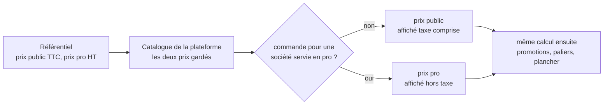

# Le chemin du prix — du référentiel au rayon, et au panier

> ✅ **Décrit le code au 2026-11-04**, réécrit ce jour-là contre le code. La
> version du 2026-09-21 (lots A1, A2) décrivait un prix pro dérivé de
> l'étiquette par un rapport, et un TTC qui pouvait dériver d'un centime :
> les deux ont disparu depuis (prix pro saisi ; particulier composé en TTC).
> Partie 1 : comprendre. Partie 2 : le code.

# Partie 1 — Comprendre

## Deux prix saisis, deux audiences

Pour chaque article, l'équipe saisit **deux prix** dans le référentiel :

- un **prix public**, taxe comprise — l'étiquette que voit un particulier ;
- un **prix pro**, hors taxe — ce que paie un professionnel.

Le référentiel les envoie tous les deux à la plateforme. Ensuite, **une seule
question** décide lequel sert : _la personne commande-t-elle pour une société
servie en pro ?_

## Ce que le particulier paie

Le particulier paie **l'étiquette**, au centime : le panier part des prix taxe
comprise de chaque ligne, et la TVA en est extraite à la fin. Le total qu'il
lit est donc la somme de ses lignes, moins ses remises, plus sa livraison,
comme sur un ticket de caisse.

## Ce que le pro paie

Le pro paie son **prix hors taxe**, éventuellement modifié par sa mercuriale,
ses paliers ou ses promotions. La TVA se calcule sur le total, par taux. S'il
règle au compte, il ne voit que le hors taxe ; la TVA et le TTC sont sur sa
facture du mois.

## Qui ne voit rien

Un article sans prix public n'est pas vendu au public. Un article sans prix
pro n'est pas vendu aux pros. Un article sans taux de TVA n'est vendu à
personne. On n'invente jamais un prix ni un taux.

# Partie 2 — Le code

## 1. Du référentiel au catalogue

- **L'émission** : `pim/channels/b2b-platform/products/projection.ts`,
  `projectVariant`. Le prix pro part en hors taxe (`priceMillicents`) tel que
  saisi ; le prix public part en TTC (`publicTtcCents`) et en hors taxe par
  contexte de vente (`publicByContext`, chaque contexte avec son taux — un
  contexte sans taux n'a pas d'entrée). Le HT se dérive par `htMillicentsOf`
  (`packages/money/src/tax.ts`), au millicentime.
- **Le stockage** : `catalog_items` (`prisma/schema/public/catalog.prisma`) :
  `price_millicents`, `public_by_context`. Un prix pro absent reste `NULL`,
  jamais zéro ([`../saisie/plan-prix-manquant-non-bloquant.md`](../saisie/plan-prix-manquant-non-bloquant.md)).

## 2. Le choix du prix servi

`servedPriceOf` (`lafoliecoffee/catalog/infrastructure/prisma-catalog.reader.ts`) est
**le seul endroit** où l'audience change le prix d'entrée :

| Audience | Prix d'entrée                                                                                                        | Taux                                  | Vendu si              |
| -------- | -------------------------------------------------------------------------------------------------------------------- | ------------------------------------- | --------------------- |
| `pro`    | `price_millicents`                                                                                                   | le taux de l'article (`billableRate`) | prix et taux présents |
| `public` | `public_by_context.takeaway.htMillicents` (`PUBLIC_SALES_CONTEXT`, `lafoliecoffee/catalog/domain/public-context.ts`) | le taux de ce contexte                | l'entrée existe       |

L'audience se décide sur la société : sans société, `public` ; avec une
société, c'est son statut qui tranche (`CatalogViewers.forCompany`,
`pricingCompanyOf` — une société servie au public ne transmet pas son
identifiant au tarificateur). Le prix d'entrée passe ensuite par la même
résolution pour les deux audiences
([`../comment-un-prix-se-fabrique.md`](../comment-un-prix-se-fabrique.md)).

## 3. Au rayon

`ShopCataloguePricing` (cf.
[`architecture-prix-boutique.md`](architecture-prix-boutique.md)) sert, par
article, un prix hors taxe (`unitPriceMillicents`), son taux, et le **TTC
d'une pièce** (`unitPriceTtcCents`) calculé par
`ttcCentsFromHtMillicentsFor` (`lafoliecoffee/catalog/application/shop-catalogue-view.ts`) :

- public : `ttcCentsFromHtMillicents` (`packages/money/src/tax.ts`), l'inverse
  exact de `htMillicentsOf` — l'étiquette saisie ;
- pro : le TTC d'une ligne d'une pièce, comme la caisse.

La carte des contextes ne sort jamais du serveur ; l'écran choisit d'afficher
le HT (pro) ou le TTC (public) sans rien recalculer.

## 4. Au panier et à la commande

Le panier (`POST /shop/quote`, `/shop/quote/mine`) et la commande passent par
le même calcul (`PricingContext` → `priceBasket`,
[`../centime-et-tva/le-prix-d-un-panier.md`](../centime-et-tva/le-prix-d-un-panier.md)),
dont le prix des lignes vient de la même porte et du même `servedPriceOf`.
Deux méthodes, choisies par l'absence de société :

|                                 | Particulier (`exact_ht`)                                                                                                                                | Pro (`line_ht`)                                                          |
| ------------------------------- | ------------------------------------------------------------------------------------------------------------------------------------------------------- | ------------------------------------------------------------------------ |
| Composé en                      | **TTC** : chaque ligne à l'étiquette (`composeTtcOrder`, `packages/money/src/ttc-order.ts`, via `exact-order-composition.ts`), la TVA extraite par taux | **HT** : `computeOrderTotals` → `ventilateVat`, la TVA calculée par taux |
| Les lignes s'additionnent       | oui, en TTC, comme un ticket                                                                                                                            | en HT ; la TVA est arrondie une fois par taux sur l'assiette entière     |
| Ce qui est figé sur la commande | les TTC de ligne et de geste, la part de chaque taux (`ttc_by_rate`)                                                                                    | les HT, la TVA par taux (`vat_shares`)                                   |

La commande garde ce qu'elle a facturé : le prix, le nom et le taux de chaque
ligne sont copiés au moment de la passation et ne se recalculent plus.

## 5. Les chemins qui demandent toujours le prix pro

Écrits en dur, avec leur raison dans le code : la saisie par l'équipe d'une
commande pour une société, le comparatif de mercuriales, les écrans de
tarification professionnelle (projection, gabarits), l'atelier.

## 6. Limites connues

- **Un seul contexte public** est servi : `takeaway` (à emporter). Les autres
  contextes de `public_by_context` sont stockés mais pas lus.
- **Qui dérive le HT public** : le référentiel l'envoie déjà dérivé
  (`publicByContext`) ; la plateforme sait aussi le dériver quand elle pose sa
  propre étiquette. Les deux appellent la même fonction (`htMillicentsOf`).
