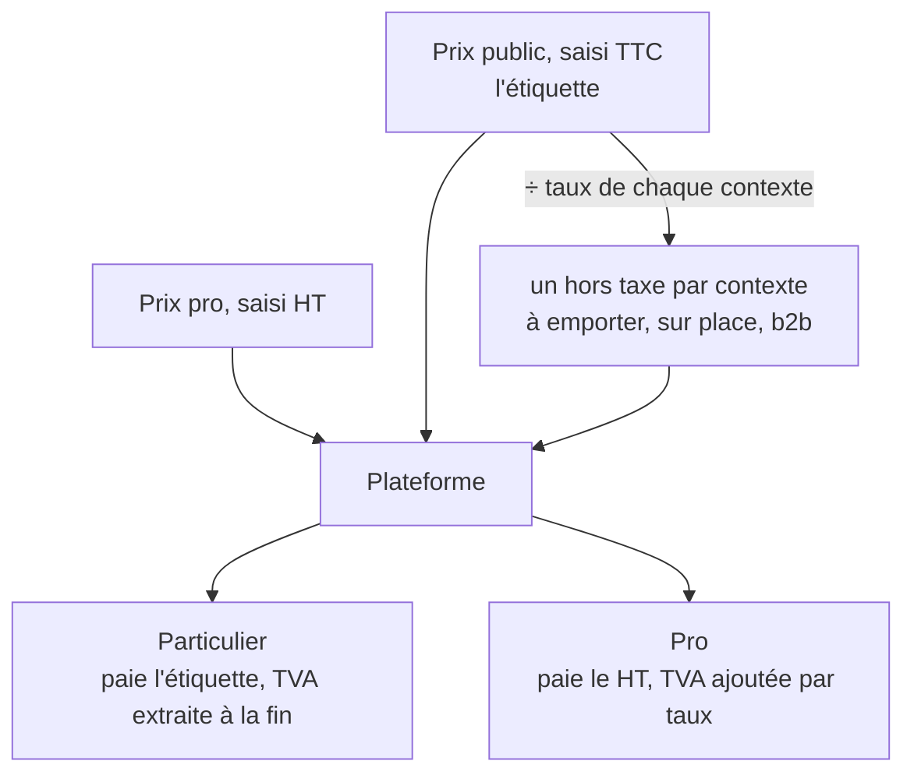

# Le prix ancré au TTC

> ✅ **Décrit le code au 2026-11-04**, réécrit ce jour-là contre le code. La
> version d'origine (2026-08-31, relue le 2026-09-06) racontait aussi le
> chantier qui a posé l'ancrage : un rapport pro qui dérivait le prix pro du
> prix public, et un ancien canal de vente en ligne. Les deux sont retirés
> (rapport : 2026-10-27 ; canal : 2026-10-16) ; le récit reste dans
> l'historique git. Partie 1 : comprendre. Partie 2 : le code.

# Partie 1 — Comprendre

## Deux prix saisis, chacun dans sa forme naturelle

- Le **prix public** se saisit **taxe comprise** : c'est l'étiquette, ce que
  lit et paie un particulier. Le même croissant coûte le même prix qu'on
  l'emporte ou qu'on le mange sur place ; c'est le hors taxe qui change, parce
  que le taux change.
- Le **prix pro** se saisit **hors taxe** : c'est ainsi qu'un professionnel
  achète et qu'une facture professionnelle se rédige.

Aucun des deux n'est dérivé de l'autre.

## Pourquoi le TTC fait foi pour le public

Passer de l'étiquette au hors taxe puis revenir au TTC peut perdre un centime.
Le sens de la perte est choisi : **l'étiquette ne bouge jamais**. On ne
recalcule pas une étiquette à partir de son propre hors taxe. Et la commande
d'un particulier est composée en partant de l'étiquette, si bien qu'il paie
exactement le prix affiché.

## Les deux règles qui protègent l'argent

1. **Un prix ou un taux manquant ne s'invente pas.** Sans prix public,
   l'article n'est pas vendu au public ; sans prix pro, pas aux pros ; sans
   taux, à personne.
2. **Une seule fonction convertit.** Le référentiel et la plateforme
   convertissent un TTC en hors taxe avec la même fonction, pour qu'ils ne
   divergent jamais d'un centime.

# Partie 2 — Le code

## 1. Où vivent les prix saisis

| Prix                       | Colonne                                              | Unité                   |
| -------------------------- | ---------------------------------------------------- | ----------------------- |
| Public                     | `pim.product_variant.price_cents`                    | centimes **TTC**        |
| Pro                        | `pim.product_variant.pro_price_millicents`           | millicentimes **HT**    |
| Prix au kilo (informatifs) | `pro_price_per_kg_millicents`, et son pendant public | saisis, jamais calculés |

Les taux vivent dans le référentiel, par contexte de vente et par famille ou
produit ([`../../pim/contextes-et-points-de-vente.md`](../../pim/contextes-et-points-de-vente.md)).

## 2. La conversion

- `htMillicentsOf(ttcCents, taux)` et `htFromTtc` (`packages/money/src/tax.ts`) :
  le taux passe par des **points de base entiers** avant la division (`5.5 *
100` vaut `550.0000000000001` en binaire), un seul arrondi, au
  millicentime. `null` sans taux : un refus, pas un repli.
- `ttcCentsFromHtMillicents` (même fichier) : l'inverse exact, qui retombe sur
  l'étiquette.
- Le référentiel et la plateforme importent ces fonctions depuis `@lfd/money`
  (`@lfd/pim-contracts` les réexporte).

## 3. L'émission vers la plateforme

`catalog-facts.ts` puis `projectVariant`
(`pim/channels/b2b-platform/products/`) :

- le prix pro part tel que saisi (`priceMillicents`, via `proPriceOf` de
  `@lfd/pim-contracts`) ;
- le prix public part en TTC (`publicTtcCents`) et en hors taxe **par
  contexte** (`publicByContext`, chaque contexte avec son taux ; un contexte
  sans taux n'a pas d'entrée) ;
- une déclinaison sans aucun prix est écartée avant
  (`IncompleteVariantProjectedError` si elle arrive quand même) ; un prix
  absent part `null`, jamais zéro.

## 4. La lecture côté plateforme

`servedPriceOf` choisit le prix d'entrée selon l'audience (cf.
[`../boutique-et-panier/chemin-du-prix-public.md`](../boutique-et-panier/chemin-du-prix-public.md)).
La résolution des étages (mercuriale, volume, promotion, geste, plancher)
travaille **en hors taxe** pour les deux audiences
([`../comment-un-prix-se-fabrique.md`](../comment-un-prix-se-fabrique.md)).
Ce qui diffère est la **composition de la commande**
([`le-prix-d-un-panier.md`](le-prix-d-un-panier.md) § 8) :

- **particulier** (`exact_ht`) : chaque ligne repart de l'étiquette
  (`ttcCentsFromHtMillicents`), la commande se compose en TTC
  (`composeTtcOrder`), la TVA s'extrait par taux à la fin ;
- **pro** (`line_ht`) : la commande se compose en HT, la TVA s'ajoute par taux
  (`ventilateVat`).

## 5. Ce qui reste en base sans être lu

- `pim.accounting_rules.pro_price_ratio_bp` et `pro_price_method` : l'ancien
  rapport pro et sa méthode, plus lus depuis le 2026-10-27 (une colonne morte
  reste en base, CLAUDE.md § 0).
- ⚠️ Les commentaires du schéma Prisma de `product.prisma` décrivent encore
  `price_cents` comme un prix « HT » et le prix pro comme dépendant de la
  méthode `ratio_ttc` : ils sont périmés (relevé le 2026-11-04, à corriger).
