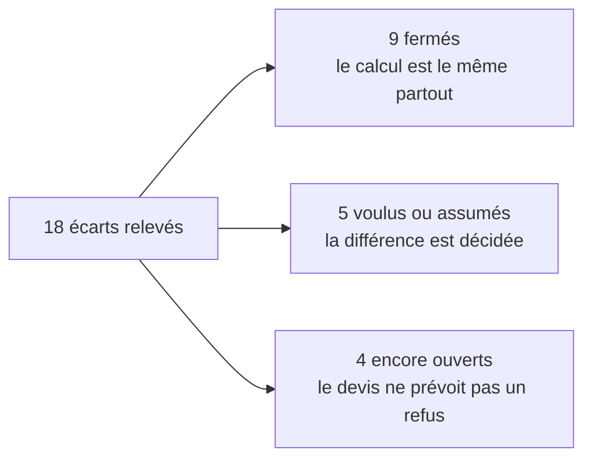

# Les écarts du chiffrage — É1 à É18

> ✅ **État des écarts au 2026-11-04**, réécrit ce jour-là contre le code.
> L'inventaire d'origine (2026-11-03, « C0 ») décrivait en détail les cinq
> façons dont le code chiffrait alors un panier ; ces assemblages ont été
> remplacés par un seul calcul
> ([`le-prix-d-un-panier.md`](le-prix-d-un-panier.md)). Le relevé détaillé
> reste dans l'historique git. Ce document garde ce qui sert encore : **les
> codes É**, que le code, les tests et le golden master citent.
> Partie 1 : comprendre. Partie 2 : l'état de chaque écart.

# Partie 1 — Comprendre

## D'où viennent ces codes

Le 2026-11-03, le prix d'un panier se calculait de **cinq façons** différentes,
selon l'endroit :

| Code  | Chemin                                                                          |
| ----- | ------------------------------------------------------------------------------- |
| **A** | le devis de la boutique et de l'espace pro                                      |
| **B** | le simulateur de prix (et, jusqu'au 2026-11-04, les prix de ligne de la saisie) |
| **C** | la passation d'une commande                                                     |
| **D** | la modification d'une commande                                                  |
| **E** | l'estimation de la saisie de l'équipe                                           |

En comparant ces cinq chemins, on a relevé **18 écarts** : des endroits où deux
chemins ne disaient pas la même chose sur le même panier. Chacun a reçu un
numéro, É1 à É18. Le chantier « un seul calcul » les a ensuite traités un par
un.

## Ce que chaque écart est devenu

Les quatre écarts ouverts ont **tous la même forme** : le devis de la
boutique ne juge pas une règle que la commande, elle, applique. Le client voit
un prix juste, mais la commande peut ensuite être **refusée** pour une raison
que le devis n'a pas annoncée. **Aucun ne fait facturer un montant faux** : la
commande refuse, elle ne se trompe pas de prix.

# Partie 2 — L'état de chaque écart

| Écart   | Ce qui différait                                                                                                      | État au 2026-11-04                                                                                                                                                                                                            | Où c'est tenu                                                                                                                             |
| ------- | --------------------------------------------------------------------------------------------------------------------- | ----------------------------------------------------------------------------------------------------------------------------------------------------------------------------------------------------------------------------- | ----------------------------------------------------------------------------------------------------------------------------------------- |
| **É1**  | Une ligne dont l'unité de vente a changé : le devis la retire, la commande la refuse                                  | **Assumé** : le devis la retire et le dit (`removedLines`, motif `sale_unit_changed`) ; une commande ne perd pas une ligne en silence                                                                                         | `shop-cart-quoting.service.ts`, `pricing-context.service.ts`                                                                              |
| **É2**  | Le classement des articles n'était pas toujours lu par le devis                                                       | **Fermé** : `PricingContext.loadCart` classe toujours                                                                                                                                                                         | `pricing-context.service.ts`                                                                                                              |
| **É3**  | L'audience n'était lue qu'avec un acheminement                                                                        | **Fermé** : lue une fois ; un panier sans acheminement le dit (`awaiting: ["fulfillment"]`)                                                                                                                                   | `price-basket.ts`, `awaitingOf`                                                                                                           |
| **É4**  | En livraison, le devis chiffre au code postal, la commande exige l'adresse                                            | **Voulu** : le prix ne dépend que du code postal ; l'adresse est un contrôle de la commande                                                                                                                                   | `basket-route-loading.ts`, `basket-pricing-context.ts`                                                                                    |
| **É5**  | La fenêtre d'ouverture du point de retrait                                                                            | **Ouvert** : le devis ne l'oppose pas, la commande refuse un créneau hors des heures du point (`windowFitsPickup`)                                                                                                            | `pricing-context.service.ts` (la passation), `agreed-fulfillment.ts`                                                                      |
| **É6**  | Une promotion jugée au créneau, sans créneau connu                                                                    | **Fermé** : le devis le dit (`awaiting: ["window"]`) au lieu d'un total silencieusement sans elle                                                                                                                             | `price-basket.ts`                                                                                                                         |
| **É7**  | Les promotions terminées aujourd'hui                                                                                  | **Fermé** : `priceBasket` les rend (`ended`) ; le devis les montre                                                                                                                                                            | `price-basket.ts`                                                                                                                         |
| **É8**  | Le refus d'un bon de fidélité sur une commande de société : avant le chiffrage au devis, dans l'agrégat à la commande | **Assumé** : même erreur, même imputation ; seul l'ordre diffère                                                                                                                                                              | `shop-cart-quoting.service.ts`, `order-amount-guards.ts`                                                                                  |
| **É9**  | Le mode de TVA du port : celui du jour, ou celui de la commande                                                       | **Tranché** (Hugo, 2026-11-03) : le jour pour un panier, le figé pour une révision                                                                                                                                            | `PricingContext` (`deliveryVatMode`)                                                                                                      |
| **É10** | L'heure limite                                                                                                        | **Ouvert** : le devis de la boutique ne juge ni le jour ni l'heure limite ; la commande refuse ou surtaxe                                                                                                                     | ordre des refus, [`le-prix-d-un-panier.md`](le-prix-d-un-panier.md) § 2.4 et § 9                                                          |
| **É11** | Le supplément de retard absent du devis                                                                               | **Fermé** (lot T1) : le devis d'un client rattaché à une société juge la surtaxe sans consommer la dérogation                                                                                                                 | `LateFeeJudgement`, `OrderCutoffGate.foresee`                                                                                             |
| **É12** | Les créneaux d'un pro saisi par l'équipe : la révision ne suivait pas la règle de la passation                        | **Fermé** (L1b) : une seule règle                                                                                                                                                                                             | `windowRequesterOf`, `domain/services/delivery-window.ts`                                                                                 |
| **É13** | La clientèle d'une révision : celle d'aujourd'hui au lieu de celle de la commande                                     | **Fermé** (L1b) : contexte figé sur la commande (`frozenAudience`). Reste : le prix d'une ligne **nouvelle** se résout au statut du jour                                                                                      | `OrderRevising`, CGV figées                                                                                                               |
| **É14** | Le payeur, le mur de l'acheteur, l'admission : jugés à la commande, pas au devis                                      | **Ouvert** : le devis ne juge pas qui a le droit de commander                                                                                                                                                                 | ordre des refus, rangs 0 et 1                                                                                                             |
| **É15** | La ventilation de TVA assemblée deux fois                                                                             | **Fermé** (L2) : le devis lit les montants de la commande (`draftedAmountsOf`)                                                                                                                                                | `shop-quote-view.ts`                                                                                                                      |
| **É16** | Le simulateur (B) sans acheminement : son sous-total peut différer d'un centime pour un particulier                   | **Assumé** : B ne sert plus qu'au simulateur de prix ; la saisie lit l'estimation                                                                                                                                             | golden master, `KNOWN_GAPS` (`test/pricing-golden-master-properties.ts`)                                                                  |
| **É17** | Une promotion « inscrits » : le devis anonyme est plus cher que la commande du même client connecté                   | **Voulu** : la porte se lit sur la route (invité ou inscrit)                                                                                                                                                                  | `buyerKind`, paramètre du chiffrage                                                                                                       |
| **É18** | Une société suspendue servie par la saisie de l'équipe                                                                | **Tranché** deux fois : L1c (2026-11-03) refusait le compte ; **S1** (2026-11-03) aligne tout sur le client — une société suspendue est servie à son tarif, comme une active, **sauf le crédit** (pas de règlement au compte) | `staff-settlement-refusal.ts`, [`../../comptes-client/plan-suspendue-au-prix-pro.md`](../../comptes-client/plan-suspendue-au-prix-pro.md) |

## Où les codes sont encore cités

- **Le golden master** (`test/pricing-golden-master*.ts`) : É16 est le seul
  écart encore admis (`KNOWN_GAPS`) ; une différence nouvelle entre un devis
  et une commande y fait échouer le test.
- **Le code** : les commentaires de `pricing-context.service.ts`,
  `basket-route-loading.ts`, `basket-pricing-context.ts` (É1, É4, É5) et de
  quelques suites de tests nomment l'écart qu'ils assument.

## Ce qui reste à décider

Les quatre écarts ouverts (É5, É10, É14, et la ligne nouvelle d'É13) ont la
même question : **le devis de la boutique doit-il annoncer les refus que la
commande opposera** (fenêtre du point, heure limite, droit de commander), ou
seulement le prix ? Aujourd'hui, seulement le prix.
