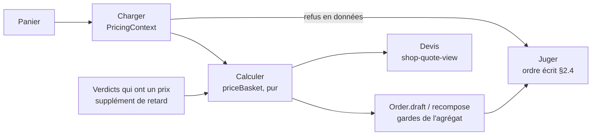

# Le prix d'un panier : charger, calculer, juger

> ✅ **Doc d'état**, écrite le 2026-11-04 à partir du code, à la clôture du
> chantier « une seule manière de calculer » (lots L0 à L7, T1 à T3, S1).
> Elle remplace trois plans supprimés ce jour-là — le prix d'un panier
> (`plan-un-seul-assemblage`), le total vu (`plan-total-vu`) et les montants
> lus (`plan-l6-montants-lus`) — qui restent dans l'historique git avec les
> objections de `vitruve`. Les numéros de section du premier sont gardés : le
> code les cite.
>
> Hugo : « je veux une seule manière de calculer » ; « pourquoi on ne suit pas
> le même flow cart → order ? » ; « ça marchera aussi pour les particuliers ? ».
> L'inventaire des écarts qui l'a fondé, et que le golden master cite encore
> (É2 à É18) : [`inventaire-c0-assemblages.md`](inventaire-c0-assemblages.md).

## 1. Ce que fait chaque chemin, et une seule fois

Tout chemin qui chiffre un panier — devis de la boutique et de l'espace pro
(`ShopCartQuoting`), devis du simulateur (`OrderQuoting`), passations
(`OrderDrafting.draft` → `Order.draft`), estimation de la saisie, révision
(`OrderRevising`) — fait trois choses **séparées** :

Une commande ne naît que d'un panier chiffré : `Order.draft`, `recompose` et
`revise` n'acceptent que `PricedDraftInput` (panier chargé + `pricing`) et
appellent eux-mêmes `priceBasket`, une seule fois. L'entrée aux montants déjà
composés a été supprimée (L7, Hugo, option 2a) : les tests et la planche des
documents passent par un panier chargé.

## 2. Les trois temps

### 2.1 Charger — `PricingContext`, et ses refus en données

`PricingContext.load` / `loadCart` (`application/services/pricing-context.service.ts`)
lisent **une fois** tout ce que le calcul consomme : paliers par article
(`pricer.load`), point ou zone, promotions vivantes et faits de l'acheteur,
classement des articles (toujours lu, É2), bon, mode de TVA du port.
Classement et clientèle se lisent en parallèle. Aucune lecture n'attend un
montant.

**Les refus de lecture sont des données** (`context.refusals`) : article
inconnu, réservé, unité ou pas de vente, minimum, point fermé à la clientèle.
Le devis les montre, la passation les lève au rang 4 de l'ordre (§ 2.4).

**L'instant n'est pas une lecture datée.** La porte du prix dit « maintenant »
par l'absence d'instant ; le chargeur ne lui en passe jamais (un instant
explicite a fait payer le prix pro à un invité le 2026-10-30). Un seul `now`
gelé par requête (CLAUDE.md §3.2).

### 2.2 Calculer — `priceBasket`, pur, appelé par l'agrégat

`priceBasket(context, cart, verdicts): BasketAmounts`
(`domain/services/price-basket.ts`) : synchrone, déterministe. Il réemploie
`AMOUNTS_BY_METHOD` (`order-amounts.ts`), `computeOrderTotals`,
`ventilateVat`, `composeExactOrder`. Il rend les termes, le sous-total, les
remises rejouées refusées, les promotions écartées au-delà de cinq, les
remises finies du jour (É7) et ce que le panier n'a pas encore dit
(`awaiting`, § 2.5).

L'agrégat l'appelle et garde ses notes (`order.pricingNotes()`, jamais
persistées) : la passation y lit l'alerte « plus de cinq promotions », la
révision les remises perdues — sans refaire le calcul. L'agrégat garde aussi
ses gardes (`order-amount-guards.ts`, `order-cumulated-discounts.ts`,
`order-exact-amounts.ts`) : aucun panier ne peut plus les déclencher, elles
restent comme **filet** contre un défaut du calcul, testées en direct
(`order-amount-guards.spec.ts`, `order-cumulated-guards.spec.ts`).

### 2.3 Les verdicts qui ont un prix

Le supplément de retard dépend d'un verdict (l'heure limite et la dérogation,
jugées sur le point retenu). `priceBasket` le reçoit (`verdicts.lateFee`). À
la passation, le jugement consomme la dérogation ; au devis d'un client
rattaché à une société, le **même jugement sans consommation**
(`LateFeeJudgement`, `OrderCutoffGate.foresee`) chiffre la surtaxe prévue
(É11 fermé). Un supplément nul ou absent n'ajoute rien et ne dit rien.

### 2.4 Juger — l'ordre des refus, écrit ici et mesuré

Les règles restent dans leurs services ; leur **ordre** est celui-ci, et
nulle part ailleurs :

0. le refus du lien au comptoir (`prepareStaffOrder`) — il nomme la
   suspension ou l'inactivité de la société ;
1. payeur ;
2. décision de la marque, vitrine ou fabrication ;
3. jour ouvert, sans verrou ;
4. refus de chargement (§ 2.1) ;
5. circuit et heure limite ;
6. opérations datées, réglages, TVA du port (`composition.arrange`) ;
7. gardes de l'agrégat (`Order.draft`) ;
   7 bis. le total vu (`ensureTotalSeen`, § 7) — après les gardes, avant le
   règlement, pour qu'aucun refus ne laisse d'intention Stripe ;
8. règlement au compte sans crédit (`settleOrder`, `staffSettlementRefusal`) ;
9. sous verrou, dans la transaction : vitrine, plan (`hold`).

Mesuré sur quatre portes (client dans son espace, invité, saisie de l'équipe,
son estimation) par `apps/lfd-api/test/pricing-golden-master-refusal-paths.ts`.
Les règles à deux implémentations (sans verrou en conseil, sous verrou en
exécution) sont prouvées concordantes : plan et dérogation
(`test/pricing-golden-master-pairs.ts`), vitrine
(`shelf-circuit-concordance.spec.ts`), heure limite (balayage minute à
minute, `order-cutoff-guard-foreseen.spec.ts`).

Une société **suspendue** est servie comme une active (prix, clientèle, CGV),
sauf le crédit : pas de règlement au compte (S1,
[`../../comptes-client/plan-suspendue-au-prix-pro.md`](../../comptes-client/plan-suspendue-au-prix-pro.md)).

### 2.5 La complétude

`BasketAmounts.awaiting` dit ce que le panier n'a pas encore dit
(`fulfillment`, `window`) ; vide, le chiffrage est le prix de la commande.
`ShopQuoteView.awaiting` le sert (absent d'un panier complet). Le panier du
visiteur arrive au corps sans aucun montant.

## 3. La preuve : le golden master

`apps/lfd-api/test/pricing-golden-master.e2e-spec.ts` et ses modules
`pricing-golden-master-*.ts`, instantané
`pricing-golden-master.snapshot.json`. Horloge figée sur un mercredi à 10 h,
32 paniers à graine fixe, 19 chemins par panier, les décisions et l'ordre des
refus en cas fixes. Régénérer : `LFD_GOLDEN_MASTER_WRITE=1`, jamais par
défaut, puis prettier.

- **G2** : commande et révision reproduites au centime ; refus comparés par
  code. Écarts admis, nommés dans `pricing-golden-master-properties.ts` :
  **É16** (le devis du simulateur, sans acheminement — § 9).
- **G3** : TTC = HT + TVA par taux, aucun montant négatif, même panier même
  résultat, ordre du § 2.4.

Chaque changement du chiffrage passe `pnpm --filter lfd-api test:e2e:orders`
en local, puis la CI de `dev`.

## 4. Les lectures

Comptées en opérations ORM, à l'égalité stricte, par
`apps/lfd-api/test/pricing-budget.e2e-spec.ts` (la base de production est
facturée à l'opération) : devis anonyme 10 à froid, 5 à chaud ; devis d'une
société 20 à froid ; estimation de la saisie 31 à froid. Le nombre ne grandit
pas avec la taille du panier.

L'estampille du cache des matériaux (`pricing_events`) se lit une fois par
requête (`pricing-materials.cache.ts`, gardée sur l'objet de contexte de la
requête) ; l'offre de connexion réemploie le classement de `loadCart`.

Écarté, et pourquoi : le statut de la société lu trois fois par passation
(trois services, les réunir est une décision de conception) ; les CGV lues
deux fois (`OrderIntake` assume de relire) ; l'heure limite relue par
l'estimation ; `order_delivery_vat` et le catalogue hors du cache faute
d'invalidation. Le catalogue de la boutique a son propre plan :
[`../../caching-usage/plan-cache-du-catalogue.md`](../../caching-usage/plan-cache-du-catalogue.md).

## 5. Ce qui n'est pas de ce sujet

Les montants figés des commandes passées ne se recalculent pas. La saisie
reste un écran de l'équipe. Les deux paniers (client, brouillon de l'équipe)
restent distincts.

## 6. Les décisions de Hugo (2026-11-03 et 2026-11-04)

- **É18 / S1** : la saisie de l'équipe sert une société suspendue comme le
  client dans son espace ; depuis S1, au tarif de la société, sans compte.
- **Le crédit** au rang 8, juste après les gardes de l'agrégat.
- **É12** : la révision suit la règle E1 des créneaux du pro
  (`windowRequesterOf`, `delivery-window.ts`).
- **É13** : la révision garde la clientèle figée sur la commande
  (`frozenAudience`, CGV figées).
- **É9** : le mode de TVA du port du jour pour un panier, le figé pour une
  révision.
- **Le total vu obligatoire** (§ 7) ; **pas de colonne HT** (§ 8) ; **la
  saisie ne lit que l'estimation** (§ 9) ; **une seule entrée chiffrée** pour
  l'agrégat (§ 1).

## 7. Le total vu est le total facturé

### 7.1 La règle

**Une commande ne naît jamais à un montant que le client n'a pas vu.** Les
trois passations (boutique, espace pro, saisie de l'équipe) reçoivent
`expectedTotalCents`, **obligatoire** (contrat cassé sur décision, pré-release),
**hors de l'empreinte d'idempotence** (`order-fingerprint.ts`) : un renvoi sous
la même clé avec le nouveau total fait naître la commande. Le TTC composé est
comparé au rang 7 bis ; différent, refus 409 `orders.total_changed`
(`OrderTotalChangedError`, faits publiés : `expectedTotalCents`,
`totalCents`). L'estimation de la saisie a son schéma sans le champ
(`adminOrderEstimatePayloadSchema`).

Les écrans : la validation est grisée tant qu'un devis (boutique) ou une
estimation (saisie, `estimateReady`) est en vol ; le total envoyé est celui
qui est affiché.

### 7.2 Le détail « par terme »

Le serveur ne reçoit qu'un total : il ne sait pas quel terme le client avait
vu. Sur un 409, l'écran redemande un devis (`ShopQuote.refresh()`) ou une
estimation et **compare deux réponses du serveur**, terme à terme — surtaxe,
port, remises, remises finies, lignes retirées, prix (`quote-changes.ts`,
`estimate-changes.ts`) — en un seul message (`TotalChangedCallout`).
Les montants y sont en TTC, même pour un pro qui voit du HT.

## 8. Un écran lit ses montants, il ne les calcule pas

### 8.1 La règle

Une commande passée est une lecture ; un devis aussi. Le « Total HT » d'un pro
au compte suit une seule règle, `orderPretaxCents`
(`packages/money/src/order-pretax.ts`) — articles moins remises, plancher à
zéro, plus livraison et supplément — appliquée **au serveur**. Pas de colonne
HT : les gestes HT sont figés sur chaque commande, ancienne comprise ; la
facture du mois les recompose elle-même et facture ce qui est parti. Le
particulier lit son TTC, figé ligne par ligne et geste par geste (`exact_ht`) ;
seules les commandes d'avant ces colonnes gardent, au PDF, la répartition au
prorata qui retombe sur le total figé.

### 8.2 Les champs servis

- `pretaxCents` dans `OrderView` / `CustomerOrderView`, `SheetMoney` (HT
  **commandé** sur le bon de commande, HT **livré** sur le bon de livraison),
  `ShopQuoteView`, `AdminOrderEstimateAmountsView`.
- `voucherRemainderCents` dans `MyShopQuoteView` : valeur du bon moins sa part
  faciale imputée (l'écran soustrayait la part HT : 0,26 € de « reste » sur un
  bon de 5 € entièrement utilisé).

### 8.3 La porte

`lint:front-money-reads` (`dev-toolbox/gates/front-money-reads.mjs`), sur les
fronts et `@lfd/b2b-ui` : refuse l'import de la règle et la forme
« total − TVA » ; compte en **dette, en baisse seulement**, les écrans qui
somment encore des montants (factures, périodes, dossier, ticket…). La
différence entre deux totaux (un tri, une comparaison) n'est pas visée.

## 9. Ce qui reste

- **La dette de la porte** (§ 8.3) : dix écrans, chacun un champ serveur à
  créer ; plus deux écarts soustraits à l'écran que la porte ne voit pas, le
  lot de prélèvement et l'historique des révisions.
- **É16** : le devis du simulateur (`/orders/quote`, `/admin/orders/quote`)
  n'a pas d'acheminement ; il ne sert plus qu'au simulateur de prix, où
  l'écart est assumé. La saisie (commercial et comptoir) ne lit que
  l'estimation.
- **L'ordre des refus**, ce qui n'est pas rangé : le devis de la boutique juge
  les opérations datées (6) avant le chargement (4) et ne juge ni le jour ni
  l'heure limite ; le mur de l'acheteur, la porte de la boutique et la lecture
  du bon passent avant le rang 0 ou 1 sans rang écrit ; les rangs 1 (payeur)
  et 6 ne sont pas mesurés.
- **Les lectures écartées** au § 4.
