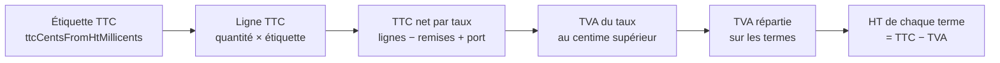

# Un particulier paie la somme de ses étiquettes

> ✅ **Doc d'état.** Une commande de particulier (`vat_method = exact_ht`) se
> compose en **TTC**, de la ligne au total ; la TVA s'extrait par taux à la
> fin, au centime supérieur, et le HT est la différence. Le pro garde son
> calcul (`line_ht`) : HT de ligne arrondi une fois, TVA une fois par taux
> (BR-S-08 d'EN 16931). Décisions de Hugo du 2026-10-27 (§ 9).

## 1. Le problème que ça règle

Banana bread, étiquette **21,00 € TTC** à 5,5 %. Calculé en pro — HT dérivé
19,90521 €, arrondi à 19,91 €, TVA 1,10 € —, le total vaut **21,01 €** :
21,00 € est inatteignable, à cause d'un premier arrondi du HT avant que la
TVA ne soit remise dessus. Même cause pour 1,90 € + 0,50 € payés 2,39 €.
Composé en TTC, le client paie 21,00 € : TVA ⌈1,0948⌉ = 1,10 €, HT 19,90 €.

## 2. Ce que dit le droit (recherche du 2026-10-27, sans le cabinet)

- **L'arrondi n'est pas fixé par le droit de l'Union** (CJCE, 10 juillet
  2008, _Koninklijke Ahold_, C-484/06) : il relève des États membres.
- **Le droit français n'impose pas, à notre connaissance, de méthode
  d'arrondi.** Le BOFiP (`BOI-TVA-DECLA-30-20-20-10`, § 260 à 320) exige sur
  une facture le taux par ligne et, par taux, le total HT et la taxe ; rien
  sur les centimes.
- **Le détail calcule déjà « en dedans »** : la ventilation des recettes TTC
  des commerçants sans facture (`BOI-TVA-DECLA-30-10-20`, art. 268 bis du CGI)
  dérive la taxe de la recette TTC. C'est une **analogie**, pas un fondement.
- **Le prix affiché est TTC** (Code de la consommation, L112-1 et suivants) :
  prélever 21,01 € pour une étiquette à 21,00 € est le vrai risque.
- **L'e-reporting B2C** (2027) ne demande que des agrégats : HT et TVA par
  taux sur la période.

Aucune interdiction trouvée, aucune autorisation écrite non plus. Le système
n'émet aucune facture à un particulier (`card-invoicing.ts`).

## 3. Ce que fait un grand distributeur

Un ticket de drive (caisse NF 525) montre des lignes TTC seulement, un total
égal à leur somme, et par taux TTC · TVA · HT : la TVA extraite du TTC de
chaque taux, le HT par différence. Ce ticket arrondit au plus proche ;
l'arrondi **au supérieur** retenu ici est une exigence de Hugo (« ne surtout
pas avoir moins de TVA »), pas un usage.

## 4. Le modèle

Pour une commande `exact_ht`, chaque terme est d'abord un montant TTC :

| Terme           | Son TTC                                                                                                        |
| --------------- | -------------------------------------------------------------------------------------------------------------- |
| Ligne           | quantité × étiquette TTC, l'étiquette étant `ttcCentsFromHtMillicents(prix résolu, taux)` — promotion comprise |
| Ligne au poids  | étiquette TTC au kilo × grammes / 1000, arrondie au centime ([`vente-au-poids.md`](../vente-au-poids.md))      |
| Remise retrait  | sur le TTC des lignes éligibles (§ 5, R2)                                                                      |
| Bon de fidélité | sa valeur faciale TTC, sur le TTC des marchandises après remise (§ 5, R3)                                      |
| Frais de zone   | le barème converti en TTC à son taux (§ 5, R1)                                                                 |
| Total           | Σ TTC des lignes − remises TTC + frais TTC — c'est ce que Stripe prélève                                       |

Puis, **pour chaque taux** (`composeTtcOrder`, `packages/money/src/ttc-order.ts`,
en entiers) :

1. **TTC net du taux** = Σ TTC des termes de ce taux ; une remise ou un port
   qui touche plusieurs taux est d'abord découpé par taux au plus fort reste
   (`splitCents`, `order-vat-split.ts`).
2. **TVA du taux** = TTC × taux / (100 + taux), **au centime supérieur**.
3. **La TVA se répartit sur les termes** (`ttc-vat-allocation.ts`) : chaque
   terme reçoit l'arrondi commercial (la moitié s'éloignant de zéro) de la
   TVA qu'il contient, signée ; l'écart se distribue un centime à la fois aux
   plus forts restes dans le sens de l'écart. Un terme de TTC nul ne reçoit
   rien, aucun HT ne prend le signe contraire de son TTC, et à égalité l'ordre
   est fixe : lignes dans l'ordre, puis remise retrait, bon, port.
4. **HT de chaque terme** = son TTC − sa part de TVA.

Ce qui en sort : les colonnes HT gardent leur sens et s'additionnent
exactement (Σ HT + TVA = total, sans colonne d'écart) ; la TVA n'est jamais
inférieure à HT net × taux (surplus < 1 c par taux) ; le client paie
Σ quantité × étiquette, moins ses remises, plus son port.

## 5. Les règles commerciales

Les réglages restent saisis comme avant ; c'est leur application au
particulier qui se fait en TTC.

- **R1 — Frais de zone** saisis HT : convertis en TTC à leur taux (20 % en
  mode standard ; découpés au prorata du TTC des marchandises par taux en
  mode « suit la marchandise »). **R1 bis** : un frais en pourcentage
  s'applique au TTC des marchandises.
- **Tout pourcentage appliqué à un TTC** s'arrondit par `cartAdjustmentCents`,
  au plus proche, la moitié vers le haut.
- **R2 — Remise retrait** : un pourcentage s'applique au TTC éligible ; un
  montant fixe saisi HT est converti par `ttcOfHtAmount`
  (`packages/money/src/ttc-of-ht-amount.ts`), la seule conversion, qu'appellent
  devis, agrégat, révision et BL. La trace garde l'ajustement tel que saisi
  (HT), le montant appliqué TTC va dans sa colonne (§ 7).
- **R3 — Bon de fidélité** : pour un particulier, la valeur d'un palier est
  un montant **TTC**, imputé sans conversion ; pour un pro, elle reste HT.
- **R4 — Promotions, paliers, prix barrés** : le prix résolu reste HT ; la
  ligne TTC en dérive par quantité × étiquette.
- **R5 — Surtaxe de retard** : n'existe pas sur une commande de boutique ;
  `Order.draft` lève `LateFeeOnPersonalOrderError` si une commande `exact_ht`
  en porte une.
- **R6 — Registre de fidélité** : `appliedCents` décompte la valeur faciale du
  bon dans l'unité de l'audience — TTC pour un particulier, HT pour un pro.

Les gardes de l'agrégat (`order-amount-guards.ts`) comparent des **TTC** pour
`exact_ht`.

**La révision** : la méthode se lit sur la commande (`vat_method`), jamais sur
la clientèle ; une commande `line_ht` révisée reste `line_ht`. Les montants
passent dans l'unité de la méthode.

**Le bon de livraison partiel** d'une commande `exact_ht` est recomposé en
entier par la même fonction sur les lignes livrées
(`delivery-notes/domain/services/exact-departure.ts`) : port fixe = TTC figé
sur la commande ; port en pourcentage et remise retrait refaits sur le TTC
livré ; bon = TTC imputé, borné au TTC livré après remise.

## 6. Où ça vit

| Endroit                                                                            | Particulier (`exact_ht`)                                                                  |
| ---------------------------------------------------------------------------------- | ----------------------------------------------------------------------------------------- |
| `@lfd/money`                                                                       | `composeTtcOrder`, `ttcOfHtAmount`, `ttc-vat-allocation.ts` ; `ventilateVat` reste au pro |
| Vignette, fiche, prix barré (`shop-catalogue-view.ts`, `shop-catalogue-struck.ts`) | étiquette par `ttcCentsFromHtMillicents`                                                  |
| Commande                                                                           | `exact-order-composition.ts`, `OrderLine.ofTtc` (le HT est reçu de la composition)        |
| Méthode                                                                            | `order-vat-method.ts` : `exact_ht` sans société, `line_ht` pour une société               |
| Documents (« Mes commandes », bon de commande, e-mail)                             | lignes TTC, total, puis « dont TVA » par taux — le format du ticket, lu sur `ttc_by_rate` |
| Facture, Factur-X, avoir                                                           | sans objet : aucune facture à un particulier                                              |

## 7. Les colonnes

- `vat_method` (`line_ht` | `exact_ht`) sur `orders` et `delivery_notes`,
  non nulle.
- Les TTC de chaque terme : `order_lines` porte ses TTC scellés
  (`unit_price_ttc_cents`, `line_total_ttc_cents`) ; `orders` et
  `delivery_notes` portent `discount_ttc_cents`, `voucher_ttc_cents`,
  `delivery_fee_ttc_cents` et `ttc_by_rate`, renseignés pour `exact_ht`
  seulement.
- Les colonnes HT reçoivent le HT calculé au § 4 : même sens, mêmes lecteurs.

Deux méthodes coexistent pour toujours : un lecteur qui recompose un total lit
les colonnes figées, jamais le prix unitaire.

## 8. Qui voit quel calcul : l'espace de travail

La boutique déclare l'espace de travail sur chaque requête ; les routes
reçoivent la société agissante (`@ActingCompany()`), `null` dans l'espace
perso. Cette société décide déjà de l'audience des prix et de la clientèle de
la commande ; la méthode la suit sans rien ajouter. Un pro dans son espace
perso voit le calcul particulier ; aucun chiffre ne bouge dans un espace
société.

## 9. Les décisions de Hugo (2026-10-27)

- « On sépare le calcul particulier » : le pro garde le sien.
- « On ne doit surtout pas avoir moins de TVA » : arrondi au supérieur.
- « Si la grande surface le fait pour le particulier on y va » : TVA en
  dedans.
- Q1, sans attendre le cabinet : « je l'assume, il vaut mieux faire payer un
  centime de plus et être juste par rapport à l'État » — le HT absorbe le
  centime, jamais la TVA ni le client.
- Q2 : pour un particulier, la valeur d'un palier de fidélité est TTC.
