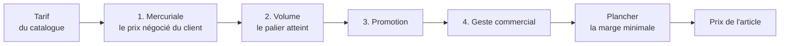
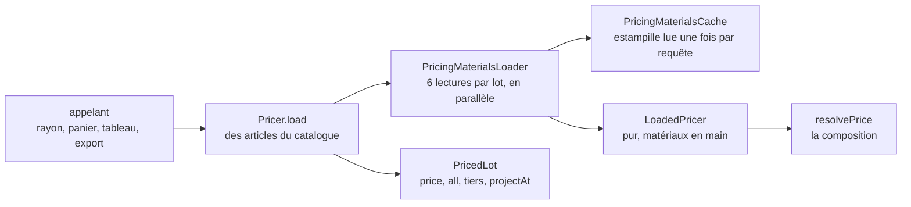

# Comment un prix se fabrique

> ✅ **Décrit le code au 2026-11-04**, réécrit ce jour-là contre le code. Le
> prix **d'un article**. Le prix d'un **panier** (remises de panier,
> livraison, TVA, total) est décrit dans
> [`centime-et-tva/le-prix-d-un-panier.md`](centime-et-tva/le-prix-d-un-panier.md).
> Partie 1 : comprendre. Partie 2 : le code.

# Partie 1 — Comprendre

## Le prix d'un article, en quatre étages

On part du **tarif** de l'article (son prix au catalogue), et on le fait
passer par quatre étages, toujours dans cet ordre :

Quatre règles simples :

1. **Les remises se composent, elles ne s'additionnent pas.** −20 % puis
   −10 % font −28 %, pas −30 %.
2. **La plus précise gagne.** Une règle sur un article précis remplace celle
   de sa famille. Si deux règles sont aussi précises l'une que l'autre, le
   calcul refuse : le résultat dépendrait du hasard.
3. **La mercuriale fige le prix.** Un client qui a un prix négocié ne reçoit
   pas en plus les promotions et les paliers, sauf ce que sa mercuriale
   accepte explicitement.
4. **Le plancher protège la marge.** Si les remises font passer le prix sous
   le plancher, le prix est remonté au plancher. Un prix ne descend jamais sous
   zéro.

Le calcul est **exact** jusqu'au bout et n'arrondit qu'**une fois**, à la fin.

## Une seule fabrique

Tout ce qui a besoin d'un prix d'article — le rayon de la boutique, le panier,
la commande, l'écran de tarification, l'export de grille — passe par **la
même porte** et donc par le même calcul. C'est ce qui garantit que le prix
affiché est le prix facturé.

# Partie 2 — Le code

## 1. La porte

| Objet                    | Où                                                  | Rôle                                                                                                                                                                                                                                                                                                                            |
| ------------------------ | --------------------------------------------------- | ------------------------------------------------------------------------------------------------------------------------------------------------------------------------------------------------------------------------------------------------------------------------------------------------------------------------------- |
| `Pricer`                 | `pricing/application/pricer.ts`                     | **La porte** : `load(LotRequest)` — des articles **du catalogue** (`CatalogArticle`, jamais un SKU nu ni un prix envoyé par l'appelant), l'acheteur (`LotBuyer` : un client réel ou l'acheteur type de l'export), l'appelant (`caller`, pour la sonde), et facultativement une date (`at`, lecture datée). Rend un `PricedLot`. |
| `PricingMaterialsLoader` | `pricing/application/pricing-materials.loader.ts`   | La **seule** séquence de lecture : règles, planchers, barèmes, engagements, mercuriale, promotions du point ligne. Les mesures de volume ne se lisent que si un engagement ou un plancher les réclame.                                                                                                                          |
| `PricingMaterialsCache`  | `pricing/infrastructure/pricing-materials.cache.ts` | Garde les matériaux en mémoire tant que l'estampille `pricing_events` n'a pas bougé ; l'estampille se lit une fois par requête.                                                                                                                                                                                                 |
| `LoadedPricer`           | `pricing/domain/loaded-pricer.ts`                   | **Pur** : matériaux en main, ne lit rien. **Seul appelant de `resolvePrice`** (tenu par `lint:price-pipeline` et `lint:price-door`).                                                                                                                                                                                            |
| `resolvePrice`           | `pricing/domain/resolve-price.ts`                   | La composition des étages, le scellement, le plancher, l'arrondi unique, la trace.                                                                                                                                                                                                                                              |

`Pricer.for` / `forAll` (par SKU) ont été retirés le 2026-09-09 : ils
résolvaient le catalogue eux-mêmes, d'où une lecture en trop et un cycle de
modules.

## 2. Les étages et d'où viennent leurs règles

| Étage        | Source                                                                                                                                                                                                                                                                        | Écrit par                                       |
| ------------ | ----------------------------------------------------------------------------------------------------------------------------------------------------------------------------------------------------------------------------------------------------------------------------- | ----------------------------------------------- |
| `mercuriale` | la mercuriale du client (`CompanyMercuriale`)                                                                                                                                                                                                                                 | `pricing/domain/entities/company-mercuriale.ts` |
| `volume`     | le **barème** (`volume-ladder.ts`), présenté à la chaîne comme une règle ; une règle `volume` ne s'écrit plus à la main (`AuthoredPriceStage`)                                                                                                                                | barèmes                                         |
| `promotion`  | les **promotions** du module `promotions/`, au point « ligne », admises pour ce client (`LinePromotionSupply`), présentées comme des règles (`promotion-as-rule.ts`). Les anciennes règles d'étage `promotion` ne sont plus lues (`withoutPromotionStage`, depuis le lot L12) | `promotions/`                                   |
| `geste`      | les règles de prix (`price_rules`)                                                                                                                                                                                                                                            | écran de tarification                           |

- **Spécificité** : `pricing/domain/specificity.ts` (qui gagne un étage) ;
  ex æquo → `AmbiguousPriceRulesError` (`domain/errors/rule-errors.ts`).
- **Scellement** : `pricing/domain/mercuriale-seal.ts`, `passesSeal`. Passe
  la mercuriale : une règle ordinaire qui porte `stacksOverMercuriale`, ou une
  promotion que la **politique de promotions** datée de la mercuriale accepte
  (« Toutes », ou « Au choix »).
- **Plancher** : `resolve-floor.ts`, `floor-policy.ts` — mur dur, ou étage
  dynamique dont la porte s'ouvre sur la quantité et le volume observé ; un
  prix relevé porte `floored: true`.
- **Zéro** : un prix négatif est ramené à zéro, `clampedToZero: true`.

## 3. Ce qu'on peut demander à un lot

| Méthode (`PricedLot`, `pricing/application/priced-lot.ts`) | La question                                   | Ce qu'elle écarte                                                      |
| ---------------------------------------------------------- | --------------------------------------------- | ---------------------------------------------------------------------- |
| `price(sku, quantité)`                                     | combien coûte cet article ?                   | —                                                                      |
| `all(lignes)`                                              | et pour ces lignes-là ? (le rayon, le panier) | —                                                                      |
| `tiers(sku, quantité)`                                     | le prix à chaque palier                       | —                                                                      |
| `projectAt(sku, cumul)`                                    | si le cumul de saison valait N ?              | les preuves et les engagements : une projection ne prouve aucun volume |
| `LoadedPricer.mercurialeAlone(…)` (statique)               | ce qu'une mercuriale accorde seule            | barème et plancher, pour comparer deux clients                         |

## 4. Les cas de figure

Sur un croissant à **2,00 €** de tarif, client `cmp_1`, sauf mention contraire.

| #   | Le cas                                                                           | Ce qui se passe                                                            | Prix               |
| --- | -------------------------------------------------------------------------------- | -------------------------------------------------------------------------- | ------------------ |
| 1   | Rien ne vise l'article                                                           | aucune étape                                                               | **2,00 €**         |
| 2   | Promotion −10 %                                                                  | une étape                                                                  | **1,80 €**         |
| 3   | Promotion −20 % puis geste −10 %                                                 | composition                                                                | **1,44 €**         |
| 4   | Deux règles, famille et article                                                  | la plus précise gagne, l'autre dans `supersededRuleIds`                    | celle de l'article |
| 5   | Deux règles aussi précises                                                       | `AmbiguousPriceRulesError`                                                 | _refus_            |
| 6   | Barème « −20 % dès 10 », commande de 1                                           | le palier ne s'ouvre pas                                                   | **2,00 €**         |
| 7   | Le même, commande de 12                                                          | le palier s'ouvre                                                          | **1,60 €**         |
| 8   | Mercuriale à 1,50 € + promotion −10 %                                            | la mercuriale scelle (`sealedByRuleId`, la promotion dans `sealedRuleIds`) | **1,50 €**         |
| 9   | Mercuriale + promotion que sa politique accepte, ou règle `stacksOverMercuriale` | composée par-dessus le prix négocié                                        | < 1,50 €           |
| 10  | Mercuriale d'un autre client                                                     | non lue                                                                    | **2,00 €**         |
| 11  | Visiteur sans société                                                            | ni mercuriale, ni engagement                                               | tarif public       |
| 12  | Engagement de 10 000 promis, commande de 10, palier « 5 000+ »                   | la promesse ouvre le palier dès la première commande                       | prix du palier     |
| 13  | Promotion −50 % + mur dur à 90 %                                                 | le plancher relève, `floored: true`                                        | **1,80 €**         |
| 14  | Idem + plancher dynamique, mesure absente                                        | porte fermée                                                               | **1,80 €**         |
| 15  | Idem + mesure au-dessus du seuil                                                 | porte ouverte                                                              | **1,00 €**         |
| 16  | Remise « −5 € » sur un article à 2 €                                             | ramené à zéro, `clampedToZero: true`                                       | **0,00 €**         |
| 17  | SKU inconnu du catalogue                                                         | `UnknownSkuError` (`catalog/domain/errors/unknown-sku.error.ts`)           | _refus_            |
| 18  | Le même article deux fois dans un lot                                            | `DuplicateArticleError`                                                    | _refus_            |
| 19  | Lecture datée sur une mercuriale expirée                                         | le prix de ce jour-là (`PriceEpoch`, `price-epoch.ts`)                     | prix négocié       |

## 5. Ce qui n'est pas un prix d'article

| La question                   | Qui répond                                                                                                           |
| ----------------------------- | -------------------------------------------------------------------------------------------------------------------- |
| combien coûte ce **panier** ? | `PricingContext` puis `priceBasket` (`orders/`) — le prix des lignes y est demandé à la porte par `OrderLinePricing` |
| **pose** ce prix              | les commandes de `PricingAdminModule` ; la porte est en lecture seule                                                |

## 6. Le budget

Six lectures par lot, en parallèle, quelle que soit sa taille. Les suites
`test/pricing-budget.e2e-spec.ts` et `test/pricer.e2e-spec.ts` comptent les
**opérations ORM** (la base de production est facturée à l'opération) à
l'égalité stricte : un devis anonyme coûte 10 opérations à froid et 5 à chaud,
et ce nombre ne grandit pas avec le nombre de lignes.
