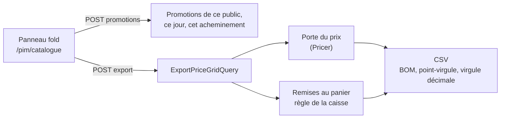

# Exporter une grille de prix

> ✅ **Doc d'état.** Demande de Hugo du 2026-10-31 : une grille CSV par
> public, pour qu'un commercial ressorte une plaquette quand les tarifs
> changent. Lecture seule : aucun prix n'est écrit, aucune règle ne change.

## 1. En deux phrases

Sur la vue d'ensemble du catalogue (`/pim/catalogue`), le bouton « Exporter
une grille de prix » ouvre un panneau : on choisit **pour qui**, **quel
jour**, **comment il reçoit** et **quelles remises au panier** on garde ; le
serveur rend un CSV où chaque prix est passé par la porte du prix, comme au
rayon. **HT pour un pro, TTC pour un particulier.**

## 2. Ce qu'on choisit

1. **Pour qui** (`priceGridAudienceSchema`, `packages/contracts/src/price-grid.ts`) :
   « Pros (société active) » (`pro_active`), « Pros en cours d'inscription »
   (`pro_pending`), « Particuliers inscrits », « Particuliers sans compte »,
   ou **une société précise** — sa mercuriale et son réglage de promotions
   s'appliquent alors.
2. **Quand** : maintenant, ou un jour lu à 00 h 00, heure de Paris. Un jour
   passé est refusé pour un particulier : l'historique des tarifs ne garde
   que le tarif pro (`price-grid-errors.ts`).
3. **Comment il reçoit** : un point de retrait, ou une zone de livraison —
   les remises au panier en dépendent.
4. **Quelles promotions** : celles du **prix affiché** sont dans le prix de
   l'article, listées pour mémoire et non décochables (la porte les
   applique sans paramètre d'exclusion). Celles **au panier** se cochent
   (au plus `PRICE_GRID_MAX_BASKET_PROMOTIONS` = 20) ; une promotion
   « à certains jours et heures » ne s'y applique pas, comme au devis sans
   créneau.
5. **Quelle partie** de chaque remise au panier retenue : `column` (une
   colonne à part, son pourcentage ou son montant), `net` (appliquée
   article par article dans le prix net estimé) ou `ignored` (nommée en
   tête, sans effet).
6. **Prix au kilo** (option `pricePerKg`) : le prix au kilo **saisi** de la
   déclinaison, pro HT ou public TTC selon le public, quand il existe —
   informatif, jamais appliqué.

## 3. Le fichier

Une ligne par déclinaison vendue à ce public : famille, produit,
déclinaison, SKU, unité (pièce / kilo) ; prix de base ; prix après les
remises du prix affiché ; une colonne par remise au panier en `column` ;
prix net (estimé si une remise au panier y entre) ; prix au kilo saisi en
option. Un article vendu au poids a ses prix au kilo. Un article non
concerné par une remise a la cellule **vide**, pas zéro.

L'en-tête dit le public, la date, l'acheminement, les promotions retenues et
la mention « document indicatif, non contractuel » ; un prix net estimé peut
différer d'un centime par ligne, parce qu'une remise au panier se calcule sur
le panier entier avec un seul arrondi. Format : UTF-8 avec BOM, `;`, virgule
décimale, CRLF (`pricing/domain/price-grid-csv.ts`).

## 4. Comment c'est fait

- **Serveur** (`apps/lfd-api/src/lafoliecoffee/pricing/`, module
  `price-grid.module.ts`) : `ListPriceGridPromotionsQuery` et
  `ExportPriceGridQuery`, derrière `POST /admin/pricing/price-grid/promotions`
  et `POST /admin/pricing/price-grid/export`, sous `b2b_pricing:read`
  (`http/admin-price-grid.controller.ts`). Chaque prix passe par le `Pricer`
  (`lint:price-door`) avec les faits d'audience du public, au jour choisi ;
  les remises au panier sont jugées par la règle même de la caisse
  (`application/price-grid-promotions.ts`) — jamais un calcul parallèle.
  La ligne se calcule dans `domain/price-grid-row.ts`.
- **Écran** : `apps/lfd-backoffice-frontend/src/app/pim/catalogue-overview/price-grid/`.

## 5. Les tests

`export-price-grid.handler.spec.ts`, `export-price-grid-typical-buyer.handler.spec.ts`,
`list-price-grid-promotions.handler.spec.ts`, `price-grid-row.spec.ts`,
`price-grid-csv.spec.ts`, et l'e2e `apps/lfd-api/test/price-grid-export.e2e-spec.ts` :
pro en HT, particulier en TTC, société sous mercuriale, remise en colonne,
en net ou ignorée, article exclu (cellule vide), article au poids, prix au
kilo saisi, et parité avec le rayon pour le même public et la même date.

## 6. Le « pro type »

La porte du prix ne sait établir « société active » que d'une société
réelle, et l'aperçu déclaré de la boutique (`previewed`) n'admet que « tout
le monde » — sans quoi `?audience=pro` publierait une promotion réservée.
L'export a donc son propre acheteur, déclaré par le staff (décision de Hugo
du 2026-10-31).

1. **Un objet opaque, pas une chaîne** : `TypicalBuyer`
   (`lafoliecoffee/promotions/domain/lot-buyer.ts`), classe à constructeur
   privé ; `LotBuyer` = `real | typical`. Il vit dans le domaine des
   promotions parce qu'un constructeur privé exige sa fabrique dans la
   classe ; la fabrique du module d'export, `priceGridTypicalBuyer`
   (`pricing/application/price-grid-typical-buyer.ts`), l'enveloppe.
   `lint:typical-buyer` (`dev-toolbox/gates/typical-buyer.mjs`) refuse
   qu'on le fabrique hors de `pricing/application/price-grid-*` : ailleurs,
   il publierait un prix ou une promotion réservés.
2. **Des faits construits en amont**, sans `PromotionAudienceFactsResolver` ;
   `lotBuyerFacts` (`promotions/application/lot-buyer-facts.ts`) les lit par
   un `switch` exhaustif, pour l'offre de ligne comme pour le rayon.
3. **Les ports de la grille prennent un lecteur, pas un `companyId`**
   (`PriceGridViewerReader`, `PriceGridShelfReader.shelfFor(viewer)`) : un pro
   type est lu comme `PRO_ANONYMOUS_VIEWER` (`catalog/domain/catalog-viewer.ts`)
   — tarif pro HT, sans mercuriale, sans tarif de canal, sans article
   réservé.
4. **Une seule définition du pro type** : `TYPICAL_BUYER`
   (`promotions/domain/promotion-targeting.ts`), lue par la grille et par
   l'annonce de la remise d'un point (`pickup-discount-announcement.ts`).
5. **Deux clientèles types seulement**, `pro_active` et `pro_pending` : les
   particuliers ont déjà leur vrai `buyerKind` sans société
   (`price-grid-context.ts`). Les deux pros ont le même tarif et ne
   diffèrent que par les promotions qui les visent.
6. **L'en-tête d'un pro type dit ses limites** : hors conditions négociées,
   hors remises réservées à une société et ses sites, hors articles
   réservés, hors remises jugées au créneau (`price-grid-context.ts`).
7. **`lens`** : `unproven` pour un pro type (une projection), `measured` pour
   une société précise (son prix réel, engagements compris), dit en tête.

Pour une société précise, la société des faits d'audience est celle que
reçoit la porte du prix (`pricingCompanyOf`), pour l'offre de ligne comme
pour le panier.

## 7. Ce qui reste ouvert

`GET /pickup-addresses` est public et annonce la remise du « pro actif
type » d'un point à tout visiteur (`promotion-pickup-discount.announcer.ts`) :
à confirmer par Hugo — publier la remise pro d'un point est-il voulu ?
