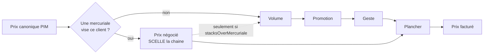
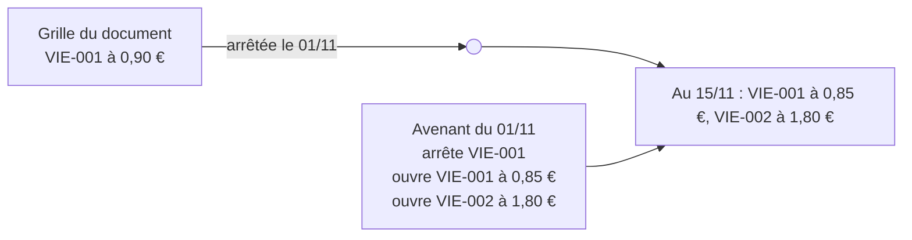

# Comprendre une mercuriale

**Écrit le 2026-09-08.** ✅ Décrit le code qui tourne.

> Le document de **définition**. Ce qu'une mercuriale est, ce qu'elle n'est pas,
> ce qu'elle refuse, et ce qu'elle ne sait pas encore faire.
>
> Pour le geste (poser, amender, clore, renommer), voir l'onglet Tarifs d'une
> fiche client. Pour l'état du chantier, voir
> [`./etat-des-lieux-mercuriale-client.md`](./etat-des-lieux-mercuriale-client.md).
> Pour ce qui va changer, voir
> [`./plan-la-mercuriale-devient-un-objet.md`](./plan-la-mercuriale-devient-un-objet.md).

---

## 1. La définition, en une phrase

**Une mercuriale est le tarif négocié d'UN client : un prix ferme, en euros, par
article, sur une période datée, qui remplace le tarif catalogue et ferme la
chaîne des remises.**

Le mot reste en français, et c'est écrit dans les conventions du dépôt : ce n'est
ni un `priceList`, ni un `catalog`, ni un `quote`. Le traduire par approximation
ferait perdre ce qu'il dit.

## 2. Ce qui la définit techniquement — un triplet

Une mercuriale n'est pas un type de donnée. C'est la **rencontre de trois
choses**, et il faut les trois :

|              | valeur       | ce que ça décide                                              |
| ------------ | ------------ | ------------------------------------------------------------- |
| **étage**    | `mercuriale` | elle **scelle** : les étages suivants deviennent transparents |
| **audience** | `company`    | elle vise **ce client-là**                                    |
| **effet**    | `replace`    | elle **pose un prix**, elle ne modifie pas l'entrant          |

Retirer l'un des trois donne autre chose :

- même étage, audience `all` → **refusé** (§4) ;
- même audience, étage `promotion` → une remise réservée à un client, qui se
  **compose** au lieu de remplacer, et que la mercuriale du client écraserait ;
- même étage, effet `alter` → **refusé** (§4).

## 3. Les quatre étages, et pourquoi la mercuriale est le premier

Un prix se construit en quatre étages qui **se composent** — chacun s'applique au
prix sortant du précédent, donc −20 % puis −10 % font −28 %, pas −30 % :

```
prix canonique (PIM)
  → mercuriale   le tarif négocié de ce client
  → volume       le barème de quantité
  → promotion    l'opération datée, publique
  → geste        le cas particulier
  → plancher     la limite en dessous de laquelle on ne descend pas
```



**La mercuriale scelle.** Dès qu'elle pose un prix, les trois étages suivants
sont ignorés. Ce n'est pas une optimisation, c'est une décision commerciale :

> Un client au tarif négocié qui empocherait AUSSI la promotion publique
> obtiendrait deux fois une remise qu'on n'a accordée qu'une fois. Avant le
> 2026-08-18, la chaîne composait jusqu'au bout — le cumul ne se lisait nulle
> part, et ne se découvrait qu'en comparant deux factures.

### La seule porte de sortie : `stacksOverMercuriale`

Une règle des étages suivants peut porter `stacksOverMercuriale: true` : elle
agit **malgré** le scellement. C'est l'override, et le défaut est `false` —
délibérément :

> Le cumul non voulu coûte de la marge en silence ; le cumul manquant se remarque
> au premier appel.

Une mercuriale, elle, ne peut pas porter ce drapeau : c'est elle qui scelle, il
ne désignerait rien. Refusé plutôt qu'ignoré — un drapeau accepté puis sans
effet finit par être coché en croyant obtenir quelque chose.

⚠️ **Depuis le 2026-10-31, ce drapeau ne vaut plus que pour les règles de prix
ordinaires.** Une **promotion** ne le porte plus : c'est la **politique de
promotions de la mercuriale** qui décide (§ 7 bis, et
[`plan-la-mercuriale-decide.md`](../../promotions/plan-la-mercuriale-decide.md)).

## 4. Ce qu'une mercuriale REFUSE, et pourquoi

Trois refus, tous portés par l'agrégat `PricingRule` — donc valables pour la
pose depuis une fiche, la pose par gabarit, une saisie à la main et le seed.

### Jamais un pourcentage

`MercurialeMustPoseAPriceError`. **Le piège central du modèle.**

Une mercuriale saisie en « −13 % » **suit le tarif de liste** : le jour où le PIM
augmente, le prix négocié augmente avec lui. Ce n'est pas ce qu'on a promis au
client. Un tarif négocié est un engagement **en euros**, il se stocke en euros.

⚠️ Le symétrique est tout aussi faux, et il n'a pas besoin d'un refus parce que
personne ne peut l'écrire : **recopier le tarif catalogue** dans une mercuriale
pour « la rendre complète » le **gèlerait** pour ce client. Le jour où le
catalogue monte, il paierait encore l'ancien prix — une remise que personne n'a
accordée, et que rien n'affiche.

**Une mercuriale ne dit que ce qui a été négocié. Le silence est une
information :** les articles qu'elle ne cite pas retombent sur le tarif catalogue
et **suivent ses évolutions**.

### Jamais tout le monde

`MercurialeTargetsOneCompanyError` (2026-09-08).

Un tarif négocié se négocie avec **quelqu'un**. C'est l'audience qui en fait le
prix de ce client-là ; l'étage, lui, ne dit que le scellement.

Ce refus n'est pas une précaution théorique : c'est le croisement de deux
mécanismes justes. L'audience `all` est la plus large, et le scellement se
déclenche sur **l'étage**, jamais sur l'audience. Une mercuriale d'audience `all`
s'appliquerait donc à tout le monde **et** éteindrait toutes les promotions sur
l'article — pour tout le monde, sans qu'aucun écran ne le signale. Le prix qui
change se voit ; la promotion neutralisée, non.

`segment` est refusé pour la même raison : le scellement ne dépend pas de la
largeur de l'audience.

### Jamais cumulable par-dessus elle-même

`MercurialeCannotStackOverItselfError`. Cf. §3.

## 5. Ce que la base rend impossible

**Deux tarifs qui se chevauchent n'existent pas.** Une contrainte d'exclusion
GiST (`price_rules_no_overlap`) porte sur `(étage, portée, audience, seuil,
fenêtre)`. Ce n'est pas une vérification applicative qu'on pourrait contourner :
c'est Postgres qui refuse l'écriture.

Deux conséquences pratiques :

- **on clôt d'abord, on repose ensuite.** Clore **archive** les règles, ce qui
  rend leur place dans la contrainte — c'est la seule façon de reposer sur la
  même période ;
- **les bornes sont basse incluse, haute exclue.** Deux fenêtres qui se succèdent
  à la même date ne se chevauchent donc pas : reposer au 1er janvier ce qui
  remplace une mercuriale close au 1er janvier passe sans rien clore.

## 6. Ce qu'elle n'efface jamais

**Clore n'est pas supprimer.** Les règles sont **archivées** :

- une lecture **datée** d'avant la clôture les retrouve ;
- ce qu'elles ont facturé est **figé sur les commandes** — chaque ligne porte sa
  trace de prix (les étages traversés, la règle qui a scellé, la décision de
  plancher). Six mois plus tard, « pourquoi ce prix ? » a une réponse même si la
  règle a été retirée ;
- le journal garde le résumé de chaque acte **tel qu'il était au moment de
  l'acte**, jamais recalculé.

C'est aussi pourquoi la **grille** d'une mercuriale posée est **en lecture
seule** à l'écran : elle n'est jamais réécrite. Ajouter, changer ou arrêter un
prix passe par un **avenant daté** (§ 7 bis) ; tout refaire passe par clore +
reposer. Dans les deux cas, ce qui a été facturé garde son explication.

**La seule exception est le libellé** : il ne participe à aucun calcul, il n'a
qu'un rôle, être lu. Corriger une faute de frappe ne devrait pas coûter une
décision close.

## 7. Ce qu'elle sait faire, et ce qu'elle ne sait pas

> 🔴 **Cette section listait six limites le 2026-09-08. Cinq sont levées**,
> et elles sont réécrites ici au **présent** : garder comme manquant ce qui
> existe fait construire un contournement pour un problème résolu. Chacune a été
> revérifiée contre le code le 2026-09-09.
>
> ⚠️ Ce bandeau annonçait « cinq limites, quatre levées » : il se comptait mal
> lui-même — cinq sont réécrites au présent ci-dessous, une seule reste
> (recompté le 2026-09-09).

### Elle EST un objet

C'était la limite qui expliquait presque toutes les autres. Poser écrivait N
règles indépendantes dans `price_rules` — une par article et par palier — dont
aucune ne savait qu'elle appartenait à une mercuriale ; « Mercuriale 2027 » était
**reconstituée** à la lecture, en regroupant les règles qui partageaient
`(libellé, fenêtre)`.

C'est désormais un **agrégat** (`CompanyMercuriale`) et **une ligne**
(`company_mercuriales`), qui porte son identifiant, ses paliers en `jsonb`, sa
fenêtre et son cycle de vie. Ce que la déduction ne savait pas faire, elle le
fait :

- **clore**, c'est fermer une ligne — plus archiver N règles ;
- **renommer**, c'est écrire un champ — plus en réécrire N ;
- deux mercuriales **homonymes** sur la même fenêtre ne se confondent plus,
  puisque ce n'est plus le nom qui les distingue ;
- une règle saisie à la main ne peut plus s'y ranger par hasard.

⚠️ Le refus d'homonymie au renommage (`MercurialeNameTakenError`) n'existait
**que** pour compenser cette absence. Il n'est plus levé nulle part, et son
propre JSDoc l'annonçait : « le jour où la pose portera son propre identifiant,
ce refus n'aura plus de raison d'être ». Le retirer est suivi au registre (R10).

### Une seule mercuriale court chez un client

Deux mercuriales portant sur des articles différents pouvaient courir en même
temps, le chevauchement n'étant refusé que **par article et par seuil**.

La contrainte porte maintenant sur le **client** : une exclusion GiST sur
`(company_id, [valid_from, valid_to))`, partielle `WHERE archived_at IS NULL`.
Deux mercuriales qui se recouvrent chez un même client sont **inexprimables**,
pas surveillées. La succession, elle, reste permise — celle qui court, et celle
qu'on a préparée pour janvier.

### Les fenêtres s'ouvrent à minuit, à Paris

Elles se construisaient à **minuit UTC** : « à partir du 1ᵉʳ janvier » ouvrait à
01 h 00 ou 02 h 00 selon la saison. Elles passent par `businessDayStart`, et
`lint:business-day` tient la ligne sur les quatre dossiers de tarification — une
conversion de jour en minuit UTC y échoue désormais à la porte.

### L'écran de tarification et la caisse annoncent le même prix

Sur un article dont un barème s'ouvrait dès la première pièce, l'écran annonçait
1,83924 € quand la caisse facturait 1,65532 € : il n'injectait pas les barèmes
dans sa résolution.

Les deux passent maintenant par **le même tarificateur**, seul appelant de
`resolvePrice` du dépôt — `lint:price-pipeline` le tient à **une** entrée. Ce
n'est plus une propriété à espérer : un e2e exige que les deux chemins tombent
d'accord, et il ne teste aucune valeur en particulier.

### Une pose par gabarit est atomique

Elle écrivait ses règles une par une, hors transaction : un refus à mi-parcours
laissait le client à moitié tarifé.

Elle écrit **une ligne**, donc tout ou rien — et **sans transaction ajoutée**,
ce qui est la bonne façon de fermer ce trou plutôt qu'un pansement. Les deux
chemins, la fiche et le gabarit, convergent en outre sur le même agrégat : tant
qu'ils divergeaient, une grille refusée d'un côté passait de l'autre.

### Ce qu'elle ne sait toujours pas faire

Une seule chose, et elle n'est pas dans la mercuriale : **le volume prévu
appartient au gabarit, pas au client**. Un gabarit posé chez trois clients porte
une seule hypothèse de saison, si bien que toute la simulation décrit le gabarit
et jamais le client qu'on a en face — alors que la base connaît ses volumes
réels. Suivi au registre (**R11**).

## 7 bis. L'avenant daté — ajouter, changer ou arrêter un prix

**Bâti le 2026-10-30** (plan
[`plan-tarif-date-sur-une-reference.md`](plan-tarif-date-sur-une-reference.md),
décisions de Hugo du 2026-10-29). ✅ Décrit le code qui tourne.

Un **avenant** est un bloc immuable rattaché à **sa** mercuriale
(`company_mercuriale_amendments`, une clé étrangère vers le document). Il
porte une fenêtre, un **motif obligatoire**, et deux choses :

- des **lignes ouvertes** — un article et ses paliers, avec les mêmes refus
  que la grille ;
- des **lignes arrêtées** — les articles dont le prix en cours **cesse** à la
  date d'effet de l'avenant, qu'il vienne de la grille ou d'un avenant
  antérieur.

Changer un prix = un avenant qui arrête l'ancienne ligne et ouvre la nouvelle à
la même date. Rien n'est réécrit : ni la grille, ni l'avenant d'origine. La
composition se fait **à la lecture**, à l'instant demandé — c'est ce qui laisse
une relecture datée rendre exactement ce qui s'appliquait à l'époque.



Ce que l'agrégat refuse (`CompanyMercuriale.amend`) :

| Refus                                                           | Erreur                                                           |
| --------------------------------------------------------------- | ---------------------------------------------------------------- |
| une mercuriale close                                            | `ArchivedMercurialeIsSealedError`                                |
| un motif vide                                                   | `MissingAmendmentReasonError`                                    |
| un avenant qui n'ouvre, n'arrête, ni ne change la politique     | `EmptyAmendmentError`                                            |
| une politique « Au choix » vide, ou une liste hors « Au choix » | `InconsistentPromotionSelectionError`                            |
| une fenêtre inversée, ou qui déborde du document                | `ReversedValidityWindowError`, `AmendmentOutsideMercurialeError` |
| un début **passé** — jamais rétroactif ; absent = maintenant    | `RetroactiveAmendmentError`                                      |
| arrêter une ligne qui ne court pas à cette date                 | `NoNegotiatedLineToEndError`                                     |
| un article déjà négocié sur la période (grille ou avenant)      | `SkuAlreadyNegotiatedError`                                      |

Ce qu'il faut savoir en le lisant :

- **une seule règle par article et par instant** : le refus de doublon le
  garantit, et la règle rendue garde l'**identifiant du document** — c'est ce
  que cherche le scellement « a facturé » (une période facturée par le seul
  avenant ne se repose pas). La pièce d'où vient le prix se lit dans le
  libellé : « Mercuriale 2027 — avenant du 1er novembre 2026 » ;
- **un sous-compte** qui suit le tarif de son principal paie le prix de
  l'avenant, comme celui de la grille ;
- **une pause** de la mercuriale suspend ses avenants ; **la clôture** les range
  avec elle, au même instant et pour le même motif ;
- **deux commerciaux** qui écrivent au même instant : le document est
  verrouillé (`FOR UPDATE`), relu et amendé dans la même transaction — le
  second voit le premier ;
- **au journal**, un avenant est un acte `amended` sur le fil du document, daté
  de sa prise d'effet, avec son motif.

À l'écran, sur l'onglet Tarifs d'une fiche client : la grille montre, pour
chaque ligne datée à part, « Avenant du … » ou sa fin ; les avenants sont listés
sous la grille ; deux gestes — **ajouter ou changer un prix** (l'article déjà
en cours est arrêté dans le même avenant) et **arrêter une ligne**.

### La politique de promotions — aucune, toutes, au choix

**Bâtie le 2026-10-31** (plan
[`plan-la-mercuriale-decide.md`](../../promotions/plan-la-mercuriale-decide.md),
§ 8, réorientation de Hugo le même jour : par la pose et les avenants, pas par
une table à part). ✅ Décrit le code qui tourne côté serveur ; l'écran est le
lot suivant.

Sur les articles qu'elle **fixe** (à partir de leur premier palier), la
mercuriale dit si son client profite des promotions : **aucune** (le défaut,
prix négocié net), **toutes**, ou **au choix** (une liste de promotions). Au
prix affiché comme au panier, et pour un site comme pour son principal.

- **à la pose** : la mercuriale porte sa politique de départ
  (`company_mercuriales.promotion_mode` / `promotion_ids`) ; le brouillon porte
  celle qu'on posera ;
- **un avenant** peut porter une NOUVELLE politique (mêmes colonnes,
  `promotion_mode` nul = il n'y touche pas), à partir de sa date d'effet, seul
  ou avec des lignes de prix — jamais rétroactif, comme tout avenant ;
- **la politique à une date** = celle du dernier avenant (non rangé à cette
  date) qui en porte une et dont la date d'effet est passée — à date égale, le
  dernier écrit —, sinon celle du document (`admissionAt`). Une lecture datée
  lit donc celle de sa date.

Le moteur : la règle d'étage `mercuriale` porte la politique de son instant
(`promotionAdmission`) ; une promotion passe le scellement si elle l'accepte
(`passesSeal`). Au panier, la ligne scellée porte le document et sa politique
(`BasketLine.sealing`), et chaque remise de panier l'exclut de **son**
assiette si elle ne l'accepte pas. Au rayon, une promotion exclue n'est pas
mentionnée sur l'article négocié. Une promotion archivée reste dans une liste,
sans effet. Au journal, la phrase de la pose et de l'avenant nomme la
politique (« promotions : au choix — « Rentrée » »).

### Le report sur une référence détachée

Quand une déclinaison est détachée en fiche à elle, la mercuriale reste sur
l'**ancienne** référence : le tarif est à plat, rien ne la déplace. La fiche
née du détachement liste ces décisions, et propose pour chaque mercuriale de
la **reporter** : un avenant dont l'origine est écrite
(`{ kind: "detached", fromSku, fromMercurialeId }`), aux mêmes paliers que la
ligne en cours de l'ancienne référence, dès maintenant (jamais avant le début de
cette ligne) et jusqu'à la fin réelle de cette ligne : son arrêt par avenant,
la fin de l'avenant qui la porte ou celle de la mercuriale — sans fin si elle
court sans fin. Le report ne survit pas au prix qu'il recopie. La garde est la **filiation**
lue au commerce (`catalog_items.detached_from_sku`) : on ne reporte que sur une
référence née de l'ancienne, et vendue aux pros. Route :
`POST admin/pricing/sale-references/:ancienSku/decisions/mercuriales/:id/carry-over`.

## 8. Les mots voisins, pour ne pas les confondre

|                               | ce que c'est                                                    | s'en distingue par                                                   |
| ----------------------------- | --------------------------------------------------------------- | -------------------------------------------------------------------- |
| **mercuriale**                | le tarif négocié d'un client                                    | scelle ; audience société ; prix ferme                               |
| **gabarit** (`PriceTemplate`) | une grille **préparée**, pour la reposer chez plusieurs clients | ne tarife personne tant qu'elle n'est pas posée                      |
| **brouillon**                 | une négociation en cours, un par société                        | **ne tarife rien** : c'est ce qui autorise à l'enregistrer incomplet |
| **barème de volume**          | un prix qui baisse avec la quantité                             | son propre objet, son propre étage ; ne scelle pas                   |
| **promotion**                 | une opération datée, publique                                   | se compose ; transparente sous une mercuriale, sauf override         |
| **plancher**                  | la limite basse d'un prix                                       | n'est pas une remise : il **relève** un prix trop bas                |

## 9. Les unités, parce que s'y tromper coûte cher

- **un prix unitaire vit en millicentimes** (10⁻⁵ €) : `173270` = 1,73270 € ;
- **un montant de panier vit en centimes** : une remise de retrait, des frais de
  zone ;
- **jamais de flottant.** `19.99 * 100_000` vaut `1998999.9999999998`.

Un export CSV de mercuriale sort donc les prix à **cinq décimales** : arrondir au
centime ferait d'un fichier envoyé au client un document qui ne correspond plus
au tarif appliqué.
