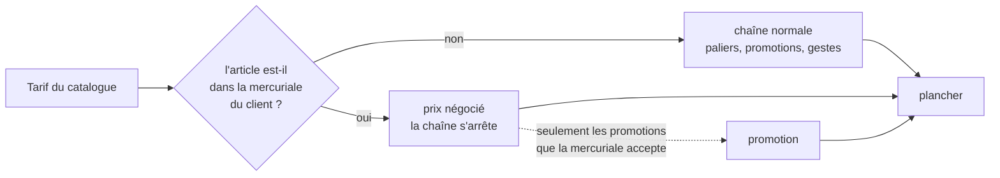
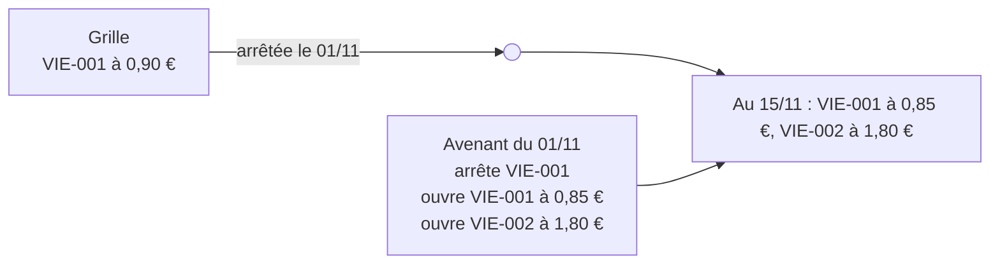

# Comprendre une mercuriale

> ✅ **Décrit le code au 2026-11-04**, réécrit ce jour-là contre le code. La
> version du 2026-09-08 décrivait encore la mercuriale comme un groupe de
> règles de prix, avant qu'elle devienne un objet à part entière. Partie 1 :
> comprendre. Partie 2 : le code.

# Partie 1 — Comprendre

## En une phrase

**Une mercuriale est le tarif négocié d'un seul client : un prix ferme, en
euros, pour chaque article négocié, sur une période datée.**

Le mot reste en français : ce n'est ni une liste de prix, ni un catalogue, ni
un devis.

## Ce qu'elle fait au prix

1. **Elle fixe le prix** des articles qu'elle cite, en euros. Jamais en
   pourcentage : un « −13 % » suivrait le tarif du catalogue, et le prix
   promis monterait avec lui. Un article peut avoir **plusieurs paliers** dans
   la mercuriale (« 0,90 € dès 1, 0,85 € dès 50 ») : le prix baisse avec la
   quantité, jamais l'inverse.
2. **Elle arrête les autres remises** sur ces articles : paliers, promotions et
   gestes ne s'ajoutent pas, sauf ce qu'elle accepte explicitement. Un client
   au prix négocié n'empoche pas en plus la promotion publique.
3. **Elle ne dit que ce qui a été négocié.** Un article qu'elle ne cite pas
   reste au tarif du catalogue, et suit ses évolutions.

## Sa vie

| Geste               | Ce qui se passe                                                                                                                      |
| ------------------- | ------------------------------------------------------------------------------------------------------------------------------------ |
| **Poser**           | on crée la mercuriale du client, avec sa grille et sa période                                                                        |
| **Amender**         | un **avenant daté** ajoute, change ou arrête un prix, ou change la politique de promotions, à partir d'une date ; rien n'est réécrit |
| **Mettre en pause** | ses prix ne s'appliquent plus le temps de la pause                                                                                   |
| **Clore**           | elle s'arrête ; elle n'est jamais supprimée                                                                                          |
| **Reporter**        | quand un article est détaché en fiche à part, son prix négocié peut être reporté sur la nouvelle référence                           |

**Une seule mercuriale court à la fois chez un client** ; on peut en préparer
une pour la période suivante.

## Ce qu'elle n'efface jamais

Une commande garde la trace du prix qu'elle a facturé : la mercuriale qui l'a
fixé et son avenant. Six mois plus tard, on sait encore pourquoi ce prix, même
si la mercuriale est close.

# Partie 2 — Le code

## 1. L'objet

- **Agrégat** : `CompanyMercuriale` (`b2b/pricing/domain/entities/company-mercuriale.ts`),
  **une ligne** par mercuriale (`company_mercuriales`), sa grille en `jsonb`
  (articles et paliers), sa fenêtre, son cycle de vie, sa politique de
  promotions, ses avenants (`company_mercuriale_amendments`).
- **Gestes** : `pose`, `amend`, `carryOver`, `rename`, `close` ; la pause par
  le cycle de vie commun (`rule-lifecycle.ts`, `suspendedFrom`).
- **Une seule par client à la fois** : contrainte d'exclusion GiST
  `company_mercuriales_no_overlap` sur `(company_id, [valid_from, valid_to))`,
  partielle sur les lignes non rangées (migration `20260908160000_mercuriale_objet`).
  Deux mercuriales qui se recouvrent chez un même client sont inexprimables.
- **Les fenêtres** s'ouvrent à minuit à Paris : l'écran convertit un jour par
  `businessDayStart` (`fiche-client/tarifs/mercuriale-amendments/amendment-draft.ts`),
  et `lint:business-day` refuse une conversion en minuit UTC.

## 2. Comment elle entre dans le calcul

`asRuleFor(contexte)` présente la ligne en cours de l'article comme une règle
de l'étage `mercuriale` (`mercurialeRuleFor`, `mercuriale-rule.ts`) : effet
`replace`, audience la société, montant **le palier le plus haut atteint** par
la quantité (`highestTierReached`), fenêtre de la ligne (grille ou avenant,
coupée par un arrêt), identifiant **du document**. Si l'article est dans la
grille mais qu'aucun palier n'est atteint, `missesTierFor` le dit. Elle passe par la même chaîne que tout le reste
([`../comment-un-prix-se-fabrique.md`](../comment-un-prix-se-fabrique.md)).

- **Le scellement** : `passesSeal` (`mercuriale-seal.ts`) laisse passer une
  règle ordinaire marquée `stacksOverMercuriale`, ou une **promotion** que la
  politique de la mercuriale accepte.
- **La politique de promotions** (bâtie le 2026-10-31,
  [`../../promotions/plan-la-mercuriale-decide.md`](../../promotions/plan-la-mercuriale-decide.md)) :
  **aucune** (le défaut), **toutes**, ou **au choix**. Posée avec la
  mercuriale (`promotion_mode`, `promotion_ids`), changée par avenant ; la
  politique à une date est celle du dernier avenant qui en porte une et a pris
  effet, sinon celle du document (`promotionPolicyAt`). Au panier, la ligne
  scellée porte le document et sa politique (`BasketLine.sealing`), et chaque
  remise de panier l'exclut de son assiette si elle ne l'accepte pas ; au
  rayon, une promotion exclue n'est pas mentionnée sur l'article.
- **Un sous-compte** qui suit le tarif de son principal paie le prix de la
  mercuriale du principal : le chargeur lit la mercuriale du compte de
  tarification (`pricingAccountOf`, `pricing-parties.resolver.ts`).

## 3. Les refus

| Où                                                    | Refus                                                                                                                                  | Erreur                                                                                                                          |
| ----------------------------------------------------- | -------------------------------------------------------------------------------------------------------------------------------------- | ------------------------------------------------------------------------------------------------------------------------------- |
| Pose                                                  | une fenêtre inversée                                                                                                                   | `ReversedValidityWindowError`                                                                                                   |
| Pose                                                  | une grille vide ou un article sans palier ; un article en double ; deux paliers au même seuil, ou un prix qui remonte avec la quantité | `EmptyMercurialeError`, `DuplicateMercurialeSkuError`, `NonDecreasingMercurialeTiersError` (`normalizeGrid`, `pricing-grid.ts`) |
| Pose                                                  | une mercuriale qui court déjà sur la période                                                                                           | contrainte `company_mercuriales_no_overlap`, traduite en `RunningMercurialeError` par le dépôt                                  |
| Avenant                                               | une mercuriale close                                                                                                                   | `ArchivedMercurialeIsSealedError`                                                                                               |
| Avenant                                               | un motif vide, un avenant qui ne change rien                                                                                           | `MissingAmendmentReasonError`, `EmptyAmendmentError`                                                                            |
| Avenant                                               | une politique « Au choix » vide, ou une liste hors « Au choix »                                                                        | `InconsistentPromotionSelectionError`                                                                                           |
| Avenant                                               | une fenêtre inversée ou hors du document ; un début passé                                                                              | `ReversedValidityWindowError`, `AmendmentOutsideMercurialeError`, `RetroactiveAmendmentError`                                   |
| Avenant                                               | arrêter une ligne qui ne court pas, ou la même deux fois ; un article déjà négocié sur la période                                      | `NoNegotiatedLineToEndError`, `DuplicateEndedSkuError`, `SkuAlreadyNegotiatedError` (`mercuriale-amendment-checks.ts`)          |
| Règle de prix écrite à la main à l'étage `mercuriale` | un pourcentage ; une audience autre qu'une société ; `stacksOverMercuriale`                                                            | `MercurialeMustPoseAPriceError`, `MercurialeTargetsOneCompanyError`, `MercurialeCannotStackOverItselfError` (`pricing-rule.ts`) |

Les erreurs sont dans `b2b/pricing/domain/errors/mercuriale-errors.ts` et
`mercuriale-amendment-errors.ts`.

## 4. L'avenant

Le détail (composition, concurrence, report, décisions) : [`l-avenant-date.md`](l-avenant-date.md).

Un bloc **immuable** rattaché à sa mercuriale, avec une fenêtre, un **motif
obligatoire**, des **lignes ouvertes** (un article et ses paliers) et des
**lignes arrêtées** (un prix en cours qui cesse à la date d'effet). Changer un
prix = arrêter l'ancienne ligne et ouvrir la nouvelle à la même date. La
composition se fait **à la lecture**, à l'instant demandé (`linesAt`) : une
relecture datée rend ce qui s'appliquait à l'époque.

- Une seule règle par article et par instant ; la règle rendue garde
  l'identifiant du document, et le libellé dit la pièce (« Mercuriale 2027 —
  avenant du 1er novembre 2026 »).
- Une pause suspend les avenants ; la clôture les range avec la mercuriale.
- Deux commerciaux en même temps : le document est verrouillé
  (`SELECT … FOR UPDATE`, `prisma-company-mercuriale.repository.ts`), relu et
  amendé dans la même transaction.
- Au journal : un acte `amended` (`amend-company-mercuriale.handler.ts`),
  daté de sa prise d'effet, avec son motif.
- **Le report** sur une référence détachée est un avenant d'origine écrite
  (`{ kind: "detached", fromSku, fromMercurialeId }`), aux paliers de la ligne
  en cours, jusqu'à la fin réelle de cette ligne. Garde : la filiation
  (`catalog_items.detached_from_sku`). Route :
  `POST admin/pricing/sale-references/:ancienSku/decisions/mercuriales/:id/carry-over`.

## 5. L'écran

Onglet Tarifs d'une fiche client (`apps/lfd-backoffice-frontend/src/app/fiche-client/tarifs/`) :
la grille d'une mercuriale posée est en **lecture seule** ; les gestes sont
« ajouter ou changer un prix », « arrêter une ligne », « changer les
promotions » (`promotion-policy-picker/`), clore. Seul le **libellé** se
corrige directement : il ne participe à aucun calcul.

## 6. Les mots voisins

|                               | Ce que c'est                                        | S'en distingue par                                   |
| ----------------------------- | --------------------------------------------------- | ---------------------------------------------------- |
| **mercuriale**                | le tarif négocié d'un client                        | prix ferme, arrête la chaîne                         |
| **gabarit** (`PriceTemplate`) | une grille préparée, à poser chez plusieurs clients | ne tarife personne tant qu'elle n'est pas posée      |
| **brouillon**                 | une négociation en cours, un par société            | ne tarife rien                                       |
| **barème de volume**          | un prix qui baisse avec la quantité                 | son propre étage ; n'arrête rien                     |
| **promotion**                 | une opération datée                                 | se compose ; sous une mercuriale, selon sa politique |
| **plancher**                  | la limite basse d'un prix                           | relève un prix trop bas                              |

## 7. Les unités

- Un **prix unitaire** vit en millicentimes (10⁻⁵ €) : `173270` = 1,73270 € ;
  un **montant** de panier en centimes ; jamais de flottant.
- L'export CSV d'une mercuriale (`fiche-client/tarifs/mercuriale-csv.ts`)
  sort les prix à **cinq décimales**, virgule décimale : arrondir au centime ferait d'un fichier envoyé au client un document qui ne correspond
  plus au tarif appliqué.

## 8. Limites connues

- Deux mercuriales **homonymes** chez un même client ne sont plus refusées :
  le refus d'homonymie compensait l'époque où une mercuriale se reconnaissait
  à son nom, et il a été retiré le 2026-11-04. Elles ne peuvent de toute façon
  pas courir en même temps (une seule par client et par période).
- Le **volume prévu** d'une simulation appartient au gabarit, pas au client
  (registre, R11).
