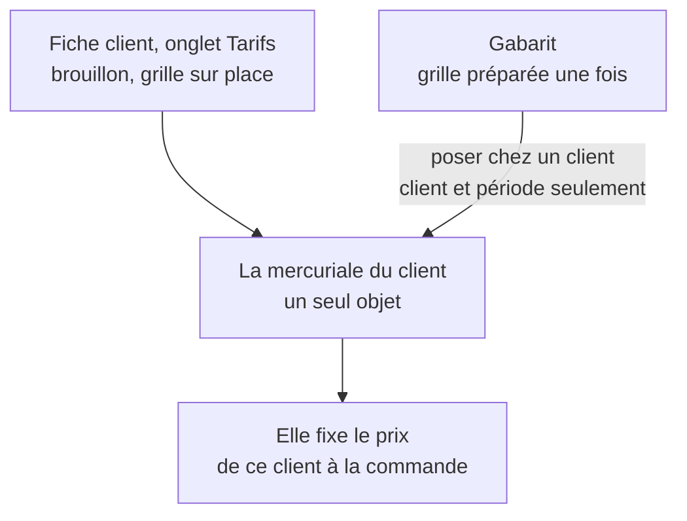

# Établir une mercuriale pour un compte client

> ✅ **Décrit le code au 2026-11-04**, réécrit ce jour-là contre le code. Ce que
> fait une mercuriale est dans
> [`comprendre-une-mercuriale.md`](comprendre-une-mercuriale.md) ; ce document
> dit **comment l'équipe en établit une** : par où, avec quels outils, et ce
> qui reste à construire. Partie 1 : comprendre. Partie 2 : le code.

# Partie 1 — Comprendre

## Deux chemins, un seul résultat

On peut établir la mercuriale d'un client de deux façons :

1. **Depuis la fiche du client** (onglet Tarifs) : on compose sa grille sur
   place, article par article, puis on la pose. On peut garder un
   **brouillon** le temps de la négociation.
2. **Depuis un gabarit** (Commercial › Tarification) : on prépare une grille
   type une fois, puis on la **pose** chez un ou plusieurs clients, en ne
   choisissant que le client et la période.

Les deux chemins écrivent **le même objet**, avec les mêmes règles : une
grille refusée d'un côté l'est aussi de l'autre.

## Ce qui aide à négocier

- **Ce que le marché paie déjà** : pour chaque article, le prix médian que
  paient les autres clients sous mercuriale, et ses bornes.
- **La simulation** : le chiffre d'affaires selon le volume, sous trois
  régimes (prix par commande, engagement signé, cumul livré), et pourquoi
  « même prix » ne veut pas dire « même chiffre ».

## Ce qu'on ne fait pas, volontairement

- **On ne modifie pas la grille au moment de poser un gabarit** : le gabarit
  porte le contenu, la pose ne porte que le client et la période. Sinon, « que
  lui a-t-on mis ? » n'aurait plus de réponse unique.
- **On ne recopie pas le tarif du catalogue** dans une grille : il vieillirait
  sans que rien ne le signale.
- **Réviser un gabarit ne change pas les mercuriales déjà posées** : une
  mercuriale posée est une décision close, qu'on modifie par avenant.

# Partie 2 — Le code

## 1. Les écrans (`apps/lfd-backoffice-frontend/src/app/`)

| Écran                         | Où                                                                                          | Ce qu'il fait                                                                                                                                                                                                                                                                    |
| ----------------------------- | ------------------------------------------------------------------------------------------- | -------------------------------------------------------------------------------------------------------------------------------------------------------------------------------------------------------------------------------------------------------------------------------- |
| Onglet **Tarifs** d'une fiche | `fiche-client/tarifs/` (route `comptes-clients/:id/tarifs`)                                 | ce que paie le client ; composer et poser sa mercuriale (`mercuriale-composer/`), son brouillon, la mercuriale posée (`posed-mercuriale/`), les avenants (`mercuriale-amendments/`), la politique de promotions (`promotion-policy-picker/`), l'export CSV (`mercuriale-csv.ts`) |
| Les **gabarits**              | `commercial/tarification/gabarits/` (route `commercial/tarification/mercuriales-templates`) | la liste des gabarits d'une nature, et leur écart moyen au catalogue                                                                                                                                                                                                             |
| La **grille** d'un gabarit    | `commercial/tarification/grille/` (`…/mercuriales-templates/:id`)                           | l'écran de travail : la grille éditée en place (`draft-grid.ts`), les mêmes colonnes que la grille générale (`mercuriale-row.ts`)                                                                                                                                                |
| La **barre de pose**          | `commercial/tarification/pose-bar/`                                                         | chez qui, de quand à quand                                                                                                                                                                                                                                                       |
| La **simulation**             | `commercial/tarification/simulation/`                                                       | les trois régimes (`pricing-regime.ts`), le chiffre d'affaires (`revenue-model.ts`), les règles qui passent la mercuriale (`piercing-rules.ts`)                                                                                                                                  |

Deux natures de gabarit partagent ces écrans, `mercuriale` et `devis`
(`…/devis-templates`) ; la nature vient de la route. Seul `mercuriale` se pose.

## 2. Le serveur (`apps/lfd-api/src/b2b/pricing/`)

| Geste                  | Route                                                                                 | Handler                                                                        |
| ---------------------- | ------------------------------------------------------------------------------------- | ------------------------------------------------------------------------------ |
| Poser depuis la fiche  | `POST admin/pricing/companies/:id/mercuriale` (`admin-company-pricing.controller.ts`) | `pose-company-mercuriale.handler.ts`                                           |
| Brouillon              | —                                                                                     | `save-mercuriale-draft.handler.ts`, `discard-mercuriale-draft.handler.ts`      |
| Amender, reporter      | —                                                                                     | `amend-company-mercuriale.handler.ts`, `carry-over-mercuriale-line.handler.ts` |
| Renommer, clore        | —                                                                                     | `rename-…`, `close-company-mercuriale.handler.ts`                              |
| Enregistrer un gabarit | `admin-price-templates.controller.ts`                                                 | `save-price-template.handler.ts`                                               |
| Poser un gabarit       | `POST admin/pricing/templates/:id/apply`                                              | `apply-price-template.handler.ts` — écrit le même agrégat                      |
| Ce que le marché paie  | —                                                                                     | `read-mercuriale-benchmark.handler.ts` (médiane, bornes, nombre de clients)    |

- **L'agrégat** : `CompanyMercuriale` ; **le gabarit** : `PriceTemplate`
  (`domain/entities/price-template.ts`). Les invariants de grille sont
  **partagés** (`domain/pricing-grid.ts`, `normalizeGrid`) avec des fabriques
  d'erreurs injectées : chacun refuse dans son vocabulaire.
- **Le contrat** (`packages/contracts/src/pricing.ts`) : une grille est une
  liste de paliers, **12 paliers** par ligne et **300 lignes** au plus ; le
  « prix fixe » est le palier unique à partir de 1. Poser un gabarit ne demande
  que `companyId`, `validFrom`, `validTo` (nullable).
- **La base** : `company_mercuriales` (une ligne par mercuriale, paliers en
  `jsonb`, client en référence opaque, contrainte
  `company_mercuriales_no_overlap`) ; `price_templates` (lignes en JSON : une
  grille s'écrit entière ou pas du tout).

## 3. Ce que le calcul en fait

Les paliers d'une mercuriale se lisent sur la **quantité de la commande**, pas
sur un cumul annuel — sauf si un **engagement de volume** couvre l'article :
le volume annoncé ouvre alors les paliers dès la première commande. Le reste
(scellement, politique de promotions, plancher) :
[`comprendre-une-mercuriale.md`](comprendre-une-mercuriale.md).

## 4. Ce qui reste ouvert

Suivi au registre ([`../ce-qui-reste-a-faire.md`](../ce-qui-reste-a-faire.md)),
revérifié le 2026-11-04 :

| Le fait                                                                                                 | Registre |
| ------------------------------------------------------------------------------------------------------- | -------- |
| L'engagement de volume a ses routes (`admin/pricing/commitments`) et **aucun écran** qui les appelle    | **R6**   |
| `PriceTemplate.archive()` existe et n'est appelé nulle part : la liste des gabarits ne peut que grandir | **R10**  |
| Le volume prévu d'une simulation appartient au **gabarit**, pas au client                               | **R11**  |
| La simulation calcule un prix **dans le navigateur**                                                    | **R2**   |
