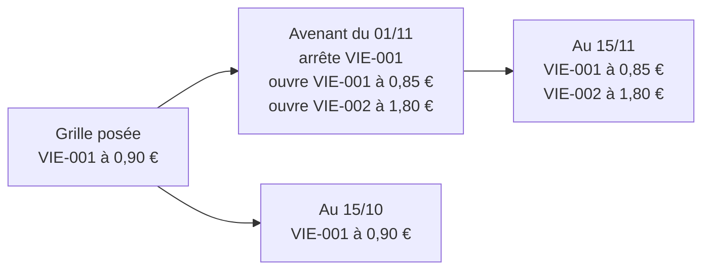
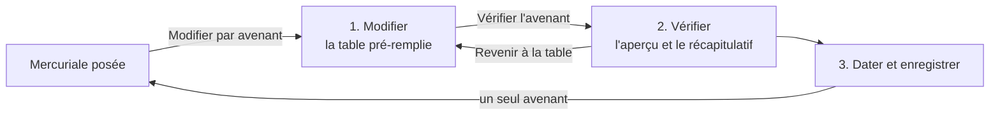

# L'avenant daté d'une mercuriale

> ✅ **Doc d'état.** Le code cite ses **§ 6** (le report) et ses décisions
> **Q1 à Q3, B1, B2** : ces repères sont gardés. Partie 1 : comprendre.
> Partie 2 : le code.

# Partie 1 — Comprendre

## À quoi sert un avenant

Une mercuriale posée ne se réécrit jamais : ce qu'elle a facturé doit rester
explicable. Pour **ajouter un prix, changer un prix ou arrêter un prix** en
cours de route, on écrit un **avenant** : un petit bloc daté, avec un motif,
rattaché à la mercuriale.

- **Ajouter** : l'avenant ouvre une ligne pour un article qui n'était pas
  négocié.
- **Changer** : l'avenant arrête l'ancienne ligne et en ouvre une nouvelle, à
  la même date.
- **Arrêter** : l'avenant arrête une ligne à une date ; l'article revient au
  tarif du catalogue.
- **Changer la politique de promotions**, seule ou avec des prix.

## Trois règles

1. **Jamais dans le passé.** Un avenant commence maintenant ou plus tard.
2. **Un motif, toujours.** On sait pourquoi le prix a changé.
3. **Rien n'est réécrit.** On lit ce qui s'appliquait à n'importe quelle date
   en recomposant la grille et ses avenants à cette date.

## Le report sur une référence détachée

Quand une déclinaison est détachée en fiche à part, elle a une nouvelle
référence. Le prix négocié reste sur l'ancienne. La nouvelle fiche propose
alors de **reporter** ce prix : un avenant qui ouvre la nouvelle référence aux
mêmes paliers, jusqu'à la fin réelle de l'ancien prix.

# Partie 2 — Le code

## 1. Le modèle

- **Table** `company_mercuriale_amendments` (migration
  `20261029190000_les_avenants_de_mercuriale`), clé étrangère vers
  `company_mercuriales` : un avenant porte sa fenêtre, son motif, ses
  **lignes ouvertes** (un article, ses paliers), ses **articles arrêtés**
  (`endedSkus`), éventuellement une politique de promotions, et son origine
  (`{ kind: "detached", fromSku, fromMercurialeId }` pour un report).
- **Domaine** (`lafoliecoffee/pricing/domain/entities/`) : les formes
  (`mercuriale-amendment.ts`), la composition à une date
  (`mercuriale-segments.ts`, `linesAt`), les refus
  (`mercuriale-amendment-checks.ts`), le geste (`CompanyMercuriale.amend`,
  `company-mercuriale.ts`).

## 2. La composition à une date

Une ligne arrêtée cesse **définitivement** à la date d'effet de l'avenant qui
l'arrête ; la fin d'un avenant ne borne que **ses** lignes ouvertes. Un arrêt
ne touche que la grille et les avenants **antérieurs** dans l'ordre
d'écriture : on peut rouvrir un article plus tard. Une ligne de grille arrêtée
garde sa fenêtre coupée dans la règle rendue, pour que la trace dise
« expirée » au lieu de se taire. La règle rendue au calcul garde
l'**identifiant du document** (B1, § 7) ; la pièce se lit dans le libellé
(« Mercuriale 2027 — avenant du 1er novembre 2026 »).

## 3. Les refus

| Refus                                                    | Erreur                                                           |
| -------------------------------------------------------- | ---------------------------------------------------------------- |
| la mercuriale est close                                  | `ArchivedMercurialeIsSealedError`                                |
| motif vide                                               | `MissingAmendmentReasonError`                                    |
| l'avenant n'ouvre, n'arrête ni ne change rien            | `EmptyAmendmentError`                                            |
| fenêtre inversée, ou hors du document                    | `ReversedValidityWindowError`, `AmendmentOutsideMercurialeError` |
| début passé (Q2)                                         | `RetroactiveAmendmentError`                                      |
| arrêter une ligne qui ne court pas, ou la même deux fois | `NoNegotiatedLineToEndError`, `DuplicateEndedSkuError`           |
| un article déjà négocié sur la période                   | `SkuAlreadyNegotiatedError`                                      |
| une politique « Au choix » vide ou incohérente           | `InconsistentPromotionSelectionError`                            |

## 4. La concurrence et la trace

- **Deux commerciaux en même temps** (B2, § 7) : le handler
  (`amend-company-mercuriale.handler.ts`) ouvre une unité de travail, y
  verrouille le document (`lockForAmendment`, `SELECT … FOR UPDATE`,
  `prisma-company-mercuriale.repository.ts`), relit les avenants et écrit
  (`addAmendment`) dans la même transaction.
- **Le journal** : un acte `amended` sur le fil du document, daté de sa prise
  d'effet, avec son motif.
- **La pause et la clôture** : une pause suspend les avenants avec le
  document (Q3) ; la clôture les range au même instant et pour le même motif.

## 5. Les routes et l'écran

- `POST admin/pricing/companies/:companyId/mercuriale/:mercurialeId/amendments`
  (`admin-company-pricing.controller.ts`) ; l'aperçu à côté, `…/amendments/preview`
  (§ 8.2).
- Écran : **un seul parcours**, « Modifier par avenant » sur la mercuriale
  posée (§ 8.4). La liste des avenants passés reste sous la grille, en lecture
  (`fiche-client/tarifs/mercuriale-amendments/`).

## 6. Le report sur une référence détachée

- **Route** : `POST admin/pricing/sale-references/:sku/decisions/mercuriales/:mercurialeId/carry-over`
  (`admin-sale-reference-decisions.controller.ts`), handler
  `carry-over-mercuriale-line.handler.ts`, domaine
  `CompanyMercuriale.carryOver` (`mercuriale-carry-over.ts`).
- **Garde** : la nouvelle référence est **née de l'ancienne**
  (`catalog_items.detached_from_sku`, lu par `DetachmentOriginReader` au
  catalogue) et vendue aux pros.
- **Paliers** : ceux de la ligne en cours de l'ancienne référence, prise dans
  la grille ou dans l'avenant qui la porte.
- **Fenêtre** : du plus tard de « maintenant » et du début de cette ligne,
  jusqu'à sa **fin réelle** — son arrêt par avenant, la fin de son avenant ou
  celle du document ; sans fin seulement si elle court sans fin (Hugo,
  2026-10-30). Le report ne survit pas au prix qu'il recopie.
- **Écran** : la fiche née du détachement, `pim/catalogue/product-form/decision-carry-over/`
  (bouton « Reporter sur … », motif prérempli, confirmation).
- Les autres décisions (règles, planchers, barèmes, engagements) ont leur
  propre report ([`../saisie/saisir-un-prix.md`](../saisie/saisir-un-prix.md)).

## 7. Les décisions qui tiennent ce modèle

| Repère                                            | Décision                                                                                                                                                                                                                                             |
| ------------------------------------------------- | ---------------------------------------------------------------------------------------------------------------------------------------------------------------------------------------------------------------------------------------------------- |
| **Q1** (Hugo, 2026-10-29, confirmé le 2026-10-30) | Un avenant ne fait pas qu'ajouter : il peut **arrêter** une ligne à une date. Changer un prix = arrêter et ouvrir à la même date.                                                                                                                    |
| **Q2**                                            | Jamais rétroactif ; `validFrom` absent = maintenant.                                                                                                                                                                                                 |
| **Q3**                                            | Un avenant est suspendu avec sa mercuriale en pause.                                                                                                                                                                                                 |
| **B1** (`vitruve`)                                | La règle rendue garde l'identifiant **du document**, pas de l'avenant : le contrôle « cette période a déjà facturé » (`prisma-priced-decisions.reader.ts`) cherche des identifiants de documents.                                                    |
| **B2** (`vitruve`)                                | Verrou, relecture et écriture dans la **même** transaction, ouverte par le handler.                                                                                                                                                                  |
| Modèle                                            | Un avenant est rattaché au **document** `CompanyMercuriale`, pas une règle de prix à part : une règle séparée aurait défait la migration `20260908160000_mercuriale_objet`, privé un sous-compte du prix, et laissé le doublon gardé d'un seul côté. |

## 8. L'avenant dans la table

Bâti le 2026-11-11 (Hugo : « l'avenant devrait rouvrir la page avec la
table, pour un avenant multi-changement — la meilleure UI/UX possible pour
le staff »). Un avenant change autant de choses qu'on veut, en un seul
avenant daté.

### 8.1 L'écart

`fiche-client/tarifs/amendment-diff.ts` compare l'état **à la date d'effet**
(rendu par l'aperçu, `state`) à la saisie, et produit le corps de l'avenant :

| Saisie                                 | Ce qui part                                                         |
| -------------------------------------- | ------------------------------------------------------------------- |
| article sans prix ferme → prix tapé    | `lines += { sku, prix }`                                            |
| prix ferme → autre prix                | `endedSkus += sku` et `lines += { sku, nouveau prix }`              |
| prix ferme → vidé                      | `endedSkus += sku` (il passe à la remise générale s'il est couvert) |
| remise différente, comparée par valeur | `generalDiscount: { set: saisie }` ; retirée : `{ set: null }`      |
| politique différente                   | `promotionPolicy`                                                   |
| rien                                   | refus : « L'avenant ne change rien »                                |

Une ligne à **paliers** ne se réécrit pas en prix fixe : on peut la retirer.
`amendment-recap.ts` en tire le récapitulatif en phrases, qui ne dit que ce
qui change (« Taux de base : −5 % → −10 % »).

### 8.2 L'aperçu

`POST …/amendments/preview` (`preview-mercuriale-amendment.handler.ts`),
une lecture : l'avenant est appliqué à une **copie** de la mercuriale
(`amend` rend un nouvel agrégat), puis chaque article est résolu à la date
d'effet avec l'originale et avec la copie, par la composition datée des prix
d'un client (`company-price-sheets.service.ts`, que `CompanyPricingQuery`
réutilise à `now`). Il rend `state` (prix fermes, remise, politique à la
date d'effet), `items` (avant, après, relevé par la limite, source : prix
ferme, remise, chaîne) et `refusals` (code et article, au plus un : `amend`
s'arrête au premier). Rien n'est écrit. Limites : le prix de base n'est pas
daté (`ProductCatalogReader.all`) ; les refus applicatifs (article hors
vente, réservé, engagement de volume) ne répondent qu'à l'enregistrement ;
une mercuriale close répond 404.

Appelé à l'ouverture, à « Vérifier », sur « Recalculer » et quand la date
d'effet change — jamais à la frappe (la base de production est facturée à
l'opération). À l'étape 1, l'écran calcule lui-même le prix « après » d'un
article dont le prix vient de la mercuriale ; un article qui en sort affiche
« recalculé à la vérification ».

### 8.3 Deux commerciaux en même temps

L'avenant annonce `basedOnAmendmentId`, le dernier avenant vu. Sous le verrou
du document, un avenant plus récent le fait refuser :
`MercurialeAmendedMeanwhileError` (409), « Un autre avenant a été enregistré
pendant votre saisie. Rechargez : vos changements seront recalculés. »

### 8.4 L'écran

`fiche-client/tarifs/mercuriale-amendment/` (mode `amending` de
`tarifs-page`) :

1. **Modifier** — la date d'effet en tête (par défaut le plus tard entre
   aujourd'hui et le début de la mercuriale, « Changer » sur place), la
   remise générale et les promotions, puis une table à cinq colonnes
   (`amendment-table/`) : Article (famille, prix de base et limite en ligne
   secondaire) · Aujourd'hui (ou « Au <date> ») · Après l'avenant · Prix
   ferme · Changement. Une ligne changée est surlignée, son ancien prix barré
   (lu « avant : … »), son étiquette dit le changement ; une hausse est
   marquée « plus cher ». Barre collante : compteur, « Voir seulement les
   changements », « Recalculer », « Vérifier l'avenant ».
2. **Vérifier** — refus, limite et hausses de prix en tête, puis le
   récapitulatif.
3. **Dater et enregistrer** — date d'effet, fin (§ 8.5), motif.

Étapes annoncées (`aria-current`, `aria-live`), focus placé sur le titre de
chaque étape. Quitter avec des changements demande confirmation, y compris
en changeant de page (`pendingChangesGuard`). Pas de brouillon d'avenant.

### 8.5 La fin d'un avenant

| Ce que l'avenant change    | À sa fin                                                           |
| -------------------------- | ------------------------------------------------------------------ |
| un prix ajouté             | s'arrête : l'article revient à la remise ou au catalogue           |
| la remise générale         | celle d'avant reparle                                              |
| un prix changé ou retiré   | l'ancien **ne revient pas** (`endingOf`, `mercuriale-segments.ts`) |
| la politique de promotions | ne s'arrête pas : elle ne lit que `validFrom`                      |

L'écran ne propose donc une fin que si l'avenant n'arrête aucun prix et ne
change pas la politique ; sinon il dit de faire un second avenant à la date
voulue. Un avenant de retour automatique a été écarté (Hugo, 2026-11-11).
