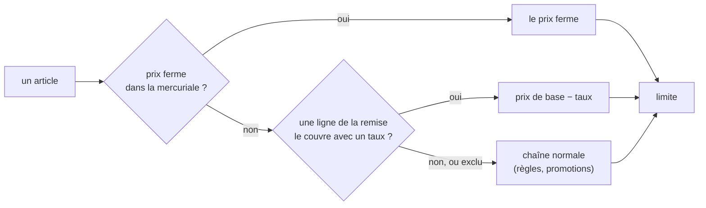

# La remise générale d'une mercuriale

> ✅ **Doc d'état.** Demande de Hugo : « tout à −30 % sauf quelques articles »,
> puis « −40 % sur le pain, −30 % sur les viennoiseries ». Les repères que le
> code cite sont gardés : **« Un taux par famille »**, les décisions **D1 à
> D9** et **Q1 à Q3**, les **§ 2.1, § 3, § 4, § 5**. Partie 1 : comprendre.
> Partie 2 : le code.

# Partie 1 — Comprendre

## Ce que c'est

Une mercuriale porte deux couches :

| Couche              | Ce qu'elle dit                                            | Suit le catalogue ?                              |
| ------------------- | --------------------------------------------------------- | ------------------------------------------------ |
| **Prix ferme**      | « ce prix-là, quoi qu'il arrive », article par article    | non                                              |
| **Remise générale** | « −30 % sur tout, −40 % sur les pains, sauf le chocolat » | **oui** : un pourcentage du prix de base du jour |



## Un taux par famille

Chaque ligne de la remise porte **son taux**, ou elle **exclut**. La plus
précise gagne : la déclinaison, puis la famille la plus proche, puis le taux de
base.

| Ligne                                  | Remise |
| -------------------------------------- | ------ |
| Tout le catalogue (mode « tout sauf ») | −30 %  |
| Famille Pains                          | −40 %  |
| Sous-famille Pains spéciaux            | −25 %  |
| Famille Chocolat                       | exclue |
| Déclinaison Baguette tradition         | −35 %  |

En mode « rien sauf », il n'y a pas de taux de base : seules les lignes qui
portent un taux remisent.

## Les décisions

| #   | Décision                                                                                                                                                                                    |
| --- | ------------------------------------------------------------------------------------------------------------------------------------------------------------------------------------------- |
| D1  | Un article couvert est **scellé comme un prix ferme** : ni palier de volume, ni geste ; les promotions selon la politique de la mercuriale.                                                 |
| D2  | **Le prix ferme l'emporte** sur la remise, sur son article — même quand sa quantité n'atteint aucun palier : l'article n'est alors jamais remisé, la mercuriale dit « palier non atteint ». |
| D3  | Lignes par **famille** et par **déclinaison** (SKU), pas par produit : la chaîne de prix ne connaît que le SKU.                                                                             |
| D4  | Les **articles au poids** sont couverts : un pourcentage sans seuil se lit sur un prix au kilo.                                                                                             |
| D5  | Une mercuriale peut ne porter **qu'une remise**, sans prix ferme ; elle est refusée si elle ne porte ni l'un ni l'autre.                                                                    |
| D6  | **Pas de palier de quantité** sur la remise : c'est le rôle du barème de volume.                                                                                                            |
| D7  | Un **avenant daté** pose, change ou arrête la remise, et elle **ne vaut que sur la fenêtre de l'avenant** (§ 2.1).                                                                          |
| D8  | Les **gabarits** n'ont pas de remise générale.                                                                                                                                              |
| D9  | **La limite** s'applique, comme partout.                                                                                                                                                    |
| Q1  | Un avenant qui **arrête le prix ferme** d'un article couvert le fait passer à la remise, pas au catalogue ; l'écran le dit avant d'enregistrer (Hugo, 2026-11-11).                          |
| Q2  | La remise est **refusée** chez un client dont un **engagement de volume** vivant recouvre sa fenêtre : elle le scellerait (Hugo, 2026-11-11).                                               |
| Q3  | Avant de poser, l'écran **liste les articles que la limite relèvera** ; il ne bloque pas (Hugo, 2026-11-11).                                                                                |

# Partie 2 — Le code

## 1. Le modèle

`apps/lfd-api/src/lafoliecoffee/pricing/domain/entities/general-discount.ts` :

```ts
interface GeneralDiscount {
  readonly mode: "all_except" | "only";
  readonly baseBp: number | null; // présent en all_except, null en only
  readonly rules: readonly {
    readonly target: "category" | "variant";
    readonly targetId: string;
    readonly bp: number | null; // null = exclue
  }[];
}
interface GeneralDiscountChange {
  readonly set: GeneralDiscount | null;
} // sur l'avenant
```

`CompanyMercuriale` porte `generalDiscount` (état dans
`company-mercuriale-state.ts`) et `generalDiscountAt(at)`.

**Refus** (`domain/errors/mercuriale-errors.ts`) :

| Refus                                                  | Erreur                                                                                                                                             |
| ------------------------------------------------------ | -------------------------------------------------------------------------------------------------------------------------------------------------- |
| un taux hors ]0 ; 100 %[                               | `InvalidGeneralDiscountError` (400)                                                                                                                |
| « tout sauf » sans taux de base, ou « seulement » avec | `GeneralDiscountBaseRateError` (400)                                                                                                               |
| « seulement » sans aucune ligne à taux                 | `GeneralDiscountIncludesNothingError` (400)                                                                                                        |
| deux lignes sur la même cible                          | `DuplicateGeneralDiscountTargetError` (400)                                                                                                        |
| ni prix ferme ni remise (D5)                           | `EmptyMercurialeError`                                                                                                                             |
| engagement de volume qui recouvre la fenêtre (Q2)      | `GeneralDiscountOverVolumeCommitmentError` (409), levée par les handlers de pose et d'avenant (`application/commands/general-discount-support.ts`) |

## 2. Le calcul

`mercurialeRuleFor` (`entities/mercuriale-rule.ts`) reste la seule porte de la
mercuriale vers le moteur : prix ferme d'abord ; sinon, si
`generalDiscountBpFor` rend un taux, une règle `alter` / `percent` /
`decrease` d'étage `mercuriale`, en portée `product` (pour ne pas gagner par
spécificité sur une règle d'étage écrite à la main), audience la société,
`suspendedFrom` du document, `promotionAdmission` de la mercuriale, libellé
« Mercuriale 2027 — remise générale −30 % ». La mercuriale est le premier
étage : le pourcentage s'applique au prix de base, et ce qui gagne l'étage
scelle (D1) — aucun changement dans `resolve-price.ts`.

La ligne qui décide est trouvée par `decidingScopeRule`
(`packages/contracts/src/promotion-scope.ts`), la recherche même de la portée
des promotions, qui la réutilise.

### 2.1 La fenêtre

`generalDiscountAt` : la remise d'un avenant ne vaut que sur
`[validFrom, validTo)`, bornée par la fin du document ; à date d'effet égale,
le dernier écrit gagne ; après, celle d'avant reparle. Ce n'est **pas** la
règle de la politique de promotions (`admissionAt`), qui court jusqu'à
l'avenant suivant : un « −20 % du 1er au 31 » ne laisse pas −20 % pour
toujours.

## 3. La persistance

Migration `20261111140000_la_remise_generale`, additive :
`general_discount jsonb` sur `company_mercuriales`,
`company_mercuriale_amendments` (avec `general_discount_set`, qui distingue
« n'en dit rien » de « l'arrête ») et `mercuriale_drafts` ; un CHECK de forme
par la fonction `general_discount_shape_ok(jsonb)`. Lecture revalidée par
`checkedGeneralDiscount` (`infrastructure/general-discount-rows.ts`) ; une
forme cassée lève `CorruptedMercurialeError`. Le corps écrit toujours
`baseBp`, à `null` en « seulement ».

## 4. Les lecteurs

| Lecteur                                                                       | Ce qu'il fait de la remise                                                                                                                                          |
| ----------------------------------------------------------------------------- | ------------------------------------------------------------------------------------------------------------------------------------------------------------------- |
| `company-pricing.query.ts`                                                    | `negotiatedSkuCount` et `averageGapBp` = prix fermes seulement ; `generalDiscountSkuCount` = articles remisés sans prix ferme                                       |
| `mercuriale-benchmark.query.ts`                                               | l'ignore : ce n'est pas un prix d'article                                                                                                                           |
| `posed-mercuriale-view.ts`                                                    | sert la remise en vigueur et celle du document                                                                                                                      |
| `general-discount-summary.ts`                                                 | journal : « remise générale −30 %, 1 taux particulier, sauf 1 famille et 2 articles »                                                                               |
| `prisma-sale-reference-usage.ts`, `prisma-sale-reference-decisions.reader.ts` | cherchent un SKU aussi dans les lignes `variant`                                                                                                                    |
| `mercuriale-carry-over.ts`, `carry-over-mercuriale-line.handler.ts`           | reportent une ligne `variant` sur la référence détachée, par un avenant de remise ; si la nouvelle référence a déjà sa ligne, `DuplicateGeneralDiscountTargetError` |

Tout ce qui passe par `resolvePrice` (rayon, panier, devis, commande, trace)
reçoit la règle sans rien changer.

## 5. L'écran

`apps/lfd-backoffice-frontend/src/app/fiche-client/tarifs/` :

- `general-discount-picker/` : la case, le mode, le taux de base, une carte
  par ligne (taux ou exclue), l'ajout d'une famille ou d'un article, le
  compteur. Sert à la composition et à l'avenant.
- fonctions pures, une raison par fichier : `general-discount-pricing.ts`
  (le taux d'un article par `decidingScopeRule`, le prix remisé par
  l'arithmétique de la caisse `@lfd/money`, les articles relevés par la
  limite — Q3), `general-discount-form.ts` (le formulaire et ses refus),
  `general-discount-lines.ts` (les lignes du sélecteur),
  `general-discount-reading.ts` (les phrases).
- Composition : le prix remisé en gris sous un prix ferme vide.
- Mercuriale posée : la remise en vigueur, « Changer la remise générale » et
  « Arrêter la remise » par avenant daté ; Q1 sur « Arrêter une ligne ».
- `mercuriale-csv.ts` : une ligne d'en-tête qui dit la remise.

## 6. Limites connues

- **Une bascule du SKU par défaut** devra aussi réécrire
  `general_discount->'rules'[*].targetId` (cible `variant`) sur les trois
  tables, et `dev-toolbox/ops/check-default-sku-switch.mjs` les compter.
- **Q1 n'est dite** que sur « Arrêter une ligne », pas quand un prix ajouté
  par avenant porte une fin.
- **Non vérifiés** : l'arrondi d'un pourcentage sur un article au poids, et
  le rayon en cache quand presque tout est scellé (`sealingOfShelf`).
- **Le journal compte** les lignes sans les nommer.
- **Aucun écran ne pose encore d'engagement de volume** (vérifié le
  2026-11-11) : le refus Q2 ne se déclenche donc pas aujourd'hui.
