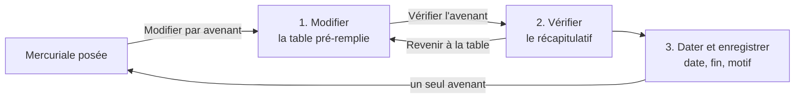

# Plan — l'avenant dans la table

> 📐 **Plan, écrit le 2026-11-11** à la demande de Hugo : « l'avenant devrait
> rouvrir la page avec la table, pour un avenant multi-changement — la
> meilleure UI/UX possible pour le staff, un parcours clair ». Maquette
> validée le même jour. Rien n'est bâti. Les affirmations sur l'existant ont
> été vérifiées dans le code le même jour ; les chemins sont cités.

# Partie 1 — Comprendre

## Aujourd'hui

Une mercuriale posée se modifie par **gestes séparés**, chacun son petit
formulaire et son avenant : « ajouter ou changer un prix », « arrêter une
ligne », « changer les promotions », « changer la remise générale »
(`apps/lfd-backoffice-frontend/src/app/fiche-client/tarifs/mercuriale-amendments/`).
Renégocier dix prix et la remise, c'est dix formulaires, dix avenants, dix
motifs — et aucune vue d'ensemble de ce que le client paiera après.

L'API, elle, accepte déjà **un avenant qui change tout à la fois** :
`amendCompanyMercurialePayloadSchema` (`packages/contracts/src/pricing.ts:2090`)
porte `lines`, `endedSkus`, `promotionPolicy`, `generalDiscount`, une date
d'effet, une fin et un motif. Seul l'écran découpe.

## Le parcours



1. **Modifier.** « Modifier par avenant » ouvre la **même page que la
   composition** (table filtrée, bloc remise générale, promotions),
   pré-remplie avec ce qui est **en vigueur**. On change ce qu'on veut, rien
   n'est enregistré. Chaque ligne qui change est surlignée : l'ancien prix
   barré, le nouveau, et une étiquette — « prix changé », « prix ajouté »,
   « prix retiré », « passe à −35 % », « suit la remise ». Une barre compte
   les changements ; « voir seulement les changements » filtre la table.
2. **Vérifier.** Un récapitulatif en phrases, une ligne par changement, avec
   ce qui peut surprendre : un article relevé par la limite, un prix ferme
   retiré qui passe à la remise (Q1 de la remise générale), un article qui
   sort de la mercuriale et revient au catalogue.
3. **Dater et enregistrer.** Date d'effet (aujourd'hui par défaut, jamais
   avant), fin facultative (§ « La fin »), motif obligatoire. Un seul
   bouton, **un seul avenant**.

## Les principes

- **Une page à apprendre** : composer et amender, c'est le même écran.
- **Rien n'est enregistré avant l'étape 3.** Revenir en arrière ne perd rien.
- **On voit l'effet en euros avant de valider**, calculé par la caisse
  (§ « Le prix après l'avenant »), pas reconstitué à l'écran.
- **Les gestes séparés disparaissent** de la mercuriale posée. Le report sur
  une référence détachée garde son geste à lui, ailleurs.

## Le prix après l'avenant

La colonne « Après l'avenant » ne se calcule **pas** à l'écran. Un article
qui sort de la mercuriale (prix retiré, exclu de la remise) retombe sur la
chaîne normale — règles, promotions, paliers —, que l'écran ne connaît pas :
« prix de ce client » inclut la mercuriale en cours, et le défaire en front
reviendrait à écrire une seconde arithmétique. On demande donc à la caisse :
une **lecture d'aperçu** qui applique l'avenant proposé à une copie en
mémoire de la mercuriale et résout chaque article à la date d'effet, par
`resolvePrice`, sans rien écrire.

**Budget** (la base de production est facturée à l'opération) : l'aperçu est
appelé **à l'ouverture** (l'état de départ, § 1), **à l'étape 2**, et sur le
bouton « Recalculer » — jamais à la frappe. À l'étape 1, la colonne « Après »
est calculée à l'écran pour les seuls articles dont le prix vient de la
mercuriale — un prix ferme, ou la remise générale sur le prix de base, relevés
par la limite — par l'arithmétique de la caisse (`@lfd/money`, comme
`general-discount.ts` le fait déjà en composition). Un article qui **sort** de
la mercuriale affiche « recalculé à la vérification » : c'est le seul prix que
l'écran ne sait pas faire.

## La fin d'un avenant

Vérifié par `vitruve` le 2026-11-11 dans le code :

| Ce que l'avenant change        | À sa fin (`validTo`)                                                                                   |
| ------------------------------ | ------------------------------------------------------------------------------------------------------ |
| un prix **ajouté**             | s'arrête : l'article revient à la remise ou au catalogue — voulu                                       |
| la **remise générale**         | celle d'avant reparle (`general-discount.ts:119-151`) — voulu                                          |
| un prix **changé ou retiré**   | l'ancien **ne revient pas** : `endingOf` coupe la ligne pour toujours (`mercuriale-segments.ts:46-60`) |
| la **politique de promotions** | **ne s'arrête pas** : elle ne lit que `validFrom` (`mercuriale-amendment.ts:42-45`)                    |

**F1** : l'écran ne propose une **fin** que si l'avenant n'**arrête aucun prix**
et ne **change pas la politique de promotions**. Sinon le champ est remplacé
par une phrase : « Un prix changé ou retiré, et les promotions, ne reviennent
pas d'eux-mêmes à une date : faites un second avenant à cette date. »

**F2 — à trancher par Hugo** : à l'étape 3, proposer « Revenir à l'état
d'avant le … » qui enregistre **en même temps** l'avenant de retour (les prix
d'avant rouverts à cette date, la politique d'avant). Plus confortable, mais
c'est un second avenant dans la même transaction, donc un champ de plus au
contrat. Sans F2, F1 seul suffit et rien ne ment.

# Partie 2 — Le code

## 1. L'écart (front, pur)

un module neuf, « amendment-diff », dans `fiche-client/tarifs/` (testé) : à partir de
**l'état en vigueur** (lignes, remise, politique, lus sur
`PosedMercurialeView` à la date d'effet) et de **l'état saisi**, produit le
corps de l'avenant :

| Saisie                                | Ce qui part                                                |
| ------------------------------------- | ---------------------------------------------------------- |
| article sans prix ferme → prix tapé   | `lines += { sku, prix }`                                   |
| prix ferme → autre prix               | `endedSkus += sku` **et** `lines += { sku, nouveau prix }` |
| prix ferme → vidé                     | `endedSkus += sku`                                         |
| remise différente de celle en vigueur | `generalDiscount: { set: saisie }`                         |
| remise retirée                        | `generalDiscount: { set: null }`                           |
| politique différente                  | `promotionPolicy: saisie`                                  |
| rien de différent                     | refus à l'écran : « L'avenant ne change rien »             |

Comparaison de la remise **par valeur normalisée** (lignes triées par cible),
pas par référence d'objet : sinon rouvrir puis refermer l'écran produirait un
avenant vide qui se croit plein. Le même module rend le récapitulatif en
phrases (étape 2) et les étiquettes de ligne (étape 1).

L'état de référence est celui **de la date d'effet**, et c'est **l'aperçu**
qui le rend (§ 2, `state`) : la composition des segments reste au serveur
(`linesAt`, `generalDiscountAt`, `promotionPolicyAt`), l'écran ne la refait
pas. Changer la date d'effet relance l'aperçu et recalcule l'écart. Vérifié
par `vitruve` : « prix ferme → autre prix » (`endedSkus` + `lines` du même
SKU dans le même avenant) passe `checkedAmendment` et
`assertNoDoubleNegotiation` quand l'état de référence est celui de
`validFrom`.

**Une ligne à paliers** (venue d'un gabarit) est affichée mais **non
modifiable** dans l'avenant : on peut la retirer, pas la réécrire en prix
fixe sans le dire. L'étiquette dit « à paliers — retirer, puis reposer un
prix ».

## 2. L'aperçu (API, lecture)

`POST admin/pricing/companies/:companyId/mercuriale/:mercurialeId/amendments/preview`
— une **requête** (CQRS : elle n'écrit rien, même pas un brouillon), qui prend
le corps d'un avenant et rend, pour chaque article du catalogue de ce
client :

```ts
{
  at: string; // la date d'effet résolue
  basedOnAmendmentId: string | null; // le dernier avenant vu (§ 2.2)
  state: {
    // l'état de la mercuriale à `at`, AVANT l'avenant
    firm: {
      sku: string;
      tiers: {
        minQuantity: number;
        unitPriceMillicents: number;
      }
      [];
    }
    [];
    generalDiscount: GeneralDiscountView | null;
    promotionPolicy: MercurialePromotionPolicyView;
  }
  items: {
    sku: string;
    beforeMillicents: number; // ce qu'il paie à `at` sans l'avenant
    afterMillicents: number; // ce qu'il paierait avec
    floored: boolean; // relevé par la limite, après
    source: "firm" | "general_discount" | "chain";
  }
  [];
  refusals: {
    code: string;
    sku: string | null;
    message: string;
  }
  [];
}
```

Construction : charger la mercuriale, appeler `amend` sur elle — l'agrégat
est immuable, `amend` rend une copie (`company-mercuriale.ts:220-233`) —,
donc les mêmes refus (rétroactif, doublon, hors document, remise invalide),
rendus dans `refusals` avec leur **code et leur SKU** pour que l'écran
désigne la ligne fautive. `amend` exige un identifiant et un auteur :
l'aperçu passe des valeurs de lecture, jamais persistées ; une date d'effet
« maintenant » reste **absente** du corps (`amendment-draft.ts:224`), jamais
un minuit du jour.

🔴 **La résolution datée n'existe pas encore** : `CompanyPricingQuery` lit à
`clock.now()` (`company-pricing.query.ts:56-63, 85`) et
`mercuriales.liveFor(…, at)` ne voit pas une mercuriale à venir. A1 en
extrait la composition en un service paramétré — `at` injecté, la mercuriale
**fournie** (l'originale, puis la copie) au lieu d'être relue —, que
`CompanyPricingQuery` réutilise à `now`. Promotions programmées et
`decisionsAt` à une date future : à vérifier au bâti.

**Le mur** : la mercuriale d'un site qui suit son principal appartient au
compte de tarif (`pricingAccountOf`). Le handler vérifie que `mercurialeId`
appartient à `parties.pricingCompanyId`, et refuse sinon (404) ; un e2e
couvre le site.

Le contrôleur n'injecte que le `QueryBus`. La route est un `POST` parce que
le corps est un avenant entier ; elle n'écrit rien.

### 2.2 Deux commerciaux en même temps

L'avenant enregistré porte `basedOnAmendmentId` — le dernier avenant connu
quand l'écran a calculé l'écart. Le handler d'avenant, qui verrouille déjà le
document (`SELECT … FOR UPDATE`), refuse (409,
`MercurialeAmendedMeanwhileError`) si un avenant plus récent existe : « Un
autre avenant a été enregistré pendant votre saisie. Rechargez : vos
changements seront recalculés. » Champ **facultatif** au contrat, pour que
les autres appelants (report) ne changent pas.

Coût : une résolution par article et par état, sur un catalogue d'une
centaine d'articles — la même charge que l'onglet Tarifs, deux fois. Appelé
à l'étape 2, et à l'étape 1 avec un délai (≈ 400 ms) après la dernière
frappe, pas à chaque frappe.

## 3. L'écran

- `tarifs-page` gagne un troisième mode, `amending`, à côté de `composing` :
  la page de composition avec un **en-tête d'étapes** (Modifier · Vérifier ·
  Dater et enregistrer), pré-remplie depuis la mercuriale.
- `mercuriale-composer` est découpé pour servir les deux : le bloc remise, la
  table filtrée et les promotions deviennent des composants partagés ; la
  composition garde « Poser », l'avenant prend « Vérifier l'avenant ».
- Colonnes en mode avenant : Article · Famille · Prix base · **Aujourd'hui** ·
  **Après l'avenant** (aperçu) · Prix ferme (saisie) · Limite · étiquette.
  « Prix de ce client » et « Effort de vente » restent en composition.
- La barre des changements est collante en bas de la page.
- Étape 2 : le récapitulatif, les avertissements de l'aperçu, puis date,
  fin (F1), motif ; « Revenir à la table », « Enregistrer l'avenant ».
- Quitter l'avenant avec des changements non enregistrés demande
  confirmation. **Aucun brouillon d'avenant** : une saisie perdue au
  rechargement est un choix assumé, la composition garde, elle, son
  brouillon ; à rouvrir si le staff le demande.
- **Accessibilité** : l'en-tête d'étapes est une liste ordonnée avec
  `aria-current="step"` ; changer d'étape annonce l'étape (région
  `aria-live` polie) et place le focus sur son titre ; revenir à la table
  rend le focus à « Vérifier l'avenant » ; l'ancien prix barré est doublé
  d'un texte lu (« avant : 1,30 € ») ; la barre collante ne masque pas le
  focus (marge en bas de la table).
- Les gestes séparés de `mercuriale-amendments/` sont retirés ; la liste des
  avenants passés reste, en lecture.

## 4. Les lots

| Lot    | Contenu                                                                                                                                 | Tests                                                                                                                                                                                                                                                                     |
| ------ | --------------------------------------------------------------------------------------------------------------------------------------- | ------------------------------------------------------------------------------------------------------------------------------------------------------------------------------------------------------------------------------------------------------------------------- |
| **A1** | l'aperçu : la composition datée extraite de `CompanyPricingQuery`, requête, handler, route, contrat ; `basedOnAmendmentId` et son refus | unitaires du handler (copie amendée, refus rendus, rien d'écrit) ; e2e : un prix changé, un prix retiré qui passe à la remise, un article qui revient à la chaîne avec la promotion du client, une date future qui tient compte d'un avenant à venir, le mur `company_id` |
| **A2** | le module « amendment-diff »                                                                                                            | unitaires : chaque ligne du tableau du § 1, remise égale par valeur, avenant vide                                                                                                                                                                                         |
| **A3** | l'écran : mode `amending`, étapes, colonnes, barre, récapitulatif, F1, confirmation de sortie ; retrait des gestes séparés              | specs, vérification à l'écran                                                                                                                                                                                                                                             |
| **A4** | doc d'état (`l-avenant-date.md` au présent) ; ce plan supprimé                                                                          | —                                                                                                                                                                                                                                                                         |

## 5. Questions ouvertes

- **F2** — l'avenant de retour automatique (§ « La fin »).

## 6. Contredit par vitruve (2026-11-11)

Bloquants corrigés : la politique de promotions ne s'arrête pas à la fin
d'un avenant (F1 l'inclut) ; une ligne arrêtée ne revient jamais (confirmé,
F1 tient, F2 posé) ; la résolution datée n'existait pas (A1 l'extrait).
Sérieux corrigés : l'état de référence vient de l'aperçu, les paliers ne se
réécrivent pas, deux commerciaux (`basedOnAmendmentId`), le mur des sites,
le budget de lectures, les refus avec code et SKU, le brouillon assumé,
l'accessibilité. Non vérifiés : les promotions programmées à une date
future, une mercuriale en pause dans l'aperçu, le nombre exact de lectures
par aperçu.
