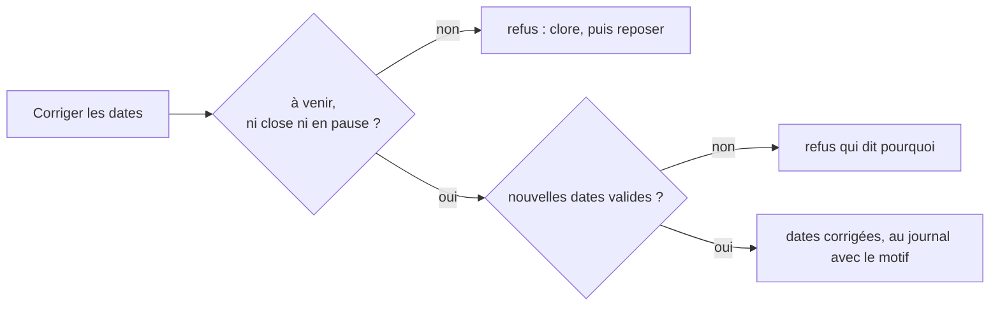

# Plan — corriger les dates d'une mercuriale

> 📐 **Plan, écrit le 2026-11-11** à la demande de Hugo, après une
> mercuriale posée en 2027 au lieu de 2026 : « fais le geste corriger les
> dates ». Rien n'est bâti. Les affirmations sur l'existant ont été
> vérifiées dans le code le même jour.

# Partie 1 — Comprendre

Aujourd'hui, une date de début ou de fin fausse ne se corrige qu'en
**closant** la mercuriale puis en la **reposant** — et on perd au passage sa
grille, sa remise et ses avenants, qu'il faut ressaisir. Un avenant ne peut
pas aider : il vit **dans** la période du document
(`AmendmentOutsideMercurialeError`).

Le geste « Corriger les dates » change le début et la fin du document,
**seulement tant que la mercuriale n'a pas commencé** (statut « À venir »).

Pourquoi « à venir » et pas « n'a rien facturé » (contredit par `vitruve`
le 2026-11-11) : une commande est tarifée à son instant de passation
(`reconstruct-line-rules.handler.ts:76`, `at: order.placedAt`), et une
mercuriale à venir ne couvre aucun instant passé ni présent — **aucune
commande ne peut l'avoir citée**. La frontière tient donc sans dépendre
d'une lecture des commandes qui vieillirait entre la vérification et
l'écriture : rien dans la passation ne verrouille `company_mercuriales`
(vérifié par `vitruve`), et `hasPriced` « peut vieillir »
(`domain/ports/priced-decisions.reader.ts:41-43`). Une mercuriale commencée
garde ses dates : la clore, puis en reposer une.

## Les règles

| #   | Règle                                                                                                                                                                                                                                                                                                                                                                               | Pourquoi                                                                                                                       |
| --- | ----------------------------------------------------------------------------------------------------------------------------------------------------------------------------------------------------------------------------------------------------------------------------------------------------------------------------------------------------------------------------------- | ------------------------------------------------------------------------------------------------------------------------------ |
| C1  | La mercuriale est **à venir** à l'instant de la correction (`validFrom > now`), **ni close, ni en pause**. Contrôlé dans l'agrégat, sous le verrou du document.                                                                                                                                                                                                                     | Aucune commande ne peut l'avoir citée ; une pause porte un instant (`pausedAt`) que des dates déplacées rendraient incohérent. |
| C2  | Le **nouveau début** est aujourd'hui ou plus tard.                                                                                                                                                                                                                                                                                                                                  | Pas d'effet rétroactif, comme un avenant.                                                                                      |
| C3  | La **fin** est vide (sans fin) ou après le nouveau début.                                                                                                                                                                                                                                                                                                                           | Comme à la pose (`ReversedValidityWindowError`).                                                                               |
| C4  | Chaque avenant **non rangé** reste dans la nouvelle période (son début ≥ nouveau début, sa fin ≤ nouvelle fin) ; sinon refus qui nomme l'avenant. Rien n'est déplacé. Les refus de doublon ne changent pas (les lignes ne bougent pas).                                                                                                                                             | Déplacer un avenant en silence changerait ce qu'il dit.                                                                        |
| C5  | Les refus de la pose sont rejoués sur la nouvelle période : chevauchement d'une mercuriale qui court (`RunningMercurialeError`, et la contrainte d'exclusion traduite comme dans `save()`), d'une close qui a facturé (`PricedPeriodIsSealedError`), et — si le document ou un avenant porte une remise générale — d'un **engagement de volume** (`assertNoVolumeCommitmentUnder`). | Une seule mercuriale à la fois ; Q2 de la remise générale.                                                                     |
| C6  | Le geste porte `basedOnAmendmentId` comme l'avenant ; un avenant passé entre-temps le fait refuser (`MercurialeAmendedMeanwhileError`).                                                                                                                                                                                                                                             | Pas d'écrasement silencieux du travail d'un collègue.                                                                          |
| C7  | **Motif obligatoire**, au journal tarifaire (« dates corrigées : du … au … → du … au … »).                                                                                                                                                                                                                                                                                          | On sait qui a déplacé quoi, et pourquoi.                                                                                       |

# Partie 2 — Le code

- **Domaine** : `CompanyMercuriale.correctWindow(from, to, now)` — C1 à C4 ;
  rend un nouvel agrégat.
- **Commande** : `CorrectMercurialeWindowCommand` + handler. Chargement par
  `designated(reader, companyId, …)` (le mur `company_id`, comme le
  renommage), puis sous le verrou du document : C5 (mêmes appels que
  `pose-company-mercuriale.handler.ts:91-117`, plus la remise), C6, écriture,
  acte.
- **Dépôt** : une méthode `correctWindow(mercuriale, act)` qui écrit
  `valid_from` et `valid_to` — aucune n'écrit `valid_from` aujourd'hui
  (`update()` n'écrit que `validTo`) —, **émet `ShelfChanges`**
  (`this.shelves.changed(companyShelves(...))`, principal et sites) et
  traduit la violation d'exclusion en `RunningMercurialeError`, comme
  `save()`. Vérifié : aucun déclencheur `context_versions` ne lit
  `company_mercuriales`.
- **Route** : `PATCH admin/pricing/companies/:companyId/mercuriale/:mercurialeId/window`,
  corps `{ validFrom, validTo, reason, basedOnAmendmentId }` ; contrôleur
  aux bus seulement.
- **Écran** : sur la mercuriale posée **à venir** (statut déjà servi, aucune
  lecture de plus), « Corriger les dates » en action secondaire ; un panneau
  avec deux `fold-date` (début ≥ aujourd'hui), le motif, et la phrase :
  « Possible tant que la mercuriale n'a pas commencé. »
- **Tests** : unitaires domaine (C1 à C4) ; handler (C5, C6, journal) ;
  e2e : corriger une mercuriale à venir (le prix s'applique dès le nouveau
  début), refus d'une mercuriale commencée, d'une en pause, d'un début passé,
  d'un avenant hors période, d'un chevauchement, d'un engagement de volume
  sous une remise, d'un avenant passé entre-temps ; le mur `company_id`.

## Ce qui n'est pas dans ce plan

- Déplacer les avenants avec le document.
- Corriger les dates d'une mercuriale commencée (même sans facture).
