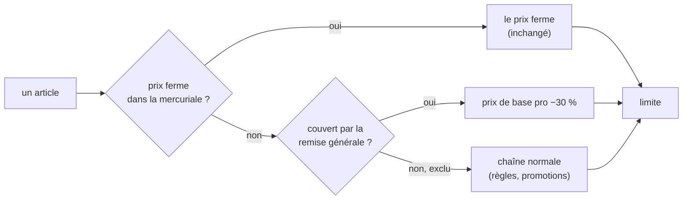

# Plan — la remise générale d'une mercuriale

> 📐 **Plan, écrit le 2026-11-11** à la demande de Hugo (« tout à −30 % sauf
> quelques articles »). Rien n'est bâti. Chaque affirmation sur l'existant a
> été vérifiée dans le code le même jour ; les chemins sont cités. Partie 1 :
> comprendre. Partie 2 : le code.

# Partie 1 — Comprendre

## Ce qu'on veut

Aujourd'hui une mercuriale ne sait dire qu'une chose : **un prix ferme en
euros, article par article**. Pour accorder « −30 % sur tout sauf le chocolat »
à un client, il faudrait taper un prix sur chacun des cent articles, et le
refaire à chaque hausse du catalogue.

On ajoute une seconde couche au même document : **la remise générale**.



| Couche                        | Ce qu'elle dit                    | Suit le catalogue ?                                    |
| ----------------------------- | --------------------------------- | ------------------------------------------------------ |
| **Prix ferme** (existe)       | « ce prix-là, quoi qu'il arrive » | non                                                    |
| **Remise générale** (nouveau) | « tout le reste, −30 %, sauf… »   | **oui** : c'est un pourcentage du prix de base du jour |

Un pourcentage suit le catalogue. C'est précisément la raison pour laquelle
la mercuriale l'a refusé jusqu'ici pour un **prix d'article**
(`comprendre-une-mercuriale.md`, « Jamais en pourcentage »). Pour une remise
générale, suivre le catalogue est le but : le client a « −30 % sur le tarif »,
pas « tel prix ».

## Les décisions

Prises par moi pendant l'écriture, à valider par Hugo. Chacune a son
alternative.

| #   | Décision                                                                                                                                                           | Pourquoi                                                                                                                                                                                                                                                          | Alternative écartée                                                                                                                                                    |
| --- | ------------------------------------------------------------------------------------------------------------------------------------------------------------------ | ----------------------------------------------------------------------------------------------------------------------------------------------------------------------------------------------------------------------------------------------------------------- | ---------------------------------------------------------------------------------------------------------------------------------------------------------------------- |
| D1  | **Un article couvert par la remise générale est scellé comme un prix ferme** : ni palier de volume, ni geste ; les promotions selon la politique de la mercuriale. | C'est le sens de « tarif négocié » : un client à −30 % n'empoche pas en plus le palier. Et c'est ce que fait déjà le moteur pour tout ce qui gagne l'étage `mercuriale` (`resolve-price.ts:171`). Zéro règle nouvelle dans la chaîne.                             | Une remise générale « transparente », qui laisserait passer paliers et gestes : il faudrait un second type de règle d'étage, et deux sortes de mercuriale à expliquer. |
| D2  | **Le prix ferme l'emporte** sur la remise générale, sur son article.                                                                                               | « Ce prix-là, quoi qu'il arrive » ne peut pas être remisé une seconde fois par le document même qui l'a fixé.                                                                                                                                                     | Appliquer −30 % au prix ferme : personne ne négocie ainsi.                                                                                                             |
| D3  | **Exclusions par famille et par déclinaison (SKU)**, en mode « tout sauf » ou « seulement ». Pas de cible « produit ».                                             | On reprend `promotionScopeMatch` (`packages/contracts/src/promotion-scope.ts`), la même mécanique que les promotions. La cible « produit » est refusée au point ligne parce que `PricingContext` n'a que le SKU (`promotion-as-rule.ts:53-60`) : même limite ici. | Une liste de SKU seule : pas de « sauf la famille Chocolat ».                                                                                                          |
| D4  | **Les articles au poids sont couverts** par une portée « tout » ou par famille.                                                                                    | Un pourcentage sans seuil se lit aussi bien sur un prix au kilo (décision de Hugo du 2026-10-31, `promotionExtendsToWeight`).                                                                                                                                     | Les exclure d'office : surprise du client sur ses fromages à la coupe.                                                                                                 |
| D5  | **Une mercuriale peut ne porter qu'une remise générale**, sans aucun prix ferme. Elle reste refusée si elle ne porte **ni l'un ni l'autre**.                       | C'est le cas d'usage le plus simple (« ce client a −15 % sur tout »).                                                                                                                                                                                             | Exiger au moins un prix ferme : on taperait un prix bidon pour pouvoir poser.                                                                                          |
| D6  | **Un seul pourcentage**, sans palier de quantité. Borné : plus de 0 %, moins de 100 %.                                                                             | Un palier de quantité sur une remise générale est un barème de volume, qui a déjà son étage.                                                                                                                                                                      | Des paliers : deux mécanismes pour la même chose.                                                                                                                      |
| D7  | **Un avenant daté** peut poser, changer ou arrêter la remise générale, et changer ses exclusions.                                                                  | Même règle que pour un prix : rien n'est réécrit, une relecture datée rend ce qui s'appliquait (`l-avenant-date.md`).                                                                                                                                             | Modification sur place : réécrirait l'explication d'une facture passée.                                                                                                |
| D8  | **Les gabarits n'ont pas de remise générale** dans ce plan.                                                                                                        | Un gabarit prépare des prix fermes à poser chez plusieurs clients ; la remise générale se décide client par client. À ouvrir si Hugo le demande.                                                                                                                  | —                                                                                                                                                                      |
| D9  | **La limite s'applique**, comme partout.                                                                                                                           | Un −30 % sur un article à faible marge est relevé à sa limite, et l'écran le dit.                                                                                                                                                                                 | —                                                                                                                                                                      |

## Ce que le client et l'équipe voient

- **Sur la fiche client** (composition et mercuriale posée) : un bloc
  « Remise générale » au-dessus des tables — un pourcentage et ses
  exclusions, avec le compteur « N articles concernés » des promotions.
  Dans les tables, la colonne « Prix mercuriale » montre, pour un article
  couvert sans prix ferme, le prix remisé en gris, « −30 % (remise
  générale) ».
- **Dans le chemin du prix** : l'étage Mercuriale porte le libellé
  « Mercuriale 2027 — remise générale −30 % ».
- **Au rayon et au panier du client** : rien de nouveau à apprendre, le prix
  affiché est celui de la caisse.
- **Au journal tarifaire** : la pose et chaque avenant disent la remise
  générale et ses exclusions.

## Un taux par famille (Hugo, 2026-11-11)

« −40 % sur le pain, −30 % sur les viennoiseries » : **chaque ligne du
sélecteur porte son taux**, et la ligne la plus précise gagne — déclinaison,
puis famille la plus proche, puis le taux de base du mode. Une ligne sans taux
est une **exclusion**.

| Ligne                                  | Remise |
| -------------------------------------- | ------ |
| Tout le catalogue (mode « tout sauf ») | −30 %  |
| Famille Pains                          | −40 %  |
| Sous-famille Pains spéciaux            | −25 %  |
| Famille Chocolat                       | exclue |
| Déclinaison Baguette tradition         | −35 %  |

En mode « rien sauf », il n'y a pas de taux de base : seules les lignes qui
portent un taux remisent. Cette section **prime** sur le « un seul
pourcentage » de D6 et du § 1 : D6 garde seulement « pas de palier de
quantité ».

# Partie 2 — Le code

## 1. Le modèle

`CompanyMercuriale` (`apps/lfd-api/src/lafoliecoffee/pricing/domain/entities/company-mercuriale.ts`)
gagne un champ :

```ts
interface GeneralDiscount {
  readonly mode: "all_except" | "only";
  /** Le taux de base, en points de base (1 à 9 999). Présent en `all_except`, `null` en `only`. */
  readonly baseBp: number | null;
  /** Cibles `category` et `variant` seulement (D3). `bp: null` = exclue. */
  readonly rules: readonly {
    readonly target: "category" | "variant";
    readonly targetId: string;
    readonly bp: number | null;
  }[];
}

// CompanyMercurialeState
readonly generalDiscount: GeneralDiscount | null;
```

L'avenant (`mercuriale-amendment.ts`) gagne de quoi la changer à sa date,
sur le modèle de la politique de promotions, qui se change déjà par avenant
(`admissionAt`, `mercuriale-promotion-policy.ts`) :

```ts
// MercurialeAmendmentDraft
readonly generalDiscount?: { readonly set: GeneralDiscount | null } | undefined;
```

`{ set: null }` arrête la remise générale ; absent, l'avenant n'en dit rien.
La remise générale à une date est lue par `generalDiscountAt` (§ 2.1).

**Refus nouveaux** (dans `mercuriale-errors.ts`, bâtis en R1) :

| Refus                                                  | Erreur                                                       |
| ------------------------------------------------------ | ------------------------------------------------------------ |
| un taux hors ]0 ; 100 %[ (base ou ligne)               | `InvalidGeneralDiscountError` (400)                          |
| « tout sauf » sans taux de base, ou « seulement » avec | `GeneralDiscountBaseRateError` (400)                         |
| « seulement » sans aucune ligne à taux                 | `GeneralDiscountIncludesNothingError` (400)                  |
| deux lignes sur la même cible                          | `DuplicateGeneralDiscountTargetError` (400)                  |
| ni prix ferme ni remise générale (D5)                  | `EmptyMercurialeError`, élargie : son message nomme les deux |

La cible « produit » est impossible par le type (D3). La lecture datée est
`generalDiscountAt` (§ 2.1), distincte de `promotionPolicyAt`. Q2 (refus chez
un client à engagement de volume) ne peut pas vivre dans l'agrégat, qui ne
connaît pas les engagements : les handlers de pose et d'avenant de R2 lisent
le port des engagements et refusent, y compris un avenant qui pose une remise
sur une mercuriale qui n'en avait pas.

`normalizeGrid` refuse aujourd'hui la grille vide (`pricing-grid.ts`) ; la
pose ne l'appelle plus sur une grille vide **quand** une remise générale est
posée. Le refus « grille vide » reste pour les gabarits.

## 2. Le calcul

Tout passe par `mercurialeRuleFor` (`entities/mercuriale-rule.ts`), qui reste
**la seule porte** de la mercuriale vers le moteur. Il rend aujourd'hui une
règle `replace` quand l'article a un prix ferme. Il rendra :

1. le prix ferme, comme aujourd'hui, s'il y en a un (D2) ;
2. **sinon**, si une remise générale court à cette date et qu'une décision
   la couvre — la déclinaison, sinon la famille la plus proche, sinon le taux
   de base du mode — avec un taux, une règle à ce taux. La recherche de la
   décision est celle de `promotionScopeMatch`
   (`packages/contracts/src/promotion-scope.ts`), mais elle doit rendre **la
   règle qui décide**, pas seulement un rang : on en extrait une fonction
   pure qui rend la règle (`articleRuleOf` / `nearestFamilyRule`), que
   `promotionScopeMatch` réutilise sans changer de comportement (D4 : le poids
   est couvert, comme `extendsToWeight: true`). Une règle :

```ts
{
  id: mercuriale.id,            // le DOCUMENT, comme pour un prix ferme
  stage: "mercuriale",
  // PRODUCT, comme la règle d'un prix ferme (mercuriale-rule.ts:100) : en
  // `variant`, la spécificité (specificity.ts:51-53) ferait gagner la remise
  // sur une règle d'étage mercuriale écrite à la main en portée produit.
  scope: { type: "product", id: context.productSku },
  audience: { type: "company", id: context.companyId },
  minQuantity: null,
  validFrom, validTo,           // la fenêtre de la remise qui parle (§ 2.1)
  suspendedFrom: suspendedFromOf(mercuriale.lifecycle), // la pause suspend la remise
  label: "Mercuriale 2027 — remise générale −30 %",
  stacksOverMercuriale: false,
  promotionAdmission: admissionAt(mercuriale, context.at),
  nature: "alter",
  alteration: { direction: "decrease", mode: "percent", bp },
}
```

3. sinon `null`, comme aujourd'hui.

🔴 **Un article qui a une ligne de prix ferme n'est JAMAIS remisé par la
remise générale**, même quand sa quantité n'atteint aucun palier : la règle
rend alors `null` et `mercurialeMissesTier` dit « palier non atteint », comme
aujourd'hui (`mercuriale-rule.ts:89-92`). Sans ça, un client dont le prix
ferme s'ouvre à 50 pièces paierait 10 pièces à −30 %, peut-être moins cher
que son prix ferme (objection 4 de vitruve).

### 2.1 La fenêtre de la remise

Contrairement à la politique de promotions — qui ignore volontairement le
`validTo` d'un avenant (`mercuriale-amendment.ts:41-46`) —, **la remise
générale d'un avenant ne vaut que sur la fenêtre de l'avenant**. Après son
`validTo`, c'est la remise d'avant qui reparle (celle d'un avenant antérieur
encore ouvert, sinon celle du document). Un avenant temporaire « −20 % du 1er
au 31 » ne laisse donc pas −20 % pour toujours (objection 3). La lecture est
une fonction à elle (`generalDiscountAt`), pas une copie de `admissionAt`.

Le moteur sait déjà appliquer une règle `alter` en pourcentage à n'importe
quel étage (`PriceRule`, `price-rule.ts:221-222`), et la mercuriale est le
**premier** étage (`PRICE_STAGES`, `price-rule.ts:24`) : le pourcentage
s'applique donc au prix de base. Ce qui gagne l'étage `mercuriale` scelle
(`resolve-price.ts:171`) : D1 est tenu sans toucher au moteur.

`mercurialeMissesTier` ne change pas : une remise générale n'a pas de palier.

🔴 **Le refus `MercurialeMustPoseAPriceError`** (`entities/pricing-rule.ts`) vise une
règle de prix **écrite à la main** à l'étage `mercuriale`. Il reste : la
règle `alter` ci-dessus n'est jamais persistée comme règle, elle est rendue
par l'agrégat à la lecture.

## 3. La persistance

Migration **additive** (`lecteur-de-migrations` la relit) :

- `company_mercuriales.general_discount jsonb NULL`
- `company_mercuriale_amendments.general_discount jsonb NULL` et
  `general_discount_set boolean NOT NULL DEFAULT false` (distinguer « n'en
  dit rien » de « l'arrête »), avec
  `CHECK (general_discount_set OR general_discount IS NULL)` ;
- `mercuriale_drafts.general_discount jsonb NULL` : le brouillon garde la
  remise saisie (objection 6) ;
- un `CHECK *_general_discount_shape` sur les trois colonnes, sur le modèle
  des `*_promotion_policy_shape` (`20261101090000_la_mercuriale_decide`,
  lignes 38, 48, 61) : `bp` entier entre 1 et 9 999, `scope.mode` dans
  `all_except`/`only` (objection 8).

Aucune donnée existante ne change : `NULL` partout = le comportement
d'aujourd'hui. L'adaptateur (`prisma-company-mercuriale.repository.ts`)
valide le JSON en entrée de `toDomain`.

Deux portes listent `CompanyMercuriale` : `dev-toolbox/gates/shelf-writes.mjs:66-67`
(un écrivain émet `ShelfChanges`) et `dated-decisions.mjs:109,126` (vérifié
par vitruve le 2026-11-11). Les écrivains de la remise passent par les gestes
existants (pose, avenant) : rien de neuf à inscrire, à revérifier au bâti.

## 4. Les lecteurs à revoir

Ceux qui lisent les **lignes** de la mercuriale plutôt que la règle
(vérifié le 2026-11-11, `grep linesAt|lines.length`) :

| Lecteur                                                                                                          | Aujourd'hui                                               | Avec la remise générale                                                                                                                 |
| ---------------------------------------------------------------------------------------------------------------- | --------------------------------------------------------- | --------------------------------------------------------------------------------------------------------------------------------------- |
| `mercuriale-benchmark.query.ts`                                                                                  | compare les prix fermes entre clients                     | **inchangé** : la remise générale n'est pas un prix d'article ; le dire dans le JSDoc                                                   |
| `pose-…`, `rename-…`, `apply-price-template.handler.ts`                                                          | comptent `lines.length` pour le journal                   | le résumé dit aussi « remise générale −30 % »                                                                                           |
| `company-mercuriale-support.ts:112`                                                                              | ensemble des SKU négociés                                 | inchangé (les prix fermes)                                                                                                              |
| `posed-mercuriale-view.ts`                                                                                       | la vue du dossier                                         | expose `generalDiscount` (contrat `@lfd/contracts`)                                                                                     |
| `company-pricing.query.ts`                                                                                       | `negotiatedSkuCount` et `averageGapBp` = articles scellés | **restreints aux prix fermes**, inchangés de sens ; un champ neuf `generalDiscountSkuCount` compte les articles couverts (objection 11) |
| `prisma-sale-reference-usage.ts:62,109-112`, `prisma-sale-reference-decisions.reader.ts:50-60`                   | cherchent un SKU dans `lines`                             | cherchent aussi dans la portée de la remise (objection 7)                                                                               |
| migration de bascule du SKU par défaut, `dev-toolbox/ops/check-default-sku-switch.mjs`                           | réécrivent `lines[].sku`                                  | réécrivent aussi les cibles `variant` de la portée, sinon une exclusion devient caduque                                                 |
| `carry-over-mercuriale-line.handler.ts`                                                                          | reporte un prix ferme                                     | reporte aussi une exclusion `variant` sur la référence détachée                                                                         |
| `mercuriale-rows.ts` (mapper de `prisma-company-mercuriale.reader.ts` et `prisma-unended-mercuriales.reader.ts`) | lit `lines`                                               | lit la remise                                                                                                                           |
| `volume-tier-prices.ts:157-161`, `export-price-grid.handler.ts`                                                  | supposent une règle `replace`                             | à relire au bâti avec la règle `alter`                                                                                                  |
| `pricing-act-summary.ts:157`                                                                                     | résume les `replace` en « prix posé »                     | dit « remise générale −30 % »                                                                                                           |
| export CSV (`mercuriale-csv.ts`, front)                                                                          | une ligne par prix ferme                                  | une ligne d'en-tête « Remise générale −30 %, sauf … »                                                                                   |

Ceux qui passent par `resolvePrice` (rayon, panier, devis, commande, trace)
n'ont **rien** à changer : ils reçoivent la règle.

## 5. L'écran

- **Composition** (`fiche-client/tarifs/mercuriale-composer/`) : un bloc
  « Remise générale » — un champ pourcentage (`fold-number-input`), le
  sélecteur de portée des promotions réutilisé tel quel
  (`targeted-promotions/scope-lines.ts`), le compteur « N articles
  concernés ».
- **Mercuriale posée** (`posed-mercuriale/`) : la remise en lecture, et le
  geste « Changer la remise générale » par avenant daté, à côté de « Changer
  les promotions ».
- La colonne « Prix mercuriale » montre le prix remisé d'un article couvert
  sans prix ferme, en gris : le prix ferme tapé l'emporte (D2).

## 6. Les lots

| Lot                  | Contenu                                                                                          | Tests                                                                                                                                                           |
| -------------------- | ------------------------------------------------------------------------------------------------ | --------------------------------------------------------------------------------------------------------------------------------------------------------------- |
| **R1** ✅ 2026-11-11 | domaine : `GeneralDiscount`, refus, pose, avenant, `mercurialeRuleFor`                           | unitaires domaine : couverture, exclusion famille / SKU, poids, prix ferme prioritaire, avenant qui arrête, relecture datée, scellement (palier écarté), limite |
| **R2** ✅ 2026-11-11 | migration + adaptateur + contrat + routes de pose et d'avenant                                   | e2e : poser une mercuriale à remise seule ; le prix d'un article couvert, exclu, à prix ferme ; un avenant qui change le taux ; le mur `company_id`             |
| **R3**               | ✅ bâtis avec R2, sauf l'export CSV du front, qui reste ; lecteurs du § 4 et journal             | unitaires des résumés, export CSV                                                                                                                               |
| **R4**               | écran : composition, mercuriale posée, avenant                                                   | specs Angular, vérification à l'écran                                                                                                                           |
| **R5**               | doc d'état : `comprendre-une-mercuriale.md` et `l-avenant-date.md` au présent ; ce plan supprimé | —                                                                                                                                                               |

## 7. Contredit par vitruve (2026-11-11)

Les trois bloquants sont corrigés ci-dessus : la portée `product` (1), la
règle complète avec la pause (2), la fenêtre propre de la remise (3). Les
sérieux 4, 6, 7, 8, 11 aussi. **Quatre restent des choix de Hugo** :

| #                        | La question                                                                                                                                                               | Ma proposition                                                                                                                                                 |
| ------------------------ | ------------------------------------------------------------------------------------------------------------------------------------------------------------------------- | -------------------------------------------------------------------------------------------------------------------------------------------------------------- |
| Q1 (obj. 5)              | Un avenant qui **arrête** le prix ferme d'un article couvert : l'article passe à la remise générale, il ne revient pas au catalogue.                                      | ✅ Accepté, et l'écran de l'avenant le dit avant d'enregistrer : « cet article passera à −30 % (remise générale) ».                                            |
| Q2 (obj. 9)              | La remise générale **scelle aussi l'engagement de volume** du client sur ce qu'elle couvre (`resolve-price.ts:141-152`). Avec « tout », il le perd sur tout le catalogue. | ✅ Refuser de poser une remise générale chez un client qui a un engagement de volume en cours, avec un message qui le nomme ; à rouvrir si le cas se présente. |
| Q3 (obj. 10)             | Un −30 % **relevé à la limite** : le client voit un prix qui n'est pas −30 %.                                                                                             | ✅ L'écran de pose liste les articles que la limite relèvera, avant de poser ; le client n'en voit rien de plus qu'aujourd'hui pour un prix ferme relevé.      |
| Q4 (obj. 1, non vérifié) | Combien de règles d'étage `mercuriale` écrites à la main existent en production ?                                                                                         | Les compter avant R1 (lecture seule).                                                                                                                          |

Non vérifiés par vitruve, à faire au bâti : l'arrondi d'un pourcentage sur un
article au poids (`price-rule-application.ts`) ; le rayon en cache quand
presque tout est scellé (`sealingOfShelf`, `shop-catalogue-offers.ts:116-162`).

## 8. Notes du bâti de R2

- **Q2 lu au sens large** : la remise est refusée si un engagement de volume
  vivant **recouvre sa fenêtre**, pas seulement s'il court aujourd'hui — une
  remise posée pour janvier scellerait un engagement qui commence en janvier.
- **Report sur une référence détachée** qui a déjà sa ligne dans la remise :
  `DuplicateGeneralDiscountTargetError` (400) répond.
- **Une future bascule de SKU par défaut** devra aussi réécrire
  `general_discount->'rules'[*].targetId` (cible `variant`) sur les trois
  tables, et `dev-toolbox/ops/check-default-sku-switch.mjs` les compter.
- **Le journal compte les cibles** (« sauf 1 famille et 2 articles ») sans les
  nommer : le domaine ne connaît que des identifiants.

## 9. Ce qui n'est pas dans ce plan

- La remise générale sur un **gabarit** (D8).
- Des **paliers** sur la remise générale (D6).
- Une remise générale **sans mercuriale** pour un client : c'est ce que fait
  déjà une promotion ciblée « une société », sans les avenants ni le
  scellement.
