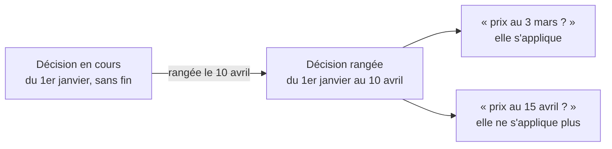

# Clore n'est pas ranger

> ✅ **Décrit le code au 2026-11-04**, réécrit ce jour-là contre le code. La
> version du 2026-09-09 racontait aussi les quatre versions du plan contredites
> par `vitruve` ; leur leçon est gardée au § 6, le récit est dans l'historique
> git. Partie 1 : comprendre. Partie 2 : le code.

# Partie 1 — Comprendre

## Le problème

Une décision de prix (une règle, un barème, un engagement, une mercuriale, un
plancher) a une **période** pendant laquelle elle agit. Quand on la **range**
(on la retire de l'écran), il faut aussi dire **jusqu'à quand** elle a agi.

Autrefois, ranger faisait **disparaître** la décision : on ne pouvait plus
retrouver le prix qu'elle avait donné. Une mercuriale active le 3 mars, rangée
en avril, était introuvable pour quelqu'un qui demandait « que payait ce
client le 3 mars ? ».

## La solution

Ranger **écrit la date de fin** dans la période de la décision. Elle reste en
base, rangée, et une lecture datée la retrouve.



## Demander un prix à une date passée

On peut demander le prix tel qu'il était à n'importe quelle date : le calcul
relit alors les décisions **rangées** qui couvraient cette date, sans passer
par le cache (qui ne contient que l'état d'aujourd'hui).

## Reposer sur une période passée

On peut reposer une décision sur une période où une autre a été rangée,
**sauf si celle-ci a déjà servi à facturer une commande**. Se tromper puis
recommencer dix minutes après reste possible ; réécrire un prix qui a été
facturé ne l'est pas.

# Partie 2 — Le code

## 1. Les deux sens de `archived_at`

| Sens       | Geste                                                             | Où ça s'écrit                                                  |
| ---------- | ----------------------------------------------------------------- | -------------------------------------------------------------- |
| **ranger** | retirer de l'écran ; rend sa place dans la contrainte d'exclusion | `archived_at`                                                  |
| **finir**  | cesser d'agir                                                     | `valid_to`, là où le domaine lit déjà la vigueur (`isInForce`) |

## 2. Quand ranger borne la fenêtre

`closingWindowAt(fenêtre, suspendedFrom, at)` (`b2b/pricing/domain/rule-lifecycle.ts`)
décide, une fois pour tous les agrégats :

| Cas                                            | Réponse                  | Ce que ça évite                                                                                    |
| ---------------------------------------------- | ------------------------ | -------------------------------------------------------------------------------------------------- |
| la décision n'a jamais agi (`validFrom >= at`) | ne rien borner           | une plage vide ou inversée, que `tstzrange` refuse (erreur 22000, un 500 sur un geste de l'équipe) |
| déjà terminée (`validTo <= at`)                | ne rien borner           | la ressusciter sur l'intervalle écoulé                                                             |
| suspendue avant d'agir                         | ne rien borner           | idem le premier cas                                                                                |
| suspendue **pendant**                          | borner à `suspendedFrom` | occuper la période de pause avec une décision qui ne s'y appliquait pas                            |
| sinon                                          | borner à `at`            | —                                                                                                  |

## 3. La lecture datée

- **L'époque** (`PriceEpoch`, `b2b/pricing/domain/price-epoch.ts`) :
  `current` ou `replay`, décidée **une fois** dans `Pricer.load`
  (`epochOf(at, now)`). À ne pas confondre avec la **lentille**, qui dit ce
  que la question a le droit de prouver.

|                     | `current`   | `replay`                                                                           |
| ------------------- | ----------- | ---------------------------------------------------------------------------------- |
| décisions lues      | non rangées | non rangées **à cette date** (`unarchivedAt(at)`, `infrastructure/archived-at.ts`) |
| cache des matériaux | utilisé     | **contourné** : le chargeur appelle les lecteurs datés (`inScopesAt`, `liveAsOf`)  |

- Le contournement du cache n'est pas de l'hygiène : le cache garde des tables
  entières pour tous les clients ; une lecture datée qui s'y rangerait
  servirait ensuite des lignes rangées **au chemin qui facture**.
- **La reconstitution complète** est datée dans ses cinq entrées : règles,
  barèmes, engagements, mercuriale (et ses avenants) ; suspension ; planchers ;
  **tarif du catalogue à la date** (la porte rescelle les articles au prix de
  la date, et refuse un article sans historique jusque-là) ; **preuves
  mesurées** (le cumul d'un engagement est borné à l'instant de la question).
- `lint:dated-decisions` exige que chaque famille de `PricingMaterials` porte
  sa fenêtre : six familles au 2026-11-04 (`PriceRule`, `ScopedPriceFloor`,
  `VolumeLadder`, `VolumeCommitment`, `CompanyMercuriale`,
  `AdmittedPromotion`). Elle s'arrête au fichier de déclaration, et le dit dans
  son JSDoc.

## 4. Reposer sur une période close

```
poser → existe-t-il une décision RANGÉE qui recouvre cette fenêtre ?
          └─ oui → l'une d'elles est-elle citée par une ligne de commande ?
                     ├─ oui → 409 PricedPeriodIsSealedError
                     └─ non → posé
```

- La contrainte d'exclusion est **partielle** (`WHERE archived_at IS NULL`) :
  elle ne voit pas les décisions rangées. Chaque famille a donc son
  `archivedOverlapping`, avec la **clé d'exclusion de sa table** :

| Famille    | Port                               | Clé                            |
| ---------- | ---------------------------------- | ------------------------------ |
| règle      | `pricing-rule.repository.ts`       | étage, portée, audience, seuil |
| barème     | `volume-ladder.repository.ts`      | portée, audience               |
| engagement | `volume-commitment.repository.ts`  | société, portée                |
| mercuriale | `company-mercuriale.repository.ts` | société                        |

- **« A facturé »** se lit par le port `PricedDecisionsReader`, déclaré par
  `pricing` (`domain/ports/priced-decisions.reader.ts`) et implémenté par
  `orders` (`orders/infrastructure/prisma-priced-decisions.reader.ts`), relié
  dans `appBootstrap`. Il interroge deux colonnes des lignes de commande :
  `pricing_steps` (ce qui a modifié le prix) et `pricing_commitment`
  (l'engagement, qui mesure sans modifier), avec deux index GIN partiels.
- Pour une mercuriale, la règle rendue au calcul garde l'identifiant **du
  document** même quand le prix vient d'un avenant, pour que ce contrôle le
  trouve ([`../mercuriales/l-avenant-date.md`](../mercuriales/l-avenant-date.md), B1).

## 5. Les planchers, versionnés

Un plancher n'avait pas de fenêtre : le reposer **réécrivait** la ligne, et
une lecture datée lui appliquait les valeurs d'aujourd'hui — un prix
historique gonflé, sans que rien ne le dise. Désormais :

|            | Avant                | Aujourd'hui                                |
| ---------- | -------------------- | ------------------------------------------ |
| identité   | dérivée de la portée | tirée, comme les autres                    |
| reposer    | réécrit              | **borne** la précédente, en pose une neuve |
| contrainte | index unique         | exclusion sur portée × plage, partielle    |
| résolution | portée seule         | fenêtre, puis portée                       |

Le journal d'un plancher a pour sujet sa **cible** (`floorScopeKey`), pas la
version : l'histoire d'une limite reste un seul fil. Les planchers d'avant le
versionnage portent pour début leur dernière pose : une lecture antérieure ne
trouve aucun plancher plutôt qu'un plancher inventé.

## 6. Ce qui ne bouge pas, et pourquoi

- **Ranger reste ranger** : `archive()` garde sa route, son écran et son sens
  (`GET /admin/pricing/rules/archived`, le panneau des archives).
- Les gardes de cycle de vie (`assertNotArchived`, `assertOpenFor(at)`)
  gardent leurs messages.
- Le chemin qui facture n'a pas changé : tout vit dans l'écriture et la
  relecture datée.
- Quatre conceptions ont été écartées avant celle-ci : garder l'archivage et
  dater la lecture (lit un intervalle que plus rien ne garde) ; borner sans
  désarchiver (les lecteurs filtrent tous `archived_at IS NULL`) ; abolir
  l'archivage (cassait le rangement et un écran en service) ; deux routes
  « clore » et « ranger » (c'est la même route pour les règles et les
  barèmes). Ce qui a survécu : **le domaine filtre déjà par fenêtre, à
  l'instant demandé**.
- Deux détails à ne pas retirer : l'`orderBy` explicite sur la relecture datée
  de la mercuriale (au passé, l'unicité n'est plus garantie), et l'`AND`
  explicite autour de `unarchivedAt`, qui rend un `OR`.

## 7. Ce qui manque

Le refus « a facturé » n'a son e2e « refusé » que pour la **mercuriale** ; les
trois autres familles n'ont que le côté « autorisé ». Même port, même appel,
même erreur — mais le dire n'est pas le prouver.
