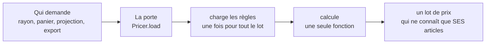

# La porte du prix

> ✅ **Décrit le code au 2026-11-04**, réécrit ce jour-là contre le code. Le
> raisonnement, les versions démolies et ce que chaque lot a trouvé sont au
> [journal de remédiation](../journal-de-remediation.md), § R26. Partie 1 :
> comprendre. Partie 2 : le code.

# Partie 1 — Comprendre

## Une seule porte pour obtenir un prix

Tout le code qui a besoin du prix d'un article — le rayon de la boutique, le
panier, la commande, la projection, l'export de grille — passe par **la même
porte**. Avant, chaque écran chargeait les règles à sa façon, et deux d'entre
eux s'étaient trompés : l'écran de tarification annonçait 1,83924 € quand la
caisse facturait 1,65532 €.



## Ce qu'on donne à la porte

- **Des articles du catalogue**, jamais un prix choisi par l'appelant : le
  prix d'entrée vient toujours du catalogue.
- **Qui achète** : une société (ou personne), et par quelle porte il entre
  (invité, client connecté, équipe).
- **Ce que la question a le droit de prouver** (la « lentille ») : une vraie
  commande tient compte des engagements et des volumes du client ; une
  projection ou un écran de tarification, non.
- **Facultativement, une date** pour relire un prix passé. Pour « maintenant »,
  on ne donne **pas** de date : la porte lit l'heure elle-même.

## Ce que la porte ne fait pas

Elle ne compose pas un panier (remises de panier, livraison, TVA, total), elle
n'écrit rien, et elle ne cherche pas un article par son code : c'est le
travail de qui a un code.

# Partie 2 — Le code

## 1. L'appel

```ts
const lot = await this.pricer.load({
  articles, // [{ article: CatalogArticle, quantity }], dans l'ordre rendu
  buyer, // { kind: "real", companyId, buyerKind } | { kind: "typical", … }
  lens, // "measured" par défaut ; "unproven" pour qui ne prouve rien
  at, // facultatif : une relecture datée, et rien d'autre
  caller, // l'étiquette de la sonde, jamais un critère de prix
});

lot.price("VIE-001", 12); // le prix et sa trace
lot.all(lignes); // plusieurs, dans l'ordre demandé
lot.tiers("VIE-001", 12); // la grille des paliers
lot.projectAt("VIE-001", 10_000); // « si le cumul valait N »
```

`LotRequest` est dans `lafoliecoffee/pricing/application/pricer.ts`. `buyerKind` vaut
`guest` sur une route publique, `registered` derrière un client reconnu,
`unknown` pour l'équipe, `previewed` pour un aperçu d'audience. L'acheteur
`typical` (un pro type) ne se fabrique que dans l'export de grille
(`lint:typical-buyer`).

## 2. Les objets

| Objet                    | Où                                                | Visibilité | Rôle                                                                                                                |
| ------------------------ | ------------------------------------------------- | ---------- | ------------------------------------------------------------------------------------------------------------------- |
| `Pricer`                 | `pricing/application/pricer.ts`                   | publique   | prend des articles scellés, décide de l'époque (`epochOf`), charge une fois, rend un lot                            |
| `PricedLot`              | `pricing/application/priced-lot.ts`               | publique   | répond par SKU ; refuse un SKU qu'il n'a pas chargé (`ArticleNotInLotError`)                                        |
| `PricingMaterialsLoader` | `pricing/application/pricing-materials.loader.ts` | interne    | six lectures par lot, en parallèle ; mesure les preuves si la lentille le permet                                    |
| `pricerOver`             | `pricing/application/pricer-over.ts`              | interne    | **la seule fabrique** du tarificateur ; la lentille décide à la fois des engagements chargés et des preuves admises |
| `LoadedPricer`           | `pricing/domain/loaded-pricer.ts`                 | interne    | pur ; **seul appelant de `resolvePrice`**                                                                           |

## 3. Qui l'emprunte (vérifié le 2026-11-04)

| Appelant                                             | Lentille   | Quantité          | Ce qu'il demande                                        |
| ---------------------------------------------------- | ---------- | ----------------- | ------------------------------------------------------- |
| `OrderLinePricing` (`orders/`), via `PricingContext` | `measured` | celle du panier   | le prix facturé : devis, commande, estimation, révision |
| `ShopCataloguePricing` (`catalog/`)                  | `measured` | 1                 | le rayon, public et reconnu, et les suggestions         |
| `PriceProjectionQuery`                               | `unproven` | le niveau projeté | la courbe du banc d'essai                               |
| `ExportPriceGridHandler`                             | —          | —                 | l'export de grille, avec l'acheteur type                |

**Le tableau de tarification** (`board-item.ts`) charge ses matériaux lui-même
(par `prisma-pricing-board.reader.ts`, à une date, sans l'étage promotion des
règles), mais il construit son tarificateur par **la même fabrique**
`pricerOver`, avec la lentille `unproven`. Les deux séquences de chargement ont
désormais la même sémantique : c'est ce qui a clos R21 le 2026-09-09.

## 4. « Maintenant » se dit par l'absence de `at`

La porte décide `current` ou `replay` en comparant `at` à **sa propre**
lecture de l'horloge. Un appelant qui lit l'horloge puis passe ce qu'il a lu
crée deux instants : dans une requête ils coïncident (instant gelé à
l'entrée) ; **hors requête** (tâche de fond, abonné, semis), la seconde lecture
tombe une milliseconde plus tard, et la question du présent devient une
relecture datée, rescellée à l'historique du tarif **pro**. C'est arrivé le
2026-10-30 : un invité passé hors requête payait le prix pro.

- `OrderLinePricing` n'injecte plus d'horloge : l'erreur n'y est plus
  exprimable. Régressions : `order-line-pricing-instant.spec.ts`,
  `test/shop-quote-placement.e2e-spec.ts`.
- **Une relecture datée au public est refusée**
  (`DatedPublicPriceUnsupportedError`, `orders/domain/errors/dated-public-price.error.ts`) :
  l'historique du tarif ne porte que le prix pro.
- ⚠️ **Encore ouvert** : `ProjectPriceHandler` passe `this.clock.now()` à la
  projection, qui le transmet à `pricer.load` comme `at`. Même figure, sans
  prix public en jeu ; hors requête, une projection pourrait devenir une
  relecture et lever `NoCanonicalPriceAtError` sur un article neuf.

## 5. À quel cran chaque garantie tient

L'ordre du dépôt : _inexprimable > refusé en base > refusé par l'agrégat >
porte CI > relecture_.

| Garantie                                                 | Cran                    | Ce qui reste possible                                                                                          |
| -------------------------------------------------------- | ----------------------- | -------------------------------------------------------------------------------------------------------------- |
| l'article est scellé par le catalogue (`CatalogArticle`) | inexprimable + porte CI | `{ … } as CatalogArticle` compile ; `lint:catalogue-authority` le voit                                         |
| le lot ne tarife que ses articles                        | refusé à l'exécution    | rien : `ArticleNotInLotError`                                                                                  |
| les rouages sont internes                                | porte CI                | `lint:price-door` (aucun code servi hors de `lafoliecoffee/pricing/` n'atteint le chargeur ni le tarificateur) |
| une seule entrée de `resolvePrice`                       | porte CI                | `lint:price-pipeline`                                                                                          |

## 6. Ce qui l'éprouve

`pricing/domain/__tests__` (la composition), `priced-lot.spec.ts`,
`pricer.spec.ts`, `board-item.spec.ts`, `test/pricer.e2e-spec.ts` (contre un
vrai Postgres), `test/pricing-budget.e2e-spec.ts` (les opérations ORM, à
l'égalité stricte), et les e2e du prix servi (`admin-pricing`, `price-rules`,
`shop-catalogue`).

## 7. Ce qui manque encore

- La projection passe un instant (§ 4).
- Le gain de la lentille `unproven` n'est pas **compté** : aucun budget
  d'opérations ne couvre la projection.
- Relevés à l'audit, sans prix faux : `mercurialeAlone` prend un paramètre que
  son objet porte déjà ; `PricedArticle.floorMillicents` duplique
  `floorDecision.floorMillicents` ; le domaine importe `@lfd/contracts`.
