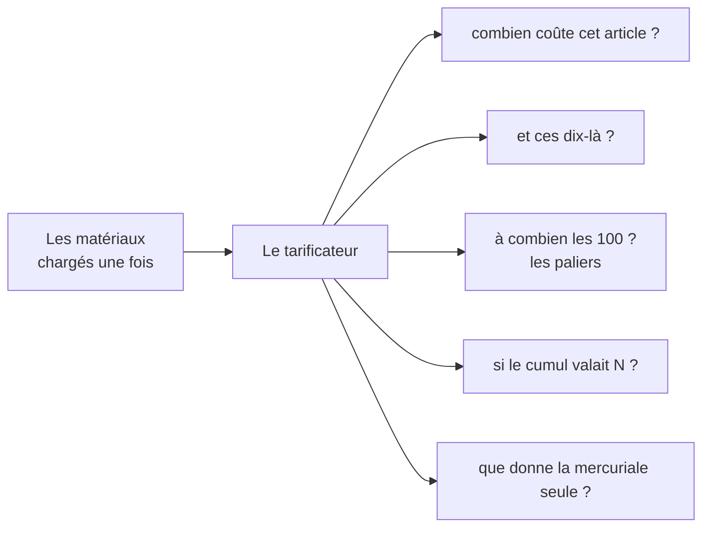
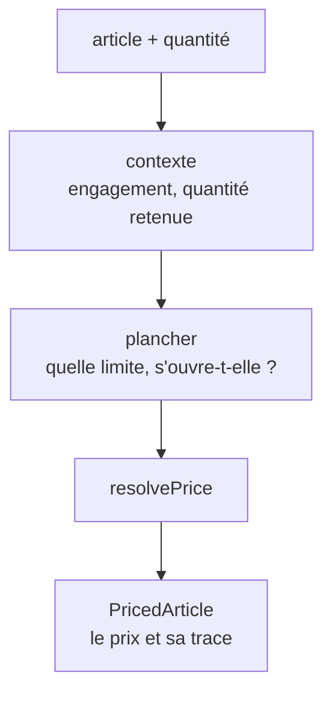

# Le tarificateur — `LoadedPricer`

> ✅ **Décrit le code au 2026-11-04**, réécrit ce jour-là contre le code. La
> version du 2026-09-09 décrivait aussi une façade `Pricer.for` / `forAll` par
> SKU, retirée le jour même ; **la porte d'entrée** est décrite dans
> [`architecture-la-porte-du-prix.md`](architecture-la-porte-du-prix.md). Ce
> document décrit **le tarificateur** qu'elle tend. Partie 1 : comprendre.
> Partie 2 : le code.

# Partie 1 — Comprendre

## Une seule recette

Avant septembre, chaque écran qui voulait un prix écrivait sa propre recette :
quelles règles lire, dans quel ordre, quel plancher appliquer. Cinq recettes,
deux fausses :

- l'écran de tarification oubliait les barèmes (1,83924 € affiché, 1,65532 €
  facturé) ;
- la projection oubliait la mercuriale (une courbe au tarif catalogue pour un
  client qui en avait une).

Aujourd'hui, il n'y a **qu'un tarificateur**. On lui donne ce qu'il faut lire
(les règles, les planchers, les barèmes…), et il répond à quelques questions,
toujours par le même calcul.

## Un prix ne sort jamais seul

Le tarificateur rend toujours **le prix et son explication** : les étages
traversés, la règle qui l'a emporté, celles qu'elle a évincées, la mercuriale
qui a fixé le prix, la décision de plancher. Six mois plus tard, on sait encore
pourquoi ce prix, même si la règle a été retirée.

## La quantité est obligatoire

« Le prix » n'existe pas sans quantité dès qu'un barème ou une mercuriale à
paliers existe. Une valeur par défaut à 1 donnerait un chiffre plausible et
faux. Le rayon de la boutique écrit donc « quantité 1 » noir sur blanc.

# Partie 2 — Le code

## 1. L'objet

`LoadedPricer` (`b2b/pricing/domain/loaded-pricer.ts`) : **pur**, matériaux en
main, ne lit rien. **Seul appelant de `resolvePrice`** du dépôt, tenu par
`lint:price-pipeline` (une entrée : `loaded-pricer.ts`, plus la définition
`resolve-price.ts`).

- Il se construit par `LoadedPricer.over(matériaux, preuves, parties, at)`,
  appelé seulement par la fabrique `pricerOver`
  (`pricing/application/pricer-over.ts`), où la **lentille** décide à la fois
  des engagements chargés et des preuves admises.
- Hors de `b2b/pricing/`, on n'y accède que par la porte `Pricer.load`, qui
  rend un `PricedLot` (`lint:price-door`).

## 2. Les questions

| Question                           | Méthode                                      | Ce qu'elle écarte, et pourquoi                                                                                                                                                |
| ---------------------------------- | -------------------------------------------- | ----------------------------------------------------------------------------------------------------------------------------------------------------------------------------- |
| combien coûte cet article ?        | `price(item, quantité)`                      | —                                                                                                                                                                             |
| et pour ces articles ?             | `priceAll(items)`                            | —                                                                                                                                                                             |
| le prix à chaque palier            | `tiers(item, quantité)`                      | —                                                                                                                                                                             |
| si le cumul valait N ?             | `priceAtCumulative(item, n)`                 | **les preuves et les engagements** : une projection ne prouve aucun volume ; ouvrir la porte d'un plancher dynamique dessus accorderait une remise que rien n'a établie (R15) |
| ce que la mercuriale accorde seule | `LoadedPricer.mercurialeAlone(…)` (statique) | **barème et plancher** : pour comparer deux clients qui n'ont pas les mêmes                                                                                                   |

`PricedLot` (`pricing/application/priced-lot.ts`) les expose par SKU : `price`,
`all`, `tiers`, `projectAt`.

## 3. Ce qu'il rend (`PricedArticle`)

Le tarif de liste (`canonicalMillicents`), le prix final (`finalMillicents`),
la quantité, et sa trace : les étages qui ont agi (`steps`), les règles
écartées avec leur cause (`rejected`, figées sur la ligne de commande en
`pricing_rejected`), la mercuriale qui a scellé (`sealedByRuleId`), ce qu'elle
laisse passer (`sealingAdmission`) et ce qu'elle a écarté (`sealedRuleIds`),
le plancher (`floored`, `floorMillicents`, `floorDecision` figée), le passage
à zéro (`clampedToZero`), et l'état de l'engagement du client si un
engagement couvre l'article. (Qui évince qui, `supersededRuleIds`, est calculé
par l'écran de tarification, pas par le tarificateur.)

## 4. Les décisions de conception

- **La quantité est obligatoire**, jamais un défaut.
- **Le même article deux fois dans un lot est refusé**
  (`DuplicateArticleError`, levé par `Pricer.load`) plutôt que fusionné : deux
  lignes de 5 sont-elles un panier de 10, ou deux demandes ? Les deux lectures
  donnent des prix différents dès qu'un barème existe.
- **L'instant ne se met pas en valeur par défaut d'une signature** : la porte
  le décide dans son corps (cf.
  [`architecture-la-porte-du-prix.md`](architecture-la-porte-du-prix.md) § 4).
- **La grille des paliers reçoit sa résolution en paramètre**
  (`volume-tier-prices.ts`) au lieu de l'importer : elle sonde des quantités,
  elle n'a pas à savoir comment un prix se fabrique.
- **Pourquoi ce nom** : `PriceResolver` aurait fait croire à un second calcul
  à côté de `resolvePrice` ; `PricingService` ne dit rien ; `Quoter` désigne
  déjà un panier chiffré (`ShopQuote`) ; `PriceBook` est le sens de
  « mercuriale ».

## 5. Ce qui l'éprouve

`pricing/domain/__tests__/loaded-pricer.spec.ts` (ce que chaque méthode lit et
écarte, sans doublure), `orders/domain/services/__tests__/price-line.spec.ts`
(les cas de la caisse), `pricing/application/__tests__/pricer.spec.ts` (la
porte), `test/pricer.e2e-spec.ts` (contre un vrai Postgres : accord avec la
caisse, budget, mur entre clients, lecture datée) et
`test/pricing-budget.e2e-spec.ts` (le nombre d'opérations ne suit pas la
taille du lot).
