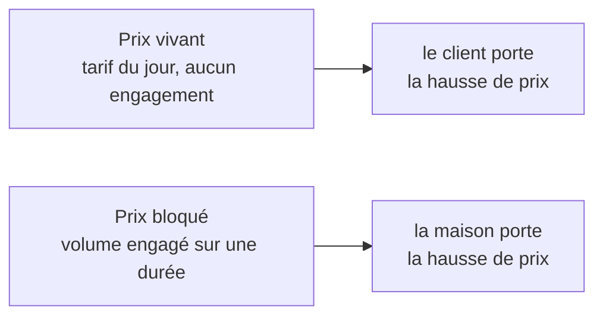

# Qui porte le risque ? — prix vivant et prix bloqué

> 🔵 **Note de conception, rien n'est bâti** (2026-08-17), relue le 2026-11-04
> contre le code : ni le prix bloqué, ni le prix par zone, ni la coopérative
> d'acheteurs n'existent. Ce qui existe de proche, et qui ne doit pas être
> confondu avec, est en partie 2. Partie 1 : l'idée. Partie 2 : l'état du code.

# Partie 1 — L'idée

## La question

Le système sait dire **combien** coûte un article. Il ne sait pas dire **qui
encaisse la variation** quand les coûts de la maison montent (farine, beurre,
électricité, salaires). Aujourd'hui, on relève le tarif et **tous les clients
le subissent en même temps**.

## Le contrat brasseur

Un brasseur vend de deux façons :

- **Au coup par coup** : le café commande quand il veut, au tarif du jour. Si
  le brasseur augmente, le café paie plus. **Le client porte le risque de
  prix.**
- **Sous contrat de volume** : le café s'engage sur un volume pour douze mois,
  à un prix arrêté à la signature. Si le brasseur augmente, ce café ne bouge
  pas. **Le brasseur porte le risque**, et l'accepte parce que le volume
  garanti absorbe ses frais fixes.

C'est un échange : le client échange sa liberté de volume contre une garantie
de prix. Un hôtel qui prend 300 viennoiseries chaque matin de décembre à avril
veut un prix ferme pour son budget ; un restaurant qui commande selon son
remplissage veut le tarif du jour et aucune obligation.

## Les deux chemins

|                       | Prix vivant (aujourd'hui, le défaut) | Prix bloqué (non bâti)                  |
| --------------------- | ------------------------------------ | --------------------------------------- |
| Engagement du client  | aucun                                | un volume sur une durée                 |
| Garantie de la maison | aucune                               | le **prix d'entrée** figé pour la durée |
| Ce qu'on gagne        | la hausse est répercutée             | le volume est acquis                    |
| Le risque             | le client commande moins, ou part    | la hausse est pour nous                 |

## Les idées liées

- **Le prix bloqué agit à l'entrée** : il remplace le tarif du catalogue par
  celui de la signature ; le reste du calcul (promotions, plancher) se déroule
  normalement, et le plancher se calcule sur le prix du contrat.
- **On le juge sur l'ensemble des clients engagés**, pas client par client :
  un contrat seul paraît perdant dès que les coûts montent, alors que le
  dispositif entier peut tenir. Si l'ensemble passe sous l'équilibre, on
  arrête de **signer** de nouveaux contrats à ce prix ; on honore ceux qui
  existent.
- **Un prix selon le territoire** : le tarif d'entrée pourrait varier par zone
  postale (Val d'Isère n'est pas la vallée). À ne pas confondre avec les frais
  de zone : les frais couvrent un **coût** (la distance), le tarif local
  refléterait un **marché**. Un contrat bloqué l'emporterait sur le tarif
  local.
- **La coopérative d'acheteurs** : le palier se mesurerait sur le volume de
  toute une zone (une tournée), si bien que chaque client a intérêt à ce que
  son voisin commande.
- **Un indicateur avant d'activer une promotion** pour les clients au prix
  bloqué : s'ils sont déjà sous le prix vivant promotionné, la promotion leur
  offrirait une seconde remise pour le même engagement.

## Ce qu'il faudrait trancher avant de bâtir

- Que se passe-t-il si le volume engagé **n'est pas atteint** ? (rien ; une
  régularisation au terme ; la perte du prix figé). Une régularisation ne doit
  **jamais** réécrire une commande passée : elle prendrait la forme d'un
  document distinct à l'échéance.
- Le volume se mesure-t-il **par référence ou au total** ? (« 300
  viennoiseries » n'est pas « 300 croissants ».)
- Un contrat couvre-t-il **une partie du catalogue** ? (Sans doute : c'est
  alors un objet à portée, comme les règles de prix.)
- Le modèle n'est **pas** un champ sur la société : un client peut être sous
  contrat sur une famille et au tarif du jour sur une autre. L'objet est
  **l'engagement**, pas le client.

# Partie 2 — L'état du code (2026-11-04)

## Ce qui existe de proche, et en quoi c'est différent

| Objet existant                                                                                                                         | Ce qu'il fait                                                                                                                                            | Ce qu'il ne fait pas                                                                                                           |
| -------------------------------------------------------------------------------------------------------------------------------------- | -------------------------------------------------------------------------------------------------------------------------------------------------------- | ------------------------------------------------------------------------------------------------------------------------------ |
| **Engagement de volume** (`VolumeCommitment`, `b2b/pricing/domain/volume-commitment.ts`, table `volume_commitments`)                   | un client annonce un volume sur une période et une portée ; le **palier** se juge sur `max(promis, livré)` dès la première commande (`retainedQuantity`) | il ne **fige pas** le tarif d'entrée : une hausse du catalogue l'atteint quand même                                            |
| **Mercuriale** (`CompanyMercuriale`, cf. [`../mercuriales/comprendre-une-mercuriale.md`](../mercuriales/comprendre-une-mercuriale.md)) | un **prix ferme en euros** sur une période, par article, avec paliers ; insensible au catalogue                                                          | elle n'exige **aucun volume**, et elle arrête les promotions sauf celles qu'elle accepte (le prix bloqué les laisserait jouer) |
| **Plancher dynamique**                                                                                                                 | une marge minimale qui s'abaisse quand un volume observé ouvre sa porte ; la décision est figée sur la ligne                                             | —                                                                                                                              |
| **Zone de livraison** (`DeliveryZone`)                                                                                                 | un frais de livraison, déduit de l'adresse                                                                                                               | aucun tarif d'entrée par zone                                                                                                  |

Le non-tenu d'un engagement de volume est noté dans son propre JSDoc : chaque
facture reste juste, mais la remise a été consentie sur un volume qui n'est
pas venu, **entièrement portée par nous** ; la compenser demande une décision
commerciale non prise.

## Ce qui n'existe pas

- le prix d'entrée figé à la signature (le prix bloqué) ;
- un tarif d'entrée par zone ;
- un palier mesuré sur le volume d'une zone (la coopérative) ;
- l'indicateur « faut-il activer cette promotion pour les engagés » ;
- un tableau de bord de la cohorte des engagés ;
- un écran pour poser un engagement de volume (ses routes existent,
  `admin/pricing/commitments`, aucun écran ne les appelle : registre, R6).
