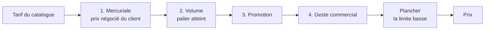

# La résolution de prix — un empilement d'étages datés

> ✅ **Décrit le code au 2026-11-04**, réécrit ce jour-là contre le code. La
> version précédente (1 474 lignes, depuis le 2026-08-17) mêlait le modèle, sa
> mise en œuvre et l'histoire du chantier S1 à S5 ; l'histoire reste dans
> l'historique git. **Les exemples chiffrés de ce document sont ceux que
> `b2b/pricing/domain/__tests__/resolve-price.spec.ts` vérifie** : si l'un
> tombe, c'est ce document qui ment. Partie 1 : comprendre. Partie 2 : le
> code.

# Partie 1 — Comprendre

## Le problème

Un même croissant n'a pas le même prix pour tout le monde : un client a son
prix négocié, un autre achète en volume, une promotion court ce mois-ci, un
commercial fait un geste. Sans ordre clair, on ne sait plus quelle remise
s'applique sur quoi, ni pourquoi un client a payé ce prix.

## La réponse : quatre étages, dans un ordre fixe

Chaque étage s'applique au prix qui sort du précédent. Un étage où rien ne
s'applique est transparent.

## Six règles qui font tout le reste

1. **Les remises se composent, elles ne s'additionnent pas.** Sur 10,00 €,
   −20 % puis −10 % donnent **7,20 €**, pas 7,00 €.
2. **On n'arrondit qu'une fois, à la fin.** 5,01 € remisé deux fois de moitié
   vaut 1,2525 €, donc **1,25 €** — arrondir à chaque étage donnerait 1,26 €,
   un centime de trop sur chaque ligne. La moitié s'arrondit en s'éloignant de
   zéro.
3. **Dans un étage, la règle la plus précise gagne** : celle d'un article
   remplace celle de sa famille. Deux règles aussi précises l'une que l'autre :
   le calcul **refuse**, le résultat dépendrait du hasard.
4. **Poser un prix n'est pas remiser.** Une mercuriale **pose** un prix en
   euros ; les autres étages **modifient** le prix qui leur arrive (un
   pourcentage ou un montant, en hausse ou en baisse).
5. **La mercuriale ferme la chaîne** : les étages suivants sont ignorés, sauf
   ce qu'elle accepte.
6. **Le plancher protège la marge** : il se mesure sur le **tarif du
   catalogue**, pas sur le prix en cours de chaîne. Sur 10,00 € avec un
   plancher à 50 %, une chaîne qui descend à 2,50 € est **relevée à 5,00 €**,
   et la commande garde la trace que le plancher a joué. Un prix ne descend
   jamais sous zéro.

## Chaque décision a une période

Toute règle, tout barème, tout plancher, toute mercuriale a une **date de
début** et une **date de fin** (ou pas de fin). On peut la mettre en **pause**
puis la reprendre, ou la **ranger** ; la ranger écrit sa date de fin, si bien
qu'on peut toujours retrouver le prix d'une date passée
([`architecture-clore-nest-pas-ranger.md`](architecture-clore-nest-pas-ranger.md)).

## Un prix garde son explication

Une commande garde, pour chaque ligne, le **chemin de son prix** : les étages
qui ont agi, les règles écartées et pourquoi, la décision de plancher. Six mois
plus tard, on sait encore pourquoi ce client a payé ce prix, même si la règle a
été retirée depuis.

## Le plancher n'est pas une marge calculée

Une marge se déduit d'un coût ; une **limite se décide**. Le plancher dit
« jamais sous ce prix », posé par l'équipe. Il a deux formes : un **mur dur**,
et un **niveau abaissé** qui s'ouvre quand le client commande assez (en
quantité, ou par rapport à son volume habituel). Sans mesure disponible, c'est
le mur dur qui s'applique : par défaut, on protège.

# Partie 2 — Le code

## 1. La fonction

`resolvePrice(tarif, matériaux, contexte, plancher)`
(`b2b/pricing/domain/resolve-price.ts`) : **pure**, calcule en rationnel
exact, arrondit une fois. Appelée par le seul `LoadedPricer`
([`architecture-pricer.md`](architecture-pricer.md)).

## 2. Les types (`b2b/pricing/domain/price-rule.ts`)

| Notion            | Type                 | Valeurs                                                                                                                 |
| ----------------- | -------------------- | ----------------------------------------------------------------------------------------------------------------------- |
| Étage             | `PRICE_STAGES`       | `mercuriale`, `volume`, `promotion`, `geste`                                                                            |
| Étage saisissable | `AuthoredPriceStage` | sans `volume` : le volume vient du **barème**, jamais d'une règle écrite à la main                                      |
| Portée            | `PriceScopeType`     | `global`, `category` (une famille, et sa lignée), `product`, `variant`                                                  |
| Audience          | `PriceAudienceType`  | `all`, `segment`, `company`                                                                                             |
| Effet             | `nature`             | `replace` (pose un montant, `amountMillicents`) ou `alter` (`PriceAlteration`)                                          |
| Altération        | `PriceAlteration`    | `direction` `increase`/`decrease`, `mode` `percent` (`bp`) ou `amount` (`millicents`)                                   |
| Plancher          | `PriceFloor`         | `percent` (`bp`, du tarif) ou `amount` (`millicents`)                                                                   |
| Règle             | `PriceRule`          | id, étage, portée, audience, `minQuantity`, `validFrom`, `validTo`, `suspendedFrom`, libellé, `stacksOverMercuriale`, … |

- **Unités** : un prix unitaire et une altération en montant sont en
  **millicentimes** (10⁻⁵ €) : `5 000` = 0,05 €, `218 000` = 2,18 € ; un
  pourcentage en points de base (`2000` = 20 %). Une grandeur négative est
  refusée : le sens est dans `direction`.
- **Spécificité** : `specificity.ts` ; ex æquo dans un étage →
  `AmbiguousPriceRulesError`. Une règle évincée par une plus précise n'est pas
  exhumée par la suivante.
- **Seuil** : `minQuantity` vaut à **tous** les étages (une promotion « dès
  6 » se juge sur la quantité de la ligne).

## 3. D'où viennent les règles de chaque étage

| Étage        | Source                                                                                                                                                                                                                                                       |
| ------------ | ------------------------------------------------------------------------------------------------------------------------------------------------------------------------------------------------------------------------------------------------------------ |
| `mercuriale` | `CompanyMercuriale`, présentée comme règle (`mercuriale-rule.ts`) — [`../mercuriales/comprendre-une-mercuriale.md`](../mercuriales/comprendre-une-mercuriale.md)                                                                                             |
| `volume`     | le **barème** `VolumeLadder` (`volume-ladder.ts`, une échelle de paliers posée d'un geste, qui progresse), présenté comme règle (`ladderAsRule`) ; l'**engagement de volume** (`volume-commitment.ts`) juge le palier sur `max(promis, livré)` de la période |
| `promotion`  | les promotions du module `promotions/` (`promotion-as-rule.ts`) ; les anciennes règles d'étage `promotion` ne sont plus lues                                                                                                                                 |
| `geste`      | les règles de prix (`price_rules`)                                                                                                                                                                                                                           |

Le scellement (`mercuriale-seal.ts`, `passesSeal`) laisse passer une règle
`stacksOverMercuriale` ou une promotion que la politique de la mercuriale
accepte.

## 4. Le plancher (`floor-policy.ts`, `resolve-floor.ts`)

- `PriceFloorPolicy` : un mur `hard`, et un étage `dynamic` facultatif avec sa
  condition d'ouverture (`FloorUnlock` : quantité minimale, et/ou ratio de
  volume observé minimal en points de base).
- `decideFloor(politique, preuves)` rend la limite appliquée et son niveau
  (`hard` ou `dynamic`). Sans preuve, la porte reste fermée.
- La décision est **figée** sur la ligne de commande (`pricing_floor`), avec
  la mesure qui l'a ouverte : un prix qui dépend de l'historique doit rester
  explicable quand l'historique bouge.
- Les planchers sont versionnés et datés
  ([`architecture-clore-nest-pas-ranger.md`](architecture-clore-nest-pas-ranger.md) § 5).

## 5. Ce qui est figé sur la ligne de commande (`orders.prisma`)

| Colonne                            | Ce qu'elle garde                                                                                                                                            |
| ---------------------------------- | ----------------------------------------------------------------------------------------------------------------------------------------------------------- |
| `pricing_steps`                    | les étages qui ont agi, dans l'ordre, avec leurs règles                                                                                                     |
| `pricing_rejected`                 | les règles écartées et leur cause : `expired`, `suspended`, `out_of_scope`, `out_of_audience`, `below_threshold`, `superseded`, `sealed` (`RejectionCause`) |
| `pricing_floor`, `pricing_floored` | la décision de plancher, et s'il a relevé le prix                                                                                                           |
| `pricing_clamped_to_zero`          | si la chaîne est passée sous zéro                                                                                                                           |
| `pricing_commitment`               | l'état de l'engagement de volume, qui mesure sans modifier                                                                                                  |

L'écran de tarification déplie ce chemin (le « chemin du prix », une teinte
par étage) ; la commande le relit tel qu'il a été figé.

## 6. Le cycle de vie et le journal

- États : `active`, `paused`, `archived` (`rule-lifecycle.ts`). La pause ne
  touche pas la fenêtre (`suspendedFrom`) ; le rangement l'écrit
  (`closingWindowAt`).
- Journal : chaque acte (`PRICING_ACTS`, `pricing-act.ts`) sur un sujet
  `rule`, `floor`, `ladder`, `mercuriale` ou `company`, avec un résumé figé au
  moment de l'acte (`pricing-act-summary.ts`), jamais recalculé.

## 7. L'élasticité

L'écran de tarification montre ce qu'une altération coûte en volume
(`board-elasticity.service.ts`, `elasticity-report.ts`) : le raisonnement est
**iso-chiffre** (combien de volume en plus pour garder le même chiffre
d'affaires après une baisse), pas iso-marge. Deux sources de volume : le
marché (`SkuVolumeReader`) pour le tableau général, le client
(`CustomerVolumeReader`) pour sa fiche.

## 8. Ce qui reste ouvert

Au registre : [`../ce-qui-reste-a-faire.md`](../ce-qui-reste-a-faire.md).
