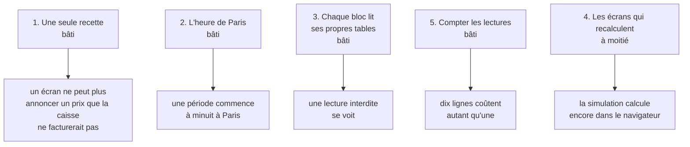

# Durcir le calcul des prix

> ✅ **Relu contre le code le 2026-11-04.** Écrit le 2026-09-08 pour répondre à
> « que faudrait-il pour passer de 7,5 à 9 ? », réécrit le 2026-09-09 quand
> quatre de ses cinq chantiers étaient bâtis. La note par axe de l'époque et le
> récit de ses deux erreurs restent dans l'historique git : ils décrivaient un
> état, pas le code. Ce qui suit dit ce que ces chantiers ont laissé, et ce qui
> le tient aujourd'hui. Le travail ouvert vit dans
> [`ce-qui-reste-a-faire.md`](../ce-qui-reste-a-faire.md). Partie 1 :
> comprendre. Partie 2 : le code.

# Partie 1 — Comprendre

## La question de départ

En septembre, un prix pouvait être juste à la caisse et faux à l'écran. Cinq
endroits du code fabriquaient chacun leur prix, avec leur propre recette, et
deux s'étaient trompés sans que rien ne le signale : un prix auquel il manque
une étape reste un prix plausible.

« Durcir », c'était faire en sorte que ces erreurs **ne puissent plus se
produire sans bruit** — pas les corriger une par une.

## Les cinq chantiers

1. **Une seule recette.** Tout prix sort du même calcul. Écrire une sixième
   recette fait échouer la CI.
2. **L'heure de Paris.** « À partir du 15 septembre » s'ouvre à minuit à
   Paris, pas à 2 h du matin l'été.
3. **Chaque bloc lit ses propres tables.** Un morceau du code qui lirait en
   douce les tables d'un autre est refusé par la CI.
4. **Les écrans qui recalculent — à moitié.** Le calcul de l'écart au tarif
   est partagé entre serveur et écrans. Mais l'écran de **simulation** du
   back-office refait encore son propre calcul de prix, sans demander au
   serveur. C'est un écran d'hypothèses — il n'annonce rien à un client —, mais
   un commercial y décide d'une grille.
5. **Compter les lectures.** Un test mesure combien de fois la base est lue
   pour chiffrer un panier, et refuse que ce nombre grandisse avec le nombre
   de lignes.

## Ce qu'on a décidé de ne pas faire

- fondre l'écran de tarification dans la caisse : ils répondent à deux
  questions différentes (« qu'a-t-on décidé ? », « que facture-t-on ? ») ;
- remplacer les contraintes de la base par des vérifications dans le code ;
- faire lire la base par la fonction de calcul : elle resterait juste, mais
  ne serait plus testable sans base ;
- sortir les prix dans un service à part : le problème était le nombre de
  recettes, pas la distance entre les modules.

# Partie 2 — Le code

## 1. Ce qui tient chaque chantier

| Chantier            | Ce qui le tient                                                                                                                                                                                                                                                        | Fichier                                                                                                                    |
| ------------------- | ---------------------------------------------------------------------------------------------------------------------------------------------------------------------------------------------------------------------------------------------------------------------- | -------------------------------------------------------------------------------------------------------------------------- |
| 1 — une recette     | `LoadedPricer` est le seul appelant de `resolvePrice` ; `lint:price-pipeline` n'admet qu'une entrée, `src/lafoliecoffee/pricing/domain/loaded-pricer.ts`. Hors de `lafoliecoffee/pricing/`, on passe par la porte `Pricer.load` (`lint:price-door`)                    | [`architecture-pricer.md`](architecture-pricer.md), [`architecture-la-porte-du-prix.md`](architecture-la-porte-du-prix.md) |
| 2 — Paris           | `lint:business-day` (`dev-toolbox/gates/business-day.mjs`) refuse une conversion de jour en minuit UTC dans sa liste de dossiers : la tarification (API et back-office), le catalogue et les opérations du commerce, l'éditeur de contenu et la vitrine de la boutique | `SCAN_ROOTS` de la porte                                                                                                   |
| 3 — propriété       | `lint:prisma-model-ownership` : le propriétaire d'un modèle est le bloc qui l'**écrit**, dérivé du code, jamais listé à la main. Liste de dérogations **vide** depuis le 2026-09-18 (`staffUser` passe par `StaffAuthorDirectory`)                                     | `dev-toolbox/gates/prisma-model-ownership.mjs`                                                                             |
| 4 — écrans (moitié) | `gapBp`, `discountBp`, `averageGapBp` dans `@lfd/money` (`packages/money/src/gap.ts`), importés des deux côtés                                                                                                                                                         | —                                                                                                                          |
| 5 — charge          | `test/pricing-budget.e2e-spec.ts` compte les **opérations ORM** (pas les millisecondes) avec une égalité stricte : à froid, dix lignes = une ligne ; à chaud, une seule estampille par requête ; 200 règles ne coûtent pas plus ; pas une lecture par article          | `COLD_QUOTE_OPS`, `WARM_QUOTE_OPS`                                                                                         |

La porte du chantier 3 rend une lecture interdite **visible**, pas impossible :
une jointure `b2b → pim` marcherait toujours en base (`CLAUDE.md` § 1).

## 2. Ce qui reste ouvert (vérifié le 2026-11-04)

- **R2 — la simulation calcule dans le navigateur.**
  `apps/lfd-backoffice-frontend/src/app/commercial/tarification/simulation/` :
  `revenue-model.ts:234` fait `Math.round(revenueMillicentsAt(…) / volume)`,
  `pricing-regime.ts:99` de même, et `pricing-regime.ts` réimplémente les trois
  régimes (sans engagement, engagement signé, cumul livré). Aucun appel au
  serveur dans le dossier. Deux remèdes possibles, à trancher : passer par la
  projection du serveur (`priceAtCumulative`, mais un aller-retour par curseur
  déplacé), ou descendre ce moteur dans un paquet pur importé des deux côtés,
  comme `@lfd/money`. Touche l'argent : `vitruve` avant de bâtir.
- **R9 — conversions de jour en minuit UTC hors du périmètre de
  `lint:business-day`** : inventoriées au registre, sans défaut avéré à ce jour.
- **La charge de la projection n'est pas comptée** : `pricing-budget` couvre le
  devis et l'écran de tarification, pas la courbe du banc d'essai
  ([`architecture-la-porte-du-prix.md`](architecture-la-porte-du-prix.md) § 7).

## 3. Une convention née ici

Le 2026-09-08, un JSDoc justifiait un mécanisme du prix par un fait faux sur
un autre fichier. D'où la règle du § 8 de `CLAUDE.md` : **une justification
qui parle d'ailleurs porte sa date**. Aucune porte ne vérifie qu'une phrase est
vraie ; la date dit jusqu'où on a regardé. `auditeur-de-justifications` les
rouvre, à la demande.
