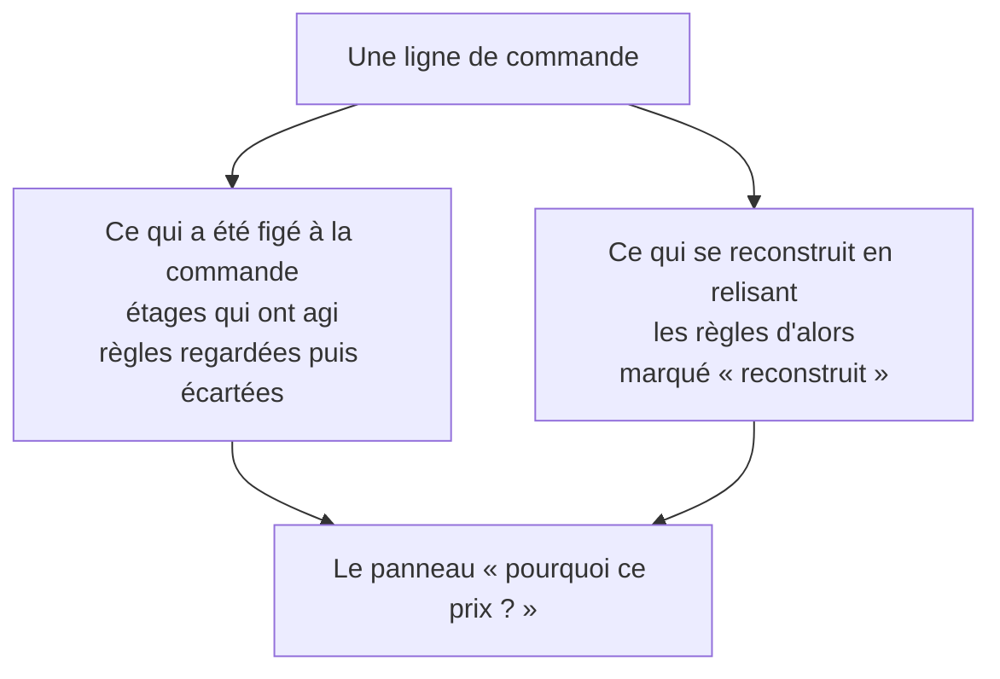

# La trace qui explique — « pourquoi ce prix ? »

> ✅ **Décrit le code au 2026-11-04.** Ce document remplace
> le plan de R25 (2026-09-09), dont les quatre lots sont bâtis
> (R25, close le 2026-09-09). Le plan racontait trois formes successives,
> démolies puis refaites par `vitruve` ; leurs leçons sont au § 5, leur récit
> dans l'historique git et au
> [journal de remédiation](../journal-de-remediation.md), § R25. Partie 1 :
> comprendre. Partie 2 : le code.

# Partie 1 — Comprendre

## Ce que ça permet

Au back-office, sur une commande passée, on clique une ligne et on voit
**pourquoi elle a été facturée à ce prix** : le tarif de départ, chaque étage
qui a agi (mercuriale, volume, promotion, geste), le plancher, et les règles
qui auraient pu agir mais ont été écartées, avec la raison.

Six mois plus tard, quand les règles ont changé, on défend encore ce qui a été
**facturé**, pas ce que le moteur ferait aujourd'hui.

## Deux sources, et l'écran dit laquelle

- **Figé** : ce que le moteur a vu au moment de la commande. Les étages qui ont
  agi, et les règles qu'il a **regardées sans les appliquer** : battue par une
  règle plus précise, bloquée par la mercuriale, quantité trop faible.
- **Reconstruit** : les règles que le moteur n'a **jamais vues**, parce
  qu'elles visaient un autre client ou étaient en pause ce jour-là. On les
  retrouve en relisant les règles à la date de la commande. L'écran les marque
  « reconstruit », et ne conclut rien quand il ne peut pas savoir.

## Trois réponses possibles, pas deux

Pour les règles écartées, une ligne dit l'une de ces trois choses :

- **on ne consignait pas encore** (ligne plus ancienne que la fonctionnalité) ;
- **aucune règle n'a été écartée** ;
- **voici celles qui l'ont été, et pourquoi.**

Confondre les deux premières ferait affirmer « rien n'a été écarté » sur une
ligne dont on ne sait rien.

## Le client ne voit pas tout

Le client voit sur sa commande le nom des **promotions** qu'il a obtenues, et
rien d'autre : ni les règles écartées, ni les noms des autres étages.

# Partie 2 — Le code

## 1. Ce qui est figé sur la ligne (`orders.prisma`)

| Colonne            | Contenu                                                                                 |
| ------------------ | --------------------------------------------------------------------------------------- |
| `pricing_steps`    | les étages **qui ont agi**, inchangé dans son sens                                      |
| `pricing_rejected` | les règles regardées puis écartées : `{ stage, ruleId, label, scope, cause }` (`Json?`) |

- `RejectedRule` et `RejectionCause` sont dans
  `b2b/pricing/domain/price-rule.ts`. Sept causes : `expired`, `suspended`,
  `out_of_scope`, `out_of_audience`, `below_threshold` (les conjonctions
  d'`applies`, dans son ordre), puis `superseded` et `sealed`. Les cinq
  premières sont rares en production, puisque le chargement écarte déjà ces
  règles ; elles existent parce que `resolvePrice` est pure et doit rester
  juste sur un tableau fabriqué à la main.
- Le **libellé** est figé avec l'identifiant, parce qu'une règle se renomme
  (`RenamePriceRuleCommand`).
- **Les trois états** : `order-line.data.ts` écrit `Prisma.DbNull` quand il n'y
  a rien à dire (« on ne consignait pas »), `[]` ou une valeur sinon ; une
  ligne neuve écrit toujours l'un des deux derniers. La relecture
  (`order-line-row.ts`, `rejectedRulesSchema` de `@lfd/contracts`) rend `null`
  pour une ligne ancienne.
- **Un barème ou une mercuriale sans palier atteint** n'atteignait jamais le
  moteur : `assembled()` (`resolve-price.ts`) rend `{ rules, dropped }`, et
  les recalés entrent dans `rejected`. Un matériau qui ne vise pas l'article
  n'y va **pas** : il n'a rien à dire.
- `supersedes` (les rivales battues par l'étage gagnant) **n'est pas
  persisté**, délibérément (`order-json.ts`) : son défaut de relecture est
  `[]`, et l'écrire rendrait à jamais indistinguables « aucune rivale » et « on
  ne consignait pas ». Il reste un champ de la résolution vivante.

## 2. Ce qui ne se mélange pas

- **`pricing_steps` ne reçoit jamais une règle écartée.** Deux mécanismes le
  lisent comme « ce qui a facturé » : l'invariant de la ligne (le dernier
  étage doit tomber sur le prix facturé), et `PricedDecisionsReader.hasPriced`
  (`prisma-priced-decisions.reader.ts`), qui refuse de reposer une décision sur
  une période où elle a facturé. Ce dernier ne lit **pas** `pricing_rejected` :
  une règle regardée n'a rien facturé.
- **Le client** : `toCustomerOrder` (`packages/contracts/src/order.ts`) ne
  recopie que `basePriceMillicents`, les étages de stage `promotion` (leur
  libellé seul) et `floored`. Pas de `rejected`.

## 3. Ce qui se reconstruit

`GET /admin/orders/:id/lines/:sku/rules` → `ReconstructLineRulesQuery`
(`b2b/orders/application/queries/reconstruct-line-rules.handler.ts`) :

- relit le **tableau de tarification daté** à `placedAt` (le même lecteur que
  l'écran de tarification, plutôt qu'une seconde réponse à « qu'est-ce qui
  était en vigueur ce jour-là ») ;
- retire ce que la trace explique déjà (étages et écartées) ;
- pour chaque règle restante, lit le **journal** (`PricingJournalReader`) :
  la pause est la seule donnée qu'une reprise efface (`resume()` remet
  `pausedAt` à `null`), et ses actes datés la retrouvent (`suspendedAt`) ;
- nomme la cause (`unexplained-rules.ts`, `causeOf`) : `suspended`,
  `out_of_audience` pour une règle d'une autre société, ou `null` — **on ne
  sait pas** — pour une règle de **segment** (le segment du client n'est pas
  figé sur la commande) et pour une règle qui visait tout le monde sans rien
  produire.

La fenêtre, l'audience et la portée d'une règle ne changent pas après sa
pose : la relire dit la vérité. Seuls le libellé (renommage) et la pause ont
une histoire.

## 4. L'écran

`apps/lfd-backoffice-frontend/src/app/commandes/price-explain/` : `PriceExplain`
déplie la chaîne figée (`frozenChainOf`, dans `frozen-chain.ts`) avec le
composant `price-path` partagé avec l'écran de tarification, puis la
reconstruction. Il ne recalcule rien. Le bouton « pourquoi ce prix ? »
n'existe qu'au back-office.

## 5. Ce que les versions démolies ont appris

- une entrée écartée logée dans `pricing_steps` faisait refuser la ligne par
  son invariant, et faisait dire à `hasPriced` qu'une règle simplement
  regardée avait facturé (une containment jsonb ignore les clés en plus) ;
- un tableau vide **affirme**, il n'avoue pas : il faut trois états ;
- reconstruire une pause depuis la règle d'aujourd'hui ment, la reprise
  efface l'intervalle ;
- écrire `below_threshold` sur tout `null` d'une mercuriale aurait marqué
  « palier non atteint » sur chaque article hors grille.

## 6. Ce qui l'éprouve

`test/price-rules.e2e-spec.ts` (la colonne relue sur une vraie commande),
`rejected-rules.spec.ts` (les causes), `price-explain.spec.ts` (l'écran, les
trois états).
