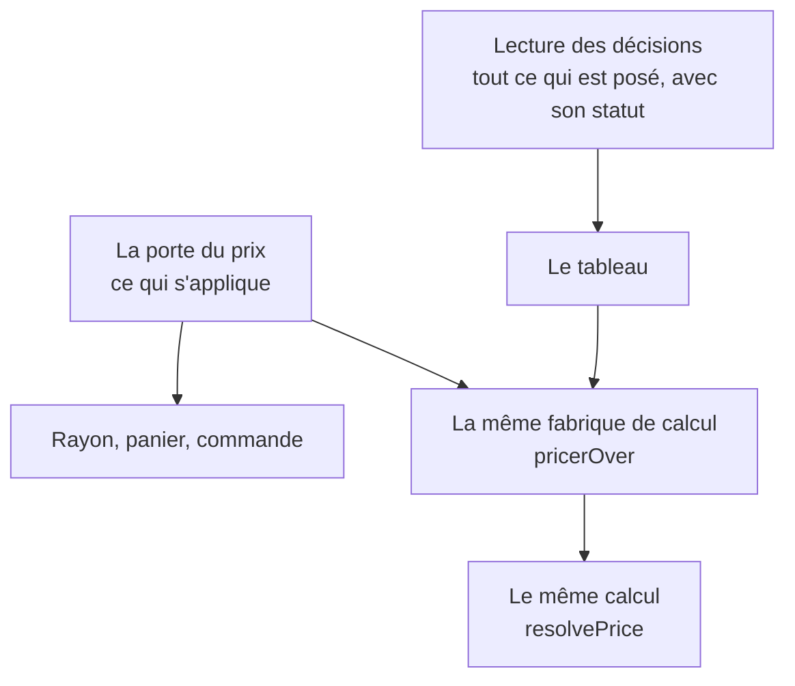

# Le tableau de tarification et la porte du prix

> ✅ **Décrit le code au 2026-11-04.** Ce document remplace le plan de R21
> (2026-09-09), qui proposait de faire passer le tableau par la porte du prix :
> `vitruve` l'a démoli, et ce qui a été bâti à la place est décrit ici (R21,
> close le 2026-09-09). Le récit est au
> [journal de remédiation](../journal-de-remediation.md) et dans l'historique
> git. Partie 1 : comprendre. Partie 2 : le code.

# Partie 1 — Comprendre

## Deux questions qui se ressemblent

- **La porte du prix** répond à « qu'est-ce qui **s'applique** à cet article,
  pour cet acheteur, maintenant ? ». Elle ne garde que les règles en vigueur,
  non suspendues, qui visent cet acheteur.
- **Le tableau de tarification** (l'écran général et l'onglet Tarifs d'une
  fiche client) répond à « qu'est-ce qu'on a **décidé** ? ». Il doit montrer
  aussi la règle programmée pour la semaine prochaine, celle qui est en pause,
  celle qui a expiré — avec leur statut.

Faire passer le tableau par la porte lui aurait fait **perdre ces lignes**, sans
qu'aucun prix ne change, donc sans qu'aucun test de prix ne le voie.

## Ce qui est partagé, et ce qui ne l'est pas

Les deux chemins **lisent** différemment, parce qu'ils posent deux questions.
Mais ils **calculent** de la même façon : même fabrique, même fonction. Le prix
affiché au tableau est donc celui que la caisse ferait, à engagement près
(le tableau n'en tient pas compte : il montre un prix de vitrine).

# Partie 2 — Le code

## 1. La lecture des décisions

`PricingDecisionsReader` (`b2b/pricing/application/ports/pricing-decisions.reader.ts`),
implémenté par `PrismaPricingDecisionsReader` :

- `decisionsAt(at, audience, articles)` rend les règles et les planchers **datés**
  (`unarchivedAt(at)`), sous leurs deux formes : celle qui calcule
  (`PriceRule`, `ScopedPriceFloor`) et celle qui s'affiche (`PriceRuleView`,
  `PriceFloorView`), appariées (`LoadedRule`, `LoadedFloor`). La vue ne se
  fabrique pas depuis le domaine : `PriceRule` ne porte ni auteur, ni date de
  création, ni raison d'archivage, et fond pause et archivage en
  `suspendedFrom` ;
- hors fenêtre, suspendu, hors audience restent **visibles** ;
- l'audience : sans client (tableau général), toutes ; avec un client (fiche),
  `all` plus `company` = ce client, dans la clause SQL (`audienceClause`).

Les deux écrans y passent : `PrismaPricingBoardReader` (l'écran général) et
`CompanyPricingQuery` (la fiche client), qui n'injecte plus `PrismaService`.
Aucun fichier `application/` de `b2b/` n'injecte `PrismaService` au
2026-11-04.

## 2. Le même calcul

`board-item.ts` construit le tarificateur du tableau par `pricerOver`
(`pricing/application/pricer-over.ts`), la fabrique unique, sous la lentille
`unproven` : sa signature refuse les engagements. `boardDecisions` y retire,
comme le chargeur de la caisse, les règles d'étage promotion, et y ajoute les
promotions de ligne admises.

## 3. Pourquoi pas la porte

Ce que le premier plan supposait, et ce que le code disait :

| Supposé                                        | Réel                                                                                                                                                    |
| ---------------------------------------------- | ------------------------------------------------------------------------------------------------------------------------------------------------------- |
| la porte lit les mêmes lignes que l'écran      | elle lit par `inScopes`, donc `inForceFor` : fenêtre, suspension et audience filtrées                                                                   |
| une lecture datée par la porte est équivalente | la porte **refuse** un article sans historique de tarif à la date (`NoCanonicalPriceAtError`) ; le tableau dégrade et publie `canonicalHistoryStartsAt` |
| la vue se fabrique là où la ligne existe       | une vue de plancher a besoin du catalogue : la fabriquer dans un port ferait dépendre `pricing` de `catalog`, le cycle que `lint:import-cycles` refuse  |

## 4. Un défaut trouvé en chemin

La fiche client montrait la limite **d'avant** une re-pose de plancher, avec
son signal de dérive, sur l'écran où l'on négocie. Le prix facturé était juste
(`resolveScopedFloor` filtre par fenêtre). La lecture unique, qui porte la
fenêtre des planchers, l'a fermé.
