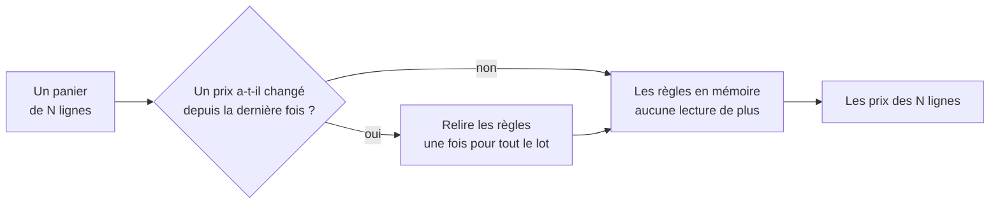

# Ce que coûte un prix — les lectures, pas le temps

> ✅ **Relu contre le code le 2026-11-04.** Ouvert le 2026-09-04 sur un constat
> (trois lectures de base **par article**), il est réécrit sur ce qui l'a
> remplacé : des lectures **par lot**, un cache en mémoire et une estampille
> lue une fois par requête. Le récit des deux premières versions est dans
> l'historique git ; ses leçons sont gardées en partie 1. Partie 1 :
> comprendre. Partie 2 : le code.

# Partie 1 — Comprendre

## Ce qui se paie

La base de production est chez Prisma, et Prisma facture **à l'opération** :
chaque appel du code à la base est compté, quelle que soit sa taille. Un prix
lent n'est donc pas le problème. Le problème, c'est un prix qui fait **beaucoup
d'appels**.

## Avant et maintenant

En septembre, chiffrer un panier de dix lignes faisait une trentaine d'appels :
trois par article. Aujourd'hui, le moteur lit **tout ce dont il a besoin en
une fois**, pour tout le panier. Et ce qu'il a lu reste en mémoire jusqu'à ce
que quelqu'un change un prix.

La question « un prix a-t-il changé ? » coûte **une** lecture par requête, pas
une par article.

## Deux leçons qui restent vraies

- **Le serveur a un coût par appel borné, l'écran a un nombre d'appels qui
  ne l'est pas.** La facture est le produit des deux. Le test de budget tient
  le premier facteur. Rien ne tient le second, sauf la conception de l'écran :
  la saisie au back-office n'appelle l'estimation qu'après 400 ms d'inactivité,
  et pas deux fois pour la même saisie.
- **Garder en mémoire n'est sûr que si la mémoire sait ce qui est rangé.** Une
  règle de prix rangée qui reviendrait en mémoire continuerait de fixer des
  prix. Le cache ne garde donc que ce qui n'est pas rangé, et une relecture à
  une date passée ne passe pas par lui.

# Partie 2 — Le code

## 1. Les lectures d'un lot

`PricingMaterialsLoader` (`b2b/pricing/application/pricing-materials.loader.ts`)
lit **six familles en parallèle**, une fois par lot, quelle que soit sa
taille : règles, planchers, barèmes, engagements, mercuriale, promotions. En
relecture datée (`replay`), il appelle les lecteurs datés (`inScopesAt`,
`unarchivedAt(at)`) au lieu du cache. La lentille `unproven` ne lit pas les
engagements. Les preuves (cumul d'un engagement, ratio de volume d'un plancher
dynamique) se lisent ensuite, **par engagement** et non par article.

## 2. Le cache des matériaux

`PricingMaterialsCache` (`b2b/pricing/infrastructure/pricing-materials.cache.ts`),
en mémoire, **par instance de l'API** :

- il garde les **tables entières** non rangées (le lecteur de planchers lit
  `archivedAt: null`), et rien par client : le tri par client, par portée et
  par fenêtre est refait en mémoire par la fonction pure ;
- il est vidé par `PricingActWriter`, passage obligé de toute écriture
  tarifaire, **après** le commit ;
- il porte une **estampille** : le dernier identifiant du journal tarifaire
  (`pricing_events`, ULID croissant). Une instance qui voit une estampille
  différente recharge : c'est ce qui le rend juste à plusieurs instances ;
- l'estampille se lit **une fois par requête** (`PricingMaterialsCache.stamp`,
  2026-11-04), pas une fois par question au cache ; hors requête (tâche de
  fond), elle se relit à chaque fois ;
- si la lecture de l'estampille échoue, il garde la dernière réussie : un prix
  peut-être périmé plutôt qu'un refus de vente.

## 3. Le budget, compté

`test/pricing-budget.e2e-spec.ts` compte les **opérations ORM** (l'unité
facturée) contre un vrai Postgres, par égalité stricte :

| Constante                | Valeur | Ce qu'elle mesure                                                                 |
| ------------------------ | ------ | --------------------------------------------------------------------------------- |
| `COLD_QUOTE_OPS`         | 10     | un devis anonyme à froid — et **le même pour dix lignes** que pour une            |
| `WARM_QUOTE_OPS`         | 5      | le même devis à chaud : catalogue, mode de TVA, une estampille                    |
| `COLD_COMPANY_QUOTE_OPS` | 20     | un devis d'un client rattaché à une société, avec un jour (heure limite comprise) |
| `COLD_ESTIMATE_OPS`      | 31     | l'estimation de la saisie au back-office, à froid, droits du staff compris        |

Ce qui compte n'est pas la valeur, c'est l'égalité : dix lignes au prix d'une,
200 règles au prix de zéro, aucune lecture par article. C'est elle qui attrape
une lecture par article réintroduite.

Le compteur de production est `SchemaOpsCounter`
(`platform/database/schema-ops.counter.ts`), branché sur `$allOperations`, par
schéma Postgres.

## 4. L'écran de saisie

La saisie d'une commande au back-office ne redemande plus un devis à chaque
ligne : elle lit l'estimation (`estimatesOf`), amortie et dédupliquée
([`../centime-et-tva/le-prix-d-un-panier.md`](../centime-et-tva/le-prix-d-un-panier.md)).

## 5. Deux leçons du chantier des matériaux (septembre 2026)

Le plan qui a fait passer les lectures de « par article » à « par lot »
(le plan des matériaux de prix, cinq lots livrés du 2026-09-05 au 2026-09-06,
retiré le 2026-11-04 ; son journal est dans l'historique git) laisse deux
règles qui tiennent toujours :

- **L'index par portée n'est pas un gain de vitesse, c'est une assurance.**
  Charger toutes les règles d'un coup aurait obligé à rebalayer l'ensemble pour
  chaque article — échanger des lectures contre du calcul `articles × règles`.
  `indexByScope` / `candidatesIn` (`b2b/pricing/domain/scope-index.ts`)
  reconstruisent en mémoire, pour chaque article, le petit tableau que la
  lecture SQL rendait : le calcul par article ne bouge pas, seules les
  lectures tombent. Ce qui ressemble à de la vitesse est du maintien.
- **On ne calcule jamais un prix dans un navigateur.** `resolvePrice` est pure
  et se partagerait techniquement, mais ses entrées sont le secret (les règles
  et leurs libellés, les planchers, c'est-à-dire la marge), il lui manque des
  données du serveur (cumul commandé, volumes) et l'heure du serveur (une
  promotion expirerait à l'heure du téléphone du client). Vers un navigateur,
  seulement le **résolu**. La simulation du back-office est l'exception
  connue, suivie en R2 ([`durcir-le-calcul-des-prix.md`](durcir-le-calcul-des-prix.md)).

Ce que le plan disait « irréductiblement par article » ne l'est plus : les
volumes d'un plancher dynamique et le cumul d'un engagement se lisent
désormais **par lot** (`PricingMaterialsLoader`, `volumeRatios`,
`orderedVolumes`).

## 6. Ce qui reste ouvert

- **Le cache du catalogue** est en cours de déploiement :
  [`caching-usage/le-rayon-en-cache.md`](../../caching-usage/le-rayon-en-cache.md).
- **La projection n'est pas comptée** : aucun budget ne couvre la courbe du
  banc d'essai.
- Le pool de connexions est à `max: 15` par instance (`prisma.service.ts`,
  relevé le 2026-10-30) ; c'est une affaire de concurrence, pas de facture.
