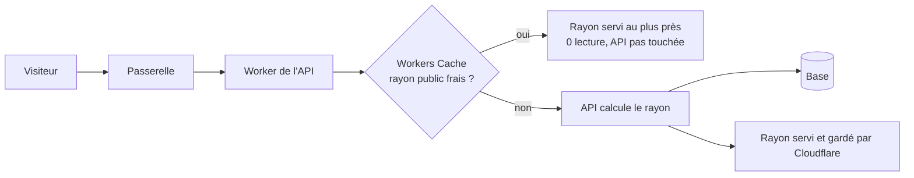
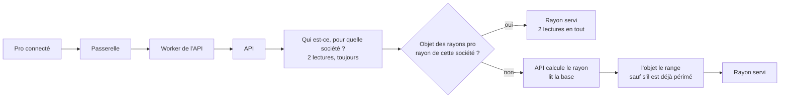
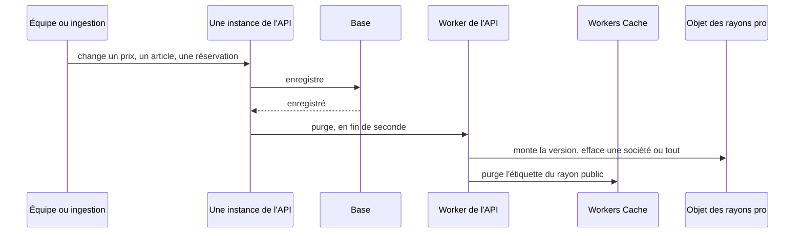

# Première visite rapide et pas chère — le cache du catalogue

> 📝 **Plan, rien n'est bâti.** Réécrit le 2026-11-04 (quatrième forme) après
> trois contradictions de `vitruve` et la vérification de la doc Cloudflare.
> Le **public** est caché par **Workers Cache**, au plus près du visiteur ;
> les **pros** dans **un Durable Object** qui range une table par société, la
> seule copie, donc sans dérive le jour où l'API aura plusieurs instances.
> Touche les prix affichés et une frontière de sécurité : contredit avant Hugo.

# Partie 1 — Comprendre

## Pourquoi

La base de production (Prisma Postgres) est **facturée à l'opération**. Une
visite de la boutique coûte aujourd'hui 6 lectures pour un visiteur et 12 pour
un pro, **même quand rien n'a changé**. La cible : une station de ski côté
particuliers, et 200 à 1 000 pros qui commandent aux mêmes heures. Et l'API
aura un jour plusieurs instances : le cache doit le supporter dès maintenant.

## Deux caches, parce que deux sortes de rayons

- **Le rayon public** (invité, ou pro de base sans connexion) est **le même
  pour tous**. Cloudflare le garde au plus près du visiteur, et le sert sans
  réveiller l'API ni lire la base.
- **Le rayon d'une société** (sa mercuriale, ses engagements, ses articles
  réservés) ne se sert qu'**après** avoir vérifié qui demande et pour quelle
  société, ce que seule l'API sait, en base. L'API le range ensuite dans **un
  seul objet** qui tient une table « société → rayon ». Une seule copie : quel
  que soit le nombre d'instances de l'API, toutes lisent la même.

### Le chemin d'un visiteur

### Le chemin d'un pro

Les deux lectures de droits ne s'économisent pas : c'est ce qui bloque tout de
suite un compte désactivé.

### Comment un changement arrive dans les caches

C'est le modèle d'un Redis : **celui qui écrit efface**, après
l'enregistrement, sans attendre qu'un visiteur passe.

**Ce qu'une purge efface** :

| Changement                                                                               | Rayons effacés                                                                             |
| ---------------------------------------------------------------------------------------- | ------------------------------------------------------------------------------------------ |
| statut d'une société, sa mercuriale, ses règles, son engagement, son suivi               | **cette société** seulement                                                                |
| une réservation posée ou levée                                                           | **tous**, public compris : l'article disparaît ou se verrouille pour tous sauf une société |
| un article, une famille, un prix général, une promotion, une opération, une heure limite | **tous**                                                                                   |

### Un rayon calculé pendant une écriture

Il ne doit pas rester en cache. L'objet tient **la version** des rayons, qu'il
monte à chaque purge. L'API la relève **avant** de calculer : l'objet refuse de
ranger un rayon calculé sur une version dépassée, et l'API ne laisse pas
Cloudflare garder un rayon public si la version a bougé pendant le calcul.

### Ce qui change sans que personne n'écrive

Une promotion qui s'ouvre à midi, une opération datée, l'heure limite : aucune
écriture, donc aucune purge. C'est la **durée de vie** qui les rattrape. Sa
valeur est **à décider** (§ 6).

## Ce qui rend une erreur sans conséquence

Le rayon n'est qu'une **vitrine**. Le panier recalcule toujours au vrai prix,
et la commande refuse un total que le client n'a pas vu. Un rayon un peu vieux
peut **afficher** un prix dépassé ; il ne peut pas le **facturer**.

Ce qui serait grave : servir le rayon d'une société à une autre. D'où la clé
`companyId` tirée de la résolution en base, jamais du client.

# Partie 2 — Le plan

## 1. Ce qui est vérifié (2026-11-04)

**Dans le dépôt :**

- la boutique est **statique** (`angular.json`, `ssr: false`) : une visite
  paie le catalogue une fois, au chargement ;
- l'API est un Cloudflare Container (`apps/lfd-api/wrangler.jsonc`,
  `max_instances: 1`), tenu chaud par le cron `*/5` (`keepWarm`, depuis
  `scheduled`, directement sur le conteneur) malgré `sleepAfter = "1h"` ; le
  Worker de l'API n'a pas d'adresse publique (`workers_dev: false`) et le
  conteneur y est un Durable Object (`Backend extends Container`, `BACKEND`) ;
- la passerelle sert toute la zone `lafoliecoffee.info/*` et rejoint l'API par
  service binding ; les requêtes `fetch` traversent le Worker de l'API par
  `guardedFetch` (`edge-guard.ts`, limite de débit comprise) ;
- `GET /shop/catalogue` et `GET /shop/featured` ne lisent **jamais**
  l'appelant (`read-shop-catalogue.ts`, `read-shop-featured.handler.ts` et son
  `anonymousViewer`) ; seul `/shop/catalogue/mine` est personnel ; l'API ne lit
  aucun cookie d'identité ;
- le **statut** d'une société ne change que son propre rayon
  (`CatalogViewers.forCompany`) ; une **réservation** change celui de tous
  (`catalog-viewer.ts` : public et pro sans connexion ne voient jamais un
  article réservé, une autre société le voit caché ou verrouillé) ;
- le conteneur joint déjà une route de la zone par la passerelle : le calcul
  routier (`container/worker.ts`, `https://lafoliecoffee.info/api/route-planner`) ;
- « après la validation » a un outil : `AfterCommit.defer`
  (`platform/database/after-commit.ts`), employé par l'outbox et le journal
  des envois ;
- le cache des **prix** supporte déjà plusieurs instances (estampille
  `pricing_events` relue une fois par requête, `PricingMaterialsCache`).

**Dans la doc Cloudflare :**

- **Workers Cache** garde la réponse d'un Worker et la ressert **sans exécuter
  le Worker** ; activé par `"cache": { "enabled": true }` (wrangler ≥ 4.69) ;
  à deux niveaux (le centre le plus proche, puis un niveau supérieur) ; marche
  pour un Worker joint par service binding ; pas de coût en plus de la requête
  Worker, pas de temps de calcul sur un succès
  ([Workers Cache](https://developers.cloudflare.com/workers/cache/)) ;
- une requête avec `Authorization` n'est servie du cache que si la réponse dit
  `public`, `must-revalidate` ou `s-maxage` ; une réponse `private`, `no-store`
  ou avec `Set-Cookie` n'est pas gardée
  ([configuration](https://developers.cloudflare.com/workers/cache/configuration/)) ;
- `ctx.cache.purge({ tags })` efface **partout** (purge instantanée), mais
  **seul le Worker propriétaire** peut purger son cache, avec les limites de
  débit de l'offre **gratuite** quelle que soit l'offre
  ([purge](https://developers.cloudflare.com/workers/cache/purge/)) ;
- l'ancien Cache API (`caches.default`) ne convient pas : local à chaque
  centre, purge locale
  ([Cache API](https://developers.cloudflare.com/workers/runtime-apis/cache/)) ;
- Cloudflare KV ne convient pas : une écriture met jusqu'à une minute à se
  propager.

## 2. La mesure

Sonde e2e jetable du 2026-11-04, opérations ORM par appel (froid / chaud) :
`GET /shop/catalogue` visiteur 11 / 6 ; `?audience=pro` 6 / 6 ;
`GET /shop/featured?audience=pro` 3 / 3 ; `GET /shop/catalogue/mine` pro
13 / 12, perso 8 / 8.

## 3. Le public — Workers Cache

- **Où** : le Worker de l'API gagne le bloc `cache`. Les réponses de
  `/shop/catalogue` et `/shop/featured` portent `Cache-Control: public,
max-age=…` et `Cache-Tag: rayon-public`. Toute autre réponse garde le
  `private` du middleware (`cache-control-by-default.middleware.ts`), donc
  n'est jamais gardée.
- **Avec un jeton** : ces deux routes ne lisent pas l'appelant (§ 1), donc
  `public` y est juste, et un visiteur connecté profite du cache. C'est la
  phrase que la porte du § 7 doit tenir : si l'une de ces routes se met un jour
  à lire l'appelant, `public` servirait un rayon personnel à tous.
- **La clé** : la doc ne dit pas si la clé contient le paramètre d'URL
  (`audience`, langue). **Premier test de C0.** S'il n'y est pas, l'audience et
  la langue passent dans le chemin.
- **Version du Worker dans la clé** : un déploiement repart d'un cache vide.
- **Le rayon douteux** : l'API relève la version de l'objet (§ 4) avant de
  calculer, la relit à la fin ; si elle a bougé, elle répond `no-store`.

## 4. Les pros — un objet, une table par société

- **Où** : une seconde classe de Durable Object dans le Worker de l'API, à côté
  de `Backend`. L'API l'interroge **après** `AuthGuard` et `@ActingCompany`, avec
  `companyId` tel que la résolution en base l'a rendu (`null` pour l'espace
  perso, qui a sa propre entrée).
- **Ce qu'il range** : `companyId → { rayon, version }`, et la **version**
  courante, dans son stockage SQLite (la mémoire se perd quand il s'endort ; la
  version ne doit pas se perdre).
- **Lire** : `get(companyId)` rend le rayon s'il existe, sinon la version
  courante. L'API calcule alors, et `put(companyId, rayon, version relevée)` ;
  l'objet refuse si sa version a avancé entre-temps.
- **Une seule copie** : plusieurs instances de l'API lisent et écrivent le même
  objet. Pas de dérive possible entre instances, pas de purge en éventail.
- **Le chemin conteneur → objet** : à établir. Le seul chemin connu passe par
  la zone (comme le calcul routier) : un aller-retour par visite pro.
  **Deuxième mesure de C0**, et une recherche dans la doc Cloudflare d'un
  chemin plus court entre un conteneur et un objet du même Worker.
- **Mémoire et débit** : 1 000 rayons de quelques centaines de Ko peuvent
  dépasser la mémoire d'un objet (limite non relue). Si c'est le cas : ranger
  dans le stockage SQLite plutôt qu'en mémoire, ou **découper** en quelques
  objets, chaque société toujours sur le même (calcul sur son identifiant). On
  commence à **un** objet ; le nombre est un réglage.
- `/mine` ignore la langue (`my-shop-catalogue.controller.ts`) : déjà le cas
  aujourd'hui, la clé n'en a donc pas besoin.

## 5. La purge

- **Montée après la validation**, par `AfterCommit.defer`, de toute écriture
  qui change un rayon. Une montée dans la transaction rouvrirait la course.
- **Une route de purge du Worker de l'API**, que le conteneur joint par la
  zone. Elle est donc **publique** : jeton secret comparé en temps constant,
  refus à la **passerelle** avant de router (comme `route-planner-guard.ts`),
  secret ajouté à `RUNTIME_KEYS` et à `runtime-keys.spec.ts` (sinon il est
  écarté sans bruit et rien ne se purge). Le Worker traite la route lui-même,
  sans la transmettre au conteneur.
- **Ce qu'elle fait** : demande à l'objet de monter sa version et d'effacer une
  société ou tout (tableau de la partie 1), puis `ctx.cache.purge({ tags:
["rayon-public"] })` si le changement touche le public.
- **Regroupée en fin de fenêtre** : au plus une purge par seconde, la dernière
  gagnant. Les limites de purge de l'offre gratuite l'imposent, et une
  ingestion de 200 fiches (`on-catalog-product-changed.handler.ts`) en
  déclencherait 200. Un redémarrage dans la seconde perd la purge en attente :
  la durée rattrape.
- **Hors requête** : les abonnés `@DurableHandler` du catalogue et le balayage
  de l'outbox purgent comme les autres.
- **Une purge qui échoue** n'est pas rejouée, elle est journalisée ; la durée
  rattrape.

### Les écritures qui doivent purger

Relevé par recherche des écritures Prisma sur les modèles que le rayon lit
(2026-11-04) — **une recherche, pas une preuve** ; la porte du § 7 la tient :

| Ce qui change           | Où ça s'écrit                                                                                                                                                                                                                                                                                                                                                          | Portée                                                |
| ----------------------- | ---------------------------------------------------------------------------------------------------------------------------------------------------------------------------------------------------------------------------------------------------------------------------------------------------------------------------------------------------------------------- | ----------------------------------------------------- |
| prix, promotions        | `PricingActWriter`                                                                                                                                                                                                                                                                                                                                                     | selon l'audience de la décision : une société ou tous |
| articles du catalogue   | `b2b/catalog/infrastructure/` : `prisma-catalog-item.repository.ts`, `catalog-decision-writes.ts`, `catalog-review-states.ts`, `prisma-catalog-order-limits.ts`, `prisma-catalog-product-facts.projection.ts`, `prisma-catalog-visuals.projection.ts`, `prisma-catalog-category.projection.ts`, `prisma-catalog-price-retracer.ts`, `prisma-made-to-order-settings.ts` | tous                                                  |
| réservations d'articles | `prisma-catalog-reservations.ts`, `prisma-made-to-order-admin.reader.ts` (qui écrit malgré son nom)                                                                                                                                                                                                                                                                    | tous                                                  |
| opérations datées       | `b2b/operations/infrastructure/prisma-operation.repository.ts`                                                                                                                                                                                                                                                                                                         | tous                                                  |
| heures limites          | `b2b/order-cutoffs/infrastructure/prisma-general-order-cutoff.repository.ts`                                                                                                                                                                                                                                                                                           | tous                                                  |
| statut d'une société    | `b2b/account/infrastructure/prisma-company.repository.ts`                                                                                                                                                                                                                                                                                                              | cette société                                         |
| suivi d'un pro          | `b2b/account/infrastructure/prisma-company-follows.repository.ts`                                                                                                                                                                                                                                                                                                      | cette société                                         |
| engagement de volume    | `b2b/pricing/infrastructure/prisma-volume-commitment.repository.ts` (passe-t-il par `PricingActWriter` ? à vérifier)                                                                                                                                                                                                                                                   | cette société                                         |

À compléter avant de bâtir : prix au kilo, offres d'acheminement, traductions.

## 6. La durée de vie — à décider

Ce qui change sans écriture n'est rattrapé que par elle. Deux formes :

- **fixe**, 30 secondes : simple ; plafonne à ~2 recalculs par minute sous
  trafic continu, mais ne sert presque à rien quand les visites sont espacées
  de plus de 30 secondes ;
- **jusqu'à la prochaine échéance connue** (ouverture ou fermeture d'une
  promotion ou d'une opération, heure limite), **au plus 10 minutes** : une
  promotion de midi apparaît à midi, et le cache sert aussi les heures creuses.
  Le risque est d'oublier une source d'échéance ; la borne de 10 minutes le
  limite, un test le tient.

La durée se calcule sur `Clock.now()` dans l'API (`lint:clock-port`) ; dans le
Worker (l'objet), la lecture de l'heure s'isole dans une seule fonction, avec
une dérogation nommée.

## 7. Les portes — avant le premier cache

- **Une porte des écritures du rayon** : tout fichier qui écrit un modèle lu
  par le rayon passe par le port de purge, **par `AfterCommit.defer`**. Même
  forme que `lint:prisma-model-ownership` : la liste des modèles dérivée, pas
  recopiée. Bâtie **avant** C2 et C3.
- **`lint:cache-control`** ne parcourt que `apps/lfd-api/src` et
  `gateway/src`. Elle gagne `apps/lfd-api/container/`, et une liste admise
  datée : les deux routes `public`, la route de purge, la classe de l'objet.
  Elle tient aussi que ces deux routes ne lisent pas l'appelant.

## 8. Le coût

À chiffrer sur la grille Cloudflare en vigueur : Workers Cache ne coûte rien de
plus que la requête Worker ; l'objet des pros coûte une requête par visite pro
(plus l'aller-retour, § 4) contre ~10 opérations Prisma évitées.

## 9. Les lots

| Lot | Contenu                                                                                                                                                        |
| --- | -------------------------------------------------------------------------------------------------------------------------------------------------------------- |
| C0  | mesures sur dev déployé : clé de Workers Cache et paramètre d'URL ; aller-retour conteneur → objet ; taille d'un rayon ; coût ; secondes d'une première visite |
| C1  | le port de purge, `AfterCommit.defer`, les écritures, la porte des écritures, le regroupement                                                                  |
| C2  | l'objet des rayons pro, sa version, la route de purge ; budget froid / chaud à l'égalité                                                                       |
| C3  | Workers Cache sur les deux routes publiques, `no-store` sur un rayon douteux ; `lint:cache-control` étendue                                                    |
| C4  | la boutique relit le rayon au retour sur l'onglet                                                                                                              |

Tests : une écriture **pendant** un calcul ne laisse pas l'ancien rayon ; une
réservation change le rayon des autres sociétés et du public ; un changement de
statut n'efface que sa société ; `/mine` ne touche jamais Workers Cache ; une
promotion qui se ferme n'est plus servie après la durée.

## 10. Ce que ce plan ne fait pas

- la passation (50 à 80 opérations) et le devis : autre chantier ;
- le réveil du conteneur après un déploiement : à décider après C0 ;
- la vérification d'identité à la passerelle : écartée, elle ferait de la
  passerelle une seconde frontière de sécurité pour économiser 2 lectures.

## 11. Non vérifié

- le paramètre d'URL dans la clé de Workers Cache ; son statut (bêta ou non) ;
- un chemin conteneur → objet plus court que la zone ;
- la mémoire et le débit d'un objet ;
- si deux conteneurs cohabitent pendant un déploiement (sans effet sur la
  justesse : l'objet est la seule copie) ;
- qu'aucun champ du rayon ne dépend de l'heure au point d'être faux avant la
  durée (compte à rebours, `sealing`) ;
- la liste complète des écritures (§ 5).
