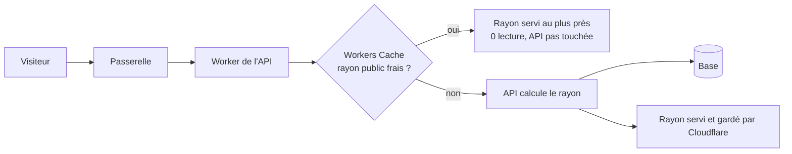
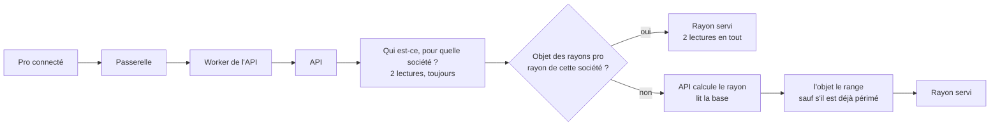
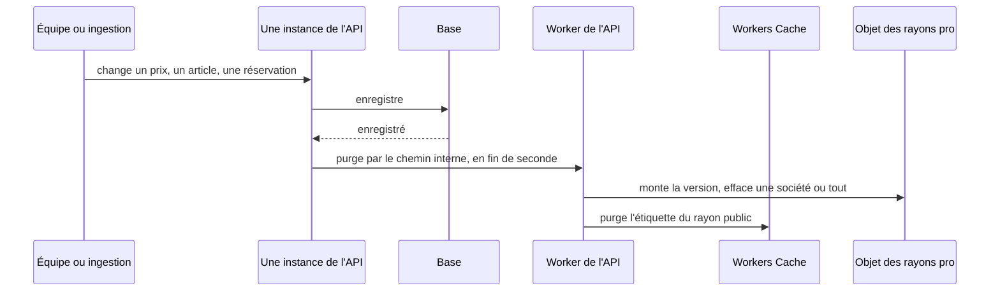

# Première visite rapide et pas chère — le cache du catalogue

> 📝 **Plan, rien n'est bâti.** Réécrit le 2026-11-04 (cinquième forme) après
> quatre contradictions de `vitruve` et la vérification de la doc Cloudflare.
> La quatrième a fermé la route publique vers l'objet des pros : le conteneur
> le joint par un **gestionnaire de sortie** interne, sans route ni jeton. La
> cinquième (aucun BLOQUANT) a nommé ses prérequis : date de compatibilité,
> `ContainerProxy`, et un contrôle de l'appelant.
> Le **public** est caché par **Workers Cache**, au plus près du visiteur ;
> les **pros** dans **un Durable Object** qui range une table par société, la
> seule copie, donc sans dérive le jour où l'API aura plusieurs instances.
> Touche les prix affichés et une frontière de sécurité : contredit avant Hugo.

# Partie 1 — Comprendre

## Pourquoi

La base de production (Prisma Postgres) est **facturée à l'opération**. Une
visite de la boutique coûte aujourd'hui 6 lectures pour un visiteur et 12 pour
un pro, **même quand rien n'a changé**. La cible : une station de ski côté
particuliers, et 200 à 1 000 pros qui commandent aux mêmes heures. Et l'API
aura un jour plusieurs instances : le cache doit le supporter dès maintenant.

## Deux caches, parce que deux sortes de rayons

- **Le rayon public** (invité, ou pro de base sans connexion) est **le même
  pour tous**. Cloudflare le garde au plus près du visiteur, et le sert sans
  réveiller l'API ni lire la base.
- **Le rayon d'une société** (sa mercuriale, ses engagements, ses articles
  réservés) ne se sert qu'**après** avoir vérifié qui demande et pour quelle
  société, ce que seule l'API sait, en base. L'API le range ensuite dans **un
  seul objet** qui tient une table « société → rayon ». Une seule copie : quel
  que soit le nombre d'instances de l'API, toutes lisent la même.

### Le chemin d'un visiteur

### Le chemin d'un pro

Les deux lectures de droits ne s'économisent pas : c'est ce qui bloque tout de
suite un compte désactivé.

### Comment un changement arrive dans les caches

C'est le modèle d'un Redis : **celui qui écrit efface**, après
l'enregistrement, sans attendre qu'un visiteur passe.

**Ce qu'une purge efface** :

| Changement                                                                               | Rayons effacés                                                                             |
| ---------------------------------------------------------------------------------------- | ------------------------------------------------------------------------------------------ |
| la mercuriale, une règle, l'engagement, le suivi ou le statut d'une société              | **cette société et ses sites** (un site hérite de son principal)                           |
| une règle de prix d'audience **segment**                                                 | **tous** : on ne sait pas énumérer les sociétés d'un segment                               |
| une réservation posée ou levée                                                           | **tous**, public compris : l'article disparaît ou se verrouille pour tous sauf une société |
| un article, une famille, un prix général, une promotion, une opération, une heure limite | **tous**                                                                                   |

### Un rayon calculé pendant une écriture

Il ne doit pas rester en cache. L'objet tient **la version** des rayons, qu'il
monte à chaque purge. L'API la relève **avant** de calculer : l'objet refuse de
ranger un rayon calculé sur une version dépassée, et l'API ne laisse pas
Cloudflare garder un rayon public si la version a bougé pendant le calcul.

### Ce qui change sans que personne n'écrive

Une promotion qui s'ouvre à midi, une opération datée, l'heure limite : aucune
écriture, donc aucune purge. C'est la **durée de vie** qui les rattrape :
**30 secondes, fixes** (Hugo, 2026-11-04).

## Ce qui rend une erreur sans conséquence

Le rayon n'est qu'une **vitrine**. Le panier recalcule toujours au vrai prix,
et la commande refuse un total que le client n'a pas vu. Un rayon un peu vieux
peut **afficher** un prix dépassé ; il ne peut pas le **facturer**.

Ce qui serait grave : servir le rayon d'une société à une autre. D'où la clé
`companyId` tirée de la résolution en base, jamais du client.

# Partie 2 — Le plan

## 1. Ce qui est vérifié (2026-11-04)

**Dans le dépôt :**

- la boutique est **statique** (`angular.json`, `ssr: false`) : une visite
  paie le catalogue une fois, au chargement ;
- l'API est un Cloudflare Container (`apps/lfd-api/wrangler.jsonc`,
  `max_instances: 1`), tenu chaud par le cron `*/5` (`keepWarm`, depuis
  `scheduled`, directement sur le conteneur) malgré `sleepAfter = "1h"` ; le
  Worker de l'API n'a pas d'adresse publique (`workers_dev: false`) et le
  conteneur y est un Durable Object (`Backend extends Container`, `BACKEND`) ;
- la passerelle sert toute la zone `lafoliecoffee.info/*` et rejoint l'API par
  service binding ; les requêtes `fetch` traversent le Worker de l'API par
  `guardedFetch` (`edge-guard.ts`, limite de débit comprise) ;
- `GET /shop/catalogue` et `GET /shop/featured` ne lisent **jamais**
  l'appelant (`read-shop-catalogue.ts`, `read-shop-featured.handler.ts` et son
  `anonymousViewer`) ; seul `/shop/catalogue/mine` est personnel ; l'API ne lit
  aucun cookie d'identité ;
- le **statut** d'une société change son propre rayon
  (`CatalogViewers.forCompany`) **et celui de ses sites** : un article réservé
  au principal ne s'ouvre à un site que si le principal est `active`
  (`reservationHoldersOf`, `b2b/shared/company-standing/infrastructure/read-reservation-holders.ts`) ;
  un site suit aussi la mercuriale et les règles de son principal
  (`pricing-act.ts`) ; une **réservation** change le rayon de tous
  (`catalog-viewer.ts` : public et pro sans connexion ne voient jamais un
  article réservé, une autre société le voit caché ou verrouillé) ;
- `@cloudflare/containers` est en 0.3.7 (`pnpm-workspace.yaml`) ;
- « après la validation » a un outil : `AfterCommit.defer`
  (`platform/database/after-commit.ts`), employé par l'outbox et le journal
  des envois ;
- le cache des **prix** supporte déjà plusieurs instances (estampille
  `pricing_events` relue une fois par requête, `PricingMaterialsCache`).

**Dans la doc Cloudflare :**

- **Workers Cache** garde la réponse d'un Worker et la ressert **sans exécuter
  le Worker** ; activé par `"cache": { "enabled": true }` (wrangler ≥ 4.69) ;
  à deux niveaux (le centre le plus proche, puis un niveau supérieur) ; marche
  pour un Worker joint par service binding ; pas de coût en plus de la requête
  Worker, pas de temps de calcul sur un succès
  ([Workers Cache](https://developers.cloudflare.com/workers/cache/)) ;
- une requête avec `Authorization` n'est servie du cache que si la réponse dit
  `public`, `must-revalidate` ou `s-maxage` ; une réponse `private`, `no-store`
  ou avec `Set-Cookie` n'est pas gardée
  ([configuration](https://developers.cloudflare.com/workers/cache/configuration/)) ;
- `ctx.cache.purge({ tags })` efface **partout** (purge instantanée), mais
  **seul le Worker propriétaire** peut purger son cache, avec les limites de
  débit de l'offre **gratuite** quelle que soit l'offre
  ([purge](https://developers.cloudflare.com/workers/cache/purge/)) ;
- l'ancien Cache API (`caches.default`) ne convient pas : local à chaque
  centre, purge locale
  ([Cache API](https://developers.cloudflare.com/workers/runtime-apis/cache/)) ;
- **un conteneur joint les liaisons de son Worker** (Durable Objects compris)
  par des **gestionnaires de sortie** : un appel HTTP simple vers un nom fictif,
  intercepté et traité dans le Worker (`outboundByHost`, `ctx.containerId`)
  ([Connect to Workers and Bindings](https://developers.cloudflare.com/containers/platform-details/workers-connections/),
  [Handle outbound traffic](https://developers.cloudflare.com/containers/platform-details/outbound-traffic/)).
  Notre `@cloudflare/containers` 0.3.7 le porte (`outboundByHost`,
  `OutboundHandlerContext.containerId`, dans les types du paquet), avec deux
  prérequis : un `ctx.exports` que notre date de compatibilité
  (`2025-06-01`, `wrangler.jsonc`) ne donne peut-être pas, et un point d'entrée
  `ContainerProxy` exporté par le Worker. Seul `http://` est intercepté par
  défaut : une adresse `https://` partirait sur internet. La doc ne dit pas si
  c'est en bêta ;
- Cloudflare KV ne convient pas : une écriture n'est pas visible partout tout
  de suite (non relu dans la doc ce jour).

## 2. La mesure

Sonde e2e jetable du 2026-11-04, opérations ORM par appel (froid / chaud) :
`GET /shop/catalogue` visiteur 11 / 6 ; `?audience=pro` 6 / 6 ;
`GET /shop/featured?audience=pro` 3 / 3 ; `GET /shop/catalogue/mine` pro
13 / 12, perso 8 / 8.

**Taille d'un rayon, mesurée en production le 2026-11-04** (deux lectures
publiques) : `GET /shop/catalogue` = **121 458 octets** bruts, **11 126**
compressés en gzip, 161 articles ; `?audience=pro` = 113 134 octets, 149
articles. Réponse : `cache-control: private, no-cache` et **`vary: Origin`**
(le CORS de C0 est donc réel). Conséquence pour l'objet des pros (§ 4) :
1 000 sociétés × ~120 Ko = **~120 Mo** en clair, de l'ordre de la mémoire d'un
objet (limite non relue) ; **~11 Mo** compressés. L'objet range donc le rayon
**compressé**, ou dans son stockage SQLite.

## 3. Le public — Workers Cache

- **Où** : le Worker de l'API gagne le bloc `cache`. Les réponses de
  `/shop/catalogue` et `/shop/featured` portent `Cache-Control: public,
max-age=…` et `Cache-Tag: rayon-public`. Toute autre réponse garde le
  `private` du middleware (`cache-control-by-default.middleware.ts`), donc
  n'est jamais gardée.
- **Avec un jeton** : ces deux routes ne lisent pas l'appelant (§ 1), donc
  `public` y est juste, et un visiteur connecté profite du cache. C'est la
  phrase que la porte du § 7 doit tenir : si l'une de ces routes se met un jour
  à lire l'appelant, `public` servirait un rayon personnel à tous.
- **La clé** : la doc ne dit pas si la clé contient le paramètre d'URL
  (`audience`, langue). **Premier test de C0.** S'il n'y est pas, l'audience et
  la langue passent dans le chemin.
- **Version du Worker dans la clé** : un déploiement repart d'un cache vide.
- **Le rayon douteux** : l'API relève la version de l'objet (§ 4) avant de
  calculer, la relit à la fin ; si elle a bougé, **ou si l'objet n'a pas
  répondu**, elle répond `no-store` : le rayon est servi, jamais gardé.
- **Le CORS** : `main.ts` reflète l'origine appelante dans
  `Access-Control-Allow-Origin` avec `Vary: Origin`. Si Workers Cache ignore
  `Vary`, la première origine fige l'en-tête pour toutes : une panne au
  navigateur, pas une fuite. **Testé en C0** ; sinon, l'en-tête se pose au
  Worker, après le cache.
- **Les en-têtes de la passerelle** (`x-lfc-request-time`, `traceparent`) ne
  doivent pas entrer dans la clé : sinon chaque requête manque le cache. Testé
  en C0.

## 4. Les pros — un objet, une table par société

- **Où** : une seconde classe de Durable Object dans le Worker de l'API, à côté
  de `Backend`. L'API l'interroge **après** `AuthGuard` et `@ActingCompany`, avec
  `companyId` tel que la résolution en base l'a rendu (`null` pour l'espace
  perso, qui a sa propre entrée).
- **Ce qu'il range** : `companyId → { rayon, version }`, et la **version**
  courante, dans son stockage SQLite (la mémoire se perd quand il s'endort ; la
  version ne doit pas se perdre).
- **Lire** : `get(companyId)` rend le rayon s'il existe, sinon la version
  courante. L'API calcule alors, et `put(companyId, rayon, version relevée)` ;
  l'objet refuse si sa version a avancé entre-temps.
- **Une seule copie** : plusieurs instances de l'API lisent et écrivent le même
  objet. Pas de dérive possible entre instances, pas de purge en éventail.
- **Le chemin conteneur → objet** : un **gestionnaire de sortie** du Worker
  (§ 1). Le conteneur appelle `http://rayons.interne/…` ; le Worker intercepte
  et parle à l'objet par sa liaison. **Aucune route publique, aucun jeton** :
  seul ce conteneur peut faire cet appel. C'est ce qui garde le mur entre
  sociétés dans l'API. ⚠️ Sans ce chemin, la forme pro n'est **pas
  bâtissable** : une route publique à secret partagé rendrait le rayon de
  n'importe quelle société à qui a le secret. À établir en C0 : la version de
  `@cloudflare/containers` qui le porte (nous sommes en 0.3.7), et le temps de
  l'aller-retour.
- **Le gestionnaire refuse tout appel qui ne vient pas de `Backend`** :
  `ContainerProxy` est un point d'entrée exporté, qu'un autre Worker du compte
  pourrait lier sans les `props` du conteneur. Il exige `ctx.containerId` et le
  compare à l'identifiant de `Backend` (`worker.ts`, `PRIMARY_INSTANCE`), sans
  supposer qu'il n'y a qu'un conteneur. `lint:cache-control` étendue le tient.
- **Si l'objet est injoignable** (au démarrage, ou en panne) : le rayon pro est
  calculé et servi, sans être rangé — le comportement d'aujourd'hui.
- **La version est globale, et doit le rester** : c'est elle qui fait refuser
  un `put` relevé avant un rattachement de site. Une version par société, pour
  réduire les refus, rouvrirait ce trou.
- **Purger « une société et ses sites »** : chaque entrée range aussi
  l'identifiant du principal de la société ; une purge par société efface
  l'entrée et celles dont le principal est cette société.
- **Mémoire et débit** : 1 000 rayons de quelques centaines de Ko peuvent
  dépasser la mémoire d'un objet (limite non relue). Si c'est le cas : ranger
  dans le stockage SQLite plutôt qu'en mémoire, ou **découper** en quelques
  objets, chaque société toujours sur le même (calcul sur son identifiant). On
  commence à **un** objet ; le nombre est un réglage.
- `/mine` ignore la langue (`my-shop-catalogue.controller.ts`) : déjà le cas
  aujourd'hui, la clé n'en a donc pas besoin.

## 4 ter. Un port, pour pouvoir changer de magasin (Hugo, 2026-11-04)

Le service du rayon ne connaît pas l'objet : il parle à un **port**
(`ShopShelfCache`, nom provisoire) déclaré côté application du catalogue,
implémenté dans `infrastructure/`, relié dans `appBootstrap`.

| Opération                                 | Objet (aujourd'hui)        | Redis (si un jour)                              |
| ----------------------------------------- | -------------------------- | ----------------------------------------------- |
| lire le rayon d'une société               | appel interne vers l'objet | `GET rayon:{société}`                           |
| ranger si la version n'a pas bougé        | l'objet compare et refuse  | un script Lua, comparer puis écrire en une fois |
| effacer une société et ses sites, ou tout | l'objet vide sa table      | `DEL` des clés, ou une version montée           |
| lire la version                           | l'objet                    | `GET version`                                   |

Passer à Redis = **un adaptateur de plus** et une liaison ; le service, la
purge après validation, la porte des écritures, le repli sur la base et les
tests d'application ne bougent pas. Le conteneur joindrait Redis directement,
sans gestionnaire de sortie. Le public (Workers Cache) n'est pas concerné : il
est devant l'API, un Redis serait derrière.

Deux exigences pour que ce soit vrai : **le port s'écrit avant l'objet**, et
les tests d'application tournent contre une **version en mémoire du port**,
jamais contre l'objet.

**Durable Object plutôt qu'Upstash, confirmé par Hugo le 2026-11-04.** Upstash
(Redis hébergé, offre gratuite) aurait été plus simple techniquement : ni
gestionnaire de sortie, ni `ctx.exports`, ni risque au démarrage. Écarté pour
**tout garder au même endroit** : un seul fournisseur, une seule facture, aucun
secret de plus, et pas de panne d'un second fournisseur qui s'ajoute à celles
de Cloudflare. Le risque au démarrage est tenu par `lint:container-start` ; le
port (§ 4 ter) laisse la porte ouverte.

## 4 bis. Le cache n'est jamais sur le chemin de la disponibilité (Hugo, 2026-11-04)

« La prod ne peut jamais tomber en panne. » Le cache accélère ; il ne doit
jamais pouvoir empêcher de servir un rayon. **Toute panne du cache retombe sur
la lecture en base**, c'est-à-dire sur le chemin d'aujourd'hui.

| Panne                                                | Ce qui se passe                                                                                                                                           |
| ---------------------------------------------------- | --------------------------------------------------------------------------------------------------------------------------------------------------------- |
| Workers Cache vide, désactivé ou en panne            | la requête atteint l'API, qui calcule depuis la base : le comportement d'aujourd'hui, sans rien à coder                                                   |
| l'objet des pros ne répond pas, répond mal, ou tarde | l'API calcule depuis la base et sert ; elle ne range rien                                                                                                 |
| l'objet répond trop lentement                        | **délai court** sur chaque appel au cache (de l'ordre de 100 ms, à fixer en C0) : passé ce délai, la base                                                 |
| l'objet est en panne durable                         | **disjoncteur** : après quelques échecs, l'API cesse de l'appeler pendant un temps, pour ne pas payer le délai à chaque visite ; elle le réessaie ensuite |
| une purge échoue                                     | journalisée ; la durée de 30 s rattrape                                                                                                                   |
| la version ne se lit pas                             | public : `no-store` ; pro : calcul depuis la base sans rangement                                                                                          |

**La seule panne que ce repli ne couvre pas** : un conteneur qui ne
**démarre** pas. Déclarer un gestionnaire de sortie sans exporter
`ContainerProxy` l'empêche de démarrer — **constaté en local le 2026-11-04**
(`wrangler dev`, conteneur d'essai : 500 « ctx.exports.ContainerProxy is
undefined »). Celle-là se tient par une **porte de CI**, `lint:container-start` (bâtie le 2026-11-04), avant tout
gestionnaire : si `Backend` déclare `outboundByHost`, le Worker exporte
`ContainerProxy` et `wrangler.jsonc` porte `enable_ctx_exports`, sinon le push
est refusé. Le déploiement, lui, détecte une image qui ne sert pas
(`deploy_lfd_api.yml`, révision attendue sur `/health`) mais ne revient pas en
arrière tout seul.

**Ce que les tests tiennent** : un objet qui lève, qui tarde au-delà du délai,
ou qui rend une réponse illisible donne le même rayon que sans cache ; le
disjoncteur s'ouvre et se referme.

## 4 quater. Surveiller le cache (Hugo, 2026-11-04)

Hugo a besoin de **voir** le cache vivre. Un cache qu'on ne voit pas finit en
panne silencieuse : il ne sert plus, ou sert du vieux, et rien ne le dit.

**Ce qu'il faut voir :**

| Mesure                                                                          | Ce qu'elle dit                                                                                              |
| ------------------------------------------------------------------------------- | ----------------------------------------------------------------------------------------------------------- |
| taux de succès, public et pro                                                   | le cache sert-il vraiment ? (public : `Cf-Cache-Status` de Workers Cache ; pro : succès / ratés de l'objet) |
| opérations de base évitées                                                      | le gain en argent : le `SchemaOpsCounter` compte déjà par schéma, à lire avant / après                      |
| purges : nombre, portée, échecs, refus de débit                                 | une purge qui échoue, ou les limites de purge de Cloudflare atteintes                                       |
| `put` refusés pour version dépassée                                             | la course qui se produit vraiment, et combien                                                               |
| replis sur la base : objet lent, absent, réponse illisible ; disjoncteur ouvert | le cache en panne, alors que les clients ne voient rien                                                     |
| temps d'un aller-retour vers l'objet                                            | la condition d'arrêt du § 8, suivie dans la durée                                                           |
| taille de l'objet, nombre d'entrées                                             | l'approche de sa limite de mémoire                                                                          |
| âge du rayon servi                                                              | qu'aucun rayon ne vit plus que la durée prévue                                                              |

**Où le voir** : la **carte de santé** du back-office (bloc `ops`, qui observe
et ne possède rien : `src/ops/`, ses sondes, son trafic, ses vitals), avec une
**alerte** quand le disjoncteur est ouvert, quand une purge échoue, ou quand
le taux de succès s'effondre. Comment `ops` lit ces chiffres sans importer le
catalogue (la matrice du `CLAUDE.md` le lui interdit) est **à trancher** : un
port déclaré par `ops` et implémenté côté `platform`, ou des journaux
structurés que la carte agrège. Chaque lot (C2, C3) livre ses compteurs avec
lui, pas après.

## L'interrupteur (Hugo, 2026-11-04)

Éteindre, rallumer ou vider le cache des **rayons pro** en production, sans
redéployer ni redémarrer : GitHub → Actions → **`ops_shelf_cache`** → « Run
workflow », puis le geste.

- **Éteindre** : `off` — chaque rayon se calcule depuis la base, tout ce qui
  était rangé est effacé.
- **Rallumer** : `on` — rien n'est rangé d'avance, le cache se remplit aux
  visites suivantes.
- **Vider** : `purge` — tout est effacé, le cache reste allumé (ou éteint).

Le résumé du job donne l'état après le geste (allumé, version). L'état vit
dans l'objet des rayons (table `meta`), allumé par défaut, et vaut pour toutes
les instances de l'API. Route : `POST /admin/ops/shelf-cache`
(`{ action }`, jeton `RECOMPUTE_TOKEN`) ; journaux `shelf_cache.switched` et
`shelf_cache.purged_manually`.

**Le rayon public** (C3, bâti le 2026-11-04) : `public-on` / `public-off`
allument ou éteignent le seul drapeau public, **éteint par défaut** ; `off`
éteint aussi le public, et `off`, `public-off` et `purge` purgent Workers
Cache. Le résumé dit l'état des deux drapeaux et si la purge publique a
abouti (`publicPurge`).

## 5. La purge

- **Montée après la validation**, par `AfterCommit.defer`, de toute écriture
  qui change un rayon. Une montée dans la transaction rouvrirait la course.
- **Par le même chemin interne** que la lecture (§ 4) : un gestionnaire de
  sortie, pas une route publique, pas de jeton. Le Worker traite l'appel
  lui-même : c'est lui qui possède Workers Cache, et seul le propriétaire peut
  le purger.
- **Ce qu'elle fait** : demande à l'objet de monter sa version et d'effacer une
  société ou tout (tableau de la partie 1), puis `ctx.cache.purge({ tags:
["rayon-public"] })` si le changement touche le public.
- **Regroupée en fin de fenêtre** : au plus une purge par seconde, la dernière
  gagnant. Les limites de purge de l'offre gratuite l'imposent, et une
  ingestion de 200 fiches (`on-catalog-product-changed.handler.ts`) en
  déclencherait 200. Un redémarrage dans la seconde perd la purge en attente :
  la durée rattrape.
- **Hors requête** : les abonnés `@DurableHandler` du catalogue et le balayage
  de l'outbox purgent comme les autres.
- **Une purge qui échoue** n'est pas rejouée, elle est journalisée ; la durée
  rattrape.

### Les écritures qui doivent purger

Relevé par recherche des écritures Prisma sur les modèles que le rayon lit
(2026-11-04) — **une recherche, pas une preuve** ; la porte du § 7 la tient :

| Ce qui change                   | Où ça s'écrit                                                                                                                                                                                                                                                                                                                                                          | Portée                                                                  |
| ------------------------------- | ---------------------------------------------------------------------------------------------------------------------------------------------------------------------------------------------------------------------------------------------------------------------------------------------------------------------------------------------------------------------- | ----------------------------------------------------------------------- |
| prix, promotions                | `PricingActWriter`                                                                                                                                                                                                                                                                                                                                                     | selon l'audience : une société et ses sites ; un segment ou tous : tous |
| articles du catalogue           | `b2b/catalog/infrastructure/` : `prisma-catalog-item.repository.ts`, `catalog-decision-writes.ts`, `catalog-review-states.ts`, `prisma-catalog-order-limits.ts`, `prisma-catalog-product-facts.projection.ts`, `prisma-catalog-visuals.projection.ts`, `prisma-catalog-category.projection.ts`, `prisma-catalog-price-retracer.ts`, `prisma-made-to-order-settings.ts` | tous                                                                    |
| réservations d'articles         | `prisma-catalog-reservations.ts`, `prisma-made-to-order-admin.reader.ts` (qui écrit malgré son nom)                                                                                                                                                                                                                                                                    | tous                                                                    |
| opérations datées               | `b2b/operations/infrastructure/prisma-operation.repository.ts`                                                                                                                                                                                                                                                                                                         | tous                                                                    |
| heures limites                  | `b2b/order-cutoffs/infrastructure/prisma-general-order-cutoff.repository.ts`                                                                                                                                                                                                                                                                                           | tous                                                                    |
| statut, principal d'une société | `b2b/account/infrastructure/prisma-company.repository.ts`                                                                                                                                                                                                                                                                                                              | cette société et ses sites                                              |
| suivi d'un pro                  | `b2b/account/infrastructure/prisma-company-follows.repository.ts`                                                                                                                                                                                                                                                                                                      | cette société et ses sites                                              |
| engagement de volume            | `b2b/pricing/infrastructure/prisma-volume-commitment.repository.ts` (son handler `sign-volume-commitment.handler.ts` n'injecte **pas** `PricingActWriter` : à brancher sur la purge)                                                                                                                                                                                   | cette société et ses sites                                              |

À compléter avant de bâtir : prix au kilo, offres d'acheminement, traductions.

## 6. La durée de vie — 30 secondes (Hugo, 2026-11-04)

Ce qui change sans écriture (une promotion qui s'ouvre à midi, une opération,
l'heure limite) n'est rattrapé que par elle : **30 secondes, fixes**.

- **Plus simple à maintenir** qu'une échéance calculée : aucune source d'heure
  à oublier, aujourd'hui ni le jour où une nouvelle décision datée apparaîtra.
- **Son défaut ne coûte presque rien** : elle ne sert pas quand les visites
  sont espacées de plus de 30 secondes, mais c'est alors peu de trafic, donc
  peu de lectures. Sous trafic continu, elle plafonne à deux recalculs par
  minute et par clé.
- Une promotion de midi apparaît au plus à 12 h 00 min 30 s. Les gestes de
  l'équipe, eux, passent par la purge.
- Écartée : « jusqu'à la prochaine échéance connue, au plus 10 minutes ».

La durée se calcule sur `Clock.now()` dans l'API (`lint:clock-port`) ; dans le
Worker (l'objet), la lecture de l'heure s'isole dans une seule fonction, avec
une dérogation nommée.

## 7. Les portes — avant le premier cache

- **Une porte des écritures du rayon** : tout fichier qui écrit un modèle lu
  par le rayon passe par le port de purge, **par `AfterCommit.defer`**. Même
  forme que `lint:prisma-model-ownership` : la liste des modèles dérivée, pas
  recopiée. Bâtie **avant** C2 et C3.
- **`lint:cache-control`** ne parcourt que `apps/lfd-api/src` et
  `gateway/src`. Elle gagne `apps/lfd-api/container/`, et une liste admise
  datée : les deux routes `public`, le gestionnaire de sortie, la classe de
  l'objet.
  Elle tient aussi que ces deux routes ne lisent pas l'appelant.

## 8. Le coût

À chiffrer sur la grille Cloudflare en vigueur : Workers Cache ne coûte rien de
plus que la requête Worker ; l'objet des pros coûte une requête par visite pro
(plus l'aller-retour, § 4) contre ~10 opérations Prisma évitées.

**Condition d'arrêt pour les pros** : une visite pro chaude paie toujours ses
2 lectures de droits, plus l'aller-retour vers l'objet. Si C0 montre un
aller-retour plus lent que les lectures qu'il évite, ou un coût plus élevé, le
lot C2 ne se bâtit pas : les pros restent sans cache, et le plan le dit.

## 9. Les lots

⚠️ **Le gestionnaire de sortie demande `ctx.exports`** : obtenu par le seul drapeau
`enable_ctx_exports`, sans avancer la date de compatibilité du Worker de l'API
(une date avancée aurait changé tout ce Worker : limite de débit, crons,
`guardedFetch`). C'est le lot **C0b**, avant C2. Il n'existe pas de « dev
déployé » : le seul déploiement est la production, depuis `main`.

| Lot | Contenu                                                                                                                                                                                                                                                          |
| --- | ---------------------------------------------------------------------------------------------------------------------------------------------------------------------------------------------------------------------------------------------------------------- |
| C0  | sur dev déployé : clé de Workers Cache (paramètre d'URL, en-têtes de la passerelle, `Vary: Origin`) ; gestionnaire de sortie et version de `@cloudflare/containers` ; aller-retour conteneur → objet ; taille d'un rayon ; coût ; secondes d'une première visite |
| C0b | ✅ `enable_ctx_exports` (pas de date avancée) et `ContainerProxy` exporté, sans gestionnaire (`8aaa1f638`) ; essai local de l'interception (2026-11-04) ; **la porte de CI du démarrage**, avant tout gestionnaire                                               |
| C1  | ✅ **bâti le 2026-11-04** (`7a62edd7f`) : le port `ShelfChanges` (`b2b/shared/shelf-changes/`), la fenêtre d'une seconde qui journalise, 28 écrivains sur 26 modèles, la porte `lint:shelf-writes`                                                               |
| C2  | ✅ **bâti le 2026-11-04** (`a8c07257f`) : l'objet `ProShelves`, le port `ShopShelfCache`, le repli (100 ms, disjoncteur 5 échecs / 30 s), la purge société + sites ; e2e et budget verts. Non éprouvé sur Cloudflare                                             |
| C3  | ✅ **bâti le 2026-11-04** (non commité à l'écriture) : Workers Cache sur les deux routes publiques derrière un drapeau public éteint par défaut, l'en-tête du middleware sur un rayon douteux ; `lint:cache-control` étendue. Non éprouvé sur Cloudflare         |
| C5  | la surveillance : les mesures du § 4 quater sur la carte de santé, et ses alertes ; chaque lot pose ses compteurs, C5 les montre                                                                                                                                 |
| C4  | la boutique relit le rayon au retour sur l'onglet                                                                                                                                                                                                                |

Tests : une écriture **pendant** un calcul ne laisse pas l'ancien rayon ; une
réservation change le rayon des autres sociétés et du public ; un changement
sur un principal efface ses sites ; une règle de segment efface tout ; un objet
qui ne répond pas donne un `no-store` ; `/mine` ne touche jamais Workers Cache ; une
promotion qui se ferme n'est plus servie après la durée.

### C1 en détail — la purge, sans cache encore

C1 ne cache **rien** : il pose le signal, pour que C2 et C3 n'aient qu'à
l'écouter. Il peut partir en production seul, sans effet visible.

- **Le port** `ShelfChanges` dans `b2b/shared/shelf-changes/` (règle commune à
  plusieurs contextes du commerce, comme `photo-cards`) :
  `changed(scope)` avec `scope` = `{ kind: "all" }` ou
  `{ kind: "company", companyId }`. Il appelle `AfterCommit.defer` lui-même :
  l'appelant ne peut pas oublier « après la validation ».
- **L'adaptateur de C1** regroupe en fin de fenêtre d'une seconde (un `all`
  absorbe les sociétés ; sinon l'ensemble des sociétés), puis **journalise**
  la purge qu'il aurait faite. C2 et C3 remplacent la journalisation par la
  vraie purge.
- **Les écrivains** appellent le port à l'endroit où ils écrivent, avec la
  portée du tableau de la partie 1. Les modèles concernés, relevés le
  2026-11-04 dans `prisma/schema/public/` : `CatalogItem`,
  `CatalogItemOverride`, `CatalogCategory`, `CatalogPriceHistory`,
  `CatalogItemReservation`, `CatalogOperation`, `CatalogOperationItem`,
  `CatalogOperationOverride`, `OrderCutoff`, `OrderCutoffSettings`,
  `Company`, `CompanyFollow`, `VolumeCommitment`, `CompanyMercuriale`,
  `CompanyMercurialeAmendment`, `PriceRule`, `PriceFloor`, `VolumeLadder`,
  `Promotion` et ses tables (`PromotionScopeRule`, `PromotionAudienceTarget`,
  `PromotionPickupPoint`, `PromotionDeliveryZone`, `PromotionSetting`). Le
  bâtisseur confronte cette liste aux lectures réelles de
  `ShopCataloguePricing` et de ses lecteurs, et rend l'écart.
- **La porte `lint:shelf-writes`** : tout fichier de `apps/lfd-api/src` qui
  écrit l'un de ces modèles (`create`, `update`, `upsert`, `delete` et leurs
  formes `Many`, ou du SQL brut qui nomme leur table) appelle `ShelfChanges`,
  ou figure dans une liste admise **datée** avec sa raison. Chaque modèle de
  la liste doit exister dans le schéma (vérifié à chaque passage, par
  `dev-toolbox/gates/lib/prisma-schema.mjs`) : un modèle renommé ne la
  désarme pas en silence.
- **Tests** : le regroupement (rafale de 200 → une purge ; `all` absorbe ;
  fin de fenêtre), `AfterCommit` (rien ne part si la transaction échoue), et
  un test par famille d'écrivains qui vérifie la portée annoncée.

### Ce que C1 a trouvé (2026-11-04)

- **Écart avec la liste** : `Site` (points de retrait) et `DeliveryAvailability`
  manquaient, ajoutés ; `CatalogOperationOverride` et `PromotionSetting` ne
  sont lus par aucun rayon, gardés dans la porte. Traductions et prix au kilo
  sont des colonnes de `catalog_items`, déjà couvertes.
  `prisma-made-to-order-admin.reader.ts` n'écrit aucun modèle de la liste.
- **Admis par la porte, datés** : trois fonctions qui écrivent dans la
  transaction de leur appelant (`catalog-item-upsert.ts`,
  `catalog-decision-writes.ts`, `catalog-review-states.ts`) — leurs appelants
  émettent ; la porte ne verrait pas un appelant neuf qui oublie — et le semis
  local `src/dev/seeding/reset.seed.ts`.
- **Une promotion qui quitte une société** purge aussi l'ancienne : une lecture
  de ses cibles avant leur remplacement.
- ❓ **Ouvert : une commande change le rayon.** La lentille `measured` du rayon
  lit les lignes de commande (cumul d'un engagement : le palier de la société ;
  ratio de volume d'un plancher dynamique : tous). Une commande passée devrait
  donc purger sa société, ou tout si un plancher dynamique s'applique — ou la
  durée de 30 s suffit. Rien n'est branché sur les commandes, `OrderLine`
  n'est pas dans la porte. **Tranché par Hugo le 2026-11-04 : la durée de 30 s suffit.** Un palier ouvert
  par une commande apparaît au rayon au plus 30 s plus tard ; le panier, lui,
  calcule toujours au vrai prix. Les commandes ne purgent pas, et `OrderLine`
  reste hors de la porte.

### Ce que C2 a trouvé (2026-11-04)

- **Le principal d'une société** : `ReservationHolders` ne le nomme que s'il
  est actif. Une entrée qui rangeait celui-là n'aurait pas été effacée quand un
  principal en attente devient actif. `ServedCompany` porte donc le principal
  **actuel**, actif ou non, lu dans la même ligne (aucune lecture de plus).
- **`outboundByHost` se pose par affectation** après la classe : un champ
  `static` masquerait l'accesseur hérité de `Container`, et le conteneur
  démarrerait sans interception, sans erreur.
- **L'objet ne lit jamais l'heure** : l'API lui passe l'instant et l'échéance.
- **Pas d'interrupteur** (bâti depuis : « L'interrupteur ») : déployé, le Worker pose `SHOP_SHELF_CACHE_URL` et le
  cache s'allume. Une panne retombe sur la base ; un cache **faux** ne
  s'éteint qu'en redéployant la version d'avant.
- **Non éprouvé** : un `fetch` Node vers `rayons.interne` dans un vrai
  conteneur Cloudflare (l'essai local passait par `wget` busybox), le délai de
  100 ms et le disjoncteur (valeurs à fixer à la mesure), la taille de l'objet.
- Fichiers déjà au-delà de 300 lignes, qui grossissent :
  `shop-catalogue-pricing.service.ts`, `container/worker.ts`, `app-config.ts`.

### Ce que C3 a trouvé (2026-11-04)

- **Désactivé par défaut** : le drapeau public vit dans l'objet des rayons
  (`meta.public_enabled`, absent = éteint) ; on l'allume par `ops_shelf_cache`
  (`public-on`) une fois la clé de Workers Cache, le `Vary: Origin` et la purge
  vus en production.
- **Un rayon douteux garde l'en-tête du middleware** (`private`), pas
  `no-store` : drapeau éteint à l'un des deux relevés, version bougée, objet
  injoignable, lent ou disjoncteur ouvert. Le délai et le disjoncteur sont
  ceux de C2, désormais partagés (`ShelfCallGuard`).
- **Une portée « une société » ne purge pas le public** : il se calcule sans
  société (`PUBLIC_VIEWER` ou pro anonyme, `pricingCompanyOf` → `null`). Seul
  « tout » purge Workers Cache, et pas quand le drapeau public est éteint.
- **La purge passe par une boucle locale** : le gestionnaire de sortie relaie
  `POST /public/purge` au point d'entrée par défaut (`exports.default`, avec des
  `props` qui la distinguent d'une requête du dehors), qui appelle
  `ctx.cache.purge`. **Non prouvé** : que `exports` existe avec notre date de
  compatibilité et `enable_ctx_exports`, et que la boucle atteigne le cache du
  point d'entrée par défaut. Un échec ne fait qu'échouer la purge (503).
- **`/shop/copy` est gardé aussi** dès que le bloc `cache` est déployé : il
  répond `public, max-age=60, stale-while-revalidate=600`, sans drapeau.
  Depuis le 2026-11-04 (Hugo), il porte `Cache-Tag: textes-boutique`, et la
  publication des textes (`PublishShopCopyHandler`) purge cette étiquette
  après la validation (`AfterCommit`), par le même relais que le rayon public.
  Le relais n'accepte que `?tag=` d'une liste fermée (`PURGEABLE_TAGS` :
  `rayon-public`, `textes-boutique`), relue des deux côtés de la boucle ; une
  autre étiquette rend 400. Une purge perdue est journalisée et la
  publication se voit à l'échéance (onze minutes au plus). L'interrupteur ne
  purge pas les textes : ils ne dépendent d'aucun drapeau, et un texte faux se
  corrige en republiant.
- Le relevé d'état coûte un appel à l'objet par réponse publique non servie
  du cache, deux quand le drapeau est allumé. Depuis le 2026-11-04, l'état
  « éteint » se garde **5 s par instance** (`PublicShelfFlagMemory`, sur
  `Clock`) : éteint, plus d'aller-retour. La version ne se garde jamais —
  allumé, les deux relevés lisent toujours l'objet. Un échec ne se range pas ;
  une bascule par l'interrupteur oublie la mémoire de cette instance. Le prix :
  une bascule faite ailleurs met au plus 5 s à être vue.

## 10. Ce que ce plan ne fait pas

- la passation (50 à 80 opérations) et le devis : autre chantier ;
- le réveil du conteneur après un déploiement : à décider après C0 ;
- la vérification d'identité à la passerelle : écartée, elle ferait de la
  passerelle une seconde frontière de sécurité pour économiser 2 lectures.

## 11. Non vérifié

- le paramètre d'URL dans la clé de Workers Cache ; son statut (bêta ou non) ;
- le gestionnaire de sortie dans notre version de `@cloudflare/containers`, et
  que son trafic reste interne ;
- que `ctx.cache.purge` soit disponible depuis le gestionnaire de sortie (un
  point d'entrée nommé du même Worker compte-t-il comme propriétaire ?) : à
  tester en C0 ; sinon, la purge publique doit repasser par le `fetch`
  principal du Worker ;
- si une société peut être principal ET site d'une autre (plus d'un niveau) :
  la purge « un niveau » ne suffirait plus ;
- la date de compatibilité qui donne `ctx.exports`, et ce qu'elle change
  d'autre ;
- que Workers Cache respecte `Vary: Origin` et ignore les en-têtes de la
  passerelle ;
- que l'engagement de volume passe par `PricingActWriter` ;
- la mémoire et le débit d'un objet ;
- si deux conteneurs cohabitent pendant un déploiement (sans effet sur la
  justesse : l'objet est la seule copie) ;
- qu'aucun champ du rayon ne dépend de l'heure au point d'être faux avant la
  durée (compte à rebours, `sealing`) ;
- la liste complète des écritures (§ 5).
