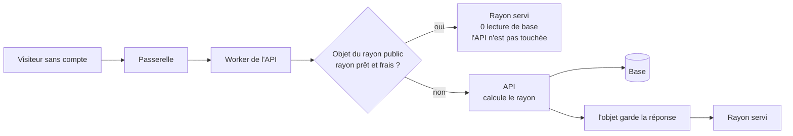
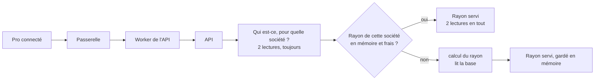
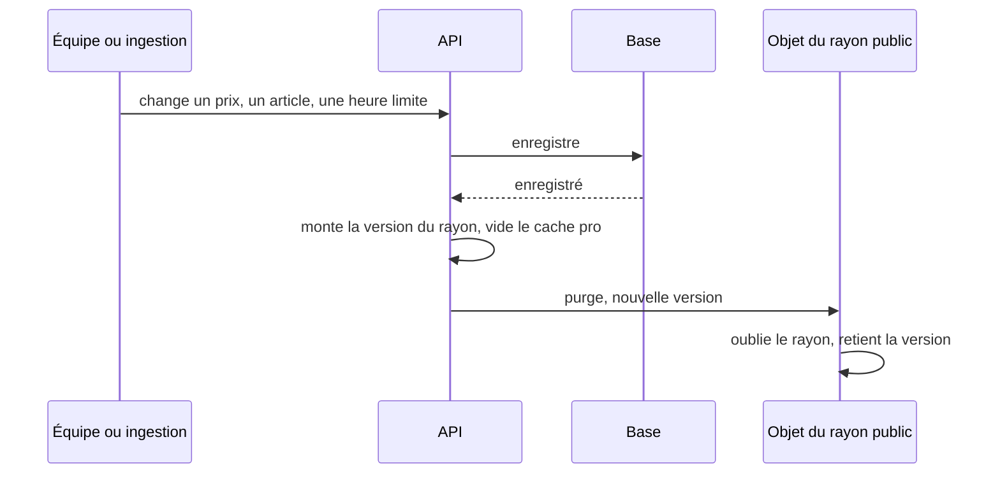

# Première visite rapide et pas chère — le cache du catalogue

> 📝 **Plan, rien n'est bâti.** Réécrit le 2026-11-04 après deux
> contradictions de `vitruve`. La première a déplacé les pros dans le
> conteneur (un objet devant lui ne sait pas quelle société sert un pro) ; la
> seconde a démoli la purge par en-tête (une course qui fige un vieux rayon, un
> délai « au pire cinq minutes » faux, un Worker sans mémoire partagée). La
> purge suit désormais le modèle d'un Redis : l'écrivain efface, après la
> validation. Touche les prix affichés et une frontière de sécurité :
> troisième contradiction avant Hugo.

# Partie 1 — Comprendre

## Pourquoi

La base de production (Prisma Postgres) est **facturée à l'opération**. Une
visite de la boutique coûte aujourd'hui 6 lectures pour un visiteur et 12 pour
un pro, **même quand rien n'a changé**. La cible : une station de ski côté
particuliers, et 200 à 1 000 pros qui commandent aux mêmes heures.

## Deux caches, parce que deux sortes de visiteurs

- **Le public** (la boutique sans espace personnel) : tout le monde voit **le même rayon**.
  On peut le garder tout prêt **devant** l'API : la visite ne réveille pas
  l'API et ne lit pas la base.
- **Le pro** : chaque société voit **son** rayon (sa mercuriale, ses
  engagements, ses articles réservés). Avant de le servir, il faut vérifier
  **qui** demande et **pour quelle société** — et seule l'API le sait, en
  base. Son cache vit donc **dans** l'API, après cette vérification.

### Le chemin d'un visiteur

La route publique ne lit jamais qui appelle : un visiteur connecté peut y
être servi par l'objet. Le rayon **personnel** (`/mine`) ne passe jamais par
lui.

### Le chemin d'un pro

Les deux lectures de droits ne s'économisent pas : c'est ce qui bloque tout de
suite un compte désactivé.

### Comment un changement arrive dans les caches

C'est le modèle d'un Redis : **celui qui écrit efface**, après
l'enregistrement. Aucune visite n'est nécessaire pour que le changement
arrive, même la nuit.

Un rayon calculé **pendant** une écriture porte la version relevée **avant**
son calcul : l'objet refuse de garder un rayon plus vieux que la dernière
version qu'il connaît. C'est la parade habituelle d'un cache Redis à la même
course.

Et ce qui change **sans que personne n'écrive** — une promotion qui s'ouvre à
midi, une opération datée, l'heure limite — est rattrapé par une **durée de
vie courte** : un rayon n'est jamais gardé plus de quelques dizaines de
secondes.

## Ce qui rend une erreur sans conséquence

Le rayon n'est qu'une **vitrine**. Le panier recalcule toujours au vrai prix,
et la commande refuse un total que le client n'a pas vu. Un rayon vieux de
quelques secondes peut **afficher** un prix dépassé ; il ne peut pas le
**facturer**.

Ce qui, en revanche, serait grave : servir le rayon d'une société à une autre.
C'est pour ça que le pro ne passe jamais par l'objet public.

# Partie 2 — Le plan

## 1. Ce qui est vérifié dans le dépôt (2026-11-04)

- la boutique est **statique** (`angular.json`, `ssr: false`) : une visite
  paie le catalogue une fois, au chargement ;
- l'API est un Cloudflare Container (`apps/lfd-api/wrangler.jsonc`,
  `max_instances: 1`), **tenu chaud** par le cron `*/5` (`keepWarm` dans
  `container/worker.ts`, qui frappe `/health` depuis `scheduled`, directement
  sur le conteneur) malgré `sleepAfter = "1h"` ; le Worker de l'API n'a pas
  d'adresse publique (`workers_dev: false`) ;
- la passerelle sert toute la zone `lafoliecoffee.info/*`
  (`gateway/wrangler.toml`), et rejoint l'API par service binding ;
- le Worker de l'API déclare **déjà** un Durable Object : le conteneur
  (`Backend extends Container`, `BACKEND`, `new_sqlite_classes`) ;
- les requêtes `fetch` traversent le Worker de l'API par `guardedFetch`
  (`edge-guard.ts`, limite de débit comprise) ; les tâches de `scheduled`
  vont au conteneur directement ;
- `GET /shop/catalogue` ne reconnaît **jamais** l'appelant
  (`read-shop-catalogue.ts`) : il sert le rayon invité, ou le pro de **base**
  sans société (`audience=pro`). Seul `/shop/catalogue/mine` est personnel.
  (`recognised` ne sert que les suggestions de panier, `pricedItems`.) L'API
  ne lit aucun cookie d'identité ;
- le conteneur sort déjà sur internet (Stripe, Resend, la base) : il peut
  joindre une route du Worker de l'API par la passerelle ;
- la boutique ne se rafraîchit jamais seule (seule `shop-clock.ts` avance
  chaque minute).

## 2. La mesure

Sonde e2e jetable du 2026-11-04, opérations ORM par appel (froid / chaud) :
`GET /shop/catalogue` visiteur 11 / 6 ; `?audience=pro` 6 / 6 ;
`GET /shop/featured?audience=pro` 3 / 3 ; `GET /shop/catalogue/mine` pro
13 / 12, perso 8 / 8. À chaud, le visiteur relit `CatalogItem` trois fois,
`CatalogOperation`, `OrderCutoff` et l'estampille `PricingEvent`. Le pro relit
en plus `User`, `Company` (deux fois), `CompanyFollow`, `VolumeCommitment`,
`CompanyMercuriale`.

**Étape 0, avant de bâtir** : mesurer sur **dev déployé** où partent les
secondes d'une première visite (page statique, conteneur, appels à l'API), et
le nombre de visites publiques d'une journée réelle.

## 3. Le public — un Durable Object devant le conteneur

- **Où** : une seconde classe de Durable Object dans le Worker de l'API
  (`container/worker.ts`), à côté de `Backend`, **après** la limite de débit
  (`guardedFetch`). Le Worker y adresse une requête **seulement si** elle est
  un `GET` de `/shop/catalogue` ou de `/shop/featured`, avec des paramètres
  admis. Ces routes ne lisent pas l'appelant (§1) : une requête avec jeton peut
  y être servie aussi. `/mine` et toute autre route vont au conteneur.
- **Clé** : la route et les paramètres qui changent la réponse (audience,
  langue). La liste des paramètres admis est écrite : un paramètre inconnu fait
  passer la requête au conteneur.
- **La clé chaude** : tous les visiteurs tombent sur la même clé. On la
  **duplique** sur N objets identiques (N à mesurer, 8 pour commencer), un tiré
  au hasard par visite ; la purge les vise tous.
- **Le remplissage** : l'objet appelle le conteneur **sans** `If-None-Match`
  ni en-tête d'identité ; il ne garde qu'une réponse **200**, avec son corps et
  son `Content-Type`, la version du rayon relevée par le conteneur **avant**
  son calcul, et l'heure. Il refuse de garder un rayon dont la version est
  plus vieille que la dernière qu'il connaît. Il retire `Set-Cookie` et
  l'en-tête de version.
- **La réponse** : il repose lui-même `Cache-Control: private, no-cache`
  (`cache-control-by-default.middleware.ts`) et son propre `ETag`, et répond
  304 à un `If-None-Match` qui correspond.
- **Mémoire perdue** : un objet endormi oublie ; il redemande au conteneur. La
  justesse n'en dépend pas.
- **Alternative écartée pour l'instant** : le cache de Cloudflare (CDN). Il ne
  se purge que par l'API de purge de Cloudflare, avec un secret de plus, et ne
  connaît pas la version.

## 4. Les pros — en mémoire du conteneur, par société

- **Où** : dans le conteneur, **après** `AuthGuard` et `@ActingCompany`, dans
  le service du rayon. La clé est `companyId` tel que la résolution en base l'a
  rendu (`null` pour l'espace perso), jamais une valeur du client.
- **Ce qu'il économise** : la société, son suivi, son engagement, sa
  mercuriale, le catalogue. Restent les deux lectures de droits.
- **Pourquoi pas un objet par société** : on n'a qu'une instance
  (`max_instances: 1`), donc la mémoire du conteneur est déjà partagée par
  toutes les requêtes ; et un objet devant le conteneur ne peut pas savoir
  quelle société sert un pro. On y reviendra avec plusieurs instances, et il
  faudra alors établir qu'un conteneur peut joindre un Durable Object.
- `/mine` ignore la langue (`my-shop-catalogue.controller.ts`) : déjà le cas
  aujourd'hui, la clé n'en a donc pas besoin. À dire, pas à corriger ici.

## 5. La purge — l'écrivain efface, comme avec un Redis

- **La version du rayon** : un nombre en mémoire du conteneur, composé avec un
  identifiant d'instance tiré au démarrage. Deux versions se comparent par
  **égalité** de l'instance, puis par **ordre** du nombre ; une instance
  différente vaut « inconnue », donc purge.
- **Relevée avant de lire** : le calcul d'un rayon (public ou pro) relève la
  version **avant** sa première lecture. Le cache pro ne range le résultat que
  si la version n'a pas bougé pendant le calcul ; l'objet public refuse un
  rayon plus vieux que sa dernière version connue.
- **Montée après la validation** de toute écriture qui change un rayon. Après,
  et non pendant : sinon une lecture concurrente remplit le cache avec l'état
  d'avant (le geste de `PricingActWriter` pour le cache des prix).
- **Le cache pro est vidé entier** à chaque montée : une réservation ou un
  statut de société change le rayon des **autres** sociétés et du public
  (`catalog-viewers.service.ts`), et vider tout est plus sûr qu'énumérer.
- **L'objet public est purgé par le conteneur**, par une route interne du
  Worker de l'API (`POST`, jeton secret comme `RECOMPUTE_TOKEN`), qui vise les
  N objets. La route n'est jamais servie au conteneur : le Worker la traite
  lui-même. Une purge qui échoue n'est pas rejouée : la durée rattrape, et
  l'échec est journalisé.
- **Les rafales** : une ingestion du référentiel émet un fait par fiche
  (`on-catalog-product-changed.handler.ts`) ; 200 fiches feraient 200 purges.
  Les montées se **regroupent** : une purge au plus par seconde, la dernière
  version gagnant.
- **Hors requête** : les abonnés `@DurableHandler` du catalogue et le balayage
  de l'outbox écrivent sans visite derrière ; ils montent la version comme les
  autres, et la purge part du conteneur, pas d'une réponse.

### Les écritures qui doivent monter la version

Relevé par recherche des écritures Prisma sur les modèles que le rayon lit
(2026-11-04) — **une recherche, pas une preuve** ; la porte du § 7 la tient :

| Ce qui change           | Où ça s'écrit                                                                                                                                                                                                                                                                                                                                                          |
| ----------------------- | ---------------------------------------------------------------------------------------------------------------------------------------------------------------------------------------------------------------------------------------------------------------------------------------------------------------------------------------------------------------------- |
| prix, promotions        | `PricingActWriter` (point unique, couvre aussi l'estampille du cache des prix)                                                                                                                                                                                                                                                                                         |
| articles du catalogue   | `b2b/catalog/infrastructure/` : `prisma-catalog-item.repository.ts`, `catalog-decision-writes.ts`, `catalog-review-states.ts`, `prisma-catalog-order-limits.ts`, `prisma-catalog-product-facts.projection.ts`, `prisma-catalog-visuals.projection.ts`, `prisma-catalog-category.projection.ts`, `prisma-catalog-price-retracer.ts`, `prisma-made-to-order-settings.ts` |
| réservations d'articles | `prisma-catalog-reservations.ts`                                                                                                                                                                                                                                                                                                                                       |
| opérations datées       | `b2b/operations/infrastructure/prisma-operation.repository.ts`                                                                                                                                                                                                                                                                                                         |
| heures limites          | `b2b/order-cutoffs/infrastructure/prisma-general-order-cutoff.repository.ts`                                                                                                                                                                                                                                                                                           |
| statut d'une société    | `b2b/account/infrastructure/prisma-company.repository.ts`                                                                                                                                                                                                                                                                                                              |

À compléter avant de bâtir : prix au kilo, offres d'acheminement,
traductions. Relevé par la seconde contradiction, à ajouter :
`b2b/account/infrastructure/prisma-company-follows.repository.ts` (le suivi
d'un pro), `b2b/pricing/infrastructure/prisma-volume-commitment.repository.ts`
(à vérifier : passe-t-il par `PricingActWriter` ?), et
`prisma-made-to-order-admin.reader.ts`, qui écrit des réservations malgré son
nom.

### Ce que la troisième contradiction a précisé (2026-11-04, aucun BLOQUANT)

- **La route de purge est publique.** Le Worker de l'API n'a pas d'adresse
  publique : le conteneur la joint par la zone,
  `lafoliecoffee.info/api/lfd/…` → passerelle → `LFD_BACKEND` — le chemin du
  calcul routier (`container/worker.ts`, `BAN_GEOCODER_URL` et voisins). Le
  jeton est donc la seule défense, et il ne protège que d'un vidage à volonté
  (des lectures en base, aucune fuite). D'où : comparaison en temps constant ;
  refus à la **passerelle** avant de router, comme `route-planner-guard.ts` ;
  le secret ajouté à `RUNTIME_KEYS` et à `runtime-keys.spec.ts`, sans quoi il
  est jeté en silence et le cache ne se purge jamais.
- **« Après la validation » a un mécanisme** : `AfterCommit.defer`
  (`platform/database/after-commit.ts`), déjà employé par l'outbox et le
  journal des envois. La porte des écritures exige ce geste, pas seulement le
  port : une montée dans la transaction rouvrirait la course.
- **L'objet ne garde jamais un remplissage d'une autre instance** que celle de
  sa dernière purge. Et sa **dernière version connue vit dans son stockage
  SQLite**, pas seulement en mémoire : sinon le refus « plus vieux » s'oublie
  avec le sommeil.
- **Le cache pro et deux conteneurs** : si un déploiement en fait cohabiter
  deux (non observé), une écriture sur l'un ne vide pas l'autre ; seule la
  durée rattrape. Dit, pas résolu.
- **Le regroupement tire en fin de fenêtre** : la dernière version de la
  seconde gagne. Un redémarrage dans la seconde perd la purge en attente ; la
  durée rattrape.
- `/shop/featured` ne lit pas l'appelant (`read-shop-featured.handler.ts`,
  `anonymousViewer`) : il peut être servi avec un jeton, comme le catalogue.
- La limite de débit compte par IP cliente : les purges du conteneur partagent
  le compteur de son IP de sortie. Négligeable à une par seconde.

## 6. La durée

Ce qui change sans écriture n'est rattrapé que par la durée : **30 secondes**
proposées, à trancher. La durée se calcule sur `Clock.now()` dans le conteneur
(`lint:clock-port`) ; dans le Worker de l'API, hors de `src/`, sur l'horloge du
Worker — ce que `lint:clock-port` ne voit pas, à écrire.

## 7. Les portes — avant le premier cache

- **Une porte des écritures du rayon** : tout fichier qui écrit un modèle lu
  par le rayon passe par le port qui monte la version. Même forme que
  `lint:prisma-model-ownership` : la liste des modèles dérivée, pas recopiée.
  Elle se bâtit **avant** C2 et C3 : sans elle, la liste du § 5 fait foi, et
  c'est une recherche.
- **`lint:cache-control`** ne parcourt que `apps/lfd-api/src` et
  `gateway/src`. Elle gagne `apps/lfd-api/container/`, avec une liste admise
  datée : la classe de l'objet public, ses deux routes, et la route de purge.
- **L'horloge du Worker** (la durée de l'objet) n'est tenue par aucune porte :
  la lecture de l'heure s'isole dans une seule fonction de `container/`, et
  `lint:clock-port` y gagne une dérogation nommée.

## 8. Le coût

À chiffrer sur la grille Cloudflare en vigueur, pas de mémoire : une requête et
la durée d'un objet par visite publique, contre les 6 opérations Prisma
évitées. Les pros ne coûtent rien de plus (mémoire du conteneur).

## 9. Les lots

| Lot | Contenu                                                                                                |
| --- | ------------------------------------------------------------------------------------------------------ |
| C0  | la mesure sur dev déployé, et le coût                                                                  |
| C1  | la version du rayon : le port, les écritures, la porte des écritures, le regroupement des rafales      |
| C2  | le cache pro en mémoire du conteneur, version relevée avant de lire ; budget froid / chaud à l'égalité |
| C3  | l'objet public, dupliqué ; la route de purge ; `lint:cache-control` étendue                            |
| C4  | la boutique relit le rayon au retour sur l'onglet                                                      |

Chaque lot a ses tests : une promotion qui se ferme n'est plus servie après la
durée ; une écriture de prix vide l'entrée ; une écriture **pendant** un
calcul ne laisse pas l'ancien rayon en cache ; `/mine` ne touche jamais
l'objet public ; une réservation change le rayon des autres sociétés ; un 304
du conteneur n'est jamais gardé.

## 10. Ce que ce plan ne fait pas

- la passation (50 à 80 opérations) et le devis : autre chantier ;
- le réveil du conteneur après un déploiement : à décider après la mesure C0.

## 11. Non vérifié

- qu'un objet tiré au hasard parmi N suffit à la pointe : à mesurer ;
- la liste complète des écritures (§5) ;
- que le rayon public filtre bien les articles réservés : inféré de
  `catalog-viewers.service.ts`, pas tracé jusqu'au filtre ;
- qu'aucun champ du rayon ne dépend de l'heure au point d'être faux en 30 s
  (compte à rebours, `sealing`) ;
- si deux conteneurs cohabitent pendant un déploiement (l'identifiant
  d'instance le couvre, mais le cas n'est pas observé) ;
- le coût d'un Durable Object, et d'une purge vers N objets (§8).
