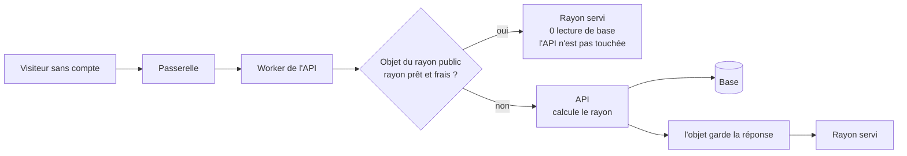
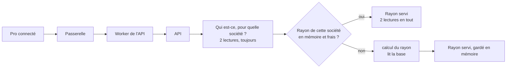
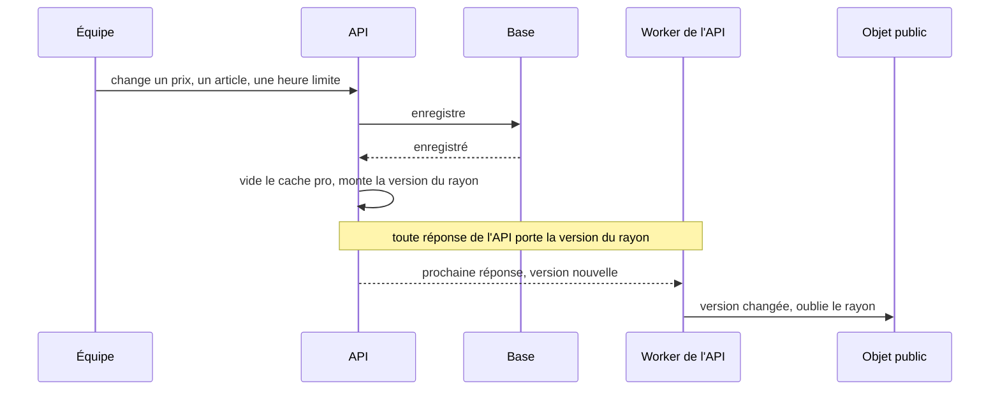

# Première visite rapide et pas chère — le cache du catalogue

> 📝 **Plan, rien n'est bâti.** Réécrit le 2026-11-04 après la première
> contradiction de `vitruve` (trois BLOQUANT : le plan se contredisait sur
> l'endroit du cache, un objet par société ne peut pas recevoir la requête
> avant la résolution des droits, et `lint:cache-control` ne voit pas le Worker
> de l'API). Touche les prix affichés et une frontière de sécurité (un cache
> partagé ne doit jamais servir un appelant à un autre) : seconde contradiction
> avant Hugo.

# Partie 1 — Comprendre

## Pourquoi

La base de production (Prisma Postgres) est **facturée à l'opération**. Une
visite de la boutique coûte aujourd'hui 6 lectures pour un visiteur et 12 pour
un pro, **même quand rien n'a changé**. La cible : une station de ski côté
particuliers, et 200 à 1 000 pros qui commandent aux mêmes heures.

## Deux caches, parce que deux sortes de visiteurs

- **Le public** (visiteur sans compte) : tout le monde voit **le même rayon**.
  On peut le garder tout prêt **devant** l'API : la visite ne réveille pas
  l'API et ne lit pas la base.
- **Le pro** : chaque société voit **son** rayon (sa mercuriale, ses
  engagements, ses articles réservés). Avant de le servir, il faut vérifier
  **qui** demande et **pour quelle société** — et seule l'API le sait, en
  base. Son cache vit donc **dans** l'API, après cette vérification.

### Le chemin d'un visiteur

Une visite **avec un jeton** ne passe jamais par l'objet public : elle va
directement à l'API, même sur la route publique.

### Le chemin d'un pro

Les deux lectures de droits ne s'économisent pas : c'est ce qui bloque tout de
suite un compte désactivé.

### Comment un changement arrive dans les caches

Et ce qui change **sans que personne n'écrive** — une promotion qui s'ouvre à
midi, une opération datée, l'heure limite — est rattrapé par une **durée de
vie courte** : un rayon n'est jamais gardé plus de quelques dizaines de
secondes.

## Ce qui rend une erreur sans conséquence

Le rayon n'est qu'une **vitrine**. Le panier recalcule toujours au vrai prix,
et la commande refuse un total que le client n'a pas vu. Un rayon vieux de
quelques secondes peut **afficher** un prix dépassé ; il ne peut pas le
**facturer**.

Ce qui, en revanche, serait grave : servir le rayon d'une société à une autre.
C'est pour ça que le pro ne passe jamais par l'objet public.

# Partie 2 — Le plan

## 1. Ce qui est vérifié dans le dépôt (2026-11-04)

- la boutique est **statique** (`angular.json`, `ssr: false`) : une visite
  paie le catalogue une fois, au chargement ;
- l'API est un Cloudflare Container (`apps/lfd-api/wrangler.jsonc`,
  `max_instances: 1`), **tenu chaud** par le cron `*/5` (`keepWarm` dans
  `container/worker.ts`, qui frappe `/health`) malgré `sleepAfter = "1h"` ;
  le Worker de l'API n'a pas d'adresse publique (`workers_dev: false`) ;
- la passerelle sert toute la zone `lafoliecoffee.info/*`
  (`gateway/wrangler.toml`), et rejoint l'API par service binding ;
- le Worker de l'API déclare **déjà** un Durable Object : le conteneur
  (`Backend extends Container`, `BACKEND`, `new_sqlite_classes`) ;
- **toute** requête vers le conteneur traverse le Worker de l'API, y compris
  le `keepWarm` toutes les cinq minutes ;
- `GET /shop/catalogue` est `@Public()` mais **reconnaît** un appelant qui
  porte un jeton (`shop-catalogue-pricing.service.ts`, `recognised`) : la même
  route sert un rayon personnel ;
- la boutique ne se rafraîchit jamais seule (seule `shop-clock.ts` avance
  chaque minute).

## 2. La mesure

Sonde e2e jetable du 2026-11-04, opérations ORM par appel (froid / chaud) :
`GET /shop/catalogue` visiteur 11 / 6 ; `?audience=pro` 6 / 6 ;
`GET /shop/featured?audience=pro` 3 / 3 ; `GET /shop/catalogue/mine` pro
13 / 12, perso 8 / 8. À chaud, le visiteur relit `CatalogItem` trois fois,
`CatalogOperation`, `OrderCutoff` et l'estampille `PricingEvent`. Le pro relit
en plus `User`, `Company` (deux fois), `CompanyFollow`, `VolumeCommitment`,
`CompanyMercuriale`.

**Étape 0, avant de bâtir** : mesurer sur **dev déployé** où partent les
secondes d'une première visite (page statique, conteneur, appels à l'API), et
le nombre de visites publiques d'une journée réelle.

## 3. Le public — un Durable Object devant le conteneur

- **Où** : une seconde classe de Durable Object dans le Worker de l'API
  (`container/worker.ts`), à côté de `Backend`. Le Worker y adresse une requête
  **seulement si** elle est un `GET` d'une route publique admise
  (`/shop/catalogue`, `/shop/featured`) **et** ne porte ni `Authorization` ni
  cookie de session. Toute autre requête va au conteneur, inchangée.
- **Clé** : la route et ses paramètres qui changent la réponse (audience,
  langue). La liste des paramètres admis est écrite, pas déduite : un paramètre
  inconnu fait passer la requête au conteneur.
- **La clé chaude** : tous les visiteurs tombent sur la même clé. On la
  **duplique** sur N objets identiques (N à mesurer, 8 pour commencer), un tiré
  au hasard par visite. Un objet traite une requête à la fois.
- **Ce qu'il garde** : le corps et les en-têtes de la réponse du conteneur, sa
  version de rayon (§5) et son heure. Il repose lui-même `Cache-Control:
private, no-cache`, l'en-tête qu'un visiteur reçoit aujourd'hui
  (`cache-control-by-default.middleware.ts`).
- **Mémoire perdue** : un objet endormi oublie ; il redemande au conteneur. La
  justesse n'en dépend pas.
- **Alternative écartée pour l'instant** : le cache de Cloudflare (CDN). Il ne
  connaît pas la version du rayon, donc il ne se purge que par l'API de purge,
  avec un secret de plus.

## 4. Les pros — en mémoire du conteneur, par société

- **Où** : dans le conteneur, **après** `AuthGuard` et `@ActingCompany`, dans
  le service du rayon. La clé est `companyId` tel que la résolution en base l'a
  rendu (`null` pour l'espace perso), jamais une valeur du client.
- **Ce qu'il économise** : la société, son suivi, son engagement, sa
  mercuriale, le catalogue. Restent les deux lectures de droits.
- **Pourquoi pas un objet par société** : on n'a qu'une instance
  (`max_instances: 1`), donc la mémoire du conteneur est déjà partagée par
  toutes les requêtes ; et un objet devant le conteneur ne peut pas savoir
  quelle société sert un pro. On y reviendra avec plusieurs instances, et il
  faudra alors établir qu'un conteneur peut joindre un Durable Object.
- `/mine` ignore la langue (`my-shop-catalogue.controller.ts`) : déjà le cas
  aujourd'hui, la clé n'en a donc pas besoin. À dire, pas à corriger ici.

## 5. La purge — une version du rayon

- Le conteneur tient une **version du rayon**, en mémoire, qu'il **monte après
  la validation** de toute écriture qui change un rayon. Après, et non pendant :
  sinon une lecture concurrente remplit le cache avec l'état d'avant, et le
  garde (le geste de `PricingActWriter` pour le cache des prix).
- Monter la version vide aussi **tout** le cache pro : une réservation ou un
  statut de société change le rayon des **autres** sociétés et du public
  (`catalog-viewers.service.ts`), et vider tout est plus sûr que d'énumérer.
- Le conteneur pose la version sur **chaque réponse** (un en-tête interne). Le
  Worker de l'API la lit au passage et prévient les objets publics si elle a
  changé ; il retire l'en-tête avant de répondre. Comme le `keepWarm` passe
  toutes les cinq minutes, une version change atteint les objets au pire en
  cinq minutes, et dès la prochaine requête en pratique.
- ⚠️ Au redémarrage du conteneur, la version repart de zéro : elle se compose
  donc avec un **identifiant d'instance**, pour qu'une version neuve ne soit
  jamais prise pour l'ancienne.

### Les écritures qui doivent monter la version

Relevé par recherche des écritures Prisma sur les modèles que le rayon lit
(2026-11-04) — **une recherche, pas une preuve** ; la porte du § 7 la tient :

| Ce qui change           | Où ça s'écrit                                                                                                                                                                                                                                                                                                                                                          |
| ----------------------- | ---------------------------------------------------------------------------------------------------------------------------------------------------------------------------------------------------------------------------------------------------------------------------------------------------------------------------------------------------------------------- |
| prix, promotions        | `PricingActWriter` (point unique, couvre aussi l'estampille du cache des prix)                                                                                                                                                                                                                                                                                         |
| articles du catalogue   | `b2b/catalog/infrastructure/` : `prisma-catalog-item.repository.ts`, `catalog-decision-writes.ts`, `catalog-review-states.ts`, `prisma-catalog-order-limits.ts`, `prisma-catalog-product-facts.projection.ts`, `prisma-catalog-visuals.projection.ts`, `prisma-catalog-category.projection.ts`, `prisma-catalog-price-retracer.ts`, `prisma-made-to-order-settings.ts` |
| réservations d'articles | `prisma-catalog-reservations.ts`                                                                                                                                                                                                                                                                                                                                       |
| opérations datées       | `b2b/operations/infrastructure/prisma-operation.repository.ts`                                                                                                                                                                                                                                                                                                         |
| heures limites          | `b2b/order-cutoffs/infrastructure/prisma-general-order-cutoff.repository.ts`                                                                                                                                                                                                                                                                                           |
| statut d'une société    | `b2b/account/infrastructure/prisma-company.repository.ts`                                                                                                                                                                                                                                                                                                              |

À compléter avant de bâtir : prix au kilo, offres d'acheminement, traductions,
et le suivi (`CompanyFollow`) d'un pro.

Piste à évaluer : le balayage de la **vitrine** (`admin/vitrine/sweep`, sur le
cron `*/5`) compare déjà la vue publique à sa dernière empreinte. Il ne tourne
que pour des abonnés allumés, et compare par empreinte, pas par écriture : il
ne remplace pas la version, il pourrait la vérifier.

## 6. La durée

Ce qui change sans écriture n'est rattrapé que par la durée : **30 secondes**
proposées, à trancher. La durée se calcule sur `Clock.now()` dans le conteneur
(`lint:clock-port`) ; dans le Worker de l'API, hors de `src/`, sur l'horloge du
Worker — ce que `lint:clock-port` ne voit pas, à écrire.

## 7. Les portes

- **`lint:cache-control`** ne parcourt que `apps/lfd-api/src` et `gateway/src`.
  Elle doit gagner `apps/lfd-api/container/`, avec une liste admise datée : la
  classe de l'objet public et la condition « pas de jeton, pas de cookie ».
- **Une porte des écritures du rayon** : tout fichier qui écrit un modèle lu
  par le rayon passe par le port qui monte la version. Même forme que
  `lint:prisma-model-ownership` : la liste des modèles dérivée, pas recopiée.

## 8. Le coût

À chiffrer sur la grille Cloudflare en vigueur, pas de mémoire : une requête et
la durée d'un objet par visite publique, contre les 6 opérations Prisma
évitées. Les pros ne coûtent rien de plus (mémoire du conteneur).

## 9. Les lots

| Lot | Contenu                                                                                                  |
| --- | -------------------------------------------------------------------------------------------------------- |
| C0  | la mesure sur dev déployé, et le coût                                                                    |
| C1  | la version du rayon : le port, les écritures, la porte des écritures, l'en-tête sur chaque réponse       |
| C2  | le cache pro en mémoire du conteneur, vidé par la version et la durée ; budget froid / chaud à l'égalité |
| C3  | l'objet public dans le Worker de l'API, dupliqué ; `lint:cache-control` étendue                          |
| C4  | la boutique relit le rayon au retour sur l'onglet                                                        |

Chaque lot a ses tests : une promotion qui se ferme n'est plus servie après la
durée ; une écriture de prix vide l'entrée ; une requête avec jeton ne touche
jamais l'objet public ; une réservation change le rayon des autres sociétés.

## 10. Ce que ce plan ne fait pas

- la passation (50 à 80 opérations) et le devis : autre chantier ;
- le réveil du conteneur après un déploiement : à décider après la mesure C0.

## 11. Non vérifié

- qu'un objet tiré au hasard parmi N suffit à la pointe : à mesurer ;
- la liste complète des écritures (§5) ;
- que le rayon public filtre bien les articles réservés : inféré de
  `catalog-viewers.service.ts`, pas tracé jusqu'au filtre ;
- le coût d'un Durable Object (§8).
