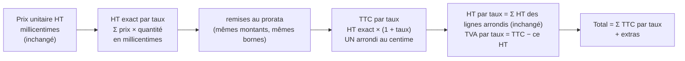

# Plan — un particulier paie la somme des étiquettes

> 📝 **Plan, rien n'est bâti** (2026-10-27). Il répond à
> [`ecart-du-centime-particuliers.md`](ecart-du-centime-particuliers.md), dont il
> reprend le diagnostic sans le recopier, et propose une autre piste que le
> « TTC d'abord » retiré le 2026-10-09. Relu par `vitruve` le 2026-10-27 :
> trois objections bloquantes, intégrées ci-dessous et listées au § 9.
>
> 🔴 **Le pro n'est pas touché.** Aucune fonction qu'un panier ou une commande
> pro traverse ne change de résultat ; un test le fige (§ 7, lot C3).

## 1. Le constat du jour

Banana bread, étiquette **21,00 € TTC**, taux 5,5 %. La boutique affiche, le
panier totalise et Stripe prélève **21,01 €**.

| Étape                                  | Valeur         |
| -------------------------------------- | -------------- |
| HT dérivé (`htMillicentsOf`)           | 19,90521 €     |
| HT de ligne arrondi (`lineTotalCents`) | 19,91 €        |
| TVA sur l'assiette (`ventilateVat`)    | 1,095 → 1,10 € |
| Total                                  | **21,01 €**    |

Sous le calcul actuel, **21,00 € est inatteignable** à 5,5 % : un HT de 19,90 €
donne 20,99 €, un HT de 19,91 € donne 21,01 €. La cause est un **premier
arrondi** du HT au centime, avant que la TVA ne soit remise dessus.

## 2. Ce que dit le droit (recherche du 2026-10-27, à faire confirmer)

Recherche faite sans le cabinet, à sa place, sur demande de Hugo. Elle ne
remplace pas un avis : elle dit ce qu'on a trouvé et ce qu'on n'a pas trouvé.

- **L'arrondi n'est pas fixé par le droit de l'Union.** CJCE, 10 juillet 2008,
  _Koninklijke Ahold_ (C-484/06) : la règle d'arrondi relève des États membres,
  sous réserve de la neutralité et de la proportionnalité.
- **Le droit français n'impose pas, à notre connaissance, une méthode
  d'arrondi** (ligne par ligne ou sur l'assiette). Le BOFiP
  (`BOI-TVA-DECLA-30-20-20-10`, § 260 à 320) exige, **sur une facture**, le
  taux sur chaque ligne et, **par taux**, le total HT et la taxe
  correspondante ; il ne dit rien des centimes. Aucune page officielle trouvée
  sur ce point.
- **Le commerce de détail calcule déjà sa TVA « en dedans ».** Le BOFiP décrit
  la ventilation des **recettes TTC** des commerçants dont les ventes au
  comptant ne donnent pas lieu à facture (`BOI-TVA-DECLA-30-10-20`, méthodes
  A, B, C ; art. 268 bis du CGI) : la taxe se dérive de la recette TTC, pas
  l'inverse. C'est la situation d'une vente à un particulier.
- **Le prix affiché est TTC** (Code de la consommation, L112-1 et suivants ;
  arrêté du 3 décembre 1987). Prélever 21,01 € pour une étiquette à 21,00 €
  est un écart entre le prix annoncé et le prix payé — c'est le risque à
  fermer, plus que l'arrondi de TVA lui-même.
- **L'e-reporting B2C** (à partir du 1ᵉʳ septembre 2027 pour une TPE/PME) ne
  demande que des **agrégats** : total HT et TVA par taux sur la période. Il
  ne recalcule pas la TVA ligne à ligne.

**Conclusion retenue pour ce plan** : **aucune interdiction trouvée** de
calculer la TVA d'une vente à un particulier de façon à ce que le total payé
égale la somme des étiquettes. ⚠️ La ventilation des recettes des détaillants
est une **analogie**, pas un fondement : elle sert à ceux qui ne savent pas
ventiler leurs recettes par taux, pas au calcul d'une vente identifiée ligne à
ligne. Et le système **n'émet aucune facture** à un particulier aujourd'hui
(`card-invoicing.ts` : une commande publique rend `not_card`) — on ne peut donc
pas s'appuyer sur ce qu'une facture afficherait. ⚠️ **À faire confirmer par le cabinet avant
la mise en production** (§ 8, Q1) — la recherche n'a trouvé aucune interdiction,
elle n'a pas trouvé non plus d'autorisation écrite.

## 3. La piste : garder le HT exact jusqu'à la TVA

Le plan retiré le 2026-10-09 inversait le calcul (partir du TTC, déduire le
HT). `vitruve` y avait trouvé trois objections bloquantes : pas de TTC exact
quand une promotion agit, des gardes de commande calculées sur le HT des
lignes, et une règle commerciale à trancher pour les remises en pourcentage.

Celui-ci **n'inverse rien**. Il retire seulement le premier arrondi, pour la
clientèle `public` :

🔴 **Le HT par taux reste Σ des HT de lignes arrondis**, exactement
comme aujourd'hui (`Order.draft` fige `subtotalCents = Σ lineTotalCents`, et
tous les lecteurs le relisent). Seule la TVA change : elle devient **la
différence** entre le TTC arrondi une fois et ce HT. L'en-tête de la commande
se recompose donc toujours : HT + TVA = TTC. Prendre « l'arrondi du HT exact »
comme HT par taux casserait cette égalité (`vitruve`, objection 1 : trois
articles à 0,50 € → Σ lignes 1,41, HT exact arrondi 1,42, TTC 1,50).

Le prix à payer : la TVA n'est plus toujours égale au HT × taux arrondi. Sur
l'exemple ci-dessus, 1,41 € HT et 0,09 € de TVA, quand 1,41 × 5,5 % = 0,078.
C'est ce point, et lui seul, que le cabinet doit valider (§ 8, Q1).

⚠️ **L'écart n'est pas borné à un centime** (mesuré le 2026-10-27 sur 4 000
paniers, `vat-exact-discounts.spec.ts`) : la TVA absorbe l'arrondi de chaque
ligne, soit jusqu'à **1 c + 0,5 c par ligne du taux**, plus 1 c par terme
réparti entre les taux (remise retrait, bon, port qui suit). Écart observé :
2 c à quatre lignes d'un même taux. Une commande de dix lignes à 5,5 % peut
porter une TVA à ~6 c de HT × taux. C'est cet ordre de grandeur, et non « un
centime », qu'il faut soumettre au cabinet.

Sur le banana bread : 19,90521 × 1,055 = 20,999997 → **21,00 €** ; HT 19,91 €,
TVA **1,09 €**. Sur les deux croissants du 2026-10-09 : 1,800948 + 0,473934 =
2,274882 HT exact, × 1,055 = 2,399999 → **2,40 €** ; HT 2,27, TVA 0,13.

Pourquoi ça retombe sur l'étiquette : le HT dérivé d'une étiquette est arrondi
au **millième de centime** ; l'erreur TTC par pièce est ≤ 0,0006 centime, et
le demi-centime n'est atteint qu'au-delà de **~830 pièces à 20 %** (~950 à
5,5 %) au même taux.

⚠️ **La promesse se limite aux étiquettes non altérées.** Sous un prix barré,
une promotion en pourcentage ou un plancher, le HT résolu est arbitraire et
l'étiquette affichée n'en est qu'un arrondi : trois pièces à −12,35 % sur
21,00 € font 55,22 € payés pour 3 × 18,41 = 55,23 € d'étiquettes. L'écart
reste d'un centime au plus par ligne, et il est cohérent entre la ligne du
panier, le total et le prélèvement — il n'est pas supprimé.

### Ce que ça règle des objections du 2026-10-09

| Objection (§ 5 et § 8 du diagnostic)      | Réponse de cette piste                                                                                                                                                                                                                                                                                                                       |
| ----------------------------------------- | -------------------------------------------------------------------------------------------------------------------------------------------------------------------------------------------------------------------------------------------------------------------------------------------------------------------------------------------- |
| Pas de TTC exact sous promotion ou palier | Il n'en faut pas : on part du HT résolu, quel qu'il soit. Le TTC est celui de ce HT, arrondi une fois.                                                                                                                                                                                                                                       |
| Gardes de commande sur Σ HT des lignes    | Inchangées : elles continuent de lire `lineTotalCents` des lignes. Seule la ventilation finale change.                                                                                                                                                                                                                                       |
| Remise en pourcentage : sur HT ou TTC ?   | Question évitée : les montants de remise restent ceux d'aujourd'hui, calculés et bornés de la même façon. **Une seule règle ajoutée** : un bon ou une remise qui couvre tout le net HT des lignes met le TTC des marchandises à zéro (sinon le reliquat exact donnerait 0,01 € à prélever, sous le minimum Stripe — `vitruve`, objection 2). |
| Le pro qui commande en perso              | La commande porte déjà `clientele` ; c'est elle qui choisit la méthode, pas le compte.                                                                                                                                                                                                                                                       |
| Aucun marqueur de méthode sur la commande | Une colonne `vat_method` (§ 5), additive ; les commandes passées sont marquées `line_ht` et gardent leurs montants figés.                                                                                                                                                                                                                    |
| Retourner la décision du 2026-09-21       | Retournée **pour le seul `public`**. `chemin-du-prix-public.md`, le test de `vat.spec.ts` et le JSDoc de `ttcCentsOf` sont mis à jour (lot C4).                                                                                                                                                                                              |

## 4. Ce qui change, endroit par endroit

| Endroit                                                                                                                               | Particulier                                                                                                                  | Pro                      |
| ------------------------------------------------------------------------------------------------------------------------------------- | ---------------------------------------------------------------------------------------------------------------------------- | ------------------------ |
| `@lfd/money` : nouvelle `ventilateVatExact` à côté de `ventilateVat`                                                                  | lignes en millicentimes, un arrondi par taux                                                                                 | non lue                  |
| Vignette, fiche, prix barré (`shop-catalogue-view.ts:75`, `shop-catalogue-pricing.service.ts:240`)                                    | `ttcCentsFromHtMillicents(prix, taux)` au lieu de `ttcCentsOf(lineTotalCents(prix, 1), taux)`                                | voir § 6                 |
| Devis du panier (`shop-cart-quoting.service.ts`) : lignes et total                                                                    | `ventilateVatExact`                                                                                                          | inchangé                 |
| `computeOrderTotals` (`b2b/orders/domain/services/vat.ts`) → `Order.draft`, révision                                                  | choisit selon `clientele`                                                                                                    | inchangé                 |
| `OrderLine` (`order-line.ts:160-161`) : TTC scellés                                                                                   | `ttcCentsFromHtMillicents`, un arrondi                                                                                       | `null` comme aujourd'hui |
| `voucher-total-effect.ts`                                                                                                             | même méthode que le total                                                                                                    | inchangé                 |
| Facture et dossier (`invoice-order-split.ts`, `invoice-dossier.ts`, `invoiceVatBreakdown`, Factur-X)                                  | **hors du plan** : aucune facture n'est émise à un particulier (`card-invoicing.ts`) ; ce code n'est traversé que par le pro | **non touché**           |
| BL partiel (`delivery-note-terms.ts:173` `composePartial` → `computeOrderTotals` ; `departing-source.ts:61` rescelle un TTC de ligne) | **recalculent** : lisent `vat_method` de la commande et prennent la même méthode                                             | inchangé                 |
| Bon de commande PDF (`order-sheet-pdf-totals.ts`)                                                                                     | à ouvrir au lot C1 : s'il additionne des TTC de lignes, il suit la méthode                                                   | inchangé                 |
| Aperçu TTC du rayon au back-office (`shelf-catalogue.ts:192-202`)                                                                     | même fonction que la vitrine publique, sinon le staff voit 21,01 où la boutique dit 21,00                                    | —                        |
| Avoir de remboursement (`refund-credit-note.ts`), cohérence (`invoice-order-consistency.ts`)                                          | à ouvrir au lot C1 : un avoir partiel d'une commande publique ne doit pas recalculer par l'ancienne méthode                  | —                        |
| Montant Stripe (`place-shop-order.handler.ts`)                                                                                        | `order.totalCents`, donc corrigé par construction                                                                            | —                        |

⚠️ Cette liste est celle des appelants trouvés le 2026-10-27 dans
`apps/lfd-api` par `grep`, **complétée par `vitruve`** (BL partiel,
back-office, `invoiceVatBreakdown`, e2e `devis-comptable` et
`catalog-fixture`). Le premier relevé avait oublié les fronts. Le lot C1 la
refait **sur tout le dépôt**, fronts et e2e compris, avant d'écrire.

## 5. Le marqueur de méthode

Migration **additive** : `orders.vat_method` (`line_ht` | `exact_ht`).
Ajoutée nullable, **remplie** à `line_ht` pour toute commande existante, puis
passée non nulle **sans défaut** : un chemin qui crée une commande sans passer
par `Order.draft` (`test/factories.ts`, le semis de dev) échoue au lieu de
recevoir `line_ht` en silence.

La méthode se décide **une fois, dans `Order.draft`**, depuis la clientèle que
`draft` dérive déjà (`clienteleOf`, `order-fulfillment.ts`) ; elle est ensuite
**relue** de la colonne, jamais redérivée de `clientele` (nullable) à la
réhydratation.

Une révision garde la méthode de la commande qu'elle révise. ⚠️ Cas presque
vide aujourd'hui : `Order.revise` refuse une commande réglée par carte, et une
commande publique l'est (ou est gratuite).

🔴 **Irréversible dans les faits** : dès la première commande `exact_ht`
prélevée, la colonne et les deux méthodes sont permanentes. Tout lecteur
futur qui recalcule un montant (avoir, BL, comptabilité) devra brancher sur
`vat_method`.

## 6. Qui voit quel calcul : l'espace de travail

Relu le 2026-10-27, sur indication de Hugo. La boutique déclare l'**espace de
travail** choisi (perso ou une société) sur chaque requête, par l'en-tête
`WORKSPACE_HEADER` (`client-workspace.interceptor.ts`). Le guard le confronte
aux rattachements (`auth.guard.ts`, `declaredCompany` → `resolveCompany`) et
les routes reçoivent la société agissante par `@ActingCompany()` : `null` dans
l'espace perso, l'identifiant de la société sinon.

Cette société est **déjà** ce qui choisit les prix :

- la vitrine : `ShopCataloguePricing.priced` déduit l'audience — `companyId
=== null ? "public" : "pro"` — au seul endroit où elle se déduit, puis
  `pricedFor(audience, …)` ;
- le devis du panier et le panier (`my-shop-quote.controller.ts`,
  `shop-cart.controller.ts`) reçoivent la même société ;
- la commande dérive sa clientèle de la même façon (`clienteleOf(companyId)`,
  `order-fulfillment.ts`).

**La méthode de calcul suit donc l'espace, sans rien ajouter** : on lit
l'`audience` déjà déduite dans `pricedFor`. Un pro qui bascule dans son espace
perso voit le calcul particulier, comme il y voit déjà le prix d'étiquette ; la
vitrine pro sans jeton (`?audience=pro`, `pricedWithoutCompany`) garde le
calcul pro. Aucun chiffre ne bouge dans un espace société.

## 7. Les lots

| Lot | Contenu                                                                                                                         | Tests                                                                                                                          |
| --- | ------------------------------------------------------------------------------------------------------------------------------- | ------------------------------------------------------------------------------------------------------------------------------ |
| C1  | `ventilateVatExact` dans `@lfd/money`, sans appelant ; relevé des appelants                                                     | banana bread 21,00 ; croissants 2,40 ; deux taux ; remise retrait ; bon ; port qui suit                                        |
| C2  | Migration `vat_method` ; `computeOrderTotals`, `OrderLine`, devis, effet du bon choisissent selon `clientele`                   | e2e : panier public 21,00 € = commande = montant Stripe ; révision garde sa méthode                                            |
| C3  | Vignette, fiche, prix barré (public seulement), aperçu du rayon au back-office ; BL partiel suit `vat_method`                   | **panier pro figé** : HT, TVA, total identiques au centime avant/après sur un jeu de 20 paniers ; BL partiel public = commande |
| C4  | Doc : `chemin-du-prix-public.md`, `ecart-du-centime-particuliers.md` → doc d'état, JSDoc de `ttcCentsOf`, test de `vat.spec.ts` | `pnpm test` racine (`packages/money` bouge)                                                                                    |

## 8. Questions ouvertes

**Décidé par Hugo le 2026-10-27** : « on sépare le calcul particulier ». Le pro
garde sa méthode — HT de ligne arrondi une fois, TVA une fois par taux sur
l'assiette, celle que rejoue la règle BR-S-08 d'EN 16931 — et le particulier
prend la sienne. Le lot C1 démarre ; la mise en production attend Q1.

- **Q1 — le cabinet** : confirmer § 2. Le plan peut être bâti avant ; il ne se
  déploie pas en production sans cette confirmation, ou sans décision écrite
  de Hugo de l'assumer.
- **Q2 — facture d'un particulier** : aucune n'est émise aujourd'hui. Le jour
  où elle existera, elle relira HT et TVA par taux figés sur la commande, sans
  recalculer.

## 8 bis. Lot C1 — bâti le 2026-10-27

`ventilateVatExact` (`packages/money/src/vat-exact.ts`), **sans appelant** ;
`ventilateVat` n'a pas bougé et un test le fige (`vat-frozen.spec.ts`).

Deux précisions que le plan ne donnait pas, prises au bâti — à relire :

- **Une remise sur plusieurs taux** : le net HT d'un taux n'est plus un
  nombre entier de centimes. Le découpage reprend celui que la facture tient
  déjà (`splitOrderByRate`, plus fort reste) ; HT du taux = brut arrondi −
  parts des remises + parts des extras ; l'en-tête se recompose (testé).
  Risque théorique non observé : une part de TVA à ±1 centime sur un résidu
  infime.
- **Une remise bornée au HT arrondi qui dépasse le net exact** : l'assiette
  passe à zéro, jamais négative (généralise B2).

Relevé des fichiers que `vitruve` n'avait pas ouverts : le montant Stripe est
`order.totalCents` sans comparaison au devis (corrigé par construction en
C2) ; avoir, cohérence de facture et bon de commande PDF ne recalculent pas la
TVA. `read-my-shop-catalogue.ts` ne reçoit qu'un `companyId` : c'est l'espace de
travail, et il suffit (§ 6).

## 9. Relecture `vitruve` (2026-10-27)

Calculs chiffrés recalculés et confirmés (21,00 ; 2,40). Objections et sort :

| Objection                                                                      | Sort                                                                   |
| ------------------------------------------------------------------------------ | ---------------------------------------------------------------------- |
| **B1** « HT par taux = arrondi du HT exact » casse HT + TVA = TTC de l'en-tête | Corrigée : le HT reste Σ des lignes, la TVA est la différence (§ 3)    |
| **B2** un bon qui solde laisse 0,01 € à prélever                               | Corrigée : couverture totale ⇒ TTC des marchandises à zéro (§ 3)       |
| **B3** le BL partiel recalcule (`composePartial`, `departing-source`)          | Corrigée : il suit `vat_method` (§ 4, C3)                              |
| S4 appelants oubliés (back-office, `invoiceVatBreakdown`, e2e)                 | Ajoutés ; C1 refait le relevé sur tout le dépôt                        |
| S5 toucher facture et dossier expose le pro pour rien                          | Corrigée : retirés du plan                                             |
| S6 la promesse ne tient pas sous promotion                                     | Assumée et dite : limitée aux étiquettes non altérées (§ 3)            |
| S7 borne d'erreur « ~1 000 »                                                   | Corrigée : ~830 à 20 %                                                 |
| S8 défaut de migration, irréversibilité, révision, source de la clientèle      | Corrigées (§ 5)                                                        |
| S9 le § 2 sur-affirme                                                          | Corrigé : « aucune interdiction trouvée », l'analogie dite comme telle |

**Non vérifié par `vitruve`, à ouvrir au lot C1** : `place-shop-order.handler.ts`
(le devis est-il comparé au total avant Stripe ?), `read-my-shop-catalogue.ts`,
`refund-credit-note.ts`, `invoice-order-consistency.ts`, le bon de commande
PDF.
