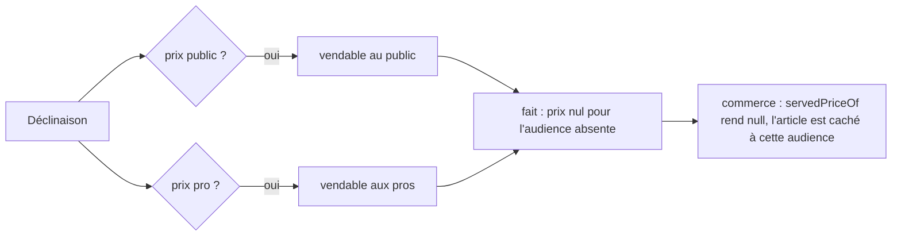

# Plan — un prix manquant ne retire plus la fiche

> ✅ **Bâti le 2026-10-27 (non commité)** — lots P1 à P4. Ce qui a changé par
> rapport au texte ci-dessous :
>
> - **L'audience de la famille entre dans le jugement de la fiche.**
>   `productCompliance`, `activationGaps` et les méthodes de `Product`
>   (`activate`, `complianceWith`, `activationGapsWith`, `isActivatableWith`)
>   prennent `categoryAudience` ; la fiche en tire son audience effective
>   (dérogation, sinon famille). `ActivateProductHandler` et
>   `ListProductComplianceWarningsHandler` lisent donc désormais la famille
>   (`CategoryRepository`). La migration se nomme
>   `20261027170000_un_prix_pro_manquant_ne_retire_plus_l_article`.
> - **Plus de lecteurs que la liste du §3 P3** : le contrat admin
>   `CatalogAdminItemView.pimPriceMillicents` (`@lfd/contracts`) devient
>   nullable, l'export CSV laisse la cellule vide et dit « Sans prix pro », la
>   vue « Catalogue publié » met la cellule pro en `incomplet`, et le rayon du
>   back-office (`shelf-catalogue.html`) montre un badge « sans prix pro ».
>   L'upsert en SQL brut écrivait déjà `NULL` pour une valeur nulle ; un test
>   le fige.
> - **P4** : `findingText` vit dans `pim/catalogue/product-compliance.ts`, pas
>   sous `products-page/`. Le libellé ajoute le geste de sortie (« Saisissez-le
>   dans la section « Tarif » »).
> - **E2E** : la suite « catalog-parity » nommée au §5 n'existe pas (2026-10-27) ; les cas
>   à moitié tarifés sont dans `catalog-ingest.e2e-spec.ts`.

> 📝 Plan du 2026-10-27, décision de Hugo du même jour : « prix pro manquant ne
> devrait pas être bloquant en effet mais indiqué dans la table si audience les
> deux et pas de prix public ou pro ». Touche l'argent et une migration :
> contredit par `vitruve` le même jour — ses deux bloquants et quatre sérieux
> sont repris au §6, corrigés.

## 1. Le constat (lu dans le code le 2026-10-27)

- Le référentiel juge une déclinaison **incomplète** dès qu'il lui manque le
  prix public (`PRICE_GAP`) **ou** le prix pro (`PRO_PRICE_GAP`) —
  `pim/catalogue/product/domain/services/variant-completeness.ts:76-84`. La
  projection l'écarte du fait (`channels/b2b-platform/products/catalog-facts.ts`,
  `projectProductFact`, `gaps[sku]`), et `sellableVariant` lève si l'un des deux
  manque.
- Le commerce retire alors l'article **partout** (`withdrawOthers`), même pour
  l'audience qui a un prix. C'est ce qui a vidé le catalogue local quand le prix
  pro est passé en « saisi » (lot R3).
- Le fil exige les deux prix : `priceMillicents` (pro HT) et `publicTtcCents`
  sont requis dans `packages/catalog-sync/src/snapshot.ts` (`syncVariantSchema`),
  que le fait `catalog_product.changed` reprend.
- En base commerce, `catalog_items.price_millicents` est `NOT NULL` ;
  `public_ttc_cents` et `public_by_context` sont nullables.
- La boutique sait déjà ne pas servir un article sans prix pour un lecteur :
  `servedPriceOf` (`b2b/catalog/infrastructure/prisma-catalog.reader.ts`) rend
  `null`, et `null` écarte l'article — il ne l'invente jamais gratuit.

## 2. La règle

Une déclinaison est **vendable** dès qu'elle a le prix d'**au moins une** des
audiences de sa fiche. Elle se vend à chaque audience **dont elle a le prix**,
et à elle seule :

| Audience de la fiche | Prix public | Prix pro | Vendue à                                 |
| -------------------- | ----------- | -------- | ---------------------------------------- |
| les deux             | oui         | oui      | les deux                                 |
| les deux             | oui         | **non**  | le public seul                           |
| les deux             | **non**     | oui      | les pros seuls                           |
| public               | **non**     | —        | personne (incomplète, comme aujourd'hui) |
| pro                  | —           | **non**  | personne (incomplète, comme aujourd'hui) |
| les deux             | non         | non      | personne (incomplète)                    |

Le prix d'une audience que la fiche ne vise pas n'est jamais exigé.

Le **taux de TVA** reste exigé comme aujourd'hui (`requiredContexts`) : on
n'invente jamais un taux, et ce plan n'y touche pas.

## 3. Ce qui change

### Lot P1 — le fil accepte un prix absent

- `syncVariantSchema` : `priceMillicents` et `publicTtcCents` deviennent
  `.nullable()`. `null` veut dire « pas de prix pour cette audience », jamais
  « gratuit ». La doc du champ le dit. `publicByContext` est vide (`{}`) quand
  le prix public manque.
- Pas de nouvelle version du contrat : élargir à `null` reste lisible par le
  récepteur, qui tourne dans le même processus et se déploie en même temps ; les
  faits déjà stockés portent des nombres et se relisent tels quels.

### Lot P2 — le référentiel publie la déclinaison à moitié tarifée

- `variantGaps` reçoit l'**audience effective** de la fiche et n'émet
  `PRICE_GAP` / `PRO_PRICE_GAP` que si **aucune** audience visée n'a son prix
  (table du §2). Ses autres appelants passent l'audience.
- `sellableVariant` projette `priceMillicents: null` sans prix pro,
  `publicTtcCents: null` et `publicByContext: {}` sans prix public ; il ne lève
  plus que si les deux manquent.
- `productCompliance` gagne un constat **`price_missing_for_audience`**, gravité
  `warning`, quand la fiche vise **les deux** audiences et qu'une déclinaison
  vivante n'a pas l'un des deux prix. Il nomme lequel (`pro` ou `public`). Il ne
  bloque pas l'activation (`activation-gaps.ts` ignore les `warning`).
- Contrat `pim-contracts` (`ingredient.ts`, les constats) : le littéral et sa
  charge.

### Lot P3 — le commerce range un article sans prix pro

- Migration **additive** : `catalog_items.price_millicents` perd son
  `NOT NULL`. Aucune donnée n'est réécrite. Retour arrière : remettre la
  contrainte, possible tant qu'aucune ligne n'est `NULL`.
- `CatalogItem.priceMillicents` devient `number | null` ; le mapping du fait
  (`catalog-fact-mapping.ts`) et les colonnes suivent.
- `servedPriceOf` : prix pro `null` → l'article n'est pas servi aux pros (même
  chemin qu'un taux absent). Rien n'est inventé.
- **Chaque** lecteur de `priceMillicents` sous `src/b2b` est relu — quinze
  fichiers hors tests au 2026-10-27 (recompte de vitruve), dont la trace des
  prix (`catalog-price-trace.ts`, `prisma-catalog-price-retracer.ts`,
  `prisma-canonical-price-history.reader.ts`), les faits produit
  (`catalog-product-facts.ts`, `prisma-catalog-product-facts.projection.ts`),
  la vue publiée, l'admin, l'upsert en SQL brut (`catalog-item-upsert.ts`, que
  le typecheck ne voit pas), la mercuriale, l'export CSV, les bundles et les
  recommandations. Un `null` y vaut « non vendable aux pros », jamais `0`. La
  liste se refait par `grep -rln priceMillicents src/b2b` au moment de bâtir,
  pas de mémoire.
- **La trace des prix saute la ligne** d'un article sans prix pro :
  `catalog_price_history.price_millicents` reste `NOT NULL`, aucune ligne
  « gratuite » n'y entre. Une lecture datée y trouve donc la dernière valeur
  connue avant le trou ; l'article n'étant pas servi aux pros, aucun prix pro
  n'est résolu pour une commande pendant le trou.

### Lot P4 — la table du référentiel le dit

- Back-office PIM : un `case` pour `price_missing_for_audience` dans
  `findingText` (`pim/catalogue/product-compliance.ts` — repointé le 2026-10-27), libellé « Prix pro
  manquant — vendu au public seul » / « Prix public manquant — vendu aux pros
  seuls ». Le filtre des constats le retrouve comme les autres.

- **Commande pro, devis, panier** : le chemin réel est la lecture du
  catalogue servi (`prisma-catalog.reader.ts`, `servedPriceOf` puis le filtre
  `servedTo`), que lisent le devis (`shop-cart-quoting.service.ts`) et la
  passation. Un SKU sans prix pro y est absent pour un pro : refusé comme un
  SKU retiré aujourd'hui. Un panier ou un abonnement qui le portait le voit
  partir comme un article retiré — comportement existant, inchangé.
- **Décisions locales** (`catalog_item_overrides`, colonnes `decided_*`) : plus
  lues depuis le lot D (`catalog-decision-columns.ts`). Une mercuriale sur un
  SKU sans prix pro ne s'applique pas : l'article n'est pas servi.

## 4. Ce qui ne change pas

- Le calcul d'un prix : `resolvePrice` lève toujours sur un prix canonique
  absent ; il ne le reçoit jamais, puisque l'article n'est pas servi.
- Une fiche qui ne vise qu'une audience exige toujours son prix.
- Le taux de TVA.

## 5. Tests

- Domaine PIM : `variantGaps` sur les six lignes du §2 ; `productCompliance`
  émet le constat dans les deux sens, et seulement pour une fiche « les deux ».
- Projection : une déclinaison sans prix pro part avec `priceMillicents: null`.
- Commerce : un article sans prix pro est servi au public, pas aux pros ; un
  article sans prix public est servi aux pros, pas au public ; la commande pro
  d'un tel SKU est refusée comme un SKU non servi.
- E2E : `catalog-ingest` et `catalog-parity` avec une fiche à moitié tarifée.

## 6. Ce que vitruve a relevé (2026-10-27), et la réponse

- **Bloquant — l'historique des prix** (`catalog_price_history`, `NOT NULL`) :
  la trace saute la ligne, §3 P3. Pas de seconde migration.
- **Bloquant — la liste des lecteurs** : elle est désormais bornée par un
  grep au moment de bâtir, §3 P3, et nomme le SQL brut.
- **Irréversible** : dès qu'un fait portant un prix `null` est stocké, un
  retour arrière du code ne le relirait plus. Le retour arrière de ce lot est
  donc **en avant** (corriger, pas revenir), et la colonne garde sa
  contrainte relâchée. Le commentaire de `snapshot.ts` qui justifiait le repli
  de `publicTtcCents` par un `priceMillicents` requis est réécrit, comme le
  JSDoc daté de `variant-completeness.ts` qui citait `NOT NULL`.
- **Le push `catalog-sync`** : référentiel et commerce tournent dans le même
  processus depuis B4 ; émetteur et récepteur changent ensemble.
- **La conformité** : `variantGaps` reçoit l'audience ; un second calcul nommé,
  `missingAudiencePrices(variant, audience)`, rend les audiences visées sans
  prix, et nourrit le constat `price_missing_for_audience`. Le constat
  `variant_incomplete` ne cite plus un prix manquant pour une fiche « les
  deux » dont l'autre prix existe — pas de double ligne.
- **Changement d'audience d'une famille** : `set-category-audience.ts`
  réémet les fiches de la famille (`reemission.productsOfCategories`), donc
  chaque fiche est rejugée par la même règle.
- **Commande pro et mercuriale** : nommées au §3 P3.
