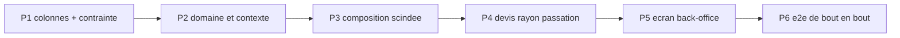

# Plan — les promotions par audience et par acheminement

**Ouvert le 2026-10-30**, à la demande de Hugo : « élargir le modèle de
promotion, qui n'était que B2B, pour paramétrer les audiences, les
acheminements et les segments d'audience ».

**Cas déclencheur** : une promotion de −20 % pour les **particuliers avec
compte** et pour **tous les pros**, sur **tous les acheminements**.

**État : doc-first.** Rien n'est bâti. Le plan touche à l'argent et porte une
migration : `vitruve` est obligatoire avant Hugo (CLAUDE.md §9 bis) — **il n'a
pas encore tourné**.

Toutes les affirmations sur l'existant ci-dessous ont été **ouvertes le
2026-10-30** ; les citations `fichier:ligne` valent à cette date.

---

## 1. L'existant

### 1.1 Les étages et leur ordre

- Quatre étages, ordre déclaré une fois : `mercuriale → volume → promotion →
geste` (`apps/lfd-api/src/b2b/pricing/domain/price-rule.ts:23`).
- `volume` n'est plus écrit en règle, il vient du barème
  (`price-rule.ts:38`, type `AuthoredPriceStage`).
- Une mercuriale **scelle** la chaîne : les étages suivants sont transparents,
  sauf une règle qui porte `stacksOverMercuriale`
  (`apps/lfd-api/src/b2b/pricing/domain/resolve-price.ts:118` ; colonne
  `stacks_over_mercuriale`, `apps/lfd-api/prisma/schema/public/pricing.prisma:73`,
  `false` par défaut). L'option « ne pas cumuler avec une mercuriale »
  demandée **existe donc déjà**, à l'envers : c'est le comportement par défaut.
- Dans un étage, un seul gagnant : `winnerOf`
  (`apps/lfd-api/src/b2b/pricing/domain/specificity.ts:340`), après filtrage par
  `applies` (`specificity.ts:279`, qui teste portée, audience, fenêtre,
  suspension).

### 1.2 L'audience d'une règle

- `PriceAudienceType = "all" | "segment" | "company"` (`price-rule.ts:44`),
  `id` nul ssi `all` (`price-rule.ts:52-56`) ; colonnes `audience_type` /
  `audience_id` (`pricing.prisma:32-34`).
- Rang de spécificité `all 0 < segment 1 < company 2` (`specificity.ts:32-36`) ;
  l'audience prime la portée (commentaire de tête du même fichier).
- `matchesAudience` (`specificity.ts:157-166`) : une commande sans société ne
  peut satisfaire que `all`.
- 🔴 **`segment` est inatteignable** : `pricingContextFor` pose
  `segmentId: null` en dur (`apps/lfd-api/src/b2b/pricing/domain/pricing-context.ts:68`),
  et son JSDoc le dit (« aucune notion de segment n'existe sur `Company` »,
  `pricing-context.ts:35-38`). Aucun modèle `Segment` dans `prisma/schema`
  (grep du 2026-10-30 : seul `ProductAudienceCounter`, `growth.prisma:423`,
  qui est un compteur, pas un groupe).
- `src/b2b/audiences/` n'est **pas** un référentiel de segments : c'est le
  tableau qui décrit la clientèle à partir des commandes
  (`apps/lfd-api/src/b2b/audiences/domain/audience-scope.ts:1-3`, lot A1 de
  `recommandation-produit/plan-audiences.md`).

### 1.3 Ce que porte le contexte

- `PricingAudienceOf = { at, companyId, segmentId }`
  (`specificity.ts:215-219`).
- `PricingParties = { companyId, pricingCompanyId }`
  (`apps/lfd-api/src/b2b/pricing/domain/loaded-pricer.ts:34-37`) ;
  `NO_PARTIES` pour « aucune société » (`loaded-pricer.ts:40`), seule
  fabrique `PricingPartiesResolver.partiesAt`
  (`apps/lfd-api/src/b2b/pricing/application/pricing-parties.resolver.ts:20-25`).
- **Rien ne dit si un particulier est connecté.** Un particulier inscrit et un
  invité arrivent tous deux avec `companyId: null` : l'inscrit passe par
  `POST /orders` (`apps/lfd-api/src/b2b/orders/http/orders.controller.ts:80-83`,
  `@ActingCompany()` nul), l'invité par `place-shop-order.handler.ts:155`
  (`companyId: null`). Et l'invité **a** un `placedByUserId` — une personne
  inscrite à la volée (`place-shop-order.handler.ts:149`) — : la présence d'un
  user ne distingue donc **pas** les deux. Seule la **route** le sait (devis
  anonyme `shop-quote.controller.ts:46` `@Public()` contre devis reconnu
  `my-shop-quote.controller.ts:51-55`, qui porte `buyerUserId`).
- **Rien ne dit l'acheminement.** `OrderComposition.resolve` tarifie les lignes
  (`apps/lfd-api/src/b2b/orders/application/services/order-composition.service.ts:145`)
  **avant** de résoudre l'acheminement (`:159`), et le tarif ne reçoit que
  `parties` (`:262`, `linePricing.resolve(requested, parties, "checkout")`).

### 1.4 La clientèle `pro` / `public` existe déjà ailleurs

- Enum `OrderClientele { pro, public }` (`prisma/schema/public/orders.prisma:59-64`).
- Les **limites** (planchers) ont gagné une clientèle le 2026-09-26, avec une
  contrainte d'exclusion élargie posée « créer puis supprimer »
  (`prisma/migrations/20260926130000_les_limites_ont_une_clientele/migration.sql:9-28`,
  colonne `pricing.prisma:143`). **C'est le précédent à copier.**
- La clientèle d'une requête : `CustomerAudiences.of`
  (`apps/lfd-api/src/b2b/orders/application/services/customer-audiences.service.ts:23-28`)
  → `audienceOf` (`packages/contracts/src/customer-audience.ts:23-25`) : `b2b`
  pour une société **active** seulement, sinon `b2c`. Partagée par devis et
  caisse.
- Le prix de base diffère déjà par clientèle : `servedPriceOf(row, audience)`
  (`apps/lfd-api/src/b2b/catalog/infrastructure/prisma-catalog.reader.ts:282`).

### 1.5 La contrainte d'exclusion

`price_rules_no_overlap`, dernière forme
(`prisma/migrations/20260817210000_cycle_de_vie_et_journal_tarifaire/migration.sql:32-45`) :
`EXCLUDE USING gist (stage =, scope_type =, scope_id =, audience_type =,
audience_id =, min_quantity =, tstzrange && ) WHERE archived_at IS NULL`.
Elle refuse deux règles **identiques** sur la même fenêtre ; elle ne refuse pas
deux règles de publics **qui se recouvrent** (`all` et `company:X`) — c'est
`winnerOf` qui arbitre.

### 1.6 La remise du point de retrait

- Un `PickupDiscount` par point, **une par clientèle** `b2b` / `b2c`
  (`apps/lfd-api/src/b2b/pickup-addresses/domain/pickup-discount.ts:36-40`).
- C'est un **ajustement de panier**, pas un étage : montant en **centimes** sur
  les lignes couvertes, calculé par `CartAdjustments` après le prix des lignes
  (`cart-adjustments.service.ts:67-102`), partagé devis/caisse. Il cumule donc
  toujours avec une promotion (la promotion baisse le prix unitaire, la remise
  s'applique ensuite sur le sous-total couvert).

### 1.7 Le prix barré

- `unitPriceMillicents` est le prix **résolu** pour qui regarde
  (`packages/contracts/src/shop-catalogue.ts:131-141`) ;
  `catalogPriceMillicents` est le tarif à barrer, **vers le bas seulement**, et
  jamais la promo sous mercuriale (`shop-catalogue.ts:225-245`).

---

## 2. Ce qui manque, en une phrase par axe

| Axe                        | Aujourd'hui                                     | Manque                                |
| -------------------------- | ----------------------------------------------- | ------------------------------------- |
| particulier inscrit/invité | indiscernables (`companyId` nul dans les deux)  | un fait « connecté » dans le contexte |
| pro (tous)                 | aucun moyen : `all` vise aussi les particuliers | une audience `pro`                    |
| acheminement               | absent du contexte, résolu après le prix        | méthode + point dans le contexte      |
| segment                    | modélisé, inatteignable                         | ne PAS le bâtir ici (Q4)              |

---

## 3. Le modèle proposé

### 3.1 Deux axes orthogonaux, pas un axe élargi

On **n'ajoute pas** de valeurs à `PriceAudienceType`. On ajoute un axe
**clientèle**, porté à côté de l'audience nominative existante :

- `clientele` — `any | public_guest | public_registered | public | pro`
  (nouvelle colonne, `NOT NULL DEFAULT 'any'`).
- `audience_type / audience_id` — inchangés : `all | segment | company`.
  `segment` et `company` impliquent `pro` ; l'agrégat **refuse** une règle
  `company:X` avec une clientèle `public*` (combinaison inexprimable plutôt que
  vérifiée en aval).

Le cas déclencheur ne tient **pas** en une seule clientèle (`public_registered`
∪ `pro`). Deux options :

- **A — deux règles jumelles** posées d'un geste par l'écran (« Particuliers
  inscrits » + « Pros » cochés → deux lignes, même libellé, même fenêtre, un
  identifiant de lot `campaign_id`). Simple pour la contrainte et la
  spécificité ; le journal les lie par le lot.
- **B — un ensemble** `clienteles text[]`. Plus fidèle à l'intention, mais la
  contrainte d'exclusion devient un `&&` sur tableau (GiST `intarray`/`text[]`),
  et la spécificité d'un ensemble n'a pas de rang naturel.

**Recommandation : A** (Q1). Elle garde une règle = un public, ce que
`winnerOf` et la trace savent déjà expliquer.

### 3.2 L'acheminement

Colonnes additives :

- `fulfillment` — `any | pickup | delivery`, `NOT NULL DEFAULT 'any'` ;
- `fulfillment_pickup_id` — nul sauf `fulfillment = 'pickup'` ciblé sur un
  point (CHECK) ;
- **pas** de zone de livraison au premier lot (Q3).

### 3.3 La contrainte d'exclusion

Nouvelle `price_rules_no_overlap_by_public`, mêmes colonnes **plus**
`clientele =, fulfillment =, coalesce(fulfillment_pickup_id,'') =`, posée
**avant** de supprimer l'ancienne (précédent §1.4). Tant que toutes les lignes
valent `any/any`, les deux disent la même chose : la création ne peut échouer.

Elle reste une garantie **d'identité**, pas de disjonction : `public` et
`public_registered` se recouvrent sans se refuser. C'est voulu — la
spécificité les arbitre, comme `all` et `company` aujourd'hui.

### 3.4 Le contexte

`PricingAudienceOf` gagne deux champs, **déduits au serveur, jamais reçus** :

- `clientele: "pro" | "public_guest" | "public_registered"` — `pro` si
  `audienceOf` rend `b2b` (§1.4) ; sinon `public_registered` si la route est
  reconnue (`buyerUserId` / `actorUserId` d'une session), `public_guest` sinon.
  Une seule fabrique, à côté de `PricingPartiesResolver` (même raison que
  `pricing-parties.resolver.ts:6-14`).
- `fulfillment: { method: "pickup" | "delivery"; pickupId: string | null } | null`
  — `null` = **inconnu** (rayon, fiche, tableau staff).

`matchesAudience` teste les trois axes. Règle pour `fulfillment === null` :
**une règle conditionnée à un acheminement ne s'applique pas** quand
l'acheminement est inconnu (Q2 : alternative « on montre le meilleur prix
possible avec la mention “en retrait” »).

🔴 Conséquence sur l'ordre de `OrderComposition.resolve` (§1.3) : l'acheminement
doit être connu **avant** le prix des lignes. Le point retenu se décide déjà
sans le prix (choix explicite ou `preselectedPickupId`, `cart-adjustments.service.ts:115-151` et `:195`) ;
seuls les **montants** de remise/frais dépendent du prix. Il faut donc scinder
`resolveFulfillment` en « quel acheminement » (avant) et « combien » (après).
C'est la seule refonte non additive du plan.

### 3.5 La spécificité

Rang lexicographique, du plus fort au plus faible :

1. audience nominative (`company > segment > all`) — **inchangé** ;
2. clientèle (`public_guest | public_registered | pro` > `public` > `any`) ;
3. acheminement (`point précis > pickup | delivery > any`) ;
4. portée, puis palier — inchangés.

Exemple : « −20 % particuliers inscrits » et « −10 % tous » courent ensemble →
l'inscrit prend −20 %, l'invité −10 %. Une promotion `company:X` bat toujours
une promotion de clientèle : la négociation nominative prime (Q5).

Pas de cumul de deux promotions : l'étage a **un** gagnant, ce qui reste vrai.

### 3.6 Le cumul

| Avec            | Comportement proposé                                                                |
| --------------- | ----------------------------------------------------------------------------------- |
| mercuriale      | inchangé : scellée, sauf `stacksOverMercuriale` (§1.1)                              |
| barème volume   | inchangé : l'étage volume précède, la promotion s'applique au résultat              |
| geste           | inchangé                                                                            |
| remise du point | cumule (ajustement de panier, §1.6) — Q6 : option « pas avec la remise du point » ? |
| plancher        | inchangé : la limite de la clientèle (`pro`/`public`, §1.4) borne le résultat       |

### 3.7 Prix barré, devis, passation

- Rayon : l'acheminement est inconnu → une promotion « retrait seulement » ne
  baisse pas `unitPriceMillicents` ; le rayon peut afficher une **mention**
  (« −20 % en retrait ») sans barrer (Q2). Le barré suit les règles existantes
  (`shop-catalogue.ts:225-245`).
- Route anonyme : clientèle `public_guest`. Une promotion « inscrits » n'y est
  **pas** appliquée ; mention « avec un compte » proposée (Q7).
- Devis et passation reçoivent le même contexte, construit par la même
  fabrique : le prix **change** si le client change d'acheminement ou se
  connecte, et le devis le montre avant le paiement. La passation fait foi
  (comme pour la TVA des frais, `shop-cart-quoting.service.ts` V4).
- Un invité qui se connecte au paiement : le panier est **re-chiffré** sur la
  route reconnue ; rien de figé côté client.

### 3.8 Journalisation et trace

- Les faits `price_rule.*` existants (`PricingEvent`, `pricing.prisma:579`)
  gagnent `clientele` et `fulfillment` dans leur charge ; un fait antérieur sans
  ces clés se lit `any/any` (valeur de donnée, pas renommage).
- La trace figée d'une ligne de commande nomme le public de la règle gagnante
  (« Particuliers inscrits · retrait ») : « pourquoi ce prix » doit rester
  répondable six mois plus tard.
- `lint:dated-decisions` : rien de neuf à dater — la règle porte déjà sa
  fenêtre (`pricing.prisma:60-61`) ; le gate est à relancer car `price-rule.ts`
  est dans son périmètre (`dev-toolbox/gates/dated-decisions.mjs:122`).

### 3.9 L'écran du back-office

Sur l'éditeur de promotion (cf. `ecrans-de-tarification.md`) :

- **Public** : cases « Particuliers sans compte », « Particuliers inscrits »,
  « Pros » (+ « Une société » existant). Plusieurs cases → plusieurs règles
  jumelles (§3.1 A).
- **Acheminement** : Tous / Retrait (tous points | un point) / Livraison.
- Case existante « S'applique aussi aux tarifs négociés » = `stacksOverMercuriale`.
- Résumé lu par le staff : « −20 % · particuliers inscrits et pros · tous
  acheminements · du … au … ».

### 3.10 Les segments

**Hors de ce plan.** Un segment de sociétés (et, a fortiori, de particuliers)
demande un référentiel de groupes, un écran et une règle d'appartenance datée ;
`segment` reste inatteignable comme aujourd'hui (§1.2). Q4.

---

## 4. Lots

| Lot | Contenu                                                                                                                                                  | Migration                |
| --- | -------------------------------------------------------------------------------------------------------------------------------------------------------- | ------------------------ |
| P1  | `clientele`, `fulfillment`, `fulfillment_pickup_id` (défauts `any`), CHECKs de nullité, contrainte élargie créée **puis** ancienne supprimée             | additive, un déploiement |
| P2  | VO `PriceClientele`, `PriceFulfillment` ; refus `company` × `public*` dans l'agrégat ; `matchesAudience` à trois axes ; rang §3.5 ; fabrique du contexte | —                        |
| P3  | `OrderComposition` : acheminement résolu avant le prix, montants après ; `linePricing.resolve` reçoit le contexte complet                                | —                        |
| P4  | devis anonyme/reconnu, rayon (mention sans barré), passation inscrit/invité ; trace et journal                                                           | —                        |
| P5  | éditeur (cases public, acheminement, lot de jumelles), résumé                                                                                            | —                        |
| P6  | e2e (§5)                                                                                                                                                 | —                        |

## 5. Tests

- **Domaine** : `matchesAudience` sur la matrice clientèle × acheminement ×
  inconnu ; rang §3.5 (inscrit bat `public`, `company` bat `pro`, point bat
  retrait) ; refus `company` + `public_guest`.
- **Application** : la fabrique du contexte (société inactive → `public_*`,
  cf. `audienceOf`) ; `OrderComposition` appelle le tarif avec l'acheminement.
- **E2E** (vrai Postgres, fenêtres en `daysAgo`) — une promo −20 %
  `public_registered` + `pro`, tous acheminements :
  - invité, retrait → prix plein ; inscrit, retrait → −20 % ; pro actif → −20 % ;
  - promo « retrait au point A » : inscrit en livraison → plein, au point B →
    plein, au point A → −20 % ; devis et passation au même centime ;
  - pro sous mercuriale → promo ignorée sauf `stacksOverMercuriale` ;
  - remise du point cumulée après la promo ;
  - contrainte : deux jumelles identiques refusées, `public` et
    `public_registered` coexistent ;
  - rayon anonyme : pas de barré sur une promo réservée aux inscrits.

## 6. Questions à Hugo

1. **Q1** — Un public multiple = règles jumelles posées d'un geste (A,
   recommandé) ou un ensemble dans une seule règle (B) ?
2. **Q2** — Acheminement inconnu (rayon, fiche) : n'appliquer **pas** une promo
   conditionnée (recommandé, + mention) ou montrer le meilleur prix possible ?
3. **Q3** — Les zones de livraison comme cible, dès maintenant ou plus tard ?
4. **Q4** — Les segments (sociétés, particuliers) : chantier séparé, d'accord ?
   Qu'est-ce qu'un segment de particuliers pour toi (fidélité, quartier,
   ancienneté) ?
5. **Q5** — Une promotion « tous les pros » et une promotion nominative
   `company:X` : la nominative gagne toujours, même moins généreuse ?
6. **Q6** — Faut-il une option « ne cumule pas avec la remise du point de
   retrait » ?
7. **Q7** — Le rayon anonyme doit-il annoncer « −20 % avec un compte » ?
8. **Q8** — « Particulier inscrit » = toute personne connectée sans société
   active, y compris le membre d'une société **non validée** (que `audienceOf`
   traite en `b2c`) ?
