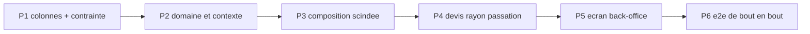

# Plan — les promotions par audience et par acheminement

**Ouvert le 2026-10-30**, à la demande de Hugo : « élargir le modèle de
promotion, qui n'était que B2B, pour paramétrer les audiences, les
acheminements et les segments d'audience ».

**Cas déclencheur** : une promotion de −20 % pour les **particuliers avec
compte** et pour **tous les pros**, sur **tous les acheminements**.

**État : doc-first.** Rien n'est bâti. Le plan touche à l'argent et porte une
migration : `vitruve` est obligatoire avant Hugo (CLAUDE.md §9 bis) — **il a
tourné le 2026-10-30** ; ses objections et les réponses sont au §7, et les
sections qu'elles corrigent le disent.

Toutes les affirmations sur l'existant ci-dessous ont été **ouvertes le
2026-10-30** ; les citations `fichier:ligne` valent à cette date.

---

## 1. L'existant

### 1.1 Les étages et leur ordre

- Quatre étages, ordre déclaré une fois : `mercuriale → volume → promotion →
geste` (`apps/lfd-api/src/b2b/pricing/domain/price-rule.ts:23`).
- `volume` n'est plus écrit en règle, il vient du barème
  (`price-rule.ts:38`, type `AuthoredPriceStage`).
- Une mercuriale **scelle** la chaîne : les étages suivants sont transparents,
  sauf une règle qui porte `stacksOverMercuriale`
  (`apps/lfd-api/src/b2b/pricing/domain/resolve-price.ts:118` ; colonne
  `stacks_over_mercuriale`, `apps/lfd-api/prisma/schema/public/pricing.prisma:73`,
  `false` par défaut). L'option « ne pas cumuler avec une mercuriale »
  demandée **existe donc déjà**, à l'envers : c'est le comportement par défaut.
- Dans un étage, un seul gagnant : `winnerOf`
  (`apps/lfd-api/src/b2b/pricing/domain/specificity.ts:340`), après filtrage par
  `applies` (`specificity.ts:279`, qui teste portée, audience, fenêtre,
  suspension).

### 1.2 L'audience d'une règle

- `PriceAudienceType = "all" | "segment" | "company"` (`price-rule.ts:44`),
  `id` nul ssi `all` (`price-rule.ts:52-56`) ; colonnes `audience_type` /
  `audience_id` (`pricing.prisma:32-34`).
- Rang de spécificité `all 0 < segment 1 < company 2` (`specificity.ts:32-36`) ;
  l'audience prime la portée (commentaire de tête du même fichier).
- `matchesAudience` (`specificity.ts:157-166`) : une commande sans société ne
  peut satisfaire que `all`.
- 🔴 **`segment` est inatteignable** : `pricingContextFor` pose
  `segmentId: null` en dur (`apps/lfd-api/src/b2b/pricing/domain/pricing-context.ts:68`),
  et son JSDoc le dit (« aucune notion de segment n'existe sur `Company` »,
  `pricing-context.ts:35-38`). Aucun modèle `Segment` dans `prisma/schema`
  (grep du 2026-10-30 : seul `ProductAudienceCounter`, `growth.prisma:423`,
  qui est un compteur, pas un groupe).
- `src/b2b/audiences/` n'est **pas** un référentiel de segments : c'est le
  tableau qui décrit la clientèle à partir des commandes
  (`apps/lfd-api/src/b2b/audiences/domain/audience-scope.ts:1-3`, lot A1 de
  `recommandation-produit/plan-audiences.md`).

### 1.3 Ce que porte le contexte

- `PricingAudienceOf = { at, companyId, segmentId }`
  (`specificity.ts:215-219`).
- `PricingParties = { companyId, pricingCompanyId }`
  (`apps/lfd-api/src/b2b/pricing/domain/loaded-pricer.ts:34-37`) ;
  `NO_PARTIES` pour « aucune société » (`loaded-pricer.ts:40`), seule
  fabrique `PricingPartiesResolver.partiesAt`
  (`apps/lfd-api/src/b2b/pricing/application/pricing-parties.resolver.ts:20-25`).
- **Rien ne dit si un particulier est connecté.** Un particulier inscrit et un
  invité arrivent tous deux avec `companyId: null` : l'inscrit passe par
  `POST /orders` (`apps/lfd-api/src/b2b/orders/http/orders.controller.ts:80-83`,
  `@ActingCompany()` nul), l'invité par
  `apps/lfd-api/src/b2b/orders/application/commands/place-shop-order.handler.ts`.
  Et l'invité **a** un `placedByUserId` — une personne inscrite à la volée
  (`buyers.register`, `:149`) **avant** que la commande soit composée
  (`drafting.draft`, `:154` ; parties `{ companyId: null, placedByUserId:
buyerUserId, placedByStaffId: null }`, `:155`) — : la présence d'un user ne
  distingue donc **pas** les deux. `OrderParties` ne porte que ces trois champs
  (`apps/lfd-api/src/b2b/orders/application/services/order-parties.ts:9-13`). Seule la **route** le sait (devis
  anonyme `shop-quote.controller.ts:46` `@Public()` contre devis reconnu
  `my-shop-quote.controller.ts:51-55`, qui porte `buyerUserId`).
- **Rien ne dit l'acheminement.** `OrderComposition.resolve` tarifie les lignes
  (`apps/lfd-api/src/b2b/orders/application/services/order-composition.service.ts:145`)
  **avant** de résoudre l'acheminement (`:159`), et le tarif ne reçoit que
  `parties` (`:262`, `linePricing.resolve(requested, parties, "checkout")`).

### 1.4 La clientèle `pro` / `public` existe déjà ailleurs

- Enum `OrderClientele { pro, public }` (`prisma/schema/public/orders.prisma:59-64`).
- Les **limites** (planchers) ont gagné une clientèle le 2026-09-26, avec une
  contrainte d'exclusion élargie posée « créer puis supprimer »
  (`prisma/migrations/20260926130000_les_limites_ont_une_clientele/migration.sql:9-28`,
  colonne `pricing.prisma:143`). **C'est le précédent à copier.**
- La clientèle d'une requête : `CustomerAudiences.of`
  (`apps/lfd-api/src/b2b/orders/application/services/customer-audiences.service.ts:23-28`)
  → `audienceOf` (`packages/contracts/src/customer-audience.ts:23-25`) : `b2b`
  pour une société **active** seulement, sinon `b2c`. Partagée par devis et
  caisse.
- Le prix de base diffère déjà par clientèle : `servedPriceOf(row, audience)`
  (`apps/lfd-api/src/b2b/catalog/infrastructure/prisma-catalog.reader.ts:282`).

### 1.5 La contrainte d'exclusion

`price_rules_no_overlap`, dernière forme
(`prisma/migrations/20260817210000_cycle_de_vie_et_journal_tarifaire/migration.sql:32-45`,
revérifié le 2026-10-30 : `20260826090000`, `20260831090000` et
`20260908160000` ne la citent qu'en commentaire, aucune ne la redéfinit ;
`btree_gist` est créée par `20260817102602_regles_tarifaires/migration.sql:51`) :
`EXCLUDE USING gist (stage =, scope_type =, scope_id =, audience_type =,
audience_id =, min_quantity =, tstzrange && ) WHERE archived_at IS NULL`.
Elle refuse deux règles **identiques** sur la même fenêtre ; elle ne refuse pas
deux règles de publics **qui se recouvrent** (`all` et `company:X`) — c'est
`winnerOf` qui arbitre.

### 1.6 La remise du point de retrait

- Un `PickupDiscount` par point, **une par clientèle** `b2b` / `b2c`
  (`apps/lfd-api/src/b2b/pickup-addresses/domain/pickup-discount.ts:36-40`).
- C'est un **ajustement de panier**, pas un étage : montant en **centimes** sur
  les lignes couvertes, calculé par `CartAdjustments` après le prix des lignes
  (`cart-adjustments.service.ts:67-102`), partagé devis/caisse. Il cumule donc
  toujours avec une promotion (la promotion baisse le prix unitaire, la remise
  s'applique ensuite sur le sous-total couvert).

### 1.7 Le prix barré

- `unitPriceMillicents` est le prix **résolu** pour qui regarde
  (`packages/contracts/src/shop-catalogue.ts:131-141`) ;
  `catalogPriceMillicents` est le tarif à barrer, **vers le bas seulement**, et
  jamais la promo sous mercuriale (`shop-catalogue.ts:225-245`).

---

## 2. Ce qui manque, en une phrase par axe

| Axe                        | Aujourd'hui                                     | Manque                                |
| -------------------------- | ----------------------------------------------- | ------------------------------------- |
| particulier inscrit/invité | indiscernables (`companyId` nul dans les deux)  | un fait « connecté » dans le contexte |
| pro (tous)                 | aucun moyen : `all` vise aussi les particuliers | une audience `pro`                    |
| acheminement               | absent du contexte, résolu après le prix        | méthode + point dans le contexte      |
| segment                    | modélisé, inatteignable                         | ne PAS le bâtir ici (Q4)              |

---

## 3. Le modèle proposé

### 3.1 Deux axes orthogonaux, pas un axe élargi

On **n'ajoute pas** de valeurs à `PriceAudienceType`. On ajoute un axe
**clientèle**, porté à côté de l'audience nominative existante :

- `clientele` — `any | public_guest | public_registered | public | pro`
  (nouvelle colonne, `NOT NULL DEFAULT 'any'`).
- `audience_type / audience_id` — inchangés : `all | segment | company`.
  `segment` et `company` impliquent `pro` ; l'agrégat **refuse** une règle
  `company:X` avec une clientèle `public*` (combinaison inexprimable plutôt que
  vérifiée en aval).

Le cas déclencheur ne tient **pas** en une seule clientèle (`public_registered`
∪ `pro`). Deux options :

- **A — deux règles jumelles** posées d'un geste par l'écran (« Particuliers
  inscrits » + « Pros » cochés → deux lignes, même libellé, même fenêtre, un
  identifiant de lot `campaign_id`). Simple pour la contrainte et la
  spécificité ; le journal les lie par le lot.
- **B — un ensemble** `clienteles text[]`. Plus fidèle à l'intention, mais la
  contrainte d'exclusion devient un `&&` sur tableau (GiST `intarray`/`text[]`),
  et la spécificité d'un ensemble n'a pas de rang naturel.

**Recommandation : A** (Q1). Elle garde une règle = un public, ce que
`winnerOf` et la trace savent déjà expliquer.

### 3.2 L'acheminement

Colonnes additives :

- `fulfillment` — `any | pickup | delivery`, `NOT NULL DEFAULT 'any'` ;
- `fulfillment_pickup_id` — nul sauf `fulfillment = 'pickup'` ciblé sur un
  point (CHECK) ;
- **pas** de zone de livraison au premier lot (Q3).

### 3.3 La contrainte d'exclusion

Nouvelle `price_rules_no_overlap_by_public`, mêmes colonnes **plus**
`clientele =, fulfillment =, coalesce(fulfillment_pickup_id,'') =`, posée
**avant** de supprimer l'ancienne (précédent §1.4). Tant que toutes les lignes
valent `any/any`, les deux disent la même chose : la création ne peut échouer.

Elle reste une garantie **d'identité**, pas de disjonction : `public` et
`public_registered` se recouvrent sans se refuser. C'est voulu — la
spécificité les arbitre, comme `all` et `company` aujourd'hui.

### 3.4 Le contexte

`PricingAudienceOf` gagne deux champs, **déduits au serveur, jamais reçus** :

- `clientele: "pro" | "public_guest" | "public_registered"` — `pro` si
  `audienceOf` rend `b2b` (§1.4) ; sinon dérivée de `buyerKind`
  (**corrigé après vitruve, §7 B1** : la présence d'un user ne suffit pas).
  `buyerKind: "guest" | "registered"` est un champ explicite de
  `OrderParties` et du contexte de prix, **posé par le handler selon sa
  route**, jamais lu dans un payload. Une seule fabrique, à côté de
  `PricingPartiesResolver` (même raison que `pricing-parties.resolver.ts:6-14`).
  Le cas de la société non validée est une **question** (Q8), pas un acquis.
- `fulfillment: { method: "pickup" | "delivery"; pickupId: string | null } | null`
  — `null` = **inconnu** (rayon, fiche, tableau staff).

`matchesAudience` teste les trois axes. Règle pour `fulfillment === null` :
**une règle conditionnée à un acheminement ne s'applique pas** quand
l'acheminement est inconnu (Q2 : alternative « on montre le meilleur prix
possible avec la mention “en retrait” »).

🔴 Conséquence sur l'ordre de `OrderComposition.resolve` (§1.3) : l'acheminement
doit être connu **avant** le prix des lignes. Le point retenu se décide déjà
sans le prix (choix explicite ou `preselectedPickupId`, `cart-adjustments.service.ts:115-151` et `:195`) ;
seuls les **montants** de remise/frais dépendent du prix. Il faut donc scinder
`resolveFulfillment` en « quel acheminement » (avant) et « combien » (après).
C'est la seule refonte non additive du plan.

### 3.5 La spécificité

Rang lexicographique, du plus fort au plus faible :

1. audience nominative (`company > segment > all`) — **inchangé** ;
2. clientèle (`public_guest | public_registered | pro` > `public` > `any`) ;
3. acheminement (`point précis > pickup | delivery > any`) ;
4. portée, puis palier — inchangés.

Exemple : « −20 % particuliers inscrits » et « −10 % tous » courent ensemble →
l'inscrit prend −20 %, l'invité −10 %. Une promotion `company:X` bat toujours
une promotion de clientèle : la négociation nominative prime (Q5).

Pas de cumul de deux promotions : l'étage a **un** gagnant, ce qui reste vrai.

Confronté à `specificityOf` / `compare` / `winnerOf`
(`apps/lfd-api/src/b2b/pricing/domain/specificity.ts:79-97`, `:340`) : le tuple
`[audience, portée, proximité de famille, palier]` devient
`[audience, clientèle, acheminement, portée, proximité, palier]`. L'en-tête du
fichier (« l'audience prime sur la portée ») reste vrai et s'étend : **tout
critère de public prime la portée**. **Changement de comportement assumé** :
une promotion « inscrits · global » bat une promotion « tous · ce produit »,
là où aujourd'hui la portée produit l'emporterait entre deux règles `all`. Les
règles existantes valent `any/any` (rang 0) et gardent exactement leur ordre.
Une égalité stricte lève toujours `AmbiguousPriceRulesError` ; elle n'est
possible qu'entre deux règles identiques sur les six axes, que la contrainte
§3.3 refuse. Tests : §5 + §7 S-spécificité.

### 3.6 Le cumul

| Avec            | Comportement proposé                                                                |
| --------------- | ----------------------------------------------------------------------------------- |
| mercuriale      | inchangé : scellée, sauf `stacksOverMercuriale` (§1.1)                              |
| barème volume   | inchangé : l'étage volume précède, la promotion s'applique au résultat              |
| geste           | inchangé                                                                            |
| remise du point | cumule (ajustement de panier, §1.6) — Q6 : option « pas avec la remise du point » ? |
| plancher        | inchangé : la limite de la clientèle (`pro`/`public`, §1.4) borne le résultat       |

### 3.7 Prix barré, devis, passation

- Rayon : l'acheminement est inconnu → une promotion « retrait seulement » ne
  baisse pas `unitPriceMillicents` ; le rayon peut afficher une **mention**
  (« −20 % en retrait ») sans barrer (Q2). Le barré suit les règles existantes
  (`shop-catalogue.ts:225-245`).
- Route anonyme : clientèle `public_guest`. Une promotion « inscrits » n'y est
  **pas** appliquée ; mention « avec un compte » proposée (Q7).
- Devis et passation reçoivent le même contexte, construit par la même
  fabrique : le prix **change** si le client change d'acheminement ou se
  connecte, et le devis le montre avant le paiement. La passation fait foi
  (comme pour la TVA des frais, `shop-cart-quoting.service.ts` V4).
- Un invité qui se connecte au paiement : le panier est **re-chiffré** sur la
  route reconnue ; rien de figé côté client.

### 3.8 Journalisation et trace

- Les faits `price_rule.*` existants (`PricingEvent`, `pricing.prisma:579`)
  gagnent `clientele` et `fulfillment` dans leur charge ; un fait antérieur sans
  ces clés se lit `any/any` (valeur de donnée, pas renommage).
- La trace figée d'une ligne de commande nomme le public de la règle gagnante
  (« Particuliers inscrits · retrait ») : « pourquoi ce prix » doit rester
  répondable six mois plus tard.
- `lint:dated-decisions` : rien de neuf à dater — la règle porte déjà sa
  fenêtre (`pricing.prisma:60-61`) ; le gate est à relancer car `price-rule.ts`
  est dans son périmètre (`dev-toolbox/gates/dated-decisions.mjs:122`).

### 3.9 L'écran du back-office

Sur l'éditeur de promotion (cf. `ecrans-de-tarification.md`) :

- **Public** : cases « Particuliers sans compte », « Particuliers inscrits »,
  « Pros » (+ « Une société » existant). Plusieurs cases → plusieurs règles
  jumelles (§3.1 A).
- **Acheminement** : Tous / Retrait (tous points | un point) / Livraison.
- Case existante « S'applique aussi aux tarifs négociés » = `stacksOverMercuriale`.
- Résumé lu par le staff : « −20 % · particuliers inscrits et pros · tous
  acheminements · du … au … ».

### 3.10 Les segments

**Hors de ce plan.** Un segment de sociétés (et, a fortiori, de particuliers)
demande un référentiel de groupes, un écran et une règle d'appartenance datée ;
`segment` reste inatteignable comme aujourd'hui (§1.2). Q4.

---

## 4. Lots

| Lot | Contenu                                                                                                                                                  | Migration                |
| --- | -------------------------------------------------------------------------------------------------------------------------------------------------------- | ------------------------ |
| P1  | `clientele`, `fulfillment`, `fulfillment_pickup_id` (défauts `any`), CHECKs de nullité, contrainte élargie créée **puis** ancienne supprimée             | additive, un déploiement |
| P2  | VO `PriceClientele`, `PriceFulfillment` ; refus `company` × `public*` dans l'agrégat ; `matchesAudience` à trois axes ; rang §3.5 ; fabrique du contexte | —                        |
| P3  | `OrderComposition` : acheminement résolu avant le prix, montants après ; `linePricing.resolve` reçoit le contexte complet                                | —                        |
| P4  | devis anonyme/reconnu, rayon (mention sans barré), passation inscrit/invité ; trace et journal                                                           | —                        |
| P5  | éditeur (cases public, acheminement, lot de jumelles), résumé                                                                                            | —                        |
| P6  | e2e (§5)                                                                                                                                                 | —                        |

## 5. Tests

- **Domaine** : `matchesAudience` sur la matrice clientèle × acheminement ×
  inconnu ; rang §3.5 (inscrit bat `public`, `company` bat `pro`, point bat
  retrait) ; refus `company` + `public_guest`.
- **Application** : la fabrique du contexte (société inactive → `public_*`,
  cf. `audienceOf`) ; `OrderComposition` appelle le tarif avec l'acheminement.
- **E2E** (vrai Postgres, fenêtres en `daysAgo`) — une promo −20 %
  `public_registered` + `pro`, tous acheminements :
  - invité, retrait → prix plein ; inscrit, retrait → −20 % ; pro actif → −20 % ;
  - promo « retrait au point A » : inscrit en livraison → plein, au point B →
    plein, au point A → −20 % ; devis et passation au même centime ;
  - pro sous mercuriale → promo ignorée sauf `stacksOverMercuriale` ;
  - remise du point cumulée après la promo ;
  - contrainte : deux jumelles identiques refusées, `public` et
    `public_registered` coexistent ;
  - rayon anonyme : pas de barré sur une promo réservée aux inscrits.

## 6. Questions à Hugo

1. **Q1** — Un public multiple = règles jumelles posées d'un geste (A,
   recommandé) ou un ensemble dans une seule règle (B) ?
2. **Q2** — Acheminement inconnu (rayon, fiche) : n'appliquer **pas** une promo
   conditionnée (recommandé, + mention) ou montrer le meilleur prix possible ?
3. **Q3** — Les zones de livraison comme cible, dès maintenant ou plus tard ?
4. **Q4** — Les segments (sociétés, particuliers) : chantier séparé, d'accord ?
   Qu'est-ce qu'un segment de particuliers pour toi (fidélité, quartier,
   ancienneté) ?
5. **Q5** — Une promotion « tous les pros » et une promotion nominative
   `company:X` : la nominative gagne toujours, même moins généreuse ?
6. **Q6** — Faut-il une option « ne cumule pas avec la remise du point de
   retrait » ?
7. **Q7** — Le rayon anonyme doit-il annoncer « −20 % avec un compte » ?
8. **Q8** — Le membre d'une société **non validée** (que `audienceOf` traite
   en `b2c`, `customer-audiences.service.ts:23-28`) : `public_registered`,
   `pro`, ou aucune des deux promotions ? Le plan ne le présuppose plus.
9. **Q9 (B2)** — Changer d'acheminement en révision : (a) re-tarifer toutes
   les lignes (dérogation datée à R3) ou (b) refuser le changement s'il fait
   perdre ou gagner une promotion conditionnée ? Voir §7 B2.

---

## 7. Contradiction de vitruve (2026-10-30)

Chaque citation ci-dessous a été rouverte le 2026-10-30.

### B1 — « inscrit » n'est pas déductible à la passation

**Objection.** La passation invité crée `buyerUserId` avant de composer
(`place-shop-order.handler.ts:149`, draft `:154`) ; `OrderParties` =
`{companyId, placedByUserId, placedByStaffId}` (`order-parties.ts:9-13`).
« Un user existe » ne distingue pas l'invité de l'inscrit.

**Réponse.** `OrderParties` gagne `buyerKind: "guest" | "registered"`, et le
contexte de prix le reçoit. Il est posé **par le handler, selon la route**,
jamais par un payload. Poseurs, ouverts un par un :

| Poseur                                                                                                                       | Valeur                                                 |
| ---------------------------------------------------------------------------------------------------------------------------- | ------------------------------------------------------ |
| `place-shop-order.handler.ts:155` (`POST` boutique invité, `PlaceShopOrderCommand(payload)`, `shop-orders.controller.ts:67`) | `guest`, en dur                                        |
| `place-order.handler.ts:153` (`POST /orders`, `orders.controller.ts:82`, `@CurrentUser`)                                     | `registered`, en dur                                   |
| `place-order-for-customer.handler.ts:76` (saisie staff)                                                                      | `registered` (le client porté a un compte : sa fiche)  |
| `quote-order.handler.ts:58-64` (devis `/orders` et devis staff, `admin-orders.controller.ts:176`)                            | `registered`                                           |
| devis anonyme : `shop-quote.controller.ts:46` `@Public()` → `QuoteShopCartQuery` → `shop-cart-quoting.service.ts:133`        | `guest` (aujourd'hui `{ companyId }` seul)             |
| devis reconnu : `my-shop-quote.controller.ts:55` → `QuoteMyShopCartQuery(payload, companyId, user.userId)`                   | `registered`                                           |
| révision : `order-revising.service.ts:182-186` (et `:320`)                                                                   | **relu sur la commande** → colonne `orders.buyer_kind` |
| `document-specimens/specimen-data.ts:154`, `dev/seeding/order-placing.seed.ts`                                               | à poser explicitement (compilation l'exige)            |

La révision ne connaît pas la route d'origine : `buyerKind` doit donc être
**figé sur la commande** (colonne additive `buyer_kind`, `NOT NULL DEFAULT
'registered'` pour l'existant — Q à vérifier en P1 : les commandes boutique
invité existantes se reconnaissent par `placedByStaffId IS NULL AND company_id
IS NULL` + absence d'identité de connexion ; la reprise se fait en SQL dans la
même migration, relue par `lecteur-de-migrations`).

**Pourquoi le client ne peut pas le falsifier** : aucun schéma Zod ne porte le
champ ; la valeur `registered` n'est posée que derrière une route gardée qui a
résolu un `Principal` en base (le token n'atteste que le `sub`, CLAUDE.md §3) ;
la route `@Public()` pose `guest` en dur. Un invité qui envoie un jeton forgé
est refusé par le guard avant le handler. Le champ est obligatoire dans
`OrderParties` (pas `?:`) : un poseur oublié ne compile pas.

### B2 — la révision garde le prix figé des lignes gardées

**Objection.** `OrderComposition.priceLines` ne re-tarife que les lignes
fraîches ; les gardées reprennent leur prix figé (R3,
`order-composition.service.ts:250-275`, appelé par
`order-revising.service.ts:187`). Une promo conditionnée à l'acheminement ne
peut donc ni apparaître ni disparaître sur une ligne gardée.

**Options.**

- **(a)** Un changement d'**acheminement** en révision re-tarife **toutes**
  les lignes au contexte nouveau. Dérogation à R3, datée et bornée à ce seul
  cas (même forme que celle du 2026-10-29 sur les minimums). Coût : un
  client peut voir ses autres prix bouger (mercuriale expirée, prix catalogue
  changé) parce qu'il a changé de point.
- **(b)** Le changement d'acheminement qui ferait **gagner ou perdre** une
  promotion conditionnée sur une ligne gardée est **refusé** par une erreur
  nommée (`FulfillmentChangeAltersPromotionError`, `BusinessError` 409 :
  « Passer en livraison retire la promotion “−20 % en retrait” : annulez et
  recommandez, ou gardez le retrait »). R3 reste intacte.

**Recommandation : (b).** R3 est la promesse « le prix que vous avez payé ne
bouge pas » ; (a) la casse pour tout le panier afin de servir une seule
règle, et ferait bouger des prix sans lien avec l'acheminement. (b) ne coûte
qu'un refus rare, nomme le cas et le geste de sortie (CLAUDE.md §0). Le test
« ferait changer » se calcule en re-tarifant à blanc les lignes gardées au
nouveau contexte et en comparant l'identifiant de la règle gagnante de
l'étage promotion — lecture seule, rien n'est écrit.

**Tests e2e de révision** (les deux options en partagent la moitié) :

- retrait A (promo « retrait ») → livraison : (b) 409 nommé, commande
  inchangée ; (a) lignes re-tarifées au plein ;
- livraison → retrait A : (b) 409 ; (a) −20 % appliqué ;
- retrait A → retrait B, promo « tous retraits » : accepté, prix inchangés ;
- changement d'acheminement sans promo conditionnée : accepté, R3 tenue ;
- ajout d'une ligne fraîche après passage en retrait A : la fraîche prend la
  promo, les gardées gardent leur prix ;
- révision staff et révision client, même verdict.

### B3 — la contrainte

**Objection.** Vérifier la vraie dernière forme et le type de la colonne.

**Réponse.** Faite au §1.5 : la forme de `20260817210000:32-45` est la
dernière, les trois autres migrations ne la citent qu'en commentaire.
`btree_gist` existe (`20260817102602:51`). `pickup_addresses.id` est `TEXT`
(`20260803115432_pickup_addresses_table/migration.sql:12`) : la colonne
`fulfillment_pickup_id` est `TEXT`, et l'expression
`coalesce("fulfillment_pickup_id", '') WITH =` est du même type que
`coalesce("scope_id", '')`. `clientele` et `fulfillment` en `TEXT` + CHECK
(pas d'enum Postgres : `=` sur `text` est couvert par `btree_gist`). La
nouvelle contrainte reprend **toutes** les expressions existantes, `coalesce`
compris, et garde `WHERE ("archived_at" IS NULL)`. Pas de clé étrangère vers
`pickup_addresses` (archivage, pas de suppression) — le domaine valide
l'existence à la pose.

### S — les lecteurs à adapter

- `prisma-pricing-decisions.reader.ts:45`, `:108-113` (`audienceClause`) :
  l'écran par société liste `all` + `company:X`. Il doit lister aussi les
  règles de clientèle `pro`/`any` (celles qui peuvent jouer pour ce client)
  et **pas** les `public_*`. Le tableau général (`null`) reste sans filtre.
- `prisma-carried-decisions.reader.ts:46-52` : la clé `ruleCarryKey({stage,
audience, minQuantity})` doit gagner `clientele` et `fulfillment(+point)` —
  sinon deux jumelles (§3.1 A) ont la même clé et se heurtent à la reprise.
- Barème volume (`volume-ladder-rows.ts:24-25`,
  `prisma-volume-ladder.repository.ts:39-69`) : **ne prend pas les axes**. Le
  palier de volume est une condition commerciale pro, pas une campagne ; sa
  clé d'exclusion reste (portée, audience). `volume-ladder.ts:129` pose
  `stacksOverMercuriale: false` : il ne touche pas aux nouveaux axes ; les
  règles qu'il fabrique valent `any/any`.
- `partiesAt` / `NO_PARTIES`, 14 occurrences hors tests (grep du 2026-10-30) :
  `pricer.ts:142`, `company-pricing.query.ts:85`, `pricing-parties.resolver.ts:3,20,22`,
  `board-item.ts:5,73,76`, `board-category.ts:9,88`,
  `prisma-pricing-board.reader.ts:4,179`, `loaded-pricer.ts:31,40`.
  `PricingParties` gagne `buyerKind` et `fulfillment` ; `NO_PARTIES` devient
  « tableau staff » = `fulfillment: null`, `buyerKind` sans objet → le tableau
  montre ce que voit un `public_guest` (aucune promo conditionnée), et le dit.
  `partiesAt(companyId, at)` prend les deux nouveaux arguments, obligatoires.
- `exact-order-composition.ts` (domaine) et `exact-shop-quote.ts` ne lisent
  **aucun** parti (grep du 2026-10-30) : ils reçoivent des prix unitaires
  déjà résolus. Rien à changer, sauf à vérifier que l'ordre scindé (§3.4) les
  appelle après le prix.

### S — le rayon

`priced(companyId, language)` (`shop-catalogue-pricing.service.ts:111`)
devient `priced(companyId, buyerKind, language)` : le contrôleur reconnu
passe `registered`, le public `guest`. **Tranché** : l'aperçu
`pricedWithoutCompany("pro")` (`GET /shop/catalogue?audience=pro`, JSDoc
`:124-137`) tarife avec une clientèle **`any` stricte** — seules les règles
`clientele = any` y jouent. L'audience y
est **déclarée par le client** (paramètre de requête) ; montrer une promo
`pro` reviendrait à la publier à quiconque tape `?audience=pro`. Le prix pro
de base y reste (décision du 2026-10-19), les promotions pro non.

### S — `stacksOverMercuriale`

Le drapeau est porté par **chaque** règle (`price-rule.ts:189`) et lu au
moment du scellement (`resolve-price.ts:118`). Une promotion de clientèle est
une `PriceRule` de l'étage promotion : elle passe par ce drapeau sans rien de
neuf. Deux jumelles d'une campagne doivent porter la **même** valeur : c'est
l'écran qui pose le lot d'un geste ; l'agrégat ne voit qu'une règle, donc
l'égalité est tenue par la commande de pose (une seule valeur dans la
commande, recopiée), pas vérifiée après coup.

### S — la spécificité

Traité au §3.5 : changement de comportement nommé (tout critère de public
prime la portée). Tests domaine : « inscrits · global » bat « tous ·
produit » ; « `company:X` · global » bat « pro · produit » ; deux règles `any`
gardent leur ordre d'aujourd'hui (non-régression sur les fixtures
existantes de `specificity`) ; égalité stricte → `AmbiguousPriceRulesError`.

### S — ce qui devient irréversible au merge

- Les faits `price_rule.*` écrits avec `clientele`, `fulfillment` et
  `campaign_id` dans leur charge sont **permanents** (journal, pas de
  suppression) : le nom de ces clés est figé dès le premier fait. Les
  renommer ensuite = migration de données (CLAUDE.md §8).
- Le **libellé** du public sur la trace figée d'une ligne (« Particuliers
  inscrits · retrait ») est écrit dans la commande et ne se recalcule pas :
  un libellé mal choisi reste sur les commandes passées.
- `campaign_id` lie des jumelles pour toujours ; dissocier un lot plus tard
  ne réécrit pas les faits passés.
- `orders.buyer_kind` (B1) : la valeur de reprise des commandes existantes
  est un fait posé une fois.

### S — Q8

Ne plus présupposer : §3.4 renvoie à Q8.

### Mineurs

Lignes de `place-shop-order.handler.ts` réalignées au §1.3 (`:149` register,
`:154` draft, `:155` parties, ouvertes le 2026-10-30).
