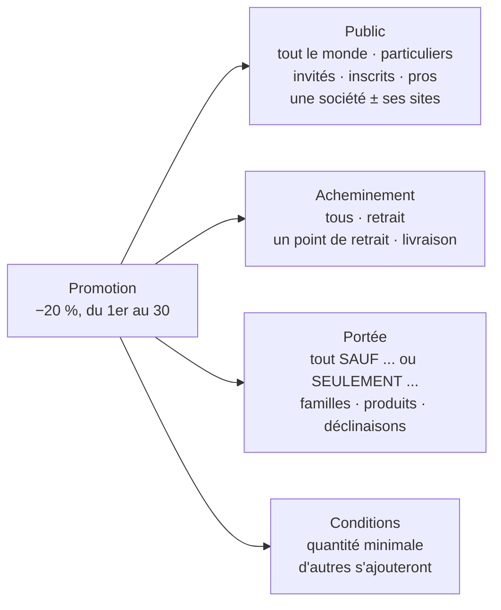
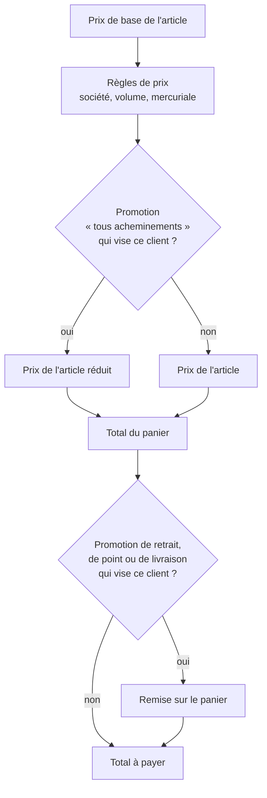
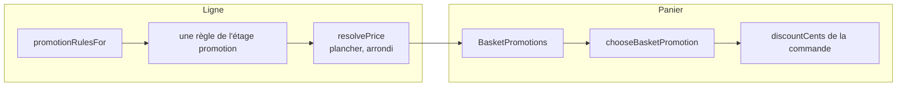
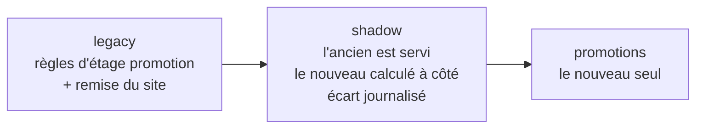

# Les promotions

> 🟧 **Doc d'état en cours de chantier — le plan fait foi pour la suite.**
> Décrit le code **tel qu'il est sur `dev`** au 2026-10-30 (lots L0 à L9 et
> L8b, jusqu'au commit `a41498947`). Ce qui est décidé et pas encore bâti vit
> dans le plan
> [`plan-promotions-par-audience-et-acheminement.md`](plan-promotions-par-audience-et-acheminement.md).
>
> **Sur `dev`, pas encore en production** : tout ce qui suit. Aucun commit des
> promotions n'est sur `main` à cette date (`git log origin/main..a41498947`).

---

## Partie 1 — en deux minutes

### Une promotion, en une phrase

Une promotion est **une réduction, pour un public, sur un mode
d'acheminement, sur une partie du catalogue, pendant une période**.

### Les quatre axes

Une promotion a aussi :

- un **nom interne** (pour l'équipe) et un **libellé client**, en français,
  anglais et italien, qui peut différer pour les particuliers et pour les pros ;
- un **état** : active, en pause, archivée ;
- un **plancher** facultatif, sous lequel elle ne fait pas descendre le prix.

### D'une commande à son prix

Une promotion agit à **un seul** des deux endroits, selon son acheminement :

- **« tous les acheminements »** → sur le **prix de chaque article** ;
- **un retrait, un point, une livraison** → sur le **total du panier**, une
  fois l'acheminement connu.

Si plusieurs promotions visent le même article, **une seule** s'applique : la
plus précise sur le public (une société bat « les pros », qui bat « tout le
monde »), puis sur l'acheminement (un point bat « le retrait »), puis la plus
avantageuse. Les promotions **ne se cumulent pas** aujourd'hui.

### Trois exemples

| Ce qu'on veut                                                    | Public                       | Acheminement               | Portée                           | Où elle agit      |
| ---------------------------------------------------------------- | ---------------------------- | -------------------------- | -------------------------------- | ----------------- |
| −20 % pour les pros au retrait La Folie Bakery, sauf les gâteaux | Pros                         | Un point : La Folie Bakery | Tout **sauf** la famille Gâteaux | Total du panier   |
| −20 % pour les particuliers inscrits et tous les pros            | Particuliers inscrits + Pros | Tous                       | Tout                             | Prix de l'article |
| −5 € sur toute commande livrée                                   | Tout le monde                | Livraison                  | Tout                             | Total du panier   |

Le premier cas est celui des anciennes « remises du point de retrait » : elles
sont **devenues des promotions** à la bascule. Le troisième se pose aujourd'hui
dans le modèle ; son affichage côté boutique viendra avec L10.

### Où on les règle

- **Tarification › Promotions** : toutes les promotions (droit « tarifs B2B »).
- **Fiche d'un site** : les promotions de ce point de retrait, et « Nouvelle
  promotion pour ce site » (droit « réglages des sites »).
- L'ancienne grille s'appelle désormais **Règles de prix**.

---

## Partie 2 — pour aller plus loin

Le contexte est `apps/lfd-api/src/b2b/promotions/` (domain, application,
infrastructure, http). Les citations `fichier:ligne` ont été ouvertes le
2026-10-30.

### 2.1 Le modèle

| Axe                   | Code                                           | Valeurs                                                                                                                                                                                |
| --------------------- | ---------------------------------------------- | -------------------------------------------------------------------------------------------------------------------------------------------------------------------------------------- |
| Effet                 | `domain/promotion-effect.ts:20-24`             | `percent_off`, `unit_amount_off`, `fixed_unit_price`, `basket_amount_off` ; effets admis par point `:31-36` (ligne : les trois premiers ; panier : `percent_off`, `basket_amount_off`) |
| Public                | `domain/promotion-audience.ts:15-25`           | `everyone`, `individuals`, `individuals_guest`, `individuals_registered`, `pros`, `pros_active`, `pros_pending`, `company`, `company_and_sites`, `everyone_but_active_pros`            |
| Public multiple (L8b) | `domain/promotion-audience-set.ts`             | un **ensemble normalisé** de cibles de l'arbre ; refus : vide, société en double, libellé d'audience sans audience (`errors/promotion-audience-errors.ts`)                             |
| Acheminement          | `domain/promotion-fulfillment.ts:15-19`        | `any`, `pickup`, `pickup_point`, `delivery`                                                                                                                                            |
| Point d'application   | `domain/promotion-fulfillment.ts:34-36`        | `any` → `line`, sinon `basket`                                                                                                                                                         |
| Portée                | `domain/promotion-scope.ts:19-26`              | mode `all_except` / `only`, cibles `category` / `product` / `variant`                                                                                                                  |
| Conditions            | `domain/promotion-condition.ts:15`             | `min_quantity` seule ; union extensible                                                                                                                                                |
| Libellés              | `prisma/schema/public/promotions.prisma:15-27` | `label_*` (commun) + `label_individuals_*` + `label_pros_*`, FR/EN/IT                                                                                                                  |

Tables : `promotions`, `promotion_scope_rules`, `promotion_audience_targets`,
`promotion_settings` (`promotions.prisma`).

L'agrégat `domain/promotion.ts` : `pose` (`:76`), `revise` (`:133`), `pause`
(`:146`), `resume` (`:160`), `archive` avec motif obligatoire (`:176`). Une
promotion archivée est scellée (`ArchivedPromotionIsSealedError`). Une
promotion en pause garde sa place au refus de chevauchement.

### 2.2 Les deux points d'application

- **Ligne** : `pricing/domain/promotion-as-rule.ts` présente la promotion
  comme une règle de l'étage `promotion` ; `resolve-price.ts:262` l'ajoute aux
  règles. Même place, même scellement par la mercuriale, même plancher que les
  anciennes règles de promotion.
- **Panier** : `orders/application/services/basket-promotions.service.ts:51`
  et `orders/domain/services/basket-promotion-choice.ts:66`.
- **Spécificité et départage** : `domain/promotion-targeting.ts:184-205`
  (`PUBLIC_RANK` : société 4, société et sites 3, sous-publics 2, publics 1,
  tout le monde 0 ; `FULFILLMENT_RANK` : point 2, mode 1, tous 0). Au panier,
  le rang est `[public, acheminement, remise]` puis l'id
  (`basket-promotion-choice.ts:75`).

### 2.3 La source et la bascule

`domain/promotions-source.ts:18` : une ligne `promotions_source` en base
(`promotion_settings`), jamais une variable d'environnement.

- Les écritures de promotion sont refusées tant que la source n'est pas
  `promotions` (`PromotionsNotEditableYetError`), et les anciens éditeurs le
  sont après (`LegacyPromotionEditorClosedError`).
- La bascule est la migration `20261031130000_la_bascule_des_promotions` :
  `bascule_des_promotions()` rejoue la reprise, contrôle chaque source champ
  par champ, s'arrête en nommant tout écart, puis passe la source à
  `promotions`, dans une transaction. Retour arrière :
  `apps/lfd-api/prisma/rollback/20261031130000_la_bascule_des_promotions.sql`.

### 2.4 La reprise

Migration `20261031120000_la_reprise_des_promotions` : les **remises de
retrait** des sites et les **règles d'étage promotion** deviennent des
promotions, par une fonction rejouable. Pré-contrôle en lecture seule :
`dev-toolbox/audits/promotions-reprise-precheck.mjs`. L'égalité des prix avant
et après est prouvée par `apps/lfd-api/test/promotions-equality.e2e-spec.ts`.

### 2.5 Les refus à la pose

| Refus                                                                                   | Erreur (`domain/errors/promotion-errors.ts`)                                                                                   |
| --------------------------------------------------------------------------------------- | ------------------------------------------------------------------------------------------------------------------------------ |
| Deux promotions du même point qui se recouvrent (public, acheminement, portée, période) | `OverlappingPromotionError` (`domain/promotion-overlap.ts:54`)                                                                 |
| Deux promotions panier possibles pour une même commande                                 | `BasketPromotionsWouldCombineError` (`promotion-overlap.ts:96`)                                                                |
| Posée depuis la mauvaise surface (fiche d'un site ≠ son point)                          | `PromotionWrongSurfaceError` (`domain/promotion-surface.ts:29`)                                                                |
| Un produit entier ciblé au point ligne                                                  | `PromotionProductTargetAtLineError` (`domain/promotion-terms.ts:108`)                                                          |
| Effet non admis à ce point                                                              | `PromotionEffectPointMismatchError`                                                                                            |
| Portée vide, fenêtre inversée, texte vide, effet hors bornes                            | `PromotionScopeIncludesNothingError`, `PromotionReversedWindowError`, `PromotionBlankTextError`, `PromotionInvalidEffectError` |

### 2.6 La révision d'une commande (L9)

La commande garde la promotion panier appliquée
(`orders.discount_promotion_id`, `orders.prisma:262`). En révision, changer
d'acheminement ou de point d'une façon qui **ajoute, retire ou remplace**
cette promotion est refusé (409, `FulfillmentChangeAltersPromotionError`,
`orders/domain/services/fulfillment-promotion.ts:24`) : « Gardez le même
acheminement, ou annulez la commande et repassez-la ». Une commande d'avant
(id inconnu) est jugée sur sa remise figée. Avant L9, la remise était
recalculée au changement de point.

### 2.7 Invité ou inscrit

`orders.buyer_kind` (`orders.prisma:130`, défaut `registered`) dit si la
commande vient d'un invité ou d'un inscrit ; reprise des commandes
existantes par la migration `20261031100000_la_porte_de_passation`. Côté
calcul : `PromotionBuyerKind` (`domain/promotion-targeting.ts:20`). Le rayon
public ne sait pas encore qui regarde : c'est L10.

### 2.8 Libellés figés

Le libellé de la promotion panier, dans l'audience de l'acheteur, est **figé
à la passation** dans `orders.discount_label` (`orders.prisma:263-268`) : un
document relu plus tard ne dépend pas d'une promotion modifiée depuis.
L'audience du libellé : `labelAudienceOf` (`promotion-targeting.ts:142`).

### 2.9 Écrans et droits

| Écran                                                 | Front                                                       | API                                          | Droit                       |
| ----------------------------------------------------- | ----------------------------------------------------------- | -------------------------------------------- | --------------------------- |
| Promotions (liste, fiche, éditeur, arbre des publics) | `apps/lfd-backoffice-frontend/src/app/targeted-promotions/` | `http/admin-promotions.controller.ts`        | `b2b_pricing` (`:60`)       |
| Promotions d'un site                                  | `reglages/sites/site-page/site-promotions-card/`            | `http/admin-pickup-promotions.controller.ts` | `lfc_site_settings` (`:43`) |
| Règles de prix (ancienne grille)                      | —                                                           | `b2b/pricing/http/`                          | `b2b_pricing`               |

### 2.10 Journal

Actes `posed`, `paused`, `resumed`, `archived`, `replaced`
(`domain/promotion-act.ts:17`), sujets `promotion.*`. En mode `shadow`, un
écart est journalisé `promotions.shadow_divergence`.

---

## Limites connues et reste à faire

- **L10** : publics invités / inscrits / pros en cours actifs dans
  l'éditeur ; le rayon connaît `buyerKind` ; mention « avec retrait à … » ;
  message « Connectez-vous pour profiter de … » à tout invité ; promotions de
  livraison visibles côté boutique. _(en cours de bâti au 2026-10-30)_
- **L11** : docs d'état de la résolution de prix et du prix boutique mises à
  jour, le plan devient doc d'état (celle-ci l'absorbera).
- **L12** : resserrer — chemin `legacy` retiré, ancienne remise de retrait et
  ses lecteurs retirés, règles d'étage promotion archivées ; plusieurs remises
  panier par commande.
- **Cumul sur demande** (plan § 16, avec L12) : case « Cumulable »,
  combinaison successive (20 % puis 15 % = −32 %), plancher toujours tenu.
- **Améliorations notées** : onglets dans Tarification ; promotions affichées
  dans la grille des règles de prix.
- **Limite actuelle** : une seule promotion par article et par point, une
  seule remise panier par commande ; une seule condition (`min_quantity`).
