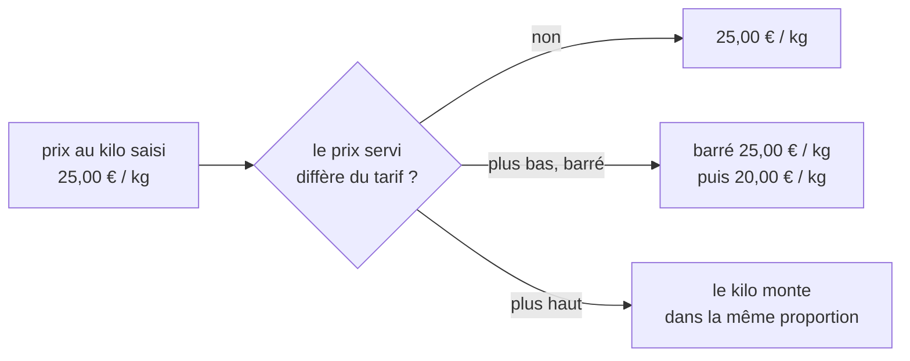

# Plan — le prix au kilo suit le prix servi

> 📝 **Plan du 2026-11-04, rien n'est bâti.** Demande de Hugo : « quand on a un
> prix barré et qu'on a aussi un prix indicatif au kilo, on peut avoir le prix
> barré au kilo en plus ? ». En relisant le code, un défaut est apparu : le prix
> au kilo affiché ne suit **jamais** le prix servi. Touche l'affichage d'un
> prix : contredit par `vitruve` avant Hugo. Partie 1 : comprendre. Partie 2 :
> le plan.

# Partie 1 — Comprendre

## Le défaut d'aujourd'hui

Le prix au kilo est un montant **saisi** dans la fiche produit, à titre
informatif, sans calcul depuis le poids (décision de Hugo du 2026-10-28,
[`plan-prix-au-kilo.md`](plan-prix-au-kilo.md)). Le rayon le montre tel quel.

Quand le prix de la pièce change pour ce client — une promotion, une
mercuriale, un palier —, le prix au kilo, lui, ne bouge pas :

| Ce que voit le client   | Aujourd'hui  | Ce qui est vrai  |
| ----------------------- | ------------ | ---------------- |
| prix de la pièce, barré | ~~10,00 €~~  | 10,00 €          |
| prix de la pièce payé   | 8,00 €       | 8,00 €           |
| prix au kilo            | 25,00 € / kg | **20,00 € / kg** |

Le prix au kilo affiché est celui du prix **plein**, sans le dire.

## Ce qu'on veut

Le prix au kilo **suit le prix servi**, dans la même proportion, et quand le
prix de la pièce est barré, le prix au kilo l'est aussi :

**La proportion** : si la pièce passe de 10,00 € à 8,00 € (−20 %), le kilo
passe de 25,00 € à 20,00 €. Aucun poids n'entre dans le calcul : la règle « pas
de calcul depuis le poids » tient.

**Calculé par le serveur**, jamais par l'écran : le dépôt interdit à un front
de calculer un prix (`lint:front-money-reads`).

# Partie 2 — Le plan

## 1. Ce qui existe (relu le 2026-11-04)

- Le kilo saisi est posé sur le rayon **après** le prix, par
  `withPricesPerKg` (`apps/lfd-api/src/b2b/catalog/application/shop-catalogue-price-per-kg.ts`),
  appelé dans `ShopCataloguePricing` (`shop-catalogue-pricing.service.ts`) :
  `proPricePerKgMillicents` pour un rayon pro (HT, millicentimes),
  `publicPricePerKgTtcCents` pour un rayon public (TTC, centimes), l'autre à
  `null`.
- Le prix servi et le barré sont posés par `struck`
  (`shop-catalogue-struck.ts`) : `unitPriceMillicents` / `unitPriceTtcCents`
  suivent toujours le prix résolu ; `catalogPriceMillicents` /
  `catalogPriceTtcCents` (le tarif) ne sont présents que si le prix servi est
  **plus bas**. Un prix servi plus **haut** n'est pas barré.
- Un barré n'est pas toujours une promotion : une mercuriale, un palier, un
  engagement le produisent aussi (`promotionNames` n'est alors pas posé).
- Un article **vendu au poids** n'affiche pas d'indication au kilo : son prix
  servi est déjà au kilo (`perKiloHintLabel`, `isSoldByWeight`).
- L'écran : `perKiloHintLabel` et `struckPriceLabel`
  (`apps/lfc-ecommerce-frontend/src/app/client/shop/shop-price-basis.service.ts`),
  lus par la fiche (`product-sheet.ts`) et la mise en avant de l'accueil
  (`home-featured.ts`). La vignette du rayon (`product-tile.ts`) ne montre pas
  le kilo.

## 2. La règle

Pour l'audience servie, dans son unité :

- **kilo servi** = kilo saisi × prix servi ÷ tarif, arrondi **une fois**, la
  moitié loin de zéro — en rationnel exact, comme `resolvePrice` ;
  - public : centimes TTC, sur `unitPriceTtcCents` ÷ `catalogPrice`
    TTC d'avant résolution (la valeur saisie) ;
  - pro : millicentimes HT, sur `unitPriceMillicents` ÷ tarif HT ;
- **kilo barré** = le kilo saisi, posé **exactement quand** le prix de la pièce
  est barré ;
- prix servi = tarif : kilo servi = kilo saisi, rien de barré (aujourd'hui) ;
- prix servi plus haut que le tarif : le kilo monte dans la même proportion,
  rien de barré — un kilo saisi plus bas que le prix payé serait faux aussi ;
- kilo non saisi (`null`) : rien ne s'affiche, barré compris ;
- vendu au poids : inchangé, pas d'indication.

## 3. Le contrat

`ShopItemView` (`packages/contracts/src/shop-catalogue.ts`) :

- `publicPricePerKgTtcCents` / `proPricePerKgMillicents` deviennent le kilo
  **servi** — même nom, sens corrigé, JSDoc réécrit. Aucun lecteur n'a besoin
  de l'ancien sens : c'est un affichage, et l'ancien était faux ;
- deux champs neufs, absents du fil dans le cas ordinaire comme le barré :
  `catalogPricePerKgTtcCents` (public) et `catalogPricePerKgMillicents` (pro),
  posés exactement quand `catalogPriceTtcCents` / `catalogPriceMillicents` le
  sont et qu'un kilo est saisi ; l'autre audience à absent ;
- `lint:front-money-reads` : l'écran lit ces champs, il ne les calcule pas.

## 4. L'ordre de composition

`withPricesPerKg` est appelé après `struck` ? **À vérifier** dans
`ShopCataloguePricing.withPrices` : le kilo servi a besoin du prix servi ET du
tarif. Si l'ordre est inverse, la proportion se pose dans `struck` ou juste
après.

## 5. Les lots

| Lot | Contenu                                                                                                                                                                                                                  |
| --- | ------------------------------------------------------------------------------------------------------------------------------------------------------------------------------------------------------------------------ |
| K1  | serveur : la règle (fonction pure, tests aux bornes : égal, plus bas, plus haut, non saisi, vendu au poids, arrondi de la moitié), le contrat, l'ordre de composition ; un e2e du rayon public et pro avec une promotion |
| K2  | écran : le kilo barré à côté du kilo servi, sur la fiche et la mise en avant ; le libellé dans les trois langues ; tests de composant                                                                                    |

## 6. Ce qui n'est pas vérifié

- que la réglementation française exige que le prix à l'unité de mesure suive
  le prix de vente pratiqué pendant une promotion : probable, non relu ;
- que la proportion ne produise pas, sur un petit prix, un kilo dont l'arrondi
  surprend (une pièce à 0,99 € barrée à 0,79 €) : à éprouver en K1 ;
- le devis, le panier, la commande et les documents ne montrent pas le kilo :
  vérifié par lecture des lecteurs de `perKiloHintLabel`, pas par les gabarits
  PDF.
