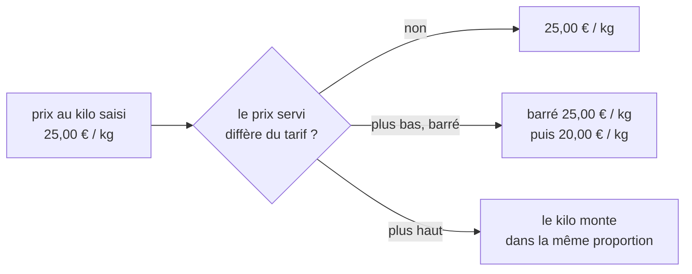

# Plan — le prix au kilo suit le prix servi

> ✅ **K1 et K2 bâtis le 2026-11-04 (non commités à l'écriture de cette ligne) — voir « Ce que le bâti a trouvé ».** Plan du 2026-11-04. Resserré par Hugo le même jour (§ 7) : seule une PROMOTION ajuste le kilo.** Demande de Hugo : « quand on a un
> prix barré et qu'on a aussi un prix indicatif au kilo, on peut avoir le prix
> barré au kilo en plus ? ». En relisant le code, un défaut est apparu : le prix
> au kilo affiché ne suit **jamais** le prix servi. Touche l'affichage d'un
> prix : contredit par `vitruve` avant Hugo. Partie 1 : comprendre. Partie 2 :
> le plan.

# Partie 1 — Comprendre

## Le défaut d'aujourd'hui

Le prix au kilo est un montant **saisi** dans la fiche produit, à titre
informatif, sans calcul depuis le poids (décision de Hugo du 2026-10-28,
[`plan-prix-au-kilo.md`](plan-prix-au-kilo.md)). Le rayon le montre tel quel.

Quand le prix de la pièce change pour ce client — une promotion, une
mercuriale, un palier —, le prix au kilo, lui, ne bouge pas :

| Ce que voit le client   | Aujourd'hui  | Ce qui est vrai  |
| ----------------------- | ------------ | ---------------- |
| prix de la pièce, barré | ~~10,00 €~~  | 10,00 €          |
| prix de la pièce payé   | 8,00 €       | 8,00 €           |
| prix au kilo            | 25,00 € / kg | **20,00 € / kg** |

Le prix au kilo affiché est celui du prix **plein**, sans le dire.

## Ce qu'on veut

Le prix au kilo **suit le prix servi**, dans la même proportion, et quand le
prix de la pièce est barré, le prix au kilo l'est aussi :

**La proportion** : si la pièce passe de 10,00 € à 8,00 € (−20 %), le kilo
passe de 25,00 € à 20,00 €. Aucun poids n'entre dans le calcul : la règle « pas
de calcul depuis le poids » tient.

**Calculé par le serveur**, jamais par l'écran : le dépôt interdit à un front
de calculer un prix (`lint:front-money-reads`).

# Partie 2 — Le plan

## 1. Ce qui existe (relu le 2026-11-04)

- Le kilo saisi est posé sur le rayon **après** le prix, par
  `withPricesPerKg` (`apps/lfd-api/src/b2b/catalog/application/shop-catalogue-price-per-kg.ts`),
  appelé dans `ShopCataloguePricing` (`shop-catalogue-pricing.service.ts`) :
  `proPricePerKgMillicents` pour un rayon pro (HT, millicentimes),
  `publicPricePerKgTtcCents` pour un rayon public (TTC, centimes), l'autre à
  `null`.
- Le prix servi et le barré sont posés par `struck`
  (`shop-catalogue-struck.ts`) : `unitPriceMillicents` / `unitPriceTtcCents`
  suivent toujours le prix résolu ; `catalogPriceMillicents` /
  `catalogPriceTtcCents` (le tarif) ne sont présents que si le prix servi est
  **plus bas**. Un prix servi plus **haut** n'est pas barré.
- Un barré n'est pas toujours une promotion : une mercuriale, un palier, un
  engagement le produisent aussi (`promotionNames` n'est alors pas posé).
- Un article **vendu au poids** n'affiche pas d'indication au kilo : son prix
  servi est déjà au kilo (`perKiloHintLabel`, `isSoldByWeight`).
- L'écran : `perKiloHintLabel` et `struckPriceLabel`
  (`apps/lfc-ecommerce-frontend/src/app/client/shop/shop-price-basis.service.ts`),
  lus par la fiche (`product-sheet.ts`) et la mise en avant de l'accueil
  (`home-featured.ts`), et la vignette du rayon (`product-tile.ts`) — qui
  montrait le kilo sans le kilo barré jusqu'au 2026-11-04.

## 2. La règle

Pour l'audience servie, dans son unité :

- **kilo servi** = kilo saisi × prix servi ÷ tarif, arrondi **une fois**, la
  moitié loin de zéro — en rationnel exact, comme `resolvePrice` ;
  - public : centimes TTC, sur `unitPriceTtcCents` ÷ `catalogPrice`
    TTC d'avant résolution (la valeur saisie) ;
  - pro : millicentimes HT, sur `unitPriceMillicents` ÷ tarif HT ;
- **kilo barré** = le kilo saisi, posé **exactement quand** le prix de la pièce
  est barré ;
- prix servi = tarif : kilo servi = kilo saisi, rien de barré (aujourd'hui) ;
- prix servi plus haut que le tarif : le kilo monte dans la même proportion,
  rien de barré — un kilo saisi plus bas que le prix payé serait faux aussi ;
- kilo non saisi (`null`) : rien ne s'affiche, barré compris ;
- vendu au poids : inchangé, pas d'indication.

## 3. Le contrat

`ShopItemView` (`packages/contracts/src/shop-catalogue.ts`) :

- `publicPricePerKgTtcCents` / `proPricePerKgMillicents` deviennent le kilo
  **servi** — même nom, sens corrigé, JSDoc réécrit. ⚠️ Un lecteur relit le
  kilo **saisi** de son côté : l'export de grille de prix
  (`catalog-price-grid-shelf.reader.ts`, `enteredPerKg`). Sans décision, le
  rayon et la grille du même acheteur type montreraient deux kilos à la même
  date (question 2, § 7). La vitrine (`b2b/vitrine`) n'a pas été relue ;
- deux champs neufs, absents du fil dans le cas ordinaire comme le barré :
  `catalogPricePerKgTtcCents` (public) et `catalogPricePerKgMillicents` (pro),
  posés exactement quand `catalogPriceTtcCents` / `catalogPriceMillicents` le
  sont et qu'un kilo est saisi ; l'autre audience à absent ;
- `lint:front-money-reads` : l'écran lit ces champs, il ne les calcule pas ;
  `lint:money-units` : les champs neufs portent leur unité dans leur nom ;
- le JSDoc « tel que saisi au référentiel » se réécrit dans le contrat **et**
  dans `shop-price-basis.service.ts`.

## 4. L'ordre de composition — tranché après contradiction (2026-11-04)

L'ordre réel est `struck` → `withPricesPerKg`
(`shop-catalogue-pricing.service.ts`, `withPrices`). `struck` remplace le prix
de l'article par le prix servi et ne garde le tarif (`catalogPrice*`) que si le
prix **baisse**. Après lui, une hausse n'a plus de tarif : la proportion
n'aurait pas de dénominateur, et le kilo retomberait en silence sur le kilo
saisi — le défaut qu'on corrige.

**Le kilo se calcule donc dans `struck`**, au seul endroit où le tarif et le
prix servi sont tous les deux en main : `withPricesPerKg` pose d'abord le kilo
**saisi** (avant `struck`), et `struck` l'ajuste avec le prix et pose le kilo
barré dans le même geste que le prix barré.

**La base publique est le TTC, et c'est un choix** : le tarif TTC
(`catalogPriceTtcCents` = le TTC dérivé du HT par `toItem`,
`ttcCentsFromHtMillicents`) et le TTC servi sont deux centimes arrondis.
TTC ÷ TTC et HT ÷ HT ne donnent pas le même kilo sur un petit prix, au centime
près. Le TTC l'emporte : le kilo affiché doit garder, au client, la proportion
des deux prix **qu'il lit**. Exemple à fixer dans les tests : pièce 0,99 €
barrée à 0,79 €, kilo saisi 9,90 € → 7,90 € / kg.

**Vendu au poids** : exclu **côté serveur** (aucun kilo servi ni barré), et non
plus seulement par l'écran.

## 5. Les lots

| Lot   | Contenu                                                                                                                                                                                                                  |
| ----- | ------------------------------------------------------------------------------------------------------------------------------------------------------------------------------------------------------------------------ |
| K1 ✅ | serveur : la règle (fonction pure, tests aux bornes : égal, plus bas, plus haut, non saisi, vendu au poids, arrondi de la moitié), le contrat, l'ordre de composition ; un e2e du rayon public et pro avec une promotion |
| K2 ✅ | écran : le kilo barré à côté du kilo servi, sur la fiche et la mise en avant ; le libellé dans les trois langues ; tests de composant                                                                                    |

## 5 bis. Ce que le bâti a trouvé (2026-11-04)

- **L'endroit de la règle n'est pas `struck`, c'est `withPricesPerKg`** — et
  le § 4 tombe avec le § 2. Le § 4 plaçait le calcul dans `struck` pour garder
  un dénominateur aux HAUSSES ; le § 7 a retiré les hausses. Or la règle
  resserrée demande trois faits : le tarif et le prix servi (posés par
  `struck`) ET la présence d'une promotion (posée par `withPromotionNames`,
  APRÈS `struck`). `withPricesPerKg` passe en dernier dans `pricedFor` : il a
  les trois sur l'article, sans rien recalculer. La règle pure vit dans
  `apps/lfd-api/src/b2b/catalog/application/shop-catalogue-promoted-per-kg.ts`
  (`servedPricePerKg`, `proportional` en `bigint`), appelée par
  `withPricesPerKg`.
- **Une promotion sans `labels`** (trace d'avant L8b) ne pose pas
  `promotionNames` : son kilo reste le kilo saisi, rien de barré. Conforme au
  § 7 (« barré sans `promotionNames` »), mais c'est une promotion quand même.
- **Le flux de la vitrine** recopiait toute la vue de la boutique par
  décomposition : les deux champs neufs y seraient partis. Ils sont retirés
  de `VitrineItemView` (`packages/contracts/src/vitrine.ts`) et de
  `vitrineItemOf`, comme les deux kilos avant eux.
- **La mise en avant de l'accueil ne barrait pas le prix de la pièce**
  (`ProFeaturedCard` n'a qu'un prix), contrairement à ce que laissait croire
  « comme le prix barré de la pièce ». Le kilo barré y est posé seul ; barrer
  aussi la pièce y est une décision à part.
- **E2E non écrite** : le rayon public et pro sous une promotion est éprouvé
  sur la vraie porte de prix, ports doublés
  (`shop-catalogue-promotion-names.spec.ts`), pas sur Postgres.

## 7. Les décisions de Hugo (2026-11-04)

« Je dirais saisi, peu d'articles ont un prix au kilo indicatif, ne cherche pas
à inventer de la donnée », puis : « le prix saisi barré et le prix altéré par la
promo ». La règle du § 2 se **resserre** :

| Situation                                                         | Ce qui s'affiche                                                                                               |
| ----------------------------------------------------------------- | -------------------------------------------------------------------------------------------------------------- |
| une **promotion** baisse la pièce (barré **et** `promotionNames`) | le kilo saisi **barré**, puis le kilo **après promotion**, dans la proportion de la pièce (TTC pour le public) |
| aucune promotion, mercuriale, palier, engagement, prix plus haut  | le kilo **saisi**, comme aujourd'hui, sans calcul                                                              |
| l'export de grille de prix                                        | le kilo **saisi**, inchangé                                                                                    |

Conséquences : `publicPricePerKgTtcCents` / `proPricePerKgMillicents` gardent
leur sens (le kilo saisi) **sauf** sous une promotion, où ils portent le kilo
après promotion ; les champs barrés neufs ne sont posés que sous une
promotion. Le § 2 (« le kilo monte dans la même proportion ») et le cas de la
mercuriale **tombent**. L'export de grille n'est pas touché.

## 6. Ce qui n'est pas vérifié

- que la réglementation française exige que le prix à l'unité de mesure suive
  le prix de vente pratiqué pendant une promotion : probable, non relu ;
- la vitrine (`b2b/vitrine/…/vitrine-item.ts`, `vitrine-xml-shapes.ts`) : lit-elle `ShopItemView` ou le kilo saisi ? ;
- le cache des rayons en cours de bâtisse (C2 du cache du catalogue) : le kilo
  servi y est rangé avec le rayon, sans effet attendu ;
- le devis, le panier, la commande et les documents ne montrent pas le kilo :
  vérifié par lecture des lecteurs de `perKiloHintLabel`, pas par les gabarits
  PDF.
