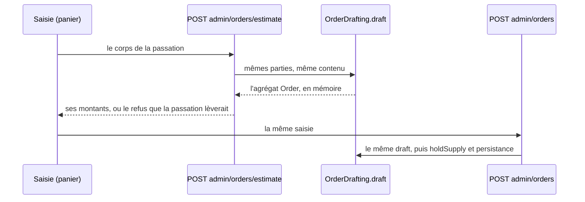

# Le prix que la saisie annonce

> 📝 Plan du 2026-11-03, doc-first : rien n'est bâti. **Révisé le même jour
> après `vitruve`** : sa première version déléguait le devis à celui de la
> boutique ; trois objections bloquantes (§6) l'ont fait tomber, et le devis
> compose désormais la commande elle-même. Demandé par Hugo :
> « est-ce que les tarifs, quand je suis sur une fiche client, sont bien
> ajustés en fonction des paramètres de commande (tarif client + promotions,
> en fonction des points de retrait, livraison, etc.) ? ». La réponse est non,
> et ce plan dit comment y arriver. Il touche à l'argent : contredit par
> `vitruve` avant de remonter à Hugo.

## 1. Ce qui est faux aujourd'hui (vérifié le 2026-11-03)

La saisie de commande de l'équipe (`apps/lfd-backoffice-frontend/src/app/commandes/nouvelle-commande/`,
ouverte aussi depuis le comptoir) montre trois prix, et deux sont faux.

| Où                                                                               | Ce qui est appliqué                                                                                                                                                                                                                                                                    | Source                                                                                                                    |
| -------------------------------------------------------------------------------- | -------------------------------------------------------------------------------------------------------------------------------------------------------------------------------------------------------------------------------------------------------------------------------------- | ------------------------------------------------------------------------------------------------------------------------- |
| La liste de gauche (catalogue, habitudes)                                        | le prix **d'étiquette**, le même pour tous les clients : ni mercuriale, ni promotion réservée                                                                                                                                                                                          | `GET /admin/catalog/sellable` (`catalog.service.ts` `list()`)                                                             |
| Le panier (sous-total HT)                                                        | **juste pour ce client** : mercuriale, palier atteint, promotion en cours                                                                                                                                                                                                              | `POST /admin/orders/quote` → `OrderDrafting.quote` (`order-drafting.service.ts`, JSDoc l. 289)                            |
| La remise de retrait, les frais de zone, la TVA, le TTC, le supplément de retard | **rien** : « calculés à la validation ». Le devis ne reçoit ni le mode, ni le point, ni l'adresse, ni le jour ; son JSDoc le dit : « Elle s'arrête au sous-total HT, parce que remise de retrait, frais de zone et TVA dépendent d'un acheminement qu'une estimation ne connaît pas. » | `orderQuotePayloadSchema` (`packages/contracts/src/order.ts`) : `companyId`, `lines`, `requestedDeliveryDate?`, `supply?` |

Conséquence au téléphone ou au comptoir : un prix lu à gauche peut être
contredit par le panier, et le total réel — 20 % de remise de retrait au Labo
pour un pro, par exemple (`discounts.b2b` du point, lu le 2026-11-03 en dev) —
n'est connu qu'une fois la commande passée.

## 2. Ce qui existe déjà et qu'on réutilise

- **La boutique a le décompte complet.** `ShopCartQuoting.quote`
  (`b2b/orders/application/services/shop-cart-quoting.service.ts`) prend un
  acheminement (`shopQuoteFulfillmentSchema` : `pickup` + point, ou `delivery`
  - code postal), le jour et le créneau, et rend sous-total, remise, frais,
    TVA par taux et TTC (`ShopQuoteView`). Il accepte une société
    (`companyId`) : le tarif négocié y entre.
- **La parité devis ↔ facture est éprouvée pour la boutique.**
  `test/quote-order-parity.e2e-spec.ts` compare le devis aux colonnes de la
  commande passée, montant par montant (retrait, coursier, barème de volume,
  TVA par taux, mode de TVA du port).
- **La saisie et la boutique composent la commande par le même chemin.**
  `PlaceOrderForCustomerHandler` et `PlaceShopOrderHandler` passent tous deux
  par `OrderDrafting`, qui applique les mêmes `CartAdjustments` que
  `ShopCartQuoting` (vérifié dans les constructeurs le 2026-11-03).
- **La vitrine sait chiffrer un catalogue pour une société.**
  `ShopCataloguePricing.priced(companyId, buyerKind, language)`
  (`b2b/catalog/application/shop-catalogue-pricing.service.ts`) rend chaque
  article « au prix qui sera facturé », promotions comprises.

## 3. Ce qu'on bâtit

> 🔴 **Une seule arithmétique** (Hugo, 2026-11-03 : « dans la mesure où on a
> déjà un calcul de panier, si on peut éviter de dériver avec autre chose »).
> Le calcul qui fait foi est celui qui **fabrique la commande** :
> `OrderDrafting.draft` puis `Order.draft`. Le devis de la saisie **compose la
> commande qu'on passerait, et ne l'écrit pas**. Il ne calcule aucun montant
> lui-même ; le front non plus, il affiche ce que le serveur rend. La parité
> devis ↔ facture n'est plus une propriété à éprouver entre deux calculs :
> c'est le même appel.

### Pourquoi `draft` peut servir de devis (vérifié le 2026-11-03)

`OrderDrafting.draft` (`order-drafting.service.ts`, l. ~145-235) ne fait que
**lire** : le payeur, la marque (`shelf.decide`), la journée, la résolution
(`composition.resolve`), l'heure limite (`cutoffGate.ensure(…, { withWaiver:
true })` **rend** la dérogation sans la consommer — son JSDoc : « la
consommer APRÈS avoir persisté la commande »), l'arrangement, le supplément
(`lateFeeFor`), puis `Order.draft` en mémoire. Ce qui écrit vit hors de lui,
chez l'appelant, dans la transaction : `holdSupply` (verrou de la vitrine ou
de la journée), la persistance, la consommation de la dérogation.

C'est ce qui règle d'un coup ce que la première version manquait :

| Objection de `vitruve`                                     | Réglée parce que…                                                                                                                 |
| ---------------------------------------------------------- | --------------------------------------------------------------------------------------------------------------------------------- |
| le supplément de retard a son propre taux de TVA           | `Order.draft` le ventile lui-même (`order-amounts.ts` l. 115 → `vat.ts` l. 102) : on lit ses montants, on ne les recompose pas    |
| la porte d'entrée (`buyerKind`)                            | les mêmes `OrderParties` que la passation de l'équipe : `REGISTERED_BUYER`, le membre « commande portée par »                     |
| créneau hors horaires, retrait immédiat, adresse du carnet | `composition.resolve` / `arrange` et `shelf` jugent exactement ce que la passation jugera, avec la même saisie (adresse comprise) |
| ligne dont l'unité a changé                                | elle est refusée comme à la passation, pas retirée en silence                                                                     |

### Lot P2 — le devis de la saisie compose la commande

- **Route** : `POST /admin/orders/estimate`, sous la même surface et le même
  droit que `POST /admin/orders` (`b2b_place_order:write`, à reprendre
  décorateur par décorateur). Corps : **le corps de la passation**
  (`placeOrderForCustomerPayloadSchema` ou son équivalent, à confirmer au
  bâti), sans clé d'idempotence. Une nouvelle route plutôt qu'un
  `/admin/orders/quote` élargi : ce dernier a deux autres lecteurs qui vivent
  de la trace de résolution par ligne (le simulateur de tarification,
  `simulateur-page.ts`, et la route client `POST /orders/quote`), et le plan
  ne les touche pas.
- **Handler** : `EstimateOrderForCustomerQuery` reprend la préparation de
  `PlaceOrderForCustomerHandler` jusqu'à `drafting.draft` inclus — mêmes
  parties, même contenu — **en extrayant cette préparation dans une fonction
  partagée** par les deux handlers, pour qu'elle ne diverge pas. Il s'arrête
  là : ni `holdSupply`, ni persistance, ni paiement, ni dérogation consommée.
- **Corps** : `adminPlaceOrderPayloadSchema` (`admin-orders.controller.ts`
  l. 199), **règlement compris** — c'est lui qui décide des refus de crédit.
- **Lire l'agrégat sans le muter** (BLOQUANT `vitruve` n° 1) : `Order`
  n'expose ni frais, ni supplément, ni TVA par taux ; ils ne sortent que par
  `toPersistence()`, qui refuse un règlement non décidé. Le lot ajoute au
  domaine un **accesseur de lecture** `Order.amounts()` (lignes et prix
  unitaires, sous-total, remises, frais, supplément, TVA par taux, TTC), testé
  au niveau domaine. Jamais `deferPayment()` pour pouvoir sérialiser.
- **Les refus, et seulement ceux qu'on sait juger** (BLOQUANT n° 3) : un refus
  de `draft` (créneau fermé, heure limite sans dérogation, jour fermé, unité
  changée, opération close…) revient comme `{ refusal: { code, message } }`,
  avec les mots de la passation. **Deux refus de la passation vivent après
  `draft`** : le stock de vitrine (lu sous verrou par `shelf.hold`) et le
  crédit du règlement au compte (`AccountSettlementNotGrantedError`,
  `ShelfWithoutCreditRefusedError`, `place-order-for-customer.handler.ts`
  l. 155-200). Décision : l'estimation les juge **sans verrou**, par les
  **mêmes prédicats** extraits de `shelf.hold` et de `settle` en fonctions
  partagées (pas recopiés) ; le panier le dit comme un avertissement (« reste
  en vitrine au moment du calcul ») et la passation reste seule juge sous
  verrou.
- **Le prix barré** : `canonicalPriceMillicents` n'existe pas dans le domaine
  des commandes (grep vide sous `domain/` et `application/`, 2026-11-03).
  Décision : la rature n'est **pas** demandée à un second devis à chaque
  frappe ; `composition.resolve` rend déjà la résolution par ligne, et
  l'estimation en reprend le prix d'entrée (`canonical`) quand la résolution
  le porte — sinon le lot l'y ajoute, dans la résolution qui facture, une
  seule fois. Un appel par changement, pas deux.
- **La sonde de coût** (SÉRIEUX) : `priceLines` passe `"checkout"` en dur ;
  chaque estimation se compterait comme une passation sur la carte de santé
  (`pricing-caller.ts` l'interdit). La fonction partagée reçoit le `caller`,
  et l'estimation se déclare `"estimate"`.
- **Le coût** : environ quinze lectures par estimation contre deux pour le
  devis actuel (estimé par `vitruve`, à MESURER au bâti). Le front attend
  400 ms d'inactivité, annule la requête en vol quand la saisie change, et
  `test/pricing-budget.e2e-spec.ts` gagne une ligne pour l'estimation.
- **Réponse** : les montants de `Order.amounts()`, l'éventuel refus, et
  l'heure limite.
- **Front** : le panier demande l'estimation dès que la saisie est assez
  complète pour qu'une commande se compose (lignes + mode + point ou adresse
  - jour + règlement) ; avant, il garde le devis actuel (sous-total). En-tête :
    « n articles · Total TTC … » ; vue panier : le détail, le supplément de
    retard en ligne à part (D1).
- **Parité** : un e2e « estimation = commande » passe la même saisie par
  `/admin/orders/estimate` puis `/admin/orders` et compare chaque montant aux
  colonnes de la commande : retrait (remise pro), coursier (frais de zone),
  retrait immédiat (sur stock), dérogation à l'heure limite (supplément et sa
  TVA), règlement au compte.

### Lot P1 — la liste de gauche au prix du client (après P2, à re-planifier)

> ⚠️ Mis en attente par `vitruve` (BLOQUANT n° 2) : la résolution qui
> facture (`priceAll`, `order-line-pricing.service.ts` l. 238) lève au
> premier SKU refusé pour TOUT le lot ; un seul article réservé ou retiré
> ferait tomber la liste, et un appel par SKU coûte N résolutions complètes à
> chaque ouverture. P1 se re-planifie après P2, avec une mesure de coût, sur
> ces acquis :

- **Pas** `ShopCataloguePricing` : quantité 1, rayon de la boutique, deux
  listes de SKU à recoller.
- La résolution est `linePricing.resolve`, celle que `draft` emploie — pas
  `explain`, qui paie les paliers (`withTiers`).
- Parties : `REGISTERED_BUYER` écrit en dur au serveur, jamais un paramètre.
- Garde : `b2b_place_order:write` décorateur par méthode (la surface de
  `/admin/catalog/sellable` n'a que `b2b_orders`, sans `@RequirePermission`).
- L'écran dit que c'est un **prix de ligne, à la quantité plancher, hors
  remise de panier** ; « à partir de » quand un barème existe (D2).
- Un article que la résolution refuse pour ce client n'a pas de prix —
  jamais le prix d'étiquette laissé en silence. Comment le savoir sans
  faire tomber le lot est la question à trancher.

## 4. Ce que ce plan ne fait pas

- Le **simulateur de tarification** et la route client `POST /orders/quote`
  gardent `OrderDrafting.quote` et sa trace : ils ne sont pas la saisie.
- Le **bon de fidélité** : la saisie de l'équipe n'en porte pas.
- Le prix du **réassort** et de la **révision** de commande.
- La saisie d'un **particulier** par l'équipe : `PlaceOrderForCustomer` exige
  une société ; l'estimation aussi.

## 5. Les décisions de Hugo (2026-11-03)

- **D1.** Le supplément de retard est une **ligne à part** dans le panier,
  comme sur la facture.
- **D2.** La liste écrit **« à partir de »** quand un barème de volume existe
  pour l'article.
- **D3.** **P2 d'abord**, puis P1.
- **D4 — le principe.** « Ce qui est important pour moi quand on commande à
  la place du client, c'est que ce soit comme s'il commandait lui-même dans
  son espace : tarif, règles, etc. » Le devis et la commande de la saisie
  donnent **les mêmes prix, remises, promotions et règles** que le client
  aurait dans son espace pro. Au bâti, toute différence entre la passation de
  l'équipe (`PlaceOrderForCustomer`) et celle du client dans son espace se
  liste et se justifie ; celles qui ne sont pas des gestes réservés à
  l'équipe (retrait immédiat, réception « hors plan », dérogation à l'heure
  limite — chacun déjà nommé et tracé) sont des écarts à fermer.

### Ce que D4 trouve dans le code (`vitruve`, 2026-11-03)

La passation du pro dans son espace est `PlaceOrderHandler` ;
`PlaceShopOrderHandler` ne sert jamais un pro (`companyId: null`, invité).

**Identique** : mêmes `companyId` et `REGISTERED_BUYER` dans `draft`, donc
mercuriale, palier, promotions, audience, remise de retrait, frais, CGV,
minimums ; heure limite et dérogation jugées pareil.

**Gestes réservés à l'équipe, déjà nommés** : réception hors plan (§8.3) ;
retrait immédiat (L6) et marque `shelf` (L4) ; porte « jour même »
`counter` au lieu de `pro_online` (`same-day-doors.ts` l. 24-28).

**Écarts non nommés, à trancher par Hugo** :

| #   | Écart                                                                                                                                                                            | Le code                                                                                                |
| --- | -------------------------------------------------------------------------------------------------------------------------------------------------------------------------------- | ------------------------------------------------------------------------------------------------------ |
| E1  | **Créneaux pro** : l'équipe peut demander une fenêtre que le pro ne pourrait pas choisir (créneau ou échéance hors de son carnet) ; « à trancher par Hugo » depuis le 2026-10-12 | `windowRequesterOf` → `"staff"` (`order-drafting.service.ts` l. 375-380) ; `delivery-window.ts` l. 108 |
| E2  | **Admission de la boutique** : l'équipe passe outre une boutique fermée à la clientèle et le premier jour commandable                                                            | `intake.admit` appelé par `PlaceOrderHandler` seul (l. 138-143 ; `order-intake.service.ts` l. 96-107)  |
| E3  | **Bon de fidélité** : le client peut en dépenser un, pas l'équipe pour lui (sans effet pour un pro tant que la fidélité pro n'est pas ouverte)                                   | `place-order-for-customer.handler.ts` l. 93                                                            |
| E4  | **Règlement** : refus différents (« pro sans crédit » sur la vitrine, lien de paiement au lieu de la carte), montants identiques                                                 | `settle` de l'équipe (l. 155-200) contre `settleOrder`                                                 |
| E5  | **Porte comptoir sur stock** : l'équipe peut commander sur stock pour un point qui n'a plus de créneau pro aujourd'hui                                                           | `refusalFor`, `door === "counter"` → `null` (l. 117-118)                                               |

L'estimation (P2) hérite de ce que la passation de l'équipe fait : trancher
E1-E5 change donc les deux ensemble, et c'est voulu.

**Tranché par Hugo le 2026-11-03** :

- **E1 → aligné sur le client.** « Ça ferait un endroit pour échapper aux
  règles de livraison et de point de retrait. » Pour un pro, la saisie de
  l'équipe demande la fenêtre comme le pro (`windowRequesterOf` rend `"pro"`) ;
  le « à trancher » du code est levé.
- **E2 → aligné sur le client.** La saisie passe par `intake.admit`. Un cas
  d'exception passe par le **système de dérogation existant**, pas par un
  contournement silencieux de l'équipe.
- **E3 → gardé, et noté** : l'équipe ne dépense pas le bon de fidélité d'un
  client (sans effet tant que la fidélité pro n'est pas ouverte).
- **E5 → gardé, geste nommé du comptoir.** « Le client est déjà en train de
  parler avec nous. » La porte `counter` sur stock ne juge pas les créneaux
  pro restants : c'est le retrait immédiat, le client est devant le comptoir.
- **E4 → pas de lien de règlement au comptoir, pour l'instant.** Au
  comptoir, la saisie de l'équipe se règle **au compte** seulement (rien ne
  s'encaisse au comptoir par notre système). Un pro sans compte ne commande
  pas au comptoir par la saisie : le refus le dit. Le lien de règlement reste
  à la saisie du commercial hors comptoir. À bâtir avec P2 : le choix
  « Lien de règlement au client » disparaît du panier quand la saisie est
  ouverte depuis le comptoir, et le serveur le refuse aussi.

## 6. Ce que `vitruve` a contredit (2026-11-03)

Première version : déléguer le devis à `ShopCartQuoting`. **BLOQUANT** ×3, tous
réglés par la révision : le supplément de retard n'aurait pu s'ajouter qu'en
recalculant la TVA hors du décompte (seconde arithmétique) ; retirer
`OrderDrafting.quote` vidait le simulateur et la route client de leur trace ;
la porte d'entrée (`buyerKind`) du devis délégué aurait été « invité » là où la
passation fige « reconnu ». **SÉRIEUX**, réglés aussi : créneau hors horaires et
retrait immédiat non jugés par le devis de la boutique ; ligne d'unité changée
retirée en silence ; code postal contre adresse du carnet ; P1 tarifé à la
quantité 1 sur le rayon de la boutique, avec un droit trop large.

**Seconde lecture, sur la révision** : la composition n'écrit rien (vérifié
service par service ; les adaptateurs Prisma ne l'ont pas été) et aucun
montant ne bouge après elle. **BLOQUANT** ×3, intégrés au §3 : l'agrégat
n'expose pas ses montants (→ `Order.amounts()`) ; P1 ne peut pas rendre « pas
de prix » pour un seul SKU sans faire tomber le lot (→ P1 re-planifié) ; deux
refus vivent après `draft`, stock de vitrine et crédit (→ jugés sans verrou par
les mêmes prédicats). **SÉRIEUX** intégrés : la sonde de coût, le coût par
frappe, le prix barré, le schéma exact (`adminPlaceOrderPayloadSchema`).
