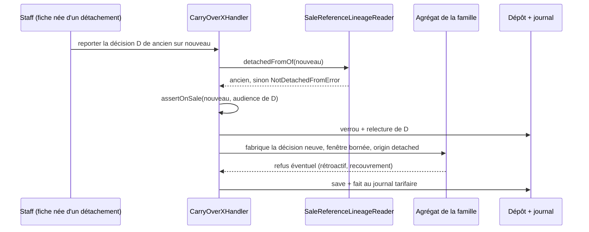

# Reporter après un détachement : les cinq autres familles de décisions

> 🟦 **Bâti le 2026-10-30, lots R0 à R6, pas encore commité** (cf. § 6 pour
> ce que chaque lot a livré et où le code s'écarte de la lettre du plan).
> Le texte ci-dessous était doc-first : il décrit l'intention. Suite du
> geste L7c bâti pour la mercuriale
> ([`plan-tarif-date-sur-une-reference.md`](../mercuriales/plan-tarif-date-sur-une-reference.md) § 6, § 13 T5 ;
> [`../../catalogue/plan-pro-voit-les-declinaisons.md`](../../catalogue/plan-pro-voit-les-declinaisons.md), L7c).
> Touche l'argent : **`vitruve` obligatoire avant Hugo** (CLAUDE.md § 9 bis).
> **Révisé le 2026-10-30 après contradiction de `vitruve`** (§ 9) : garde par
> surface, engagement reporté à l'identique, chemin propre du plancher, origine
> en `Json`, refus du rétroactif posé dans le domaine.

## 0. Ce que dit le code aujourd'hui (ouvert le 2026-10-30)

- Le report n'existe que pour la mercuriale. `carryOverDraft`
  (`apps/lfd-api/src/b2b/pricing/domain/entities/mercuriale-carry-over.ts:28-45`)
  copie les paliers de la ligne en cours de l'ancienne référence, pose
  `validFrom = max(maintenant, début de la ligne)` (`:40`), `validTo` = fin
  réelle de la ligne (`:41`) et `origin: { kind: "detached", fromSku, fromMercurialeId }` (`:43`).
- Le handler (`apps/lfd-api/src/b2b/pricing/application/commands/carry-over-mercuriale-line.handler.ts`)
  garde la filiation (`detachedFromOf(toSku) === fromSku`, `:53-56`), la vente
  aux pros (`assertOnSale`, `:57`), la réservation (`:68`), et écrit sous
  verrou dans une seule `uow.run` (`:61-87`).
- La liste des décisions d'une référence
  (`apps/lfd-api/src/b2b/pricing/infrastructure/prisma-sale-reference-decisions.reader.ts`)
  connaît six familles : `mercuriale` (`:67`), `price_rule` (`:77-91`),
  `price_floor` (`:93-108`, `companyId: null`, sans pause), `volume_ladder`
  (`:110-124`), `volume_commitment` (`:126-145`, `companyId` propre,
  `validTo > at` sans `null`), `price_template` (`:147-161`, **sans fenêtre** :
  `validFrom: null`, `validTo: null`).
- À l'écran, seule la mercuriale est « reportable » :
  `carriable: view.kind === 'mercuriale'`
  (`apps/lfd-backoffice-frontend/src/app/pim/catalogue/product-form/detached-decisions/detached-decisions-lines.ts:69-70`) ;
  le bouton est `app-mercuriale-carry-over`
  (`detached-decisions/detached-decisions.html:18-24`), et le JSDoc dit que
  « les autres familles gardent leur geste propre, sur leur écran »
  (`detached-decisions.ts:28-29`). Ce geste propre est la **saisie** — rien ne
  pré-remplit depuis l'ancienne décision.
- Chaque pose a déjà son contrôle « en vente » (L5) : `create-price-rule.handler.ts:44`,
  `set-price-floor.handler.ts:39` (par clientèle), `set-volume-ladder.handler.ts:37`,
  `sign-volume-commitment.handler.ts:48` (`"pro"`), `save-price-template.handler.ts:22`,
  `apply-price-template.handler.ts:60`. Et son refus de période scellée
  (`PricedPeriodIsSealedError`, importée par les handlers depuis
  `domain/pricing-errors.js`, ex. `create-price-rule.handler.ts:3`) :
  règles `create-price-rule.handler.ts:58-60`, barèmes
  `set-volume-ladder.handler.ts:51-53`, engagements
  `sign-volume-commitment.handler.ts:63-65`.
- Les refus du report mercuriale vivent dans
  `domain/errors/mercuriale-carry-over-errors.ts` (`NotDetachedFromError` `:19`,
  `NoNegotiatedLineToCarryError` `:35`).
- **Origine** : absente des quatre tables `price_rules`, `price_floors`,
  `volume_ladders`, `volume_commitments` (`@@map`, `prisma/schema/*/pricing.prisma`,
  ouvert le 2026-10-30). Seul l'avenant de mercuriale la porte, en
  `origin Json?` (`CompanyMercurialeAmendment`, `pricing.prisma:368`), relue et
  revalidée par `originFromJson` (`infrastructure/mercuriale-rows.ts:103-115`).
  Le report de mercuriale n'est **pas** idempotent par contrainte : aucune
  unicité ne porte sur cette origine. Ce n'est donc pas un précédent à copier
  pour « déjà reporté ».
- **Garde** : posée par contrôleur (`@AdminSurface`), pas par route ;
  `@RequiresPermission` n'existe pas dans `pricing/http`. Le panneau de
  décisions est sous `b2b_pricing`
  (`admin-sale-reference-decisions.controller.ts:23`), comme les règles et
  barèmes (`admin-pricing.controller.ts:71`), les engagements
  (`admin-volume-commitments.controller.ts:29`) et les gabarits
  (`admin-price-templates.controller.ts:44`) ; les **planchers** sont sous
  `lfc_price_limits` (`admin-price-floors.controller.ts:56`, JSDoc `:49-54`).
- **Rétroactif** : `lint:dated-decisions` ne refuse PAS un `validFrom` passé —
  elle juge la forme des matériaux (`dev-toolbox/gates/dated-decisions.mjs:36-41`).
  Le seul refus existant est celui des avenants (`RetroactiveAmendmentError`,
  `domain/entities/mercuriale-amendment-checks.ts:82-84`) ; `PricingRule` ne
  refuse qu'une fenêtre inversée (`pricing-rule.ts:138-139`). Le gabarit
  échappe de toute façon à la porte : il n'est pas dans `PricingMaterials`.
- **Période scellée** = `archivedOverlapping` + `anyPriced`
  (`create-price-rule.handler.ts:58-60`) : une décision rangée ET qui a
  facturé. Sur un sku neuf, rien n'a facturé : ce refus ne peut pas se
  produire et **ne compte pas** comme protection du report.

## 1. Le principe, commun aux familles

Reporter = **poser une décision neuve** sur la nouvelle référence, par le
chemin de pose de sa famille (agrégat, recouvrements, L5, journal), avec une
fenêtre bornée par celle de l'ancienne. Jamais une réécriture de l'ancienne :
elle reste telle quelle (la référence ne se vend plus, elle ne fait plus de
prix — même raisonnement que `mercuriale-carry-over.ts:22-24`).

Fenêtre, partout : `validFrom = max(maintenant, début de l'ancienne)`,
`validTo = fin réelle de l'ancienne` (`null` si elle court sans fin). Jamais
de `validFrom` passé : une lecture datée d'hier ne doit pas changer. Aucune
porte ne le tient (§ 0) : chaque fabrique `carriedFrom(...)` du domaine
**refuse** un `validFrom` antérieur à `maintenant`
(`RetroactiveCarryOverError`, neuf, sur le modèle de
`RetroactiveAmendmentError`), éprouvé par un test unitaire par famille.

**Portée posée** : celle de l'ancienne, même type (`product` ou `variant`,
les deux `REFERENCE_SCOPES` du lecteur, `prisma-sale-reference-decisions.reader.ts:10`),
`scopeId` = nouveau sku. Une décision de catégorie ne figure pas au panneau
et n'est jamais reportée : elle couvre déjà le nouveau sku s'il est dans la
famille.

## 2. Famille par famille

| Famille                    | Ce que porte la décision (lecteur)                                | Ce qu'on reporte                                                 | Audience L5                                    | Refus propres                                                 |
| -------------------------- | ----------------------------------------------------------------- | ---------------------------------------------------------------- | ---------------------------------------------- | ------------------------------------------------------------- |
| Règle de prix              | portée référence, fenêtre, audience (société ou clientèle), pause | une règle neuve, même effet, même audience, portée = nouveau sku | celle de la règle                              | rétroactif ; recouvrement d'une règle de même portée/audience |
| Plancher                   | portée référence, clientèle, fenêtre, pas de société              | voir § 2.3 — chemin propre                                       | la clientèle (`set-price-floor.handler.ts:39`) | un plancher déjà en vigueur sur le nouveau sku                |
| Barème de volume (paliers) | portée, audience, fenêtre, pause                                  | un barème neuf, mêmes paliers                                    | celle du barème                                | rétroactif ; recouvrement                                     |
| Engagement de volume       | portée, **société**, quantité promise, fenêtre toujours bornée    | voir § 2.1 — la même promesse                                    | `"pro"`                                        | rétroactif ; engagement clos                                  |
| Gabarit de prix            | lignes de skus, **aucune fenêtre ni société**                     | voir § 2.2 — ne s'applique pas tel quel                          | —                                              | —                                                             |

**Une règle ou un barème en pause** : on reporte la pause aussi (la décision
neuve naît en pause), sinon le report rallume un prix que le staff avait coupé.
À trancher (Q1).

### 2.1 L'engagement : reporter la promesse telle quelle

**La quantité promise FAIT le prix.** `retainedQuantity = max(promis, livré)`
(`domain/volume-commitment.ts:38`, `:58-60`) : le promis ouvre le palier dès
la première commande. Le livré se mesure **par sku** (`committedVolumesFor`,
`prisma-customer-volume.reader.ts:80-82`, `groupBy sku`) sur la fenêtre de
l'engagement bornée à l'instant demandé (`pricing-materials.loader.ts:227-243`).

Conséquence, et elle renverse la première version de ce plan :

- reporter le **reste** (ancienne option A) abaisse le promis, donc le palier :
  le client paierait plus cher dès le jour du détachement, pour une décision
  qui n'est pas la sienne ;
- **clore** (ancienne option B) supprime le promis sur la nouvelle référence :
  même effet, en pire, jusqu'à la renégociation.

Les deux sont **écartées**. Reporter = **copier la quantité promise** sur le
nouveau sku, même société, fenêtre `max(maintenant, début)` → fin réelle de
l'ancien (toujours bornée). Le livré du nouveau sku repart de zéro, mais le
`max` garde le palier promis : le client garde son palier, rien de plus.

**Coexistence (Q2).** L'ancien engagement court jusqu'à sa fin. Il ne double
pas l'avantage : son livré se compte sur l'ancien sku seul
(`prisma-customer-volume.reader.ts:80-82`), et `commitmentFor`
(`volume-commitment.ts:83-99`) ne retient, pour un article, que l'engagement
qui couvre CE sku — l'ancien ne couvre pas le nouveau. Chaque engagement ne
fait le prix que de sa référence, et l'ancienne ne se vend plus. Le seul
« doublon » est d'affichage (deux lignes au cockpit).

**Cohabitation avec une catégorie.** Si un engagement de catégorie de la même
société couvre déjà le nouveau sku, `commitmentFor` trie par `RANK`
(`volume-commitment.ts:121-126`, `variant 3 > product 2 > category 1`) : le
reporté, de portée référence, **l'emporte** pour ce sku. C'est l'état qui
régnait avant le détachement (la référence engagée battait la famille) ; le
report le prolonge, il ne l'aggrave pas. Le handler le dit au staff (« un
engagement de famille couvre aussi cet article ; le reporté prévaut ») sans
refuser.

### 2.2 Le gabarit : pas de portée article, pas de report

Un gabarit n'a ni fenêtre ni société (`prisma-sale-reference-decisions.reader.ts:147-161`) :
c'est un modèle de mercuriale, appliqué par `apply-price-template.handler.ts`
pour **poser** une mercuriale. Ce qu'on « reporte » d'un gabarit n'est pas une
décision datée — c'est une **édition** : remplacer la ligne de l'ancien sku par
le nouveau. Rien de rétroactif (les mercuriales déjà posées depuis lui portent
leurs propres lignes, que L7c reporte déjà). Le geste est donc « Remplacer
`ancien` par `nouveau` dans le gabarit », hors règle des décisions datées, avec
`assertOnSale` comme `save-price-template.handler.ts:22`. À confirmer (Q3) :
faut-il retirer l'ancienne ligne, ou ajouter seulement la nouvelle ?
La surface est `b2b_pricing` (`admin-price-templates.controller.ts:44`).

### 2.3 Le plancher : un chemin propre

`SetPriceFloorHandler` ne convient pas tel quel
(`set-price-floor.handler.ts:37-42`) : il pose **à `now`**, **sans `validTo`**
(`PricingFloor.pose`, `pricing-floor.ts:144`), et **remplace** un plancher en
vigueur (acte `replaced`). Un report y écraserait sans bruit un plancher déjà
posé sur la nouvelle référence, et perdrait la fin de l'ancien.

Tranché : **extension explicite du domaine plancher**, pas un contournement.
`PricingFloor.carriedFrom(old, toScope, at, canonical)` :

- `validFrom = max(at, old.validFrom)`, `validTo = old.validTo` (le champ
  existe déjà, `pricing-floor.ts:39`, écrit seulement par `close` `:181`) ;
- refuse si un plancher est **déjà en vigueur** sur la nouvelle portée et la
  même clientèle (`FloorAlreadyInForceError`, neuf) — jamais `replaced` ;
- garde les refus de `pose` (dont `FloorAboveCanonicalError`).

Handler `CarryOverPriceFloorHandler` ; le journal garde la clé de portée
(`floorSubjectKey`, `set-price-floor.handler.ts:55-63`), acte neuf `carried`.

**Plancher en pourcentage.** Il est relatif au canonique de la référence
(`referenceCanonicalFor`, `set-price-floor.handler.ts:52-54`). Le report copie
le **pourcentage** (la règle), pas le montant résolu. C'est voulu : la
décision du staff était « jamais sous X % du prix de référence », et la
nouvelle déclinaison a son propre canonique ; recopier un montant figerait
une protection calée sur un autre article (trop haute si la déclinaison est
plus petite, trop basse si plus grande). Un plancher en euros (article seul)
copie le montant.

## 3. Refus nommés (communs)

- `NotDetachedFromError` (existe, `mercuriale-carry-over-errors.ts:19`) —
  la référence cible n'est pas née de l'ancienne.
- **`DecisionAlreadyCarriedError`** (neuf) — une décision de la même famille,
  **en vigueur ou programmée**, porte déjà une origine `detached` depuis le même
  ancien sku, sur le nouveau sku, pour la même audience (clientèle ou
  société). Clé : (ancien sku, nouveau sku, famille, audience), **pas**
  l'identifiant de la décision d'origine — un plancher versionné change d'id
  à chaque période (`set-price-floor.handler.ts:55-60`), une unicité sur
  l'id laisserait reporter deux fois la même protection. Tenu sous verrou dans
  le handler ; pas de contrainte unique (l'origine est en `Json`, § 6 R0).
- **`CarriedDecisionClosedError`** (neuf) — l'ancienne est archivée, ou sa
  fin réelle est passée : rien à reporter (pendant de
  `NoNegotiatedLineToCarryError`, `:35`).
- `SaleReferenceNotOnSaleError` — la cible ne se vend pas à l'audience de la
  décision (L5, via `assertOnSale`).
- Réservation à un autre compte (`assertNotReservedElsewhere`, comme
  `carry-over-mercuriale-line.handler.ts:68`) — pour les décisions à société
  seulement.
- **`RetroactiveCarryOverError`** (neuf) — `validFrom` calculé antérieur à
  `maintenant` ; refusé dans la fabrique du domaine (§ 1).
- **`FloorAlreadyInForceError`** (neuf) — § 2.3.
- Les refus de pose de chaque famille (recouvrement) remontent tels quels.
  `PricedPeriodIsSealedError` n'est pas compté : impossible sur un sku neuf
  (§ 0).

## 4. Qui peut le faire

Le droit de **poser** la famille, pas un droit neuf : reporter, c'est poser.
La garde étant posée **par contrôleur** (`@AdminSurface`), chaque route de
report vit **dans le contrôleur de SA surface**, jamais dans celui du
panneau :

| Famille       | Contrôleur                                     | Surface            |
| ------------- | ---------------------------------------------- | ------------------ |
| Règle, barème | `admin-pricing.controller.ts:70-71`            | `b2b_pricing`      |
| Plancher      | `admin-price-floors.controller.ts:55-56`       | `lfc_price_limits` |
| Engagement    | `admin-volume-commitments.controller.ts:28-29` | `b2b_pricing`      |
| Gabarit       | `admin-price-templates.controller.ts:43-44`    | `b2b_pricing`      |

Un report de plancher sous `admin-sale-reference-decisions` (`b2b_pricing`)
donnerait le plancher à qui n'a pas `lfc_price_limits` : c'est la faute à
éviter.

## 5. À l'écran

`detached-decisions-lines.ts:69-70` devient
`carriable = kind ∈ {mercuriale, price_rule, price_floor, volume_ladder}` (+
`volume_commitment`), et `carried` lit l'origine renvoyée par le
lecteur de décisions de la **nouvelle** référence (pas seulement les ids de
mercuriales). Un composant de report générique remplace
`app-mercuriale-carry-over` : motif pré-rempli « report de la déclinaison
détachée <ancien sku> », `fold-inline-confirm`, puis la route de la famille.
Le gabarit affiche « Remplacer dans le gabarit ». Le bouton du plancher n'est
offert qu'au staff qui a `lfc_price_limits`.

## 6. Lots (un lot = un commit)

- ~~**R0** — migration additive : `origin Json?` sur `price_rules`,
  `price_floors`, `volume_ladders`, `volume_commitments`~~ — ✅ bâti le
  2026-10-30 : `20261030230000_l_origine_des_decisions_reportees`
  (`lock_timeout` 5 s), lue par `decisionOriginFromJson`
  (`apps/lfd-api/src/b2b/pricing/infrastructure/decision-origin-rows.ts`), rendue par le lecteur de
  décisions (`SaleReferenceDecisionView.origin`). `lecteur-de-migrations`
  avant main reste à faire.
- ~~**R1** — règles~~ — ✅ bâti le 2026-10-30 : `PricingRule.carriedFrom`
  (+ `apps/lfd-api/src/b2b/pricing/domain/entities/pricing-rule-carry-over.ts`), `CarryOverPriceRuleHandler`, acte
  `posed` avec le motif. ⚠️ La route est dans
  `apps/lfd-api/src/b2b/pricing/http/admin-pricing-carry-over.controller.ts`, **même surface**
  `b2b_pricing`, et non dans `admin-pricing.controller.ts`, qui dépassait déjà
  300 lignes.
- ~~**R2** — planchers~~ — ✅ bâti le 2026-10-30 : `PricingFloor.carriedFrom`,
  port `CarriedFloorRepository` (insérer sans borner), acte neuf `carried`
  (fait `price_floor.carried`), route `POST admin/pricing/floors/:id/carry-over`
  sous `lfc_price_limits`.
- ~~**R3** — barèmes, comme R1~~ — ✅ bâti le 2026-10-30 (même contrôleur que R1).
- ~~**R4** — engagements~~ — ✅ bâti le 2026-10-30 : même promesse, fait
  `volume_commitment.signed` ; route `POST admin/pricing/commitments/:id/carry-over`.
- ~~**R5** — gabarit~~ — ✅ bâti le 2026-10-30 : `PriceTemplate.replaceSku`,
  route `POST admin/pricing/templates/:id/carry-over` (le motif est reçu,
  sans journal où l'écrire).
- ~~**R6** — front~~ — ✅ bâti le 2026-10-30 : `app-decision-carry-over`
  remplace `app-mercuriale-carry-over`, `linesToCarryAll` et « Tout
  reporter » dans `detached-decisions/`.

« Déjà reporté » est tenu sous `pg_advisory_xact_lock` par (famille, nouvelle
référence) — port `CarryOverLock` —, puis relu par `CarriedDecisionsReader`
(`origin->>'fromSku'`).

## 7. Tests

- **Unitaires domaine**, par famille : fenêtre `max(maintenant, début)` /
  fin réelle / `null` ; ancienne programmée dans le futur ; ancienne close →
  refus ; `validFrom` passé → `RetroactiveCarryOverError` ; pause reportée
  (selon Q1) ; plancher en % reporté en % ; engagement à promis égal. Dates relatives (`daysAgo`), jamais
  absolues (CLAUDE.md § 5).
- **Unitaires application** (ports doublés) : filiation refusée, L5 refusé,
  déjà reportée, recouvrement remonté, journal écrit une fois.
- **E2E par famille** sur Postgres jetable, sur le modèle de
  `apps/lfd-api/test/mercuriale-carry-over.e2e-spec.ts` : détacher, reporter,
  vérifier que le prix résolu du nouveau sku à `maintenant` est celui de
  l'ancien, qu'une lecture datée d'hier est inchangée, et qu'un second report
  est refusé (409), y compris après versionnage du plancher d'origine.
  Engagement : le palier résolu du nouveau sku le jour du report est celui
  de l'ancien ; un engagement de catégorie de la même société ne le
  détrône pas. Garde : un staff sans `lfc_price_limits` reçoit 403 sur le
  report de plancher. Mur tenant : une règle de société A n'est pas reportable
  vers un sku réservé à B.

## 7 bis. Réponses de Hugo (2026-10-30)

- **Pause** : une règle ou un barème en pause se reporte **en pause**.
- **Engagement** : l'ancien engagement **court jusqu'à sa fin** à côté du
  reporté (aucun avantage cumulé ; il ne s'applique plus, la référence n'étant
  plus vendue) — la recommandation, retenue.
- **Gabarit** : la ligne de l'ancienne référence est **remplacée**.
- **Plancher** : **reporté** comme les autres, un pourcentage restant un
  pourcentage (appliqué au prix de la nouvelle référence).
- **Geste** : un **« Tout reporter »** qui ne reporte que ce que le rôle de la
  personne permet (tarifs sous `b2b_pricing:write`, planchers sous
  `lfc_price_limits:write`), à côté des reports un par un.

## 8. Questions ouvertes à Hugo (tranchées au § 7 bis)

1. **Pause** : une règle/un barème en pause se reporte-t-il en pause, ou pas
   du tout ?
2. **Engagement** : l'ancien engagement court jusqu'à sa fin à côté du
   reporté (recommandé : il ne double aucun avantage, § 2.1), ou faut-il le
   clore au report — et avec quel motif (la fermeture accepte `null`,
   `close-volume-commitment.command.ts:11`) ?
3. **Gabarit** : remplacer l'ancienne ligne, ou ajouter la nouvelle à côté ?
4. **Plancher** : un plancher clientèle est-il vraiment à reporter, ou la
   nouvelle référence reçoit-elle le sien par l'écran de confirmation
   (`confirm-price-floor.handler.ts`) ? Et le report en % (§ 2.3) est-il bien
   l'intention ?
5. **Report groupé** : un bouton « tout reporter », ou une décision à la fois
   (comme L7c) ? Un « tout » traverserait deux surfaces (`b2b_pricing`,
   `lfc_price_limits`).

## 9. Contradiction de vitruve (2026-10-30)

| Objection                                                                                                                            | Réponse                                                                                                                                                                                                               |
| ------------------------------------------------------------------------------------------------------------------------------------ | --------------------------------------------------------------------------------------------------------------------------------------------------------------------------------------------------------------------- |
| **B1** Garde par contrôleur (`@AdminSurface`), pas par route ; `@RequiresPermission` inexistant ; planchers sous `lfc_price_limits`. | Chaque report vit dans le contrôleur de sa surface (§ 4) ; gabarits vérifiés sous `b2b_pricing` (`admin-price-templates.controller.ts:44`).                                                                           |
| **B2** La quantité promise fait le prix ; mesure par sku et fenêtrée.                                                                | Options A et B écartées (le client paierait plus cher le jour du détachement) ; report à promis égal, fenêtre `max(maintenant, début)` → fin réelle (§ 2.1). Coexistence vérifiée sans double avantage ; Q2 réécrite. |
| **B3** `SetPriceFloorHandler` pose à `now`, sans fin, et remplace ; % relatif au canonique.                                          | Extension explicite de `PricingFloor` (`carriedFrom`, `validTo`, refus si déjà en vigueur) ; le report copie le pourcentage, voulu (§ 2.3).                                                                           |
| **S** Origine absente des quatre tables ; mercuriale en `origin Json?` ; unicité sur l'id ne survit pas au versionnage.              | `origin Json?` aligné sur l'avenant ; « déjà reporté » par (ancien, nouveau, famille, audience) sous verrou (§ 3, R0).                                                                                                |
| **S** `lint:dated-decisions` ne refuse pas un `validFrom` passé ; gabarit hors porte.                                                | Refus ajouté au domaine (`RetroactiveCarryOverError`, § 1) ; constat au § 0.                                                                                                                                          |
| **S** Période scellée impossible sur un sku neuf.                                                                                    | Retirée des protections (§ 0, § 2, § 3).                                                                                                                                                                              |
| **S** Recouvrements : quel `scope_type`, cohabitation avec un engagement de catégorie.                                               | Même type que l'ancienne (`product`/`variant`) ; le reporté l'emporte par `RANK`, comme avant le détachement (§ 1, § 2.1).                                                                                            |
| Mineur : import de `PricedPeriodIsSealedError`.                                                                                      | Corrigé : `domain/pricing-errors.js` (§ 0).                                                                                                                                                                           |
| Mineur : le report de mercuriale n'est pas idempotent par contrainte.                                                                | Écrit au § 0 ; plus cité comme précédent.                                                                                                                                                                             |
| Mineur : la fermeture d'engagement accepte `reason` null.                                                                            | Intégré à Q2.                                                                                                                                                                                                         |

**Correction du 2026-10-30 (coordinateur, sous mandat de Hugo), après bâti.**
La clé « déjà reportée » d'une **règle** est son identité d'exclusion
(`price_rules_no_overlap`) : étage, audience, seuil — et non l'audience
seule. Deux règles distinctes de l'ancienne référence (ex. une promotion et
un geste pour la même société) se reportent donc toutes deux ; la même deux
fois reste refusée (409). Le **barème** garde l'audience : son exclusion
(`volume_ladders_no_overlap`) ne porte que portée et audience. Tenu par
`ruleCarryKey` (`apps/lfd-api/src/b2b/pricing/domain/entities/decision-carry-over.ts`).
