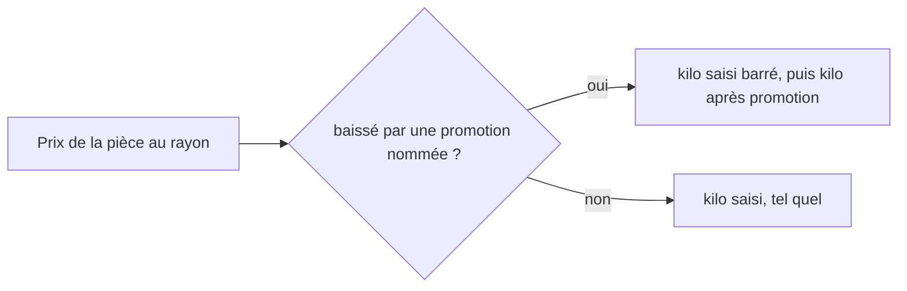

# Saisir un prix

> ✅ **Doc d'état, ouverte le 2026-11-11**, écrite contre le code à partir de
> l'audit des docs de la saisie
> ([`audit-des-docs-de-la-saisie.md`](audit-des-docs-de-la-saisie.md)). Elle
> se remplit partie par partie, et chaque plan absorbé est retiré (l'histoire
> reste dans git). Partie 1 : comprendre. Partie 2 : le code.
>
> | Partie  | Sujet                                    | État                                                        |
> | ------- | ---------------------------------------- | ----------------------------------------------------------- |
> | § 1     | Les écrans de tarification               | à écrire (aujourd'hui : `ecrans-de-tarification.md`)        |
> | **§ 2** | **Le prix d'un article dans sa fiche**   | ✅ écrite                                                   |
> | § 3     | Changer l'unité de vente                 | à écrire (aujourd'hui : `plan-changer-l-unite-de-vente.md`) |
> | § 4     | Le report après détachement              | à écrire (aujourd'hui : `plan-report-apres-detachement.md`) |
> | § 5     | Le prix pendant la saisie d'une commande | à écrire (aujourd'hui : `plan-prix-de-la-saisie.md`)        |
> | § 6     | Ce qui reste                             | ci-dessous                                                  |

# Partie 1 — Comprendre

## § 2. Le prix d'un article dans sa fiche

Dans la fiche produit, carte **« Tarif & TVA »**, chaque déclinaison porte ce
que le commercial saisit. Rien n'y est calculé : ce qui est saisi est ce qui
est lu.

| Ce qu'on saisit                      | Unité                 | Ce que c'est                                         |
| ------------------------------------ | --------------------- | ---------------------------------------------------- |
| **Prix public**                      | TTC, au centime       | ce que paie un particulier                           |
| **Prix pro**                         | HT, à cinq décimales  | ce que paie un pro, avant ses remises                |
| **Prix au kilo public** (facultatif) | TTC, au centime       | une information pour le client                       |
| **Prix au kilo pro** (facultatif)    | HT, à cinq décimales  | une information pour le client                       |
| **Afficher le prix au kilo**         | une case par audience | le montrer aux particuliers, aux pros, ou à personne |

### Le prix pro est toujours saisi

Il n'existe qu'une source du prix pro : la **saisie**. On ne le déduit plus du
prix public par un rapport, et rien ne le pré-remplit.

### Un prix manquant n'empêche pas de vendre ailleurs

Une déclinaison est **vendable à chaque audience dont elle a le prix**. Sans
prix pro, elle reste vendue aux particuliers ; sans prix public, elle reste
vendue aux pros. Un prix manquant n'est **jamais** lu comme zéro : il veut
dire « pas vendable à cette audience ». La fiche le signale par un
avertissement, qui **ne bloque pas** l'activation. La TVA, elle, est toujours
exigée.

### Le prix au kilo est une information

Il n'entre dans **aucun** calcul : ni le prix, ni le panier, ni la facture, ni
une règle, une mercuriale ou une limite. Il est saisi, puis affiché.

- **Non saisi** : rien ne s'affiche. Ce n'est pas une condition pour vendre.
- **Une case par audience** : décocher « particuliers » cache le prix au kilo
  public aux particuliers ; décocher « pros » cache le prix au kilo pro aux
  pros. Le prix reste saisi.
- **Une déclinaison qui suit le tarif de la déclinaison par défaut** suit
  aussi ses prix au kilo et ses deux cases.
- **Un article vendu au poids** n'affiche pas ces prix au kilo : son prix
  _est_ au kilo ([`../vente-au-poids.md`](../vente-au-poids.md)).

### Sous une promotion, le prix au kilo suit

Quand une **promotion nommée baisse le prix de la pièce** au rayon, la
boutique affiche le kilo saisi **barré**, puis le kilo **après promotion**,
dans la proportion de la pièce (en TTC pour les particuliers). Dans tous les
autres cas — pas de promotion, mercuriale, palier, prix plus haut —, elle
affiche le kilo saisi, sans calcul (Hugo, 2026-11-04 : « ne cherche pas à
inventer de la donnée »).

# Partie 2 — Le code

## § 2. Le prix d'un article dans sa fiche

**Le modèle** (`pim.product_variant`, `apps/lfd-api/prisma/schema/pim/product.prisma`) :
`proPricePerKgMillicents` (millicentimes) et `publicPricePerKgTtcCents`
(centimes), nullables, `CHECK > 0` (migration `20261028210000_le_prix_au_kilo_saisi`) ;
`pricePerKgShownPublic` et `pricePerKgShownPro`, `BOOLEAN NOT NULL DEFAULT true`
(migration `20261029160000_prix_au_kilo_par_audience`).

**L'écriture** : `pim/catalogue/product/application/update-variant-pricing.ts`
(commande `UpdateVariantPricingPayload`, `@lfd/pim-contracts`) ; la
déclinaison mute par `price()` (`variant.ts`), `ZeroPricePerKgError` refuse un
kilo à zéro. L'héritage du tarif du défaut est résolu par `resolvedSnapshot`
(`product.ts`). Le fait de journal `product.pricing_saved` trace les clés dans
`changes` (`packages/contracts/src/journal-facts/referential-catalogue.ts`,
`pricingChanges`) ; la clé `pricePerKgShown` y reste pour relire les faits
écrits le 2026-10-29, avant les deux cases.

**Le prix pro** : `proPriceOf(taux, saisie)`
(`packages/pim-contracts/src/pro-price.ts`) ne lit que la saisie. Le contexte
des règles comptables et la table `accounting_rules` n'existent plus
(migration `20261104110000_le_rapport_pro_quitte_la_base`) ; l'en-tête des
révisions est `ENTERED_PRO_PRICE_HEADER`. L'événement
`product.pro_price_prefilled` n'est plus émis : il reste pour relire les faits
passés.

**Le prix manquant** : le fil porte des prix nullables
(`packages/catalog-sync/src/snapshot.ts`, `priceMillicents`, `publicTtcCents`) —
`null` = pas vendable à cette audience, jamais gratuit ;
`catalog_items.price_millicents` accepte `NULL` (migration
`20261027170000_un_prix_pro_manquant_ne_retire_plus_l_article`, irréversible
dès qu'un `null` est ingéré). La complétude par audience :
`variant-completeness.ts` (`missingAudiencePrices`, `variantGaps`), constat
`price_missing_for_audience` en avertissement (`product-compliance.ts`, API et
back-office).

**Le fil et la boutique** : la projection
(`pim/channels/b2b-platform/products/projection.ts`) émet `null` pour un prix
au kilo dont la case de l'audience est décochée ; le fil est en version 17
(`snapshot.ts`, `CATALOG_SNAPSHOT_VERSION`). Le commerce lit les prix au kilo
par un port à part, `CatalogPricePerKgReader`
(`catalog/infrastructure/catalogue-snapshot/snapshot-catalog-price-per-kg.reader.ts`),
**après** la résolution du prix : le kilo ne traverse pas `ResolvedCatalogItem`.
Le rayon public ne reçoit que le TTC, le pro que le HT
(`catalog/application/shop-catalogue-price-per-kg.ts`).

**Sous une promotion** : `servedPricePerKg`
(`catalog/application/shop-catalogue-promoted-per-kg.ts`, arithmétique
entière, `proportional`) calcule le kilo après promotion quand la pièce est
barrée **et** nommée par une promotion. L'ordre de composition du rayon
(`shop-catalogue-pricing.service.ts`) : prix → noms de promotion → offres
d'acheminement → prix au kilo. Contrat : `catalogPricePerKgMillicents`,
`catalogPricePerKgTtcCents` (`packages/contracts/src/shop-catalogue.ts`) ;
écran : `shop-price-basis.service.ts` (`perKiloHintLabel`, kilo barré).

**L'écran** : `pim/catalogue/product-form/form-sections/pricing/` (les prix au
kilo et les deux cases, masqués pour un article au poids).

## § 6. Ce qui reste

- **La colonne morte `price_per_kg_shown`** : retirée du schéma Prisma le
  2026-11-11 ; la migration qui la supprime part au déploiement suivant (le
  SQL est dans l'audit, § 4).
- **La vitrine** lit-elle le kilo servi ou le kilo saisi ? Non vérifié.
- **La réglementation** du prix à l'unité pendant une promotion : question
  ouverte, non tranchée.
- **La sortie aval d'un prix manquant** (devis, CSV, badge du rayon) : non
  vérifiée en détail.
- **La suite e2e `catalog-parity`**, citée autrefois, n'existe pas.
