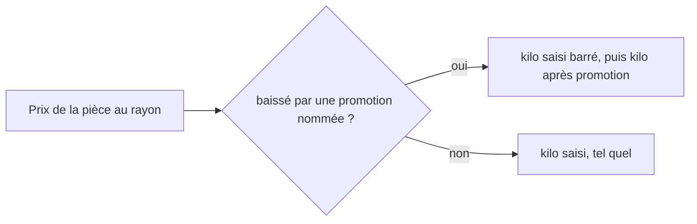

# Saisir un prix

> ✅ **Doc d'état, vérifiée contre le code le 2026-11-11.** Partie 1 :
> comprendre. Partie 2 : le code.
>
> « Saisir un prix », c'est **définir** le prix d'un article. Le prix **lu**
> pendant qu'un membre de l'équipe passe une commande pour un client est dans
> [`commande-passee-par-l-equipe.md`](../../commandes/passation/commande-passee-par-l-equipe.md), § 8.
>
> | Partie | Sujet                              | État      |
> | ------ | ---------------------------------- | --------- |
> | § 1    | Les écrans de tarification         | ✅ écrite |
> | § 2    | Le prix d'un article dans sa fiche | ✅ écrite |
> | § 3    | Changer l'unité de vente           | ✅ écrite |
> | § 4    | Le report après détachement        | ✅ écrite |
> | § 5    | Ce qui reste                       | ✅ écrite |

# Partie 1 — Comprendre

## § 1. Les écrans de tarification

**Un écran de tarification ne calcule pas un prix.** Il affiche ce que rend
la fonction qui facture. Chaque fois qu'un écran a refait le calcul de son
côté, son chiffre et celui de la facture ont fini par différer.

| Écran                          | Adresse                   | La question                                                    |
| ------------------------------ | ------------------------- | -------------------------------------------------------------- |
| **La grille**                  | `/promotions`             | qu'est-ce qui est décidé, aujourd'hui, sur le catalogue ?      |
| **La frise**                   | `/promotions/frise`       | qu'est-ce qui l'était tel jour, et qu'est-ce qui a bougé ?     |
| **Le banc d'essai**            | `/promotions/simulateur`  | pour CE client, à CETTE quantité, ça fait combien ?            |
| **Les gabarits**               | écran du commercial       | cette grille de prix nommée, que donne-t-elle chez un client ? |
| **La fiche client « Tarifs »** | onglet de la fiche client | que paie ce client, et sous quelle mercuriale ?                |

### La grille, lue à une date

La grille se lit **aujourd'hui** ou **à une date passée**. Une date passée
montre les décisions en vigueur ce jour-là : une règle rangée hier
s'appliquait encore le mois dernier, et elle y figure.

| Elle dit                                            | Elle ne dit PAS                        |
| --------------------------------------------------- | -------------------------------------- |
| quelles **décisions** étaient en vigueur ce jour-là | quel prix a été **facturé** ce jour-là |

Ce qui a été facturé se lit sur la ligne de commande, qui garde son prix et
sa trace. Le tarif du catalogue a son historique (une ligne par changement
de prix) : une date antérieure au début de cet historique montre le tarif
d'aujourd'hui, et l'écran le dit, avec la date de début.

### La frise, et la comparaison de deux dates

Un axe du temps, une barre par décision. Un clic pose une date : le
catalogue de ce jour-là. Un clic glissé pose deux dates : les deux
catalogues, l'écart de prix entre eux, et le volume vendu entre les deux,
comparé à la période de même durée juste avant. Un glissement très court
reste un clic. L'axe va toujours jusqu'à aujourd'hui, et une date se pose au
jour. Deux champs de date font la même chose qu'à la souris.

La comparaison n'affiche que les articles **qui ont bougé**, du plus gros
écart au plus petit. Une variation depuis zéro n'est pas une variation :
elle n'a pas de pourcentage.

### Le banc d'essai

Un article, un client (ou « de passage »), et le prix à plusieurs quantités.
**Chaque ligne est un devis** de la fonction qui facture. Les quantités ne
sont pas devinées : un premier devis dit quel barème vise l'article, puis le
banc sonde chaque seuil **et** la quantité juste en dessous, huit sondes au
plus. L'écart au tarif est signé : le banc montre aussi un prix qui monte.

Le **mode temporel** répond à la question d'un engagement : « et s'il n'en
prend que 70 % ? ». Trois scénarios (70 %, 100 %, 130 % de la promesse)
partent en **un seul appel** à la projection, qui rend le prix à des niveaux
de cumul qui n'existent pas encore, vingt-quatre niveaux au plus. La
projection n'ouvre jamais le plancher dynamique : une hypothèse ne prouve pas
un volume. Les prix du banc sont **HT et hors acheminement**, et l'écran le
dit.

### Les gabarits

Un **gabarit** est une grille de prix nommée, composée hors de tout client.
**Poser** un gabarit chez un client écrit une mercuriale. Le gabarit se
révise, et s'**archive** quand il ne sert plus : il sort alors des listes de
choix, et les mercuriales qu'il a déjà posées ne bougent pas. Un prix fixe est
une grille à un seul palier. Le gabarit refuse une grille qui monte, deux
paliers au même seuil, deux lignes sur le même article, une grille vide.

L'écran du gabarit montre :

- la **simulation du chiffre** selon le volume, avec un **volume prévu** par
  article, gardé avec le gabarit et jamais lu comme une décision de prix ;
- deux **anneaux** : la part de chaque rayon dans le chiffre, et sa part dans
  la remise accordée (en euros, jamais en pourcentages additionnés) ;
- l'**indicateur du marché** : par article, la médiane des mercuriales en
  place chez les autres clients, ses bornes et le nombre de clients. Le
  plancher n'y est pas appliqué : il est propre à un client.

⚠️ La simulation d'un gabarit est **calculée dans le navigateur**, ce qui
contredit la règle de cette partie. Elle suppose qu'une mercuriale scelle le
prix ; quand une règle est cochée « par-dessus la mercuriale », l'écran le
signale au lieu de composer. Le reste à faire est au § 6.

### La fiche client « Tarifs »

L'onglet **« Tarifs »** de la fiche client montre ce que paie ce client :
sa mercuriale, ses avenants, sa remise générale. Il est réservé au droit
`b2b_pricing:read`. Ce qu'il manipule est expliqué ailleurs :

- [`comprendre-une-mercuriale.md`](../mercuriales/comprendre-une-mercuriale.md) ;
- [`la-remise-generale.md`](../mercuriales/la-remise-generale.md) ;
- [`l-avenant-date.md`](../mercuriales/l-avenant-date.md).

## § 2. Le prix d'un article dans sa fiche

Dans la fiche produit, carte **« Tarif & TVA »**, chaque déclinaison porte ce
que le commercial saisit. Rien n'y est calculé : ce qui est saisi est ce qui
est lu.

| Ce qu'on saisit                      | Unité                 | Ce que c'est                                         |
| ------------------------------------ | --------------------- | ---------------------------------------------------- |
| **Prix public**                      | TTC, au centime       | ce que paie un particulier                           |
| **Prix pro**                         | HT, à cinq décimales  | ce que paie un pro, avant ses remises                |
| **Prix au kilo public** (facultatif) | TTC, au centime       | une information pour le client                       |
| **Prix au kilo pro** (facultatif)    | HT, à cinq décimales  | une information pour le client                       |
| **Afficher le prix au kilo**         | une case par audience | le montrer aux particuliers, aux pros, ou à personne |

### Le prix pro est toujours saisi

Il n'existe qu'une source du prix pro : la **saisie**. On ne le déduit plus du
prix public par un rapport, et rien ne le pré-remplit.

### Un prix manquant n'empêche pas de vendre ailleurs

Une déclinaison est **vendable à chaque audience dont elle a le prix**. Sans
prix pro, elle reste vendue aux particuliers ; sans prix public, elle reste
vendue aux pros. Un prix manquant n'est **jamais** lu comme zéro : il veut
dire « pas vendable à cette audience ». La fiche le signale par un
avertissement, qui **ne bloque pas** l'activation. La TVA, elle, est toujours
exigée.

### Le prix au kilo est une information

Il n'entre dans **aucun** calcul : ni le prix, ni le panier, ni la facture, ni
une règle, une mercuriale ou une limite. Il est saisi, puis affiché.

- **Non saisi** : rien ne s'affiche. Ce n'est pas une condition pour vendre.
- **Une case par audience** : décocher « particuliers » cache le prix au kilo
  public aux particuliers ; décocher « pros » cache le prix au kilo pro aux
  pros. Le prix reste saisi.
- **Une déclinaison qui suit le tarif de la déclinaison par défaut** suit
  aussi ses prix au kilo et ses deux cases.
- **Un article vendu au poids** n'affiche pas ces prix au kilo : son prix
  _est_ au kilo ([`../vente-au-poids.md`](../vente-au-poids.md)).

### Sous une promotion, le prix au kilo suit

Quand une **promotion nommée baisse le prix de la pièce** au rayon, la
boutique affiche le kilo saisi **barré**, puis le kilo **après promotion**,
dans la proportion de la pièce (en TTC pour les particuliers). Dans tous les
autres cas — pas de promotion, mercuriale, palier, prix plus haut —, elle
affiche le kilo saisi, sans calcul (Hugo, 2026-11-04 : « ne cherche pas à
inventer de la donnée »).



## § 3. Changer l'unité de vente

Une déclinaison se vend **à la pièce** ou **au poids**
([`../vente-au-poids.md`](../vente-au-poids.md)). On choisit dans la carte
« Tarif & TVA ».

**L'unité change librement tant que la référence de vente n'a servi nulle
part**, même si la déclinaison est publiée (Hugo, 2026-10-29). Dès qu'elle a
servi, l'unité est verrouillée. « Servi » veut dire : une commande (de tout
statut, annulée comprise), un brouillon de commande, un panier de la
boutique, un abonnement, un réassort, un lot, un gabarit, une règle de prix,
un plancher, un barème, une mercuriale ou un engagement de volume — en
vigueur ou clos.

Pourquoi : une commande, une facture ou une décision lisent un SKU dans son
unité. Il n'existe aucune conversion entre un prix à la pièce et un prix au
kilo. Une référence qui n'a jamais servi n'a pas de passé à réécrire.

- **La carte « Tarif »** demande, avant le geste, si la référence a servi, et
  pourquoi.
- **Le refus** dit où la référence a servi, et le geste de sortie : **créer
  une autre déclinaison**.
- **Si le commerce ne répond pas**, le changement est refusé. On ne le tient
  jamais pour accordé.
- **Un panier** qui contient la ligne dans l'ancienne unité la perd au
  prochain devis, avec la raison « l'article se vend désormais dans une
  autre unité ». Elle n'est jamais convertie.

Le pas et le minimum d'une vente au poids, eux, restent réglables.

## § 4. Le report après détachement

Une déclinaison **détachée** devient une fiche à part, avec un nouveau SKU.
Les décisions tarifaires posées sur l'ancien SKU ne la suivent pas. Le
**report** les pose sur la nouvelle référence.

**Reporter, c'est poser une décision neuve.** On ne réécrit jamais
l'ancienne : elle reste telle quelle. La nouvelle passe par le chemin de
pose de sa famille, avec ses contrôles et son journal.

**La fenêtre** : elle commence au plus tard de « maintenant » et du début de
l'ancienne, et finit à la fin réelle de l'ancienne (sans fin si l'ancienne
n'en a pas). Jamais un début dans le passé : une lecture datée d'hier ne
change pas.

### Les six familles

| Famille                  | Ce qu'on reporte                                                                                                  |
| ------------------------ | ----------------------------------------------------------------------------------------------------------------- |
| **Mercuriale**           | la ligne négociée de l'ancien SKU, ses paliers compris                                                            |
| **Règle de prix**        | une règle neuve, même effet, même audience ; une règle **en pause** se reporte en pause                           |
| **Barème de volume**     | un barème neuf, mêmes paliers ; en pause s'il l'était                                                             |
| **Plancher**             | un plancher neuf ; un plancher en **pourcentage** reste un pourcentage, appliqué au prix de la nouvelle référence |
| **Engagement de volume** | la **même quantité promise**, même société ; l'ancien engagement court jusqu'à sa fin                             |
| **Gabarit**              | la ligne de l'ancien SKU est **remplacée** par le nouveau dans le gabarit                                         |

Décisions de Hugo, le 2026-10-30 : la pause se reporte ; l'engagement garde
sa promesse (reporter le reste, ou clore, ferait payer le client plus cher
le jour du détachement) ; le gabarit remplace sa ligne ; le plancher se
reporte comme les autres.

**L'engagement ne double pas l'avantage.** Le livré se compte par SKU, et
chaque engagement ne fait le prix que de sa référence. L'ancienne ne se vend
plus.

### Les refus

- la nouvelle référence n'est pas née de l'ancienne ;
- la décision a **déjà été reportée** (même famille, même ancien et nouveau
  SKU, même audience — pour une règle, même identité qu'une règle qui en
  exclurait une autre) ;
- l'ancienne décision est **close** (rangée, ou finie) ;
- la nouvelle référence ne se vend pas à l'audience de la décision ;
- la nouvelle référence est réservée à un autre client ;
- la fenêtre commencerait dans le passé ;
- un plancher est **déjà en vigueur** sur la nouvelle référence : le report
  ne le remplace jamais ;
- les refus de pose de chaque famille (un recouvrement, par exemple).

### Qui peut reporter

Le droit de **poser** la famille, pas un droit neuf. Les planchers sont sous
le droit des limites de prix ; le reste, sous celui de la tarification. À
l'écran, chaque décision a son bouton, et **« Tout reporter »** ne reporte
que ce que le rôle de la personne permet.

# Partie 2 — Le code

## § 1. Les écrans de tarification

**Les routes** (`lafoliecoffee/pricing/http/admin-pricing.controller.ts`,
`@Controller("admin/pricing")`) : `GET /admin/pricing?at=` (la grille
datée), `GET /admin/pricing/comparison?from=&to=`, `POST
/admin/pricing/projection` (borne `max(24)` dans
`priceProjectionPayloadSchema`, `packages/contracts/src/pricing.ts`). La
clause « rangée à l'instant lu » s'écrit une fois, dans
`pricing/infrastructure/archived-at.ts`.

**La composition** : `pricing/application/board-item.ts` monte un nœud ; le
port `application/ports/pricing-board.reader.ts` porte `read()` et
`readForScreen()` (qui ajoute la mesure des ventes, que la comparaison ne
paie pas) ; l'adaptateur `infrastructure/prisma-pricing-board.reader.ts`.

**L'historique du tarif** : la table `catalog_price_history`, une ligne par
changement, et `canonicalHistoryStartsAt` au fil
(`packages/contracts/src/pricing.ts`).

**Les écrans** (back-office) : routes dans `app.routes.ts` (`promotions`,
`promotions/frise`, `promotions/simulateur`) ; les anciennes adresses
`/reglages/tarification…` y redirigent (`reglages/reglages.routes.ts`).
Code sous `b2b/tarification/` : la frise (`frise/axis-model.ts`, seuil de
clic `DRAG_THRESHOLD_PERCENT = 1.5` dans
`frise/timeline-axis/timeline-axis.ts`) ; le banc
(`simulateur/simulateur-page.ts`, devis par `POST /admin/orders/quote` ;
`simulateur/quote-bench.ts`, `MAX_PROBES = 8` ;
`simulateur/commitment-bench.ts`, projection).

**Les gabarits** : `@Controller("admin/pricing/templates")`
(`admin-price-templates.controller.ts`) ; l'archivage est
`POST …/templates/:id/archive` (`archive-price-template.handler.ts`, qui
charge le gabarit et appelle `PriceTemplate.archive`, 409 s'il l'est déjà),
la zone dangereuse est dans `gabarits/gabarits-page.html` ; écran sous
`commercial/tarification/` (`grille/`, `gabarits/`, `simulation/`). La
simulation est `simulation/revenue-model.ts`. L'indicateur du marché :
`pricing/application/queries/mercuriale-benchmark.query.ts` lit les
mercuriales en place et passe chaque prix par la fonction qui facture ;
`pricing/domain/services/mercuriale-benchmark.ts` (`benchmarkByProduct`)
garde **une observation par client et par article** (le plus haut prix d'un
client, celui de son plus petit seuil), puis prend la médiane. La règle
« par-dessus la mercuriale » est `stacksOverMercuriale` (contrat des règles).

**La fiche client** : onglet `tarifs` de `fiche-client/fiche-client-shell.ts`
(droit `b2b_pricing:read`), écran `fiche-client/tarifs/`.

## § 2. Le prix d'un article dans sa fiche

**Le modèle** (`pim.product_variant`, `apps/lfd-api/prisma/schema/pim/product.prisma`) :
`proPricePerKgMillicents` (millicentimes) et `publicPricePerKgTtcCents`
(centimes), nullables, `CHECK > 0` (migration `20261028210000_le_prix_au_kilo_saisi`) ;
`pricePerKgShownPublic` et `pricePerKgShownPro`, `BOOLEAN NOT NULL DEFAULT true`
(migration `20261029160000_prix_au_kilo_par_audience`).

**L'écriture** : `pim/catalogue/product/application/update-variant-pricing.ts`
(commande `UpdateVariantPricingPayload`, `@lfd/pim-contracts`) ; la
déclinaison mute par `price()` (`variant.ts`), `ZeroPricePerKgError` refuse un
kilo à zéro. L'héritage du tarif du défaut est résolu par `resolvedSnapshot`
(`product.ts`). Le fait de journal `product.pricing_saved` trace les clés dans
`changes` (`packages/contracts/src/journal-facts/referential-catalogue.ts`,
`pricingChanges`) ; la clé `pricePerKgShown` y reste pour relire les faits
écrits le 2026-10-29, avant les deux cases.

**Le prix pro** : `proPriceOf(taux, saisie)`
(`packages/pim-contracts/src/pro-price.ts`) ne lit que la saisie. Le contexte
des règles comptables et la table `accounting_rules` n'existent plus
(migration `20261104110000_le_rapport_pro_quitte_la_base`) ; l'en-tête des
révisions est `ENTERED_PRO_PRICE_HEADER`. L'événement
`product.pro_price_prefilled` n'est plus émis : il reste pour relire les faits
passés.

**Le prix manquant** : le fil porte des prix nullables
(`packages/catalog-sync/src/snapshot.ts`, `priceMillicents`, `publicTtcCents`) —
`null` = pas vendable à cette audience, jamais gratuit ;
`catalog_items.price_millicents` accepte `NULL` (migration
`20261027170000_un_prix_pro_manquant_ne_retire_plus_l_article`, irréversible
dès qu'un `null` est ingéré). La complétude par audience :
`variant-completeness.ts` (`missingAudiencePrices`, `variantGaps`), constat
`price_missing_for_audience` en avertissement (`product-compliance.ts`, API et
back-office).

**Le fil et la boutique** : la projection
(`pim/channels/b2b-platform/products/projection.ts`) émet `null` pour un prix
au kilo dont la case de l'audience est décochée ; le fil est en version 17
(`snapshot.ts`, `CATALOG_SNAPSHOT_VERSION`). Le commerce lit les prix au kilo
par un port à part, `CatalogPricePerKgReader`
(`catalog/infrastructure/catalogue-snapshot/snapshot-catalog-price-per-kg.reader.ts`),
**après** la résolution du prix : le kilo ne traverse pas `ResolvedCatalogItem`.
Le rayon public ne reçoit que le TTC, le pro que le HT
(`catalog/application/shop-catalogue-price-per-kg.ts`).

**Sous une promotion** : `servedPricePerKg`
(`catalog/application/shop-catalogue-promoted-per-kg.ts`, arithmétique
entière, `proportional`) calcule le kilo après promotion quand la pièce est
barrée **et** nommée par une promotion. L'ordre de composition du rayon
(`shop-catalogue-pricing.service.ts`) : prix → noms de promotion → offres
d'acheminement → prix au kilo. Contrat : `catalogPricePerKgMillicents`,
`catalogPricePerKgTtcCents` (`packages/contracts/src/shop-catalogue.ts`) ;
écran : `shop-price-basis.service.ts` (`perKiloHintLabel`, kilo barré).

**L'écran** : `pim/catalogue/product-form/form-sections/pricing/` (les prix au
kilo et les deux cases, masqués pour un article au poids).

## § 3. Changer l'unité de vente

**Le domaine** : `Variant.price(input, clearance)` appelle
`changeSaleTerms` (`pim/catalogue/product/domain/entities/variant.ts`) ;
un changement d'unité passe par `ensureUnused`, qui lève
`SaleReferenceUsageUnknownError` (500, le commerce n'a pas répondu) ou
`SaleReferenceInUseError` (409, la référence a servi), toutes deux dans
`domain/errors/sale-unit-errors.ts` avec les libellés des douze catégories
d'usage (`USE_LABELS`).

**Le port** : `SaleReferenceUsage`
(`pim/channels/b2b-platform/sale-reference-usage/sale-reference-usage.ts`),
déclaré par le référentiel, lu par lot ; implémenté par le commerce
(`lafoliecoffee/catalog/infrastructure/prisma-sale-reference-usage.ts`,
`PrismaSaleReferenceUsage`) ; relié par
`appBootstrap/sale-reference-usage.module.ts`. Le handler lit le port et
passe la réponse au domaine.

**La lecture de l'écran** : `GET /pim/catalogue/products/:id/sale-unit-usage`
(`product/http/product-sale-unit-usage.controller.ts`,
`application/get-product-sale-unit-usage.ts`).

**Le panier** : `shop-cart-quoting.service.ts` rend `removedLines` avec la
raison `sale_unit_changed` (`packages/contracts/src/shop-quote.ts`).

**Les e2e** : `test/sale-unit-change.e2e-spec.ts`,
`test/sale-reference-usage.e2e-spec.ts` (et `pim-sale-unit`,
`catalog-sale-unit`, `pricing-sale-references`).

## § 4. Le report après détachement

**Le domaine** (`lafoliecoffee/pricing/domain/entities/`) :
`decision-carry-over.ts` (la fenêtre, le refus du rétroactif, `ruleCarryKey`),
`mercuriale-carry-over.ts`, `pricing-rule-carry-over.ts`, et une fabrique
par famille dans `pricing-floor.ts`, `volume-ladder.ts`,
`volume-commitment.ts` ; le gabarit, `PriceTemplate.replaceSku`
(`price-template.ts`). Les refus : `domain/errors/decision-carry-over-errors.ts`
(`DecisionAlreadyCarriedError`, `CarriedDecisionClosedError`,
`CarriedDecisionNotFoundError`, `DecisionNotOnReferenceError`,
`RetroactiveCarryOverError`, `FloorAlreadyInForceError`).

**L'origine** : colonne `origin Json?` sur les quatre tables de décisions
(migration `20261030230000_l_origine_des_decisions_reportees`). « Déjà
reporté » est tenu sous verrou transactionnel, pas par une contrainte
unique.

**Les routes** — chacune dans le contrôleur de sa surface :

| Famille          | Route                                                                                     | Contrôleur                                     | Surface            |
| ---------------- | ----------------------------------------------------------------------------------------- | ---------------------------------------------- | ------------------ |
| Mercuriale       | `POST /admin/pricing/sale-references/:sku/decisions/mercuriales/:mercurialeId/carry-over` | `admin-sale-reference-decisions.controller.ts` | `b2b_pricing`      |
| Règle de prix    | `POST /admin/pricing/rules/:id/carry-over`                                                | `admin-pricing-carry-over.controller.ts`       | `b2b_pricing`      |
| Barème de volume | `POST /admin/pricing/volume-ladders/:id/carry-over`                                       | `admin-pricing-carry-over.controller.ts`       | `b2b_pricing`      |
| Plancher         | `POST /admin/pricing/floors/:id/carry-over`                                               | `admin-price-floors.controller.ts`             | `lfc_price_limits` |
| Engagement       | `POST /admin/pricing/commitments/:id/carry-over`                                          | `admin-volume-commitments.controller.ts`       | `b2b_pricing`      |
| Gabarit          | `POST /admin/pricing/templates/:id/carry-over`                                            | `admin-price-templates.controller.ts`          | `b2b_pricing`      |

**L'écran** : `pim/catalogue/product-form/decision-carry-over/` (le bouton
de report) et `product-form/detached-decisions/` (la liste et « Tout
reporter »).

## § 5. Ce qui reste

- **La colonne morte `price_per_kg_shown`** : retirée du schéma Prisma le
  2026-11-11. La migration qui la supprime part au déploiement **suivant**
  (Prisma lit toutes les colonnes déclarées : la supprimer dans le même
  déploiement couperait les lectures pendant la bascule) :

  ```sql
  SET lock_timeout = '5s';
  ALTER TABLE "pim"."product_variant" DROP COLUMN IF EXISTS "price_per_kg_shown";
  ```

  Destructive : la valeur figée au 2026-10-29 est perdue ; elle a été
  recopiée dans `_public` / `_pro` par `20261029160000`.

- **La vitrine** lit-elle le kilo servi ou le kilo saisi ? Non vérifié.
- **La réglementation** du prix à l'unité pendant une promotion : question
  ouverte, non tranchée.
- **La sortie aval d'un prix manquant** (devis, CSV, badge du rayon) : non
  vérifiée en détail.
- **La suite e2e `catalog-parity`**, citée autrefois, n'existe pas.

**Les écrans de tarification (§ 1)**

- **R2 — la simulation des gabarits calcule dans le navigateur**
  (`commercial/tarification/simulation/revenue-model.ts`, importée par cinq
  fichiers de l'écran, compté le 2026-11-11). Elle doit passer par le
  serveur, au plus tard le jour où une promotion pourra s'empiler sur une
  mercuriale.
- **L'historique du tarif a trois écrivains** :
  `catalog/infrastructure/prisma-catalog-item.repository.ts`,
  `prisma-catalog-product-facts.projection.ts` et
  `prisma-catalog-price-retracer.ts` écrivent chacun dans
  `catalog_price_history`. Qu'ils écrivent la même chose n'est pas vérifié.
- **Le comparatif des mercuriales** : la requête
  (`mercuriale-benchmark.query.ts`) émet une observation **par palier**, et
  son commentaire le revendique ; le domaine les ramène à une par client.
  Le résultat servi est par client ; le commentaire de la requête est à
  aligner.

**Changer l'unité de vente (§ 3)**

- **Le fait de journal `variant.sale_unit_changed` n'est pas bâti** : un
  changement d'unité ne laisse pas de trace propre au journal.
- **Le trou du défaut** : une déclinaison passée au poids (son SKU jamais
  servi) qui devient ensuite le défaut se vend sous le SKU de la fiche, déjà
  vendu à la pièce. Il se ferme avec
  [`plan-defaut-sous-sa-reference.md`](../../catalogue/plan-defaut-sous-sa-reference.md).
  D'ici là, ne pas faire d'une déclinaison au poids le défaut d'une fiche
  déjà vendue à la pièce.

**Le report (§ 4)**

- **Les e2e par famille** existent (`test/*-carry-over.e2e-spec.ts`, une
  suite par famille) ; ce qu'elles éprouvent n'a pas été relevé.
- **Le refus du rétroactif** n'est tenu que par le domaine :
  `lint:dated-decisions` ne refuse pas un début passé. Le gabarit, sans
  fenêtre, n'a pas ce refus et échappe à la porte.
