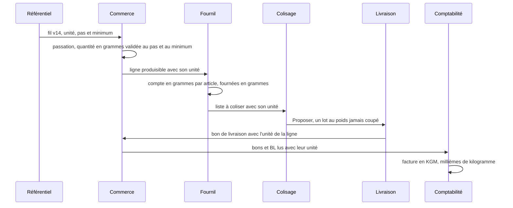

# La vente au poids, de la fiche à Factur-X

> ✅ **Implémenté** — lots P0 à P7 (du `3ecc02cb1` au `f7d7c08f0`), restes
> corrigés le 2026-10-29. Ce document décrit l'état du code ; il remplace le
> plan du 2026-10-28, contredit par vitruve deux fois (le modèle, puis la
> facture) et tranché par Hugo.

Certains articles se vendent **en vrac** (graines au chocolat, saumon gravlax).
Pour eux, **le poids commandé est le poids facturé** : aucune pesée après coup,
aucun prix qui bouge entre la commande et la facture. C'est ce qui permet aux
particuliers de payer par carte à la commande, comme pour une pièce.

Il fait suite à [`plan-prix-au-kilo.md`](plan-prix-au-kilo.md), où le prix au
kilo est une donnée informative : pour un article au poids, il devient **le**
prix de vente.

## 1. Le modèle

- **Une unité de vente par déclinaison** : `piece` (défaut) ou `weight`,
  choisie dans « Tarif & TVA » (« Vendre à la pièce » / « Vendre au poids »).
  Elle est **figée à la première publication** (`has_been_published`, posé à
  l'activation, jamais remis à faux) : le référentiel sait ce qu'il a publié,
  pas ce qui a été commandé. Vendre le même produit à la pièce ET au poids,
  c'est **deux déclinaisons**.
- **La quantité est un entier dans l'unité de la ligne** : des pièces, ou des
  **grammes** (1,25 kg = 1250). Jamais de décimale. Chaque ligne porte son
  unité (`order_lines.sale_unit`), figée à la passation comme son prix.
- **Une quantité ne s'écrit pas sans son unité** : `SaleQuantity`
  (`packages/money/src/sale-quantity.ts`) est le seul argument de
  `lineTotalCents` (`packages/money/src/millicents.ts`). Pièces : prix × n ;
  poids : prix au kilo × grammes ÷ 1000, un seul arrondi.
- **Le prix d'un article au poids est un prix au kilo** : le prix public TTC
  et le prix pro HT de la fiche s'entendent par kilogramme ; les deux prix au
  kilo informatifs ne s'affichent pas sur cette déclinaison.

## 2. Les règles

| Règle                         | Ce qui la tient                                                                                                                                                                                                                                                                                                      |
| ----------------------------- | -------------------------------------------------------------------------------------------------------------------------------------------------------------------------------------------------------------------------------------------------------------------------------------------------------------------- |
| **Le pas**                    | `weightStepGrams`, réglable par article (ex. 100 g) : une quantité qui n'en est pas un multiple est refusée au domaine (`apps/lfd-api/src/b2b/orders/domain/services/sale-quantity-rules.ts`), jamais arrondie en silence.                                                                                           |
| **Le minimum**                | `weightMinGrams`, facultatif (vide = aucun) : en dessous, refus.                                                                                                                                                                                                                                                     |
| **La garde d'une tonne**      | Pas de limite métier ; `MAX_LINE_WEIGHT_GRAMS` = 1 000 000 (`packages/contracts/src/order.ts`) arrête la faute de frappe. Les pièces gardent `MAX_LINE_QUANTITY` (10 000).                                                                                                                                           |
| **L'unité figée**             | Le sélecteur n'est modifiable que tant que la déclinaison n'a jamais été publiée.                                                                                                                                                                                                                                    |
| **Le prix au kilo**           | Les particuliers lisent un TTC au kilo, dérivé du HT au kilo ; la ligne vaut étiquette × grammes ÷ 1000, arrondie au centime ([`plan-centime-particuliers.md`](plan-centime-particuliers.md) §4).                                                                                                                    |
| **Les décisions de prix**     | Une décision qui couvre plusieurs articles — règle, barème ou plancher de portée **globale ou de famille** — ne s'applique pas à un article au poids : `coversManyArticles` (`apps/lfd-api/src/b2b/pricing/domain/specificity.ts`). La mercuriale et les décisions d'un article s'appliquent, au kilo et en grammes. |
| **L'affichage**               | Grammes sous le kilo, kilos au-delà : « 500 g », « 1,25 kg », « 12,40 € / kg » (`packages/money/src/sale-quantity-label.ts`). Sur la facture et l'avoir, toujours des kilos à trois décimales.                                                                                                                       |
| **Les totaux multi-articles** | Fiche d'atelier, compte à produire, dossier du jour, camembert, prévisionnel, colisage, comptoir, feuille de route : une ligne au poids compte pour **une pièce** (`pieceTally`, `packages/money/src/sale-quantity-tally.ts`), et pour rien à 0 g.                                                                   |

## 3. Du panier à la facture

### Fournil

Un article au poids se compte **en grammes, par article** : son unité est une,
la somme est homogène, et un même SKU vu dans les deux unités fait refuser
l'arrêt (`MixedSaleUnitCountError`). Les fournées, les raccourcis de fournée
et le contenant principal se règlent en grammes (« plaque de 1,5 kg »,
« 1 bac · 500 g ») ; la barre de paliers de la fiche d'atelier dit
« 1,25 kg avant 7 h ». Un raccourci refusé nomme des grammes pour un article
au poids, des pièces sinon.

### Colisage et livraison : un lot

Un article au poids se met au bac **en un lot** : un seul contenant le porte,
il se retire et se déplace entier (`WeightLotSplitError`), mais il peut se
poser en partie quand la réserve n'en tient qu'une partie.

« Proposer » ne coupe jamais un lot :

- côté livraison (`apps/lfd-api/src/delivery/domain/services/propose-packing.ts`),
  un lot qui tient dans un bac entier y va entier ou attend le bac suivant ;
  **un lot plus lourd qu'un bac entier de chacun des types de son groupe**
  n'est pas posé et sort avec le motif `weight_lot_over_bin` (« lot trop
  lourd pour un bac »), à côté de `no_capacity` et `cold_without_isotherm` ;
  le nombre de bacs attendus devient alors inconnu, comme pour les deux
  autres motifs ;
- côté colisage (`apps/lfd-api/src/packing/domain/services/proposal-distribution.ts`),
  le lot disponible va entier dans le premier bac qui a la place, sinon il
  reste « à répartir » ; le préparateur le pose à la main, en un geste.

Un **manquant** est la différence de grammes entre le dû et le lot au bac. Le
manifeste du transfert interne porte l'unité ; un réassort est toujours
`piece`.

### Facture

- Les deux lecteurs des bons portent l'unité, obligatoire, lue sur
  `order_lines.sale_unit` ou `delivery_note_line.sale_unit` ; une valeur
  inconnue arrête la lecture (`TechnicalError`).
- L'agrégation (`apps/lfd-api/src/b2b/accounting/domain/services/invoice-lines.ts`)
  porte `unitCode` (`H87` | `KGM`) et `quantityThousandths` (pièces × 1000,
  ou les grammes). Un même SKU dans les deux unités sur un dossier lève
  `InvoiceDossierMixedSaleUnitError` (409).
- Le relevé arrêté est en `body_version` 2 ; un corps v1 se relit en `H87`,
  quantité × 1000 — le seul repli de la chaîne
  (`apps/lfd-api/src/b2b/accounting/infrastructure/billing-statement-json.schema.ts`).
- **Le prix net (BT-146) s'entend par 1 KGM**, sans `BasisQuantity`. Le
  montant de ligne reste la somme des bons. Quand BT-129 × prix des bons
  s'écarte de BT-131 de plus de 0,02 € (tolérance Peppol R120), le prix net
  est **dérivé** : BT-131 ÷ BT-129, au millicentime
  (`apps/lfd-api/src/b2b/accounting/domain/services/invoice-net-price.ts`).
  Seule la pièce émise porte le prix dérivé ; dossier, relevé et CSV gardent
  le prix des bons.
- Le PDF dit « 1,250 kg » (`invoice-pdf-wording.ts`) ; le XML écrit BT-129
  sans zéro superflu (`1.25`). Une pièce témoin au poids est validée par le
  XSD Factur-X et les Schematron EN 16931 et BR-FR.
- **L'avoir n'est pas touché** (`refund-credit-note.ts`) : il porte des euros
  par taux de TVA, pas des grammes.

## 4. Hors champ

Refusés au domaine pour un article au poids : **les abonnements, les
engagements de volume, le réassort des boutiques**. Leurs quantités sont des
entiers de pièces sans unité ; les ouvrir est un autre chantier, inscrit à la
[carte des chantiers](../carte-des-chantiers.md).

Aucune pesée réelle, aucun ajustement après la commande.

## 5. À confirmer par Hugo

Décisions prises au bâti, que personne n'a encore validées :

- **Raccourcis de fournée et contenant principal en grammes**, plutôt que
  masqués pour un article au poids.
- **Le lot plus lourd qu'un bac** n'est jamais posé par « Proposer » : il sort
  en `weight_lot_over_bin` et se pose à la main, plutôt qu'un bac débordé.
  Le motif est servi par la proposition (`DeliveryPackingUnplacedView`) ; aucun
  écran ne libelle encore les motifs de non-placement.
- **Le refus à l'écriture** d'une décision de portée produit qui mêlerait les
  deux unités n'est pas bâti : une portée produit vise aujourd'hui un seul
  SKU, elle ne peut pas les mêler.
- **Un particulier n'a pas de facture** aujourd'hui (`cardInvoiceVerdict`) :
  l'écart TTC mesuré pour lui (+0,22 € sur 50 kg à 5,5 %) est rattrapé par la
  dérivation du prix net le jour où il en aura une.
